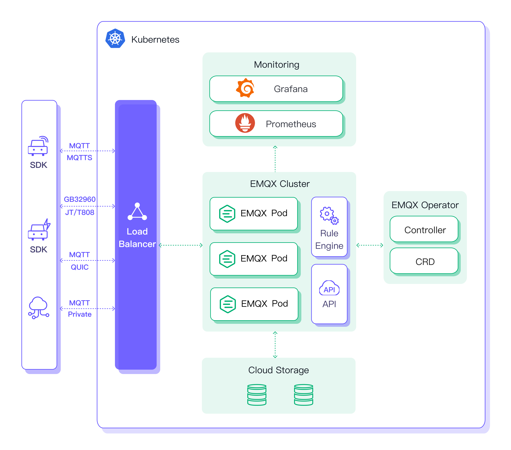

# EMQX Operator 概要

EMQX Operator は、[Kubernetes](https://kubernetes.io/) ネイティブ対応による [EMQX](https://www.emqx.io/) クラスターのデプロイおよび管理を提供します。主な目的は、Kubernetes 環境における EMQX のライフサイクル管理を簡素化し、自動化することです。

EMQX Operator 3.0 は Kubernetes 1.27 以降を必要とします。`StatefulSetAutoDeletePVC` 機能ゲートは Kubernetes 1.27 以降でデフォルトで有効になっています。クラスター管理者が無効化している場合は、EMQX Operator を使用する前に Kubernetes API サーバーおよびコントローラマネージャーで有効化してください。

EMQX Operator は以下の機能を含みますが、これらに限定されません：

* **簡素化されたデプロイ**：EMQX カスタムリソースで EMQX クラスターを宣言し、迅速にデプロイできます。

    詳細は [Getting Started](./getting-started.md) ガイドをご覧ください。

* **クラスター管理**：ローリングアップデート、永続ストレージ、Kubernetes 管理リソースの同期など、EMQX クラスターの運用と保守を自動化します。

    詳細は [Manage EMQX](./tasks/overview.md) セクションをご覧ください。

## EMQX と EMQX Operator の互換性

### EMQX Operator 3.0.x

EMQX Operator 3.0.x リリースシリーズは、以下の EMQX バージョンと互換性があります：
- EMQX 5.9 および 5.10
- EMQX 6.0 以降

サポートされている API バージョン：
- [apps.emqx.io/v3beta1](./reference/v3beta1-reference.md)

EMQX Operator 3.0 は Core ノードのインプレースローリングアップデート、Replicant ノードの Deployment スタイルのロールアウト、Core-Replicant クラスターの HPA 対応スケーリングを導入しています。以前の EMQX CR API バージョンとの後方互換性は提供していません。

### 過去のリリース

#### EMQX Operator 2.3.x

EMQX Operator 2.3.x リリースシリーズは、以下の EMQX バージョンと完全に互換性があります：
- EMQX 5.9 および 5.10
- EMQX 6.0 以降

サポートされている API バージョン：
- [apps.emqx.io/v2](./reference/v2-reference.md)
- [apps.emqx.io/v2beta1](./reference/v2beta1-reference.md)（非推奨）

#### EMQX Operator 2.2.x

EMQX Operator 2.2.x リリースシリーズは、以下の EMQX バージョンと互換性があります：
- EMQX Open Source & Enterprise 5.1.1 ～ 5.8.x
- EMQX 5.9 & 5.10（限定サポート*）
- EMQX 6.0 以降（限定サポート*）

サポートされている API バージョン：
- [apps.emqx.io/v2beta1](./reference/v2beta1-reference.md)
- apps.emqx.io/v2alpha1（非推奨）
- apps.emqx.io/v1beta4
- apps.emqx.io/v1beta3（非推奨）

::: tip
* これらのバージョンでは Durable Storage レプリケーションの自動管理はサポートされていません。
:::
