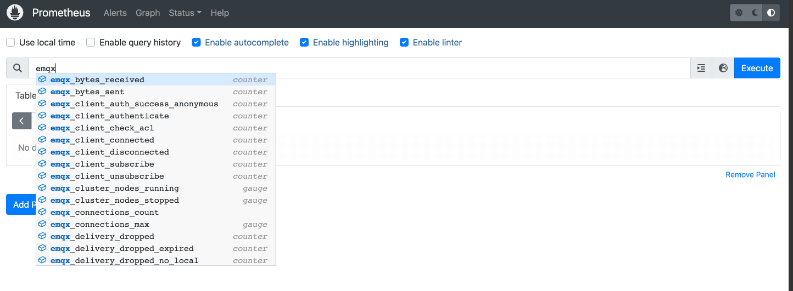
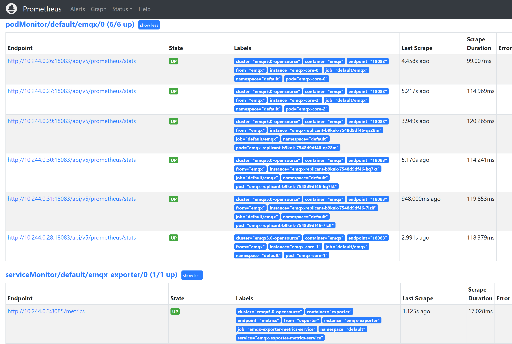
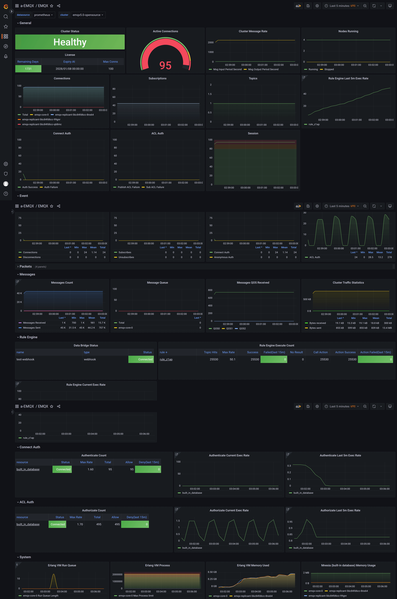

# Prometheus と Grafana で EMQX を監視する

## 目的

Prometheus を設定して EMQX クラスターをスクレイプし、そのメトリクスを Grafana で可視化します。

## Prometheus と Grafana のデプロイ

* Prometheus のデプロイ方法については、[Prometheus](https://github.com/prometheus-operator/prometheus-operator) のドキュメントをご参照ください。
* Grafana のデプロイ方法については、[Grafana](https://grafana.com/docs/grafana/latest/setup-grafana/installation/kubernetes/) のドキュメントをご参照ください。

## EMQX クラスターのデプロイ

EMQX は [Prometheus 互換の HTTP API](../../../../../guides/observability/prometheus.md) を通じてさまざまなメトリクスを公開します。

```yaml
apiVersion: apps.emqx.io/v3beta1
kind: EMQX
metadata:
  name: emqx
spec:
  image: emqx/emqx:@EE_VERSION@
  config:
    roots:
      license:
        key: "..."
```

上記の内容を `emqx.yaml` として保存し、以下のコマンドを実行して EMQX クラスターをデプロイします。

```bash
$ kubectl apply -f emqx.yaml
emqx.apps.emqx.io/emqx created
```

EMQX クラスターのステータスを確認し、`STATUS` が `Ready` になっていることを確認してください。準備完了までに時間がかかる場合があります。

```bash
$ kubectl get emqx emqx
NAME   STATUS   AGE
emqx   Ready    10m
```

## API キーの作成

ダッシュボードにサインインし、[専用の API キーを作成](../../../../../guides/dashboard/system.md#api-keys)します。Prometheus 用には、Viewer ロールかつ `monitoring` スコープのみの API キーを作成してください。`PodMonitor` はこのキーを使用して `/api/v5/prometheus/stats` をスクレイプします。

API キーとシークレットキーを保存してください。EMQX はシークレットキーを一度だけ表示します。

## Prometheus モニターの設定

Prometheus Operator は [PodMonitor](https://prometheus-operator.dev/docs/developer/getting-started/#using-podmonitors) CRD を使用して Pod を選択し、スクレイプエンドポイントを定義します。EMQX はダッシュボードリスナーを通じて Prometheus メトリクスを公開し、そのコンテナポートはデフォルトで `dashboard` と名付けられています。

以下の PodMonitor は、`emqx` クラスター内のすべての Pod から基本的な EMQX メトリクスエンドポイントをスクレイプします。

EMQX 6.3.0 以降、Prometheus のスクレイプ API はデフォルトで認証を必要とします。Prometheus 用に作成した API キーとシークレットキーを格納する Kubernetes Secret を `PodMonitor` と同じネームスペースに作成してください。

```bash
kubectl create secret generic emqx-prometheus-basic-auth \
  --from-literal=username='<API_KEY>' \
  --from-literal=password='<SECRET_KEY>'
```

```yaml
apiVersion: monitoring.coreos.com/v1
kind: PodMonitor
metadata:
  name: emqx
  labels:
    app.kubernetes.io/name: emqx
spec:
  podMetricsEndpoints:
    - interval: 5s
      path: /api/v5/prometheus/stats
      basicAuth:
        username:
          name: emqx-prometheus-basic-auth
          key: username
        password:
          name: emqx-prometheus-basic-auth
          key: password
      # EMQX ダッシュボードコンテナポートの名前。
      port: dashboard
      relabelings:
        - action: replace
          # 各 EMQX クラスターで一意の値を使用してください。
          replacement: emqx5
          targetLabel: cluster
        - action: replace
          # この値は変更しないでください。
          replacement: emqx
          targetLabel: from
        - action: replace
          # Pod 名を Prometheus のインスタンスラベルとして使用します。
          sourceLabels: [pod]
          targetLabel: instance
  selector:
    matchLabels:
      # `emqx` リソースで管理されている Pod にマッチします。
      apps.emqx.io/instance: emqx
      apps.emqx.io/managed-by: emqx-operator
  namespaceSelector:
    matchNames:
      # EMQX クラスターが別のネームスペースにある場合はこの値を変更してください。
      - default
```

`path` はメトリクス収集 API のパスを指定します。EMQX 5.0 以降は `/api/v5/prometheus/stats` を使用してください。`basicAuth` セクションは Kubernetes Secret から API キーとシークレットキーを読み込みます。セレクターは `emqx` リソースで管理されている Pod に一致します。`cluster` ターゲットラベルは、同じ Prometheus サーバーで監視する各 EMQX クラスターごとに一意である必要があります。

`prometheus.enable_basic_auth = false` に設定して認証を明示的に無効にした場合は、`podMetricsEndpoints` から `basicAuth` を省略できます。利用可能なエンドポイントと認証オプションの詳細は、[Prometheus との統合](../../../../../guides/observability/prometheus.md#configure-pull-mode-integration)をご参照ください。

上記の内容を `monitor.yaml` として保存し、以下のコマンドを実行してください。

```bash
$ kubectl apply -f monitor.yaml
```

## Prometheus で EMQX メトリクスを確認する

Prometheus の式ブラウザを開き、`emqx` を入力すると EMQX のメトリクスを確認できます。以下の図のように表示されます。



**Status** -> **Targets** を開くと、クラスター内のすべての監視対象 EMQX Pod が表示されます。



## Grafana ダッシュボードのインポート

[EMQX Grafana ダッシュボード](https://grafana.com/grafana/dashboards/17446-emqx/) をインポートし、EMQX Pod をスクレイプする Prometheus データソースを選択してください。


