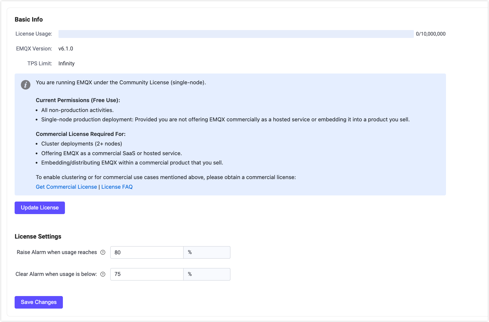

# EMQX Enterprise ライセンスの利用

EMQX 5.9 以降、EMQX は Business Source License (BSL) 1.1 のもとでリリースされており、オープンな開発を許可しつつ、EMQX の商用利用を保護するソース公開ライセンスです。

::: tip

ライセンス変更の詳細については、[EMQX ライセンス FAQ](https://www.emqx.com/en/content/license-faq) をご参照ください。

:::

インストールパッケージには、限定的な商用利用が許可された単一ノードの Community ライセンスが含まれています。ただし、EMQX Enterprise を完全な商用利用やクラスター展開で使用する場合は、商用ライセンスの取得が必要です。

本ページでは、商用ライセンスの取得方法と EMQX へのインポート手順をご案内します。

## ライセンスの申請

有効なライセンスキーを伴う商用ライセンスを申請するには、EMQ の営業担当者にご連絡いただくか、[お問い合わせ](https://www.emqx.com/en/contact?product=emqx&channel=apply-Licenses) ページの連絡先情報を入力して商用ライセンスを申請してください。営業担当者より折り返しご連絡いたします。

購入前に EMQX Enterprise を試用したい場合は、[トライアルライセンス申請ページ](https://www.emqx.com/en/apply-licenses/emqx) からトライアルライセンスを申請できます。ライセンスファイルは即座にメールで送付されます。

- トライアルライセンスの有効期限は15日間です。
- トライアルライセンスは最大10,000の同時セッションをサポートします。

::: tip 注意

トライアル期間中は EMQX Enterprise の全機能が利用可能です。ただし、トライアル期間終了後はクラスター機能が無効になります。クラスター機能を継続して利用するには商用ライセンスの購入が必要です。

トライアルライセンスの EMQX Enterprise は本番環境での利用は許可されていません。

:::

トライアル期間の延長を希望される場合は、営業部門までご連絡ください。

## ライセンス設定の更新と構成

ライセンスファイルの更新やライセンス接続クォータ使用状況の設定は、EMQX ダッシュボード、コマンドラインインターフェース（CLI）、または設定ファイルから行えます。

### ダッシュボード

1. EMQX ダッシュボードの左側ナビゲーションメニューから **System** -> **License** をクリックします。ライセンスページの **Basic Info** セクションで、ライセンス接続クォータ使用状況、EMQX バージョン、発行情報などを確認できます。

2. **Update License** ボタンをクリックします。ポップアップダイアログにライセンスキーを貼り付け、**Save** をクリックします。送信後、ページ上のライセンス情報が自動的に更新されます。

   新しいライセンスファイルが有効になったことを確認してください。

3. **License Settings** セクションでは、ライセンスセッションクォータ使用制限のウォーターマーク閾値を設定できます。セッション制限の詳細は [Session Limits](#session-limits) を参照してください。

   - **Usage High Watermark**: ライセンスセッションクォータ使用率がこの割合を超えた場合にアラームが発生する閾値を指定します。
   - **Usage Low Watermark**: ライセンスセッションクォータ使用率がこの割合を下回った場合にアラームが解除される閾値を指定します。

4. **Save Changes** をクリックしてライセンス設定を保存します。

   

#### Community ライセンスへの戻し方

EMQX ダッシュボードでは、デフォルトの単一ノード Community ライセンスに戻すことが可能です。**License** ページの **Remove License** ボタンをクリックし、ポップアップで確認すると現在のライセンスが削除されます。

::: tip 注意

クラスター モードではライセンスを削除できません。クラスター モードで EMQX を使用している場合は、まずクラスターを解散する必要があります。

:::

Community ライセンスに戻した場合：

- 現在のライセンスはクリアされ、Community ライセンスに置き換えられます。
- 既存のクライアント接続は維持されます。

::: tip 注意

Community ライセンスは完全な商用利用を許可しておらず、単一ノード展開のみをサポートします。ライセンスを削除するとクラスター展開は無効になります。

:::

### CLI

以下のコマンドでも EMQX Enterprise ライセンスの更新が可能です：

```bash
./bin/emqx ctl

    license info             # ライセンス情報を表示
    license update <License> # ライセンス文字列を指定して更新
    license update default   # デフォルトの Community ライセンスに戻す
```

### 設定ファイル

設定ファイルでライセンスファイルを設定することもできます。設定後、[EMQX コマンドラインツール](../../guides/cli.md) で `emqx ctl license reload` を実行してライセンスをリロードしてください。

```bash
license {
    ## ライセンスキー
    key = "MjIwMTExCjAKMTAKRXZhbHVhdGlvbgpjb250YWN0QGVtcXguaW8KZGVmYXVsdAoyMDIzMDEwOQoxODI1CjEwMAo=.MEUCIG62t8W15g05f1cKx3tA3YgJoR0dmyHOPCdbUxBGxgKKAiEAhHKh8dUwhU+OxNEaOn8mgRDtiT3R8RZooqy6dEsOmDI="
    ## ライセンス接続クォータ使用アラーム解除の低ウォーターマーク閾値
    connection_low_watermark = "75%"

    ## ライセンス接続クォータ使用アラーム発生の高ウォーターマーク閾値
    connection_high_watermark = "80%"
}
```

実行後、`emqx ctl license info` を実行して新しいライセンスファイルが有効になったことを確認できます。

<!-- 環境変数 `EMQX_LICENSE__KEY` でもライセンスを設定可能です。TODO: リロード可能か確認 -->

## ライセンス制限

EMQX Enterprise ライセンスには、本番環境でのライセンス条件遵守を強制するための使用制限が含まれる場合があります。ライセンス制限には以下が含まれます：

- セッション制限
- TPS 制限（EMQX 6.0 以降）

### セッション制限

セッション制限は、現在のライセンスで許可された最大同時 MQTT クライアント接続数（セッション数）を定義します。

- セッション数が接続強制閾値に達すると、新規接続は拒否されます。
- 拒否されたクライアントには、CONNACK 理由コード `151 (0x97)` の「Quota Exceeded」応答が返されます。
- セッション使用率が設定された高ウォーターマーク閾値を超えるとアラームが発生します。
- 使用率が低ウォーターマーク閾値を下回るとアラームは自動的に解除されます。

::: tip 注意

EMQX はセッション数統計の遅延による誤差を考慮し、10% の強制バッファを適用しています。したがって、接続制限はライセンスセッションクォータの110%で強制されます。このバッファは制限強制用であり、追加のライセンスセッション容量を付与するものではありません。

:::

アラームのウォーターマークは EMQX ダッシュボードまたは設定ファイルで設定可能です。

### セッション高ウォーターマーク履歴

EMQX Enterprise はクラスター全体の毎日のピークセッション数を自動的に記録し、最大24ヶ月分の履歴を保持します。このデータは複製され整合性が保たれた内部テーブルに保存され、ノードの再起動やクラスターのトポロジー変更をまたいで永続化されます。これにより、課金精算の監査用データとして利用可能です。

#### CLI

記録された履歴は `emqx ctl license history` で照会できます：

```bash
# 月次ピーク（デフォルト）
emqx ctl license history

# 過去7日間の日次ピーク
emqx ctl license history 7 --period daily

# JSON 出力
emqx ctl license history --json
```

コマンドの詳細は [license history](../../guides/cli.md#license-history) を参照してください。

#### REST API

```bash
GET /api/v5/license/session_hwm_history
```

**クエリパラメータ**

| パラメータ | 型 | デフォルト | 説明 |
| --------- | ---- | ------- | ----------- |
| `period` | `daily` \| `monthly` | `daily` | 集計粒度。`daily` はカレンダー日ごとに1行、`monthly` は日次ピークを月次最大値に集約します。 |
| `limit` | 整数 | `30` | 返却する最大行数。`daily` 時のみ適用。`monthly` は最大24ヶ月分の全データを返します。 |

**レスポンス例**

以下は月次集計を明示的に指定した例です：

```bash
GET /api/v5/license/session_hwm_history?period=monthly
```

```json
{
  "period": "monthly",
  "count": 2,
  "data": [
    { "period": "2026-04", "high_watermark": 25000, "observed_at": "2026-04-18T13:53:05.000Z" },
    { "period": "2026-03", "high_watermark": 23500, "observed_at": "2026-03-31T22:10:42.000Z" }
  ]
}
```

各レコードは以下を含みます：
- `period`: 要求された期間に応じたカレンダー日（`YYYY-MM-DD`）または月（`YYYY-MM`）
- `high_watermark`: 期間内に観測されたピークセッション数
- `observed_at`: ピーク観測時の RFC 3339 タイムスタンプ

#### タイムゾーン設定

日付の境界は `license.high_watermark_timezone` 設定項目で決定されます。デフォルトはノードホストのローカルタイムゾーン（`"system"`）です。異なる地域のノード間で一貫した日付境界を確保するために、明示的に UTC オフセット（例：`"+08:00"`）を設定可能です。詳細は [ライセンス設定](../../guides/configuration/license.md) を参照してください。

### TPS 制限

EMQX 6.0 以降、ライセンスには TPS（Transactions Per Second）制限が含まれる場合があります。この制限はクラスター全体で処理される MQTT メッセージ（受信・送信合計）に適用されます。

- TPS 使用率がライセンス制限を超えると、EMQX はアラームを発生させます。
- アラームはピーク TPS を記録しますが、メッセージトラフィックを制限しません。
- アラームは以下のいずれかで解除されるまで継続します：
  - より高い TPS 制限の新しいライセンスが適用された場合
  - EMQX ダッシュボードまたは CLI から手動でアラームが解除された場合

この TPS 制限は厳密な強制ではなく、可視化とコンプライアンス目的で設計されています。

::: tip 注意

TPS 制限はライセンスで定義されており、ユーザー側で設定や調整はできません。制限を引き上げるには、より高い TPS 値を持つ新しいライセンスを適用してください。

:::
