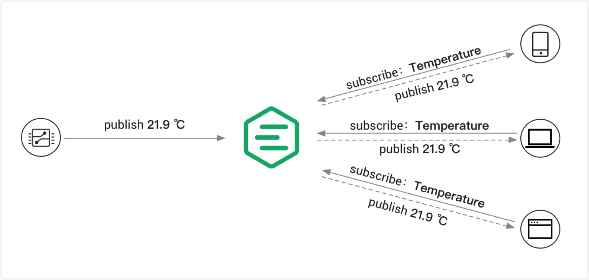

# パブリッシュ／サブスクライブ

世界最高水準のMQTTブローカーであるEMQXは、MQTTプロトコルの重要な機能である[パブリッシュ／サブスクライブメッセージングパターン](./mqtt-concepts.md#publish-subscribe-pattern)をサポートしています。EMQXのパブリッシュ／サブスクライブ機能は、ワイルドカードトピックのサポート、トピックベースのメッセージフィルタリング、メッセージのパーシステンス、QoS（サービス品質）設定など、多様な機能を備えており、複雑かつ高性能なメッセージングアプリケーションに適しています。

**パブリッシュ**機能は、EMQXブローカーに接続されたデバイスが特定のトピックにメッセージを送信できるようにします。メッセージには、センサーの読み取り値、ステータス更新、コマンドなど、あらゆる種類のデータを含めることが可能です。デバイスがトピックにメッセージをパブリッシュすると、EMQXはそのメッセージを受信し、そのトピックをサブスクライブしているすべてのデバイスに転送します。

EMQXの**サブスクライブ**機能は、デバイスが特定のトピックからメッセージを受信できるようにします。デバイスは1つ以上のトピックをサブスクライブでき、サブスクライブしたトピックでパブリッシュされたすべてのメッセージを受け取ります。これにより、デバイスはリアルタイムで特定のイベントやデータストリームを監視でき、常に更新をポーリングする必要がなくなります。

## 拡張パブリッシュ／サブスクライブ機能

EMQXはネイティブなMQTTパブリッシュ／サブスクライブモデルをサポートするだけでなく、より高度で非同期なメッセージングシナリオを支援するために多くの強力な拡張機能も提供しています。

本章では、[MQTTコアコンセプト](./mqtt-concepts.md)を学び、EMQXのパブリッシュ／サブスクライブ機能を試し、MQTTクライアントツールを用いて以下のMQTT固有の機能をテストする方法を紹介します。

- [共有サブスクリプション](./mqtt-shared-subscription.md)
- [保持メッセージ](./mqtt-retained-message.md)
- [遺言メッセージ](./mqtt-will-message.md)
- [トピックワイルドカード](./mqtt-wildcard-subscription.md)

### EMQXにおけるMQTT拡張機能

EMQXはネイティブMQTT機能に加え、基本的なパブリッシュ／サブスクライブモデルを拡張・強化する複数の機能を提供しています。これらの機能は、高度なメッセージングパターン、オフライン消費、トピック管理などに対応するために設計されています。

- [排他サブスクリプション](./mqtt-exclusive-subscription.md)
- [遅延パブリッシュ](./mqtt-delayed-publish.md)
- [自動サブスクライブ](./mqtt-auto-subscription.md)
- [トピック書き換え](./mqtt-topic-rewrite.md)
- [サブスクリプションフィルター](../../develop/subscription-filter/subscription-filter-concept.md)
- [メッセージキュー](../../develop/message-queue/message-queue-concept.md)

### サブスクリプションフィルター（高度機能）

[サブスクリプションフィルター](../../develop/subscription-filter/subscription-filter-concept.md)は、EMQX 6.2で導入された高度な機能で、MQTT 5.0のパブリッシュ／サブスクライブモデルを拡張し、サブスクリプションレベルでのコンテンツベースフィルタリングを可能にします。トピックフィルターにフィルター式を付加することで、サブスクライバーはMQTT 5.0のユーザープロパティが指定条件を満たすメッセージのみをEMQXに配信させることができます。

これにより、別のトピック階層やパブリッシャーの変更を必要とせず、サーバー側で正確なメッセージルーティングが可能になります。

- 任意のMQTT 5.0ユーザープロパティのキーと値でフィルタリング
- 複数条件の論理AND（`&`）による組み合わせ
- クライアント側のフィルタリングロジック不要の完全サーバーサイド処理

### メッセージキュー（高度機能）

[メッセージキュー](../../develop/message-queue/message-queue-concept.md)は、EMQX 6.0で導入された高度な機能で、MQTTのパブリッシュ／サブスクライブモデルを耐久性と非同期メッセージキューイング機能で拡張します。サブスクライバーがオフラインの間もメッセージを保存でき、Last-Value Semanticsによる高度な配信戦略やメッセージ圧縮をサポートします。

共有サブスクリプションや保持メッセージとは異なり、メッセージキューは以下を提供します。

- クライアントの接続状態に依存しない耐久的なメッセージパーシステンス
- キューのライフサイクルやメッセージのTTL（有効期限）を設定可能
- キュー単位の配信セマンティクスと細かな制御
