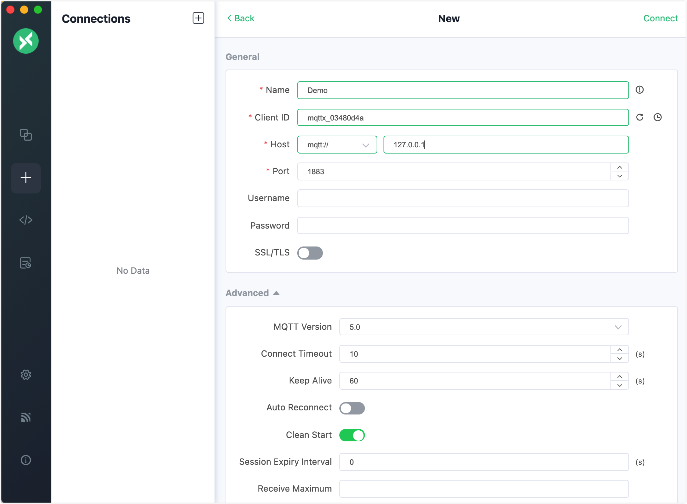
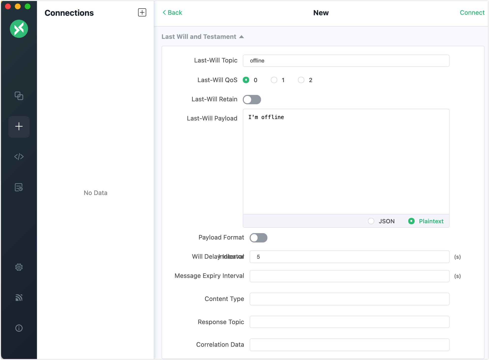
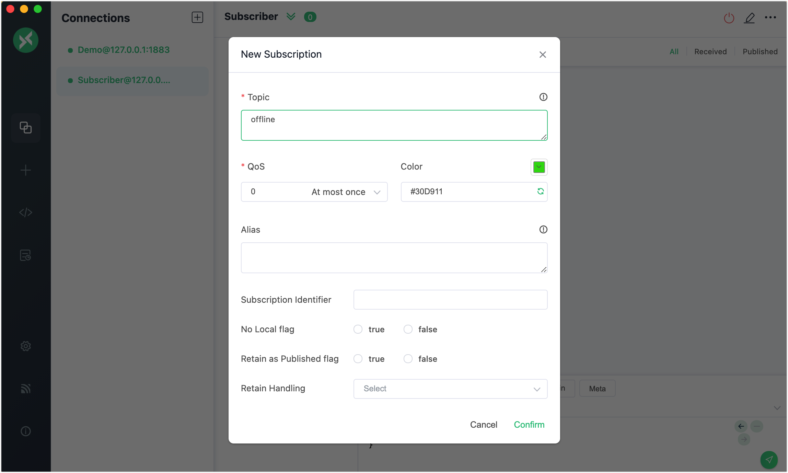
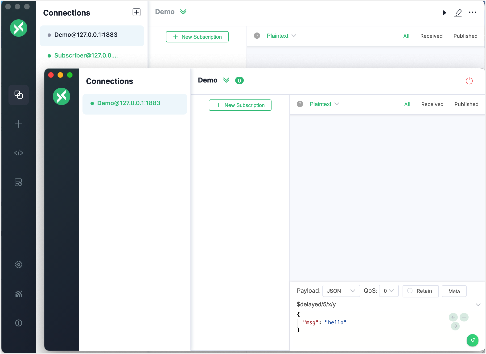
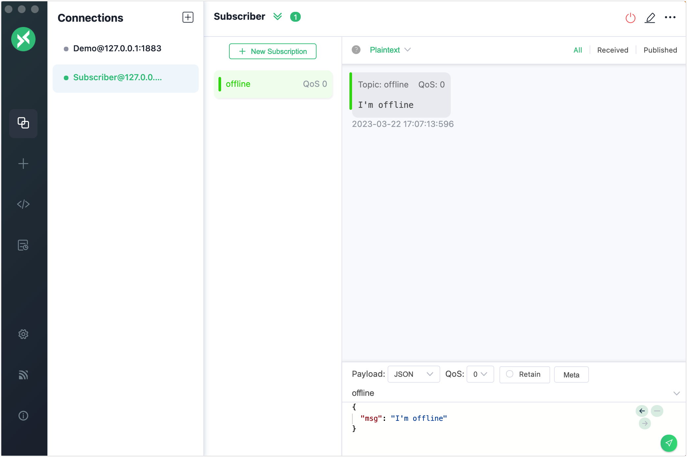

# MQTT Will Message

EMQXはMQTTのWill Message機能を実装しています。クライアントにWill Messageが設定されている場合、クライアントが意図せず切断されると、EMQXは関連するサブスクライバーにそのメッセージを送信し、サブスクライバーがクライアントの状態を把握・更新できるようにします。

EMQXでこのメッセージングサービスを試すにはクライアントツールを使用できます。本節では、[MQTTX Desktop](https://mqttx.app/)および[MQTTX CLI](https://mqttx.app/cli)を使ってクライアントをシミュレートし、Will Messageのパブリッシュと受信の流れを紹介します。

## Will Delay IntervalとWill Messageのパブリッシュ

MQTT 5.0では、Will Delay Intervalが満了する前にクライアントが再接続し同じセッションを再開した場合、保留中のWill Messageはパブリッシュされません。そのセッションを再開するには、同じClient IDを使用し、Clean Startをfalseに設定します。クライアントが再接続する時点でセッションが存在している必要があります。

もしWill Delay Intervalの満了前にセッションが終了した場合、サーバーはセッション終了時に保留中のWill Messageをパブリッシュします。例えば、Will Delay Intervalが10秒、Session Expiry Intervalが5秒の場合、クライアントがセッションを再開しなければ、5秒後にセッションが期限切れとなり、その時点でWill Messageがパブリッシュされます。

:::tip 前提条件

- MQTTの[Will Message](./mqtt-concepts.md#will-message)に関する知識
- [MQTTX](./publish-and-subscribe.md)を使った基本的なパブリッシュおよびサブスクライブ操作

:::

## MQTTX DesktopでWill Messageをパブリッシュする

1. EMQXとMQTTX Desktopを起動します。**New Connection**をクリックして、パブリッシャーとしてクライアント接続を作成します。

   - **Name**欄に`Demo`と入力します。
   - **Host**にはローカルホストの`127.0.0.1`を入力し、本デモの例として使用します。
   - その他の設定はデフォルトのままにして、**Connect**をクリックします。

   ::: tip

   MQTT接続の詳細な作成手順は[MQTTX Desktop](./publish-and-subscribe.md#mqttx-desktop)で紹介しています。

   :::

   

   ページをスクロールし、**Last Will and Testament**セクションでWill Messageの設定を行います。

   - **Last-Will Topic**：`offline`と入力します。
   - **Last-Will QoS**：デフォルトの`0`を設定します。
   - **Last-Will Retain**：デフォルトで無効のままにします。有効にするとWill Messageはリテインドメッセージにもなります。
   - **Last-Will Payload**：`I'm offline`と入力します。
   - **Will Delay Intervals (s)**：`5`秒に設定します。

   その他の設定はデフォルトのままにして、**Connect**ボタンをクリックします。

   

2. **Connections**ペインで**+** -> **New Connection**をクリックし、新しいクライアント接続を作成します。接続の**Name**を`Subscriber`、**Host**を`127.0.0.1`に設定します。その他はデフォルトのままにして**Connect**をクリックします。

3. **Subscriber**ペインで**New Subscription**をクリックします。**Topic**テキストボックスに`offline`と入力し、その他はデフォルトのままにして**Confirm**をクリックします。

   

4. **Connections**ペインで`Demo`という名前のクライアント接続を選択し、右クリックして**New Window**を選択します。新しいウィンドウで**Connect**ボタンをクリックします。

   

5. 新しいウィンドウを閉じて5秒待ちます。クライアント`Subscriber`はWill Messageの`I'm offline`を受信します。

   

## MQTTX CLIでWill Messageをパブリッシュする

1. 1つのクライアントで接続要求を開始します。トピックを`t/1`、ペイロードを`A will message from MQTTX CLI`に設定します。

   ```bash
   $ mqttx conn -h 'localhost' -p 1883 --will-topic 't/1' --will-message 'A will message from MQTTX CLI'
   Connected
   ```

2. 別のクライアントでトピック`t/1`をサブスクライブし、Will Messageの受信を待ちます。

   ```bash
   mqttx sub -t 't/1' -h 'localhost' -p 1883 -v
   ```

3. ステップ1で指定したクライアントを切断すると、ステップ2のクライアントはWill Messageを受信します。

   ```bash
   topic:  t/1
   payload:  A will message from MQTTX CLI
   ```
