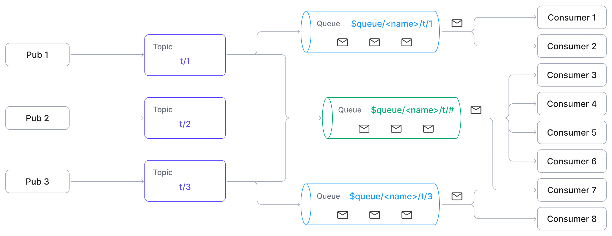

# 新機能

このページでは、現在のリリースでサポートされている主な新機能を紹介します。EMQXが提供するすべての機能を網羅しているわけではありませんのでご注意ください。

## EMQX 6.x シリーズ

### サブスクリプションフィルター

EMQX 6.2では、MQTT 5.0クライアント向けにサブスクリプションフィルターを導入しました。サブスクライバーはトピックフィルターの後に`?`を付けてフィルター条件を追加します。パブリッシャーはトピックに条件を含めず、通常のトピック名を使用し、MQTT 5.0のユーザープロパティで評価用の値を提供します。EMQXはトピックと条件の両方が一致した場合にのみメッセージを配信します。

例えば、サブスクリプション`sensor/+/temperature?location=roomA&value>25`は、ユーザープロパティが`location=roomA`かつ`value=26`である`sensor/1/temperature`にパブリッシュされたメッセージにマッチします。

#### 機能のポイント

- **一致するメッセージのみ配信**：まずメッセージのトピックをマッチさせ、その後ユーザープロパティに対して条件を評価します。
- **柔軟な式**：等価比較や数値比較演算子を使用でき、複数条件は`&`で組み合わせ可能です。
- **ネットワークとクライアント負荷の軽減**：サブスクライバーの条件に合わないメッセージの配信を防ぎます。
- **後方互換のオプトイン方式**：`mqtt.subscription_message_filter`で機能を制御します。デフォルトは無効で、無効時は`?`をトピックフィルターの一部として扱います。
- **組み込みの可観測性**：フィルター不一致は`delivery.dropped`イベントで`subscription_filter`理由として報告され、`delivery.dropped.filter`メトリクスでカウントされます。

詳細は[サブスクリプションフィルターのドキュメント](../develop/subscription-filter/subscription-filter-concept.md)をご覧ください。

### MQTTストリーム

MQTTストリームは、永続的かつリプレイ可能なストリーミングモデルをEMQXに導入し、MQTTのリアルタイムなパブリッシュ／サブスクライブのパラダイムを耐久性のあるメッセージ保存とコンシューマー制御のリプレイ機能で拡張します。

従来のMQTT配信は一時的でサブスクライバーの可用性に依存しますが、MQTTストリームはトピックフィルターにマッチするメッセージを名前付きの永続ストリームに継続的にキャプチャします。各ストリームは一意の名前で識別され、トピックフィルターとは独立して管理されます。

コンシューマーは`$stream/<name>`または`$stream/<name>/<topic_filter>`形式でサブスクライブします。リプレイ開始位置はMQTT 5のサブスクリプションプロパティ`stream-offset`で指定でき、特定のタイムスタンプや`earliest`、`latest`などから過去メッセージを再生可能です。

これにより、外部ストリーミングシステムを必要とせずに、EMQXがネイティブに過去メッセージのリプレイ、イベントトレース、状態復旧をサポートします。

#### 機能のポイント

- **耐久的なメッセージストリーム**：明示的に名前付けされたストリームにMQTTメッセージを永続化し、保持ポリシーを設定可能。
- **オフセットベースのリプレイ**：コンシューマーは`stream-offset`プロパティでリプレイ位置を制御。
- **通常ストリームとラストバリューストリーム**：フルイベントストリームと、ラストバリューセマンティクス有効時はキーごとに最新メッセージのみを保持する圧縮ストリームをサポート。
- **キー単位の順序保証**：同じストリームキーを持つメッセージは厳密にパブリッシュ順で配信。
- **MQTTネイティブ設計**：既存のMQTTパブリッシャーやクライアントの変更は不要。

MQTTストリームにより、EMQXはリアルタイムメッセージングとストリーム処理の両方に適し、アーキテクチャの複雑さを減らし、新たなIoTやイベント駆動型アプリケーションの実現を可能にします。

詳細は[MQTTストリームのドキュメント](../develop/mqtt-stream/mqtt-stream-concept.md)をご覧ください。

### メッセージキュー

メッセージキューは、信頼性の高いリアルタイムMQTTパブリッシュ／サブスクライブと非同期メッセージキューイングをEMQX内で統合し、外部キューイングサービスの必要をなくします。

従来のMQTTはサブスクライバーの可用性に依存しますが、メッセージキューはサーバー側でメッセージをバッファリングし、パブリッシャーとサブスクライバーを切り離します。設定されたトピックフィルターにマッチするメッセージは名前付きキューに永続的に保存され、`$queue/<name>`または`$queue/<name>/<topic_filter>`形式で後から消費可能です。

各キューはトピックフィルターではなく一意の名前で明示的に識別され、フィルタリングルールとは独立して管理、監視、アクセスが可能です。

> メッセージキューが有効な場合、`$queue/`プレフィックスはメッセージキューのサブスクリプション専用となり、共有サブスクリプションには使用できません。

この機能により、MQTTはリアルタイムと遅延処理の両方に対応可能となり、KafkaやRabbitMQなどの外部キューイングシステムを不要にしてIoTシステムのアーキテクチャを簡素化します。メッセージの耐久性、信頼性の高い配信、オフラインバッファリングが重要なシナリオに最適です。

#### 機能のポイント
- **名前付き永続キュー**：明示的に名前付けされたキューにメッセージを保存し、動作を設定可能。
- **配信の切り離し**：サーバー側のバッファリングによりパブリッシャーとサブスクライバーを完全に切り離し。
- **オフライン保存**：サブスクライバーが切断されていてもメッセージは保持。
- **ラストバリュー保持**：キーごとに最新メッセージのみを保持するオプションがあり、センサー値など変化の激しいデータに最適。
- **柔軟な配信戦略**：ランダム、ラウンドロビン、最少インフライトサブスクライバーから選択可能。
- **配信保証**：永続ストレージとQoS 1配信をサポートし、データ損失を防止。

詳細は[メッセージキューのドキュメント](../develop/message-queue/message-queue-concept.md)をご覧ください。

### ネームスペース付きロールによるマルチテナンシー

EMQX 6.0.0では、[マルチテナンシー](../guides/multi-tenancy/namespace-overview.md)と大規模IoT展開におけるアクセス制御を強化するため、ネームスペース付きロールを導入しました。この機能により、ユーザーは特定のネームスペースに割り当てられ、ルール、コネクター、アクションなどのリソースを他のテナントに影響を与えずに管理できます。

ネームスペース付きロールは、管理者や閲覧者などの細かな権限をサポートし、ダッシュボード、API、CLIから管理可能です。これにより、チームや部署、顧客間での安全な分離を保ちながら責任の委譲が容易になります。

#### 機能のポイント
- **安全な分離**：ユーザーは割り当てられたネームスペース内のリソースのみアクセス・管理可能（例：`ns:team_a::administrator`）。
- **細かなアクセス制御**：ネームスペースユーザーはネームスペース固有のリソースにフルアクセス可能だが、クラスター全体の設定はグローバル管理者権限がない限り読み取り専用。
- **運用の簡素化**：ユーザー作成時にロールの作成・割り当てが容易。
- **企業向けスケーラビリティ**：マルチテナントMQTTサービス提供や内部ビジネスユニット管理に最適。

#### 追加の改善点
- **可観測性の向上**：ダッシュボードの表示はネームスペースでフィルタリングされ、フォーカスが向上。
- **セッショントラッキングの最適化**：ネームスペース別のセッション数は1,000未満ならオンデマンド更新、それ以上は5秒ごとに更新され、パフォーマンスと精度が向上。

詳細な手順は[ネームスペース付きロールのユーザー作成](../guides/dashboard/system.md#create-a-user-with-a-namespaced-role)をご覧ください。

### 最適化されたパーシステントストレージ

EMQX 6.0.0では、パーシステントストレージの性能とスケーラビリティを大幅に改善し、高スループットなIoTワークロードに対応可能になりました。セッションデータを他のブローカーメタデータから分離することで、RAM消費を削減し、ストレージ効率を向上させ、ノードあたりの接続数を増加させています。

#### 最適化されたRocksDBパラメータ

新しい設定オプションにより、メモリと性能を細かく制御可能です：

- `durable_storage.messages.rocksdb.write_buffer_size`：シャードごとのメムテーブルサイズを制御。
- `durable_storage.messages.rocksdb.cache_size`：シャードごとのブロックキャッシュサイズを設定。
- `durable_storage.messages.rocksdb.max_open_files`：シャードごとのファイルディスクリプタ数を制限。
- `durable_storage.messages.layout.wildcard_thresholds`：ストレージレイアウトにおけるワイルドカード処理を最適化。

#### 追加の改善点

- **効率的なシリアライズ**：デフォルトのシリアライズ形式をASN.1に変更し、ストレージサイズ削減と処理速度向上を実現。
- **高速アクセスと低オーバーヘッド**：改善されたストレージレイアウトにより、メッセージ取得速度が向上し、ディスクおよびメモリのオーバーヘッドが低減。

これらの改善により、EMQXは大規模で永続的なMQTTワークロードを安定した性能で処理可能になりました。

### データ統合の対応拡大

EMQX 6.0.0では、データ統合機能をさらに強化し、MQTTデータを最新のクラウドやデータベースエコシステムとシームレスに連携してリアルタイム分析や処理、保存を可能にします。

#### 新規統合

EMQX 6.0.0で新たに追加された統合：

- **[Google BigQuery](../develop/data-integration/bigquery.md)**：大規模データウェアハウスと高度なクエリを可能にし、膨大なIoTデータセットから洞察を得るためのMQTTデータ連携。
- **[AWS AlloyDB](../develop/data-integration/alloydb.md)**、**[CockroachDB](../develop/data-integration/cockroachdb.md)**、**[AWS Redshift](../develop/data-integration/redshift.md)**：高性能データベースへのMQTTデータストリーミングを実現し、リアルタイム分析とスケーラブルな保存に最適。エンタープライズグレードのIoT分析に適しています。

#### 強化された統合

新規統合に加え、既存統合の性能、使いやすさ、クラウドネイティブ対応が向上：

- **Snowflake Snowpipe Streaming**：Snowflakeのプレビュー機能であるSnowpipe Streamingによる低レイテンシデータ取り込みをAWSホストアカウント向けにサポート。
- **RocketMQアクション**：`key`と`tag`テンプレートのサポート追加および柔軟なメッセージルーティングとメタデータ拡充のための`key_dispatch`戦略を追加。
- **AWS S3およびAWS S3 Tablesコネクター**：`access_key_id`と`secret_access_key`がオプション化され、AWSホスト環境ではEC2インスタンスメタデータサービスv2 APIから自動取得可能に。
- **RabbitMQシンク**：ヘッダーおよびプロパティテンプレートのカスタマイズを可能にし、RabbitMQ内でのメッセージルーティングと互換性を強化。

### その他の強化

#### 高度なLLMベースのMQTTデータ処理

EMQX 6.0.0では、OpenAIやAnthropic Claudeに加え、[Google Geminiモデル](../develop/flow-designer/gemini-node-quick-start.md)のサポートを追加し、LLMベースのデータ処理を強化しました。

#### LDAPサポートの強化

LDAP認可はJSON形式の拡張ACLルールをサポートし、LDAP認証はクライアント側キャッシュを用いてLDAPから直接ACLルールを取得可能になりました。

#### トレーシングの改善

最大トレース数（`trace.max_traces`）およびトレースファイルサイズ（`trace.max_file_size`）の設定が可能に。`max_file_size`に達するとトレースログは停止せず、新しいファイルにローテーションされます。

#### クラスター管理

新しい`cluster.description`設定オプションにより、EMQXダッシュボードでカスタムクラスター説明を設定・表示可能になりました。ダッシュボードでの設定方法は[ダッシュボード -> 管理 -> クラスター設定](../guides/dashboard/cluster_settings.md#cluster)をご覧ください。

### その他の機能

上記のハイライトに加え、最近のEMQXアップデートには多くの新機能や改善が含まれています。完全な一覧は[リリースノート](../release-notes/changes-ee-v6.md)をご参照ください。

### 破壊的変更

非推奨事項や破壊的変更の詳細については、[EMQX 5.xとEMQX 6.0の非互換変更](../release-notes/breaking-changes-6.0.0.md)をご覧ください。

## EMQX 5.x シリーズ

EMQX 5.xの機能およびアップデートの完全な一覧については、[EMQX 5.10 ドキュメント – 新機能](https://docs.emqx.com/en/emqx/v5.10/get-started/new-features.html)をご参照ください。
