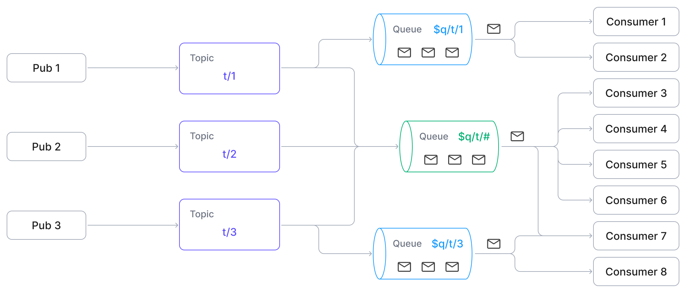

# 新機能

このページでは、現在のリリースでサポートされている主な新機能を紹介します。EMQXが提供するすべての機能を網羅しているわけではありませんのでご注意ください。

## EMQX 6.0.0（最新）

### メッセージキュー

メッセージキューは、EMQX内で信頼性の高いリアルタイムMQTTのパブリッシュ／サブスクライブと非同期メッセージキューイングを統合し、外部のキューイングサービスを不要にします。

従来のMQTTがサブスクライバーの接続状態に依存するのに対し、メッセージキューはサーバー上でメッセージをバッファリングすることでパブリッシャーとサブスクライバーを分離します。指定されたトピックフィルターにマッチするメッセージは永続的に保存され、特殊なトピック形式 `$q/{topic_filter}` を使って後から消費可能です。これにより、クライアントがオフラインやネットワークが不安定な場合でも信頼性の高いメッセージ配信が保証されます。

この機能により、MQTTはリアルタイム処理と遅延処理の両方に対応可能となり、KafkaやRabbitMQのような外部キューイングシステムを不要にしてIoTシステムのアーキテクチャを簡素化します。メッセージの耐久性、信頼性の高い配信、オフラインバッファリングが重要なシナリオに最適です。

#### 特徴のハイライト
- **統合メッセージングモデル**：軽量なMQTTとエンタープライズグレードのキューイングを単一システムで実現。
- **オフラインストレージ**：サブスクライバーが切断されていてもメッセージを保持。
- **最新値保持**：キーごとに最新のメッセージのみを保持するオプション（例：デバイスID単位）、センサーの高速変化データに最適。
- **柔軟な配信戦略**：ランダム、ラウンドロビン、最小インフライトサブスクライバーから選択可能で効率的にメッセージを分配。
- **配信保証**：永続化ストレージとQoS 1配信をサポートし、データの損失を防止。

詳細は[メッセージキューのドキュメント](../develop/message-queue/message-queue-concept.md)をご覧ください。

### ネームスペース付きロールによるマルチテナンシー

EMQX 6.0.0では、[マルチテナンシー](../guides/multi-tenancy/namespace-overview.md)と大規模IoT展開におけるアクセス制御を強化するためにネームスペース付きロールを導入しました。ユーザーは割り当てられたネームスペース内でルール、コネクター、アクションなどのネームスペース対応リソースを管理できます。

ユーザーはダッシュボード、API、CLIを通じてネームスペース付きのAdministratorまたはViewerロールを割り当てられます。これにより、信頼できるチームや事業部門間でリソース管理を委任可能です。

#### 特徴のハイライト
- **リソース管理**：ユーザーは割り当てられたネームスペース内のリソース（例：`ns:team_a::administrator`）のみを閲覧・管理可能。
- **メタデータの可視化**：MQTTサブスクリプション情報などのクラスター全体のメタデータは、ユーザーのロール、スコープ、エンドポイント制限に応じてネームスペースを跨いで閲覧可能。
- **細粒度アクセス制御**：許可された操作はユーザーのロールとスコープに依存。クラスター全体の設定はネームスペースユーザーに対して読み取り専用。
- **簡素化された操作**：ユーザー作成時にネームスペース付きロールを割り当て可能。
- **エンタープライズ向けスケーラビリティ**：信頼できる内部チームや事業部門ごとに分離されたリソース管理をサポート。

#### 追加の改善点
- **観測性の向上**：ダッシュボードのネームスペース対応リソースビューはネームスペースでフィルタリングされ、フォーカスが向上。
- **セッショントラッキングの最適化**：ネームスペース付きセッション数は、1,000セッション未満ではオンデマンド更新、それ以上は5秒ごとに更新され、パフォーマンスと精度が向上。

詳細な手順は[ネームスペース付きロールのユーザー作成](../guides/dashboard/system.md#create-a-user-with-a-namespaced-role)をご覧ください。

### 最適化されたパーシステントストレージ

EMQX 6.0.0では、パーシステントストレージの性能とスケーラビリティを大幅に改善しました。セッションデータを他のブローカーメタデータから分離することで、RAM消費を削減し、ストレージ効率を向上。ノードあたりの接続数を増やせるようになりました。

#### 最適化されたRocksDBパラメータ

新しい設定オプションにより、メモリとパフォーマンスを細かく制御可能です：

- `durable_storage.messages.rocksdb.write_buffer_size`：シャードごとのメムテーブルサイズを制御。
- `durable_storage.messages.rocksdb.cache_size`：シャードごとのブロックキャッシュサイズを設定。
- `durable_storage.messages.rocksdb.max_open_files`：シャードごとのファイルディスクリプタ数を制限。
- `durable_storage.messages.layout.wildcard_thresholds`：ストレージレイアウトにおけるワイルドカード処理を最適化。

#### 追加の改善点

- **効率的なシリアライズ**：デフォルトのシリアライズ形式をASN.1に変更し、ストレージサイズを削減し処理速度を向上。
- **高速アクセスと低オーバーヘッド**：ストレージレイアウトの改善により、メッセージ取得が高速化され、ディスクとメモリのオーバーヘッドが低減。

これらの改善により、大規模かつ永続的なMQTTワークロードを安定したパフォーマンスで処理可能になりました。

### データ統合のサポート拡大

EMQX 6.0.0では、データ統合機能をさらに強化し、MQTTデータを最新のクラウドやデータベースエコシステムとシームレスに接続してリアルタイム分析、処理、保存を実現します。

#### 新規統合

EMQX 6.0.0で新たに追加された統合：

- **[Google BigQuery](../develop/data-integration/bigquery.md)**：大規模データウェアハウスと高度なクエリを可能にし、膨大なIoTデータセットから洞察を得るためにMQTTデータをBigQueryと連携。
- **[AWS AlloyDB](../develop/data-integration/alloydb.md)**、**[CockroachDB](../develop/data-integration/cockroachdb.md)**、および **[AWS Redshift](../develop/data-integration/redshift.md)**：高性能データベースへMQTTデータをストリーミングし、リアルタイム分析とスケーラブルな保存を実現。エンタープライズグレードのIoT分析に最適。

#### 既存統合の強化

新規統合に加え、既存統合も性能、使いやすさ、クラウドネイティブ対応が向上：

- **Snowflake Snowpipe Streaming**：Snowflakeのプレビュー機能であるSnowpipe Streamingを使い、AWSホストアカウント向けに低レイテンシでSnowflakeテーブルへのデータ取り込みをサポート。
- **RocketMQアクション**：`key` と `tag` テンプレートのサポートを追加し、柔軟なメッセージルーティングとメタデータ付加を実現する `key_dispatch` 戦略を導入。
- **AWS S3およびAWS S3 Tablesコネクター**：`access_key_id` と `secret_access_key` がオプション化され、AWSホスト環境ではEC2インスタンスメタデータサービスv2 APIから自動取得可能に。
- **RabbitMQシンク**：ヘッダーおよびプロパティテンプレートのカスタマイズが可能となり、RabbitMQ内でのメッセージルーティングと互換性を強化。

### その他の強化

#### 高度なLLMベースのMQTTデータ処理

EMQX 6.0.0では、OpenAIやAnthropic Claudeに加え、[Google Geminiモデル](../develop/flow-designer/gemini-node-quick-start.md)のサポートを追加し、LLMベースのデータ処理を強化しました。

#### LDAPサポートの強化

LDAP認可はJSON形式の拡張ACLルールをサポートし、LDAP認証はLDAPから直接ACLルールを取得し、クライアント側でキャッシュ可能になりました。

#### トレーシングの改善

最大トレース数（`trace.max_traces`）およびトレースファイルサイズ（`trace.max_file_size`）の設定が可能に。`max_file_size`に達するとトレースログは停止せず新しいファイルにローテーションされます。

#### クラスター管理

新しい設定オプション `cluster.description` により、EMQXダッシュボード上でカスタムクラスター説明を設定・表示可能です。ダッシュボードでのクラスター説明追加方法は[ダッシュボード -> 管理 -> クラスター設定](../guides/dashboard/cluster_settings.md#cluster)をご覧ください。

### その他の機能

上記のハイライトに加え、最近のEMQXアップデートには多くの新機能と改善が含まれています。完全な一覧は[リリースノート](../release-notes/changes-ee-v6.md)をご参照ください。

### 破壊的変更

非推奨事項や破壊的変更の詳細は[EMQX 5.xとEMQX 6.0の互換性のない変更](../release-notes/breaking-changes-6.0.0.md)をご覧ください。

## EMQX 5.xシリーズ

EMQX 5.xの機能およびアップデートの完全な一覧については、[EMQX 5.10 ドキュメント – 新機能](https://docs.emqx.com/en/emqx/v5.10/get-started/new-features.html)をご参照ください。
