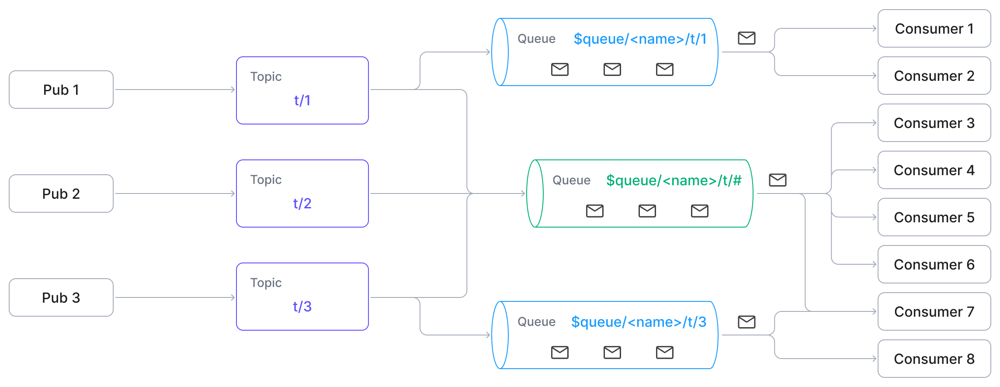

# 新機能

このページでは、現在のリリースでサポートされている主な新機能を紹介します。EMQXが提供するすべての機能を網羅しているわけではありませんのでご注意ください。

## EMQX 6.x シリーズ

### セキュリティプロファイル

EMQX 6.3では、後方互換のデフォルト設定とより厳格でセキュアなデフォルト動作を選択できるノード全体のセキュリティプロファイルを導入しました。

#### 機能のハイライト

- **レガシー互換性**: デフォルトの`legacy`プロファイルは、以前のEMQXバージョンのデフォルト動作を維持します。
- **強化されたデフォルト設定**: `hardened`プロファイルは、リスナーの公開範囲、認証、認可、遅延パブリッシュ、拡張機能、およびダッシュボードアクセスを強化します。
- **クラスターの一貫性**: 各ノードのアクティブなプロファイルを表示し、クラスター全体でのプロファイルの違いを検出できます。

起動時に`EMQX_SECURITY_PROFILE`でプロファイルを選択します。すべてのノードで同じプロファイルを使用し、変更を適用するにはノードを再起動してください。詳細は[セキュリティプロファイル](../guides/access-control/security-profile.md)をご覧ください。

### 機能ゲート

EMQX 6.3では、デプロイ時に必要なオプション機能のみを起動するための機能ゲートを導入しました。

#### 機能のハイライト

- **プリセットまたはカスタム選択**: `FULL`、`ESSENTIAL`、または`EMQX_FEATURES`を通じた明示的な機能リストを使用可能です。
- **自動依存関係解決**: 選択した機能に必要な依存関係をEMQXが自動的に有効化します。
- **フットプリント削減**: `ESSENTIAL`はコアのMQTTブローカーとアクセス制御機能のみを起動し、オプションの機能アプリケーションは含みません。
- **一貫したデプロイ**: 機能の選択は起動時に解決され、クラスター内のすべてのノードで同一である必要があります。

詳細は[機能ゲート](./deploy/feature-gates.md)をご覧ください。

### 強化された可観測性

EMQX 6.3は、MQTTトラフィック、クライアントセッション、および外部可観測性プラットフォームに対する運用上の可視性を拡張しました。

#### 機能のハイライト

- **トピックメトリクスv2**: ワイルドカードトピックフィルター、ネームスペース分離、REST API管理、Prometheusエクスポートを備えた名前付きメトリクスコレクションを作成可能。
- **セッションバッファのインサイト**: バッファされたペイロードバイト数を追跡し、設定された閾値を超えた場合に警告を発し、`emqx ctl session-top`で最大のセッションを特定可能。
- **Dynatrace連携**: OAuth2トークン認証を用いてOpenTelemetryのトレースとログをDynatraceにエクスポート。

詳細は[トピックメトリクス](../guides/observability/topic-metrics.md)、[本番監視のベストプラクティス](../guides/observability/monitoring-best-practices.md)、および[Dynatrace連携](../guides/observability/opentelemetry/dynatrace.md)をご覧ください。

### サブスクリプションフィルター

EMQX 6.2では、MQTT 5.0クライアント向けにサブスクリプションフィルターを導入しました。サブスクライバーはトピックフィルターの後に`?`で区切ったフィルター条件を追加します。パブリッシャーは条件をトピックに含めず、通常のトピック名を使用し、MQTT 5.0のユーザープロパティで評価に必要な値を提供します。EMQXはトピックと条件の両方が一致した場合にのみメッセージを配信します。

例えば、サブスクリプション`sensor/+/temperature?location=roomA&value>25`は、`sensor/1/temperature`にパブリッシュされ、ユーザープロパティが`location=roomA`かつ`value=26`のメッセージにマッチします。

#### 機能のハイライト

- **一致するメッセージのみ配信**: まずメッセージのトピックをマッチさせ、その後ユーザープロパティに対して条件を評価します。
- **柔軟な式**: 等価比較や数値比較演算子を使用でき、複数条件は`&`で組み合わせ可能です。
- **ネットワークおよびクライアント負荷軽減**: サブスクライバーの条件に合致しないメッセージの配信を防ぎます。
- **後方互換のオプトイン**: `mqtt.subscription_message_filter`で機能を制御。デフォルトは無効で、無効時は`?`をトピックフィルターの一部として扱います。
- **組み込みの可観測性**: フィルター不一致は`delivery.dropped`イベントで`subscription_filter`理由として報告され、`delivery.dropped.filter`メトリクスでカウントされます。

詳細は[サブスクリプションフィルターのドキュメント](../develop/subscription-filter/subscription-filter-concept.md)をご覧ください。

### MQTTストリーム

::: warning 重要なお知らせ
MQTTストリームは現在ベータ機能です。機能やインターフェースは大幅に変更される可能性があります。
:::

MQTTストリームは、MQTTのリアルタイムなパブリッシュ／サブスクライブモデルを拡張し、耐久性のあるメッセージストレージとコンシューマー制御のリプレイを可能にする永続的かつリプレイ可能なストリーミングモデルをEMQXに導入します。

従来のMQTT配信は一時的でサブスクライバーの可用性に依存しますが、MQTTストリームはトピックフィルターにマッチするメッセージを名前付きの永続ストリームに継続的にキャプチャします。各ストリームは一意の名前で識別され、トピックフィルターとは独立して管理されます。

コンシューマーは`$stream/<name>`または`$stream/<name>/<topic_filter>`形式でサブスクライブします。リプレイ開始位置はMQTT 5のサブスクリプションプロパティ`stream-offset`で指定でき、特定のタイムスタンプや`earliest`、`latest`などから過去メッセージをリプレイ可能です。

これにより、外部ストリーミングシステムを必要とせずに、EMQXがネイティブに過去メッセージのリプレイ、イベントトレース、状態復旧をサポートします。

#### 機能のハイライト

- **耐久的なメッセージストリーム**: 明示的に名前付けされたストリームにMQTTメッセージを永続化し、保持ポリシーを設定可能。
- **オフセットベースのリプレイ**: コンシューマーは`stream-offset`プロパティでリプレイ位置を制御。
- **通常ストリームとラストバリューストリーム**: フルイベントストリームと、ラストバリューセマンティクス有効時はキーごとに最新メッセージのみを保持する圧縮ストリームをサポート。
- **キー単位の順序保証**: 同じストリームキーを持つメッセージは厳密にパブリッシュ順に配信。
- **MQTTネイティブ設計**: 既存のMQTTパブリッシャーやクライアントの変更は不要。

MQTTストリームにより、EMQXはリアルタイムメッセージングとストリーム処理の両方に適し、アーキテクチャの複雑さを減らし、新たなIoTやイベント駆動型アプリケーションの可能性を広げます。

詳細は[MQTTストリームのドキュメント](../develop/mqtt-stream/mqtt-stream-concept.md)をご覧ください。

### メッセージキュー

メッセージキューは、EMQX内で信頼性の高いリアルタイムMQTTパブリッシュ／サブスクライブと非同期メッセージキューイングを統合し、外部キューイングサービスの必要性を排除します。

従来のMQTTはサブスクライバーの可用性に依存しますが、メッセージキューはサーバー側でメッセージをバッファリングし、パブリッシャーとサブスクライバーを分離します。設定されたトピックフィルターにマッチするメッセージは名前付きキューに永続的に保存され、`$queue/<name>`または`$queue/<name>/<topic_filter>`形式で後から消費可能です。

各キューはトピックフィルターではなく一意の名前で明示的に識別されます。これにより、キューはフィルタリングルールとは独立して管理、監視、アドレス指定が可能です。

> メッセージキューが有効な場合、`$queue/`プレフィックスはメッセージキューのサブスクリプション用に予約され、共有サブスクリプションには使用できなくなります。

この機能により、MQTTはリアルタイムおよび遅延処理の両方を扱えるようになり、KafkaやRabbitMQなどの外部キューイングシステムを不要にしてIoTシステムのアーキテクチャを簡素化します。メッセージの耐久性、信頼性の高い配信、オフラインバッファリングが重要なシナリオに最適です。

#### 機能のハイライト
- **名前付き永続キュー**: 明示的に名前付けされたキューにメッセージを保存し、動作を設定可能。
- **デカップリング配信**: サーバー側のバッファリングによりパブリッシャーとサブスクライバーを完全に分離。
- **オフラインストレージ**: サブスクライバーが切断されていてもメッセージを保持。
- **ラストバリュー保持**: オプションでキー（例：デバイスID）ごとに最新メッセージのみ保持可能。センサー読み取り値などの高速変化データに最適。
- **柔軟なディスパッチ戦略**: ランダム、ラウンドロビン、最小インフライトサブスクライバーから選択可能で効率的にメッセージを配信。
- **配信保証**: 永続ストレージとQoS 1配信をサポートし、データ損失を防止。

詳細は[メッセージキューのドキュメント](../develop/message-queue/message-queue-concept.md)をご覧ください。

### ネームスペース付きロールによるマルチテナンシー

EMQX 6.0.0では、大規模IoT展開における[マルチテナンシー](../guides/multi-tenancy/namespace-overview.md)とアクセス制御を強化するためにネームスペース付きロールを導入しました。この機能により、ユーザーは特定のネームスペースに割り当てられ、ルール、コネクター、アクションなどのリソースを他のテナントに影響を与えずに管理できます。

ネームスペース付きロールは、管理者や閲覧者などの細かな権限をサポートし、ダッシュボード、API、CLIから管理可能です。これにより、チームや部門、顧客間の安全な分離を保ちながら責任の委譲が容易になります。

#### 機能のハイライト
- **安全な分離**: ユーザーは割り当てられたネームスペース内のリソースのみアクセス・管理可能（例：`ns:team_a::administrator`）。
- **細粒度アクセス制御**: ネームスペースユーザーはネームスペース固有リソースにフルアクセス可能だが、クラスター全体設定はグローバル管理者権限がない限り読み取り専用。
- **運用の簡素化**: ユーザー作成時にロールを簡単に作成・割り当て可能。
- **企業向けスケーラビリティ**: マルチテナントMQTTサービス提供や内部事業部門の分離管理に最適。

#### 追加の改善点
- **可観測性の向上**: ダッシュボードの表示はネームスペースでフィルタリングされ、より集中可能。
- **セッショントラッキングの最適化**: ネームスペース別のセッション数は1,000未満ならオンデマンド更新、それ以上は5秒ごとに更新され、パフォーマンスと精度が向上。

詳細は[ネームスペース付きロールでのユーザー作成](../guides/dashboard/system.md#create-a-user-with-a-namespaced-role)をご覧ください。

### 最適化された耐久ストレージ

EMQX 6.0.0は耐久ストレージを大幅に改善し、高スループットなIoTワークロードでのパフォーマンスとスケーラビリティを向上させました。セッションデータを他のブローカーメタデータから分離することで、RAM消費を削減し、ストレージ効率を高め、ノードあたりの接続数を増加させています。

#### 最適化されたRocksDBパラメーター

新しい設定オプションでメモリとパフォーマンスを細かく制御可能です：

- `durable_storage.messages.rocksdb.write_buffer_size`: シャードごとのメムテーブルサイズを制御。
- `durable_storage.messages.rocksdb.cache_size`: シャードごとのブロックキャッシュサイズを設定。
- `durable_storage.messages.rocksdb.max_open_files`: シャードごとのファイルディスクリプタ数を制限。
- `durable_storage.messages.layout.wildcard_thresholds`: ストレージレイアウトのワイルドカード処理を最適化。

#### 追加の改善点

- **効率的なシリアライズ**: デフォルトのシリアライズ形式をASN.1に変更し、ストレージサイズ削減と処理速度向上を実現。
- **高速アクセスと低オーバーヘッド**: 改善されたストレージレイアウトにより、メッセージ取得が高速化され、ディスクおよびメモリのオーバーヘッドが削減。

これらの改善により、EMQXは大規模で永続的なMQTTワークロードを一貫したパフォーマンスで処理可能になりました。

### データ統合のサポート拡大

EMQX 6.xは、MQTTデータをクラウドやデータベースエコシステムと連携させ、リアルタイム分析、処理、保存を強化し続けています。

#### 新規統合

EMQX 6.xシリーズで追加された統合：

- **[Google Bigtable](../develop/data-integration/bigtable.md) (6.3.0)**: MQTTデータをBigtableに追加し、スケーラブルで低レイテンシな運用IoTデータの保存と取得を実現。
- **[Google BigQuery](../develop/data-integration/bigquery.md) (6.0.0)**: 大規模データウェアハウスと高度なクエリを可能にし、膨大なIoTデータセットから洞察を得るためにMQTTデータを統合。
- **[AWS AlloyDB](../develop/data-integration/alloydb.md) (6.0.0)**、**[CockroachDB](../develop/data-integration/cockroachdb.md) (6.0.0)**、**[AWS Redshift](../develop/data-integration/redshift.md) (6.0.0)**: これらの高性能データベースへMQTTデータをストリーミングし、リアルタイム分析とスケーラブルな保存を実現。エンタープライズグレードのIoT分析に最適。

#### 強化された統合

新規統合に加え、EMQX 6.xは既存統合の認証、データ管理、パフォーマンス、使いやすさを改善：

- **クラウドネイティブ認証 (6.3.0)**: [GCP Pub/Sub](../develop/data-integration/data-bridge-gcp-pubsub.md#attached-service-account-prerequisites)のプロデューサー・コンシューマーコネクターおよび[BigQuery](../develop/data-integration/bigquery.md#attached-service-account-prerequisites)コネクターは、アタッチされたサービスアカウント経由でアクセストークンを取得可能。Amazon MSK接続時は、[Kafka](../develop/data-integration/data-bridge-kafka.md#authentication-method)のプロデューサー・コンシューマーコネクターがAWS IAM Roles Anywhereをサポートし、クレデンシャルヘルパー経由で一時的AWS認証情報を取得可能。
- **[Disk Log Connector](../develop/data-integration/disk-log.md#log-rotation) (6.3.0)**: 時間単位または日単位のファイルローテーションをサポートし、保持期間やローテーションタイムゾーンを設定可能。
- **[Snowflake Snowpipe Streaming](../develop/data-integration/snowflake.md#create-a-snowflake-streaming-connector) (6.0.0)**: Snowflakeのプレビュー機能であるSnowpipe Streamingを利用し、AWSホストアカウント向けに低レイテンシなデータ取り込みをサポート。
- **RocketMQアクション (6.0.0)**: `key`と`tag`テンプレートのサポートおよび柔軟なメッセージルーティングとメタデータ付加のための`key_dispatch`戦略を追加。
- **[AWS S3](../develop/data-integration/s3.md#prepare-an-s3-bucket)および[AWS S3 Tables](../develop/data-integration/s3-tables.md#deployment-prerequisites-and-credential-sources)コネクター (6.0.0)**: `access_key_id`と`secret_access_key`はオプションとなり、AWSホスト環境ではEC2インスタンスメタデータサービスv2 APIから自動取得可能。
- **[RabbitMQ Sink](../develop/data-integration/data-bridge-rabbitmq.md#set-headers-and-properties-templates) (6.0.0)**: メッセージルーティングとRabbitMQ内の互換性を向上させるために、ヘッダーおよびプロパティテンプレートのカスタマイズを許可。

### その他の改善点

#### 高度なLLMベースのMQTTデータ処理

EMQX 6.0.0は、OpenAIやAnthropic Claudeに加え、[Google Geminiモデル](../develop/flow-designer/gemini-node-quick-start.md)をサポートし、LLMベースのデータ処理を強化しました。

#### LDAPサポートの強化

LDAP認可はJSON形式の拡張ACLルールをサポートし、LDAP認証はLDAPから直接ACLルールを取得可能でクライアント側キャッシュも利用できます。

#### トレース機能の改善

最大トレース数(`trace.max_traces`)およびトレースファイルサイズ(`trace.max_file_size`)の設定可能な上限を追加。`max_file_size`に達するとトレースログは停止せずに新しいファイルにローテーションされます。

#### クラスター管理

新しい`cluster.description`設定オプションにより、EMQXダッシュボードでカスタムクラスター説明を設定・表示可能です。ダッシュボードでのクラスター説明追加方法は[ダッシュボード -> 管理 -> クラスター設定](../guides/dashboard/cluster_settings.md#cluster)をご覧ください。

### その他の機能

上記のハイライトに加え、最近のEMQXアップデートには多くの新機能や改善があります。完全なリストは[リリースノート](../release-notes/changes-ee-v6.md)をご参照ください。

### 破壊的変更

EMQX 6.3で導入された破壊的変更については[EMQX 6.3の互換性のない変更](../release-notes/breaking-changes-6.3.md)をご覧ください。EMQX 5.xから6.0への移行については[EMQX 5.xと6.0の互換性のない変更](../release-notes/breaking-changes-6.0.0.md)をご参照ください。

## EMQX 5.x シリーズ

EMQX 5.xの機能およびアップデートの完全なリストについては、[EMQX 5.10 ドキュメント – 新機能](https://docs.emqx.com/en/emqx/v5.10/get-started/new-features.html)をご覧ください。
