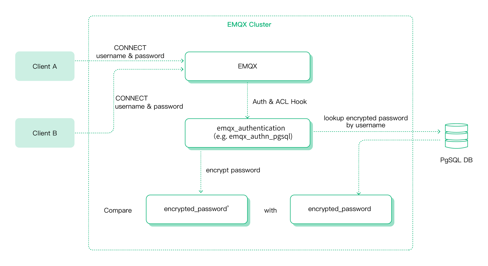
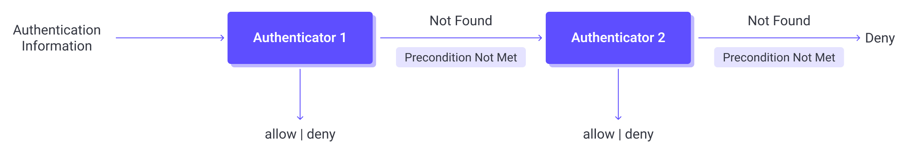
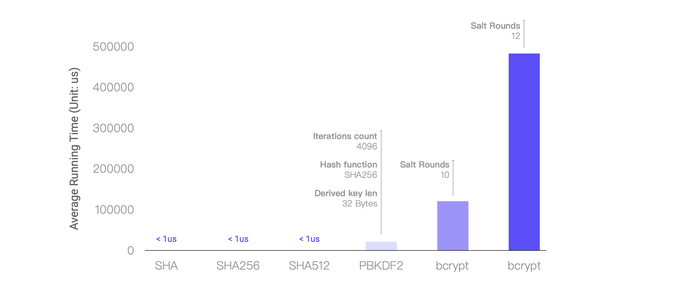
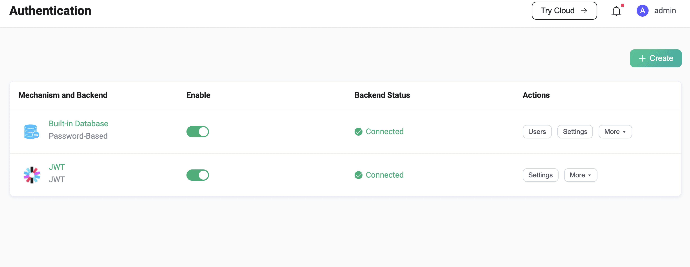

# 認証

認証はクライアントの身元を検証するプロセスです。ほとんどのアプリケーションにおいて不可欠な要素であり、不正なクライアント接続からサービスを保護するのに役立ちます。

EMQXは複数の認証機構をサポートしており、[TLS X.509](https://en.wikipedia.org/wiki/X.509)証明書認証や[TLS-PSK](https://www.rfc-editor.org/rfc/rfc4279)認証もサポートしています。これにより、クライアントとサーバー間の認証要求に対する選択肢が提供されます。

本章では、身元認証の基本概念と設定について説明します。

::: tip

デフォルトではEMQXは認証機能を有効にしておらず、すべてのクライアントの接続を許可します。運用環境で使用する場合は、少なくとも1つの認証方式を事前に設定してください。

:::

## 認証機構

EMQXがサポートする認証機構は以下の通りです。

- X.509証明書認証
- JWT認証
- ユーザー名／パスワード認証
- MQTT 5.0の拡張認証
- PSK認証

### X.509証明書認証

EMQXはクライアント認証のために[X.509証明書認証](./x509.md)をサポートしています。EMQXでX.509証明書認証を使用すると、クライアントとサーバーはTLS/SSLを通じて信頼できる接続を確立し、通信相手の真正性と送信データの整合性を保証します。EMQXは片方向認証（クライアントがサーバーのみを認証）と双方向認証（クライアントとサーバーが相互に証明書を検証）をサポートし、さまざまなセキュリティ要件や展開シナリオに対応可能です。

### JWT認証

[JSON Web Token (JWT)](https://jwt.io/)は、サーバー側でクライアントの認証情報やセッション情報を保持しないトークンベースの認証機構です。

クライアントは接続要求時にJWTを携帯し、EMQXは事前に設定されたシークレットまたは公開鍵を用いてJWTの署名を検証します。JWKSエンドポイントを設定している場合は、JWT認証器はJWKSエンドポイントから取得した公開鍵リストを使ってJWT署名を検証します。

### パスワード認証

EMQXは最もシンプルで広く使われているパスワード認証をサポートしており、クライアントはユーザー名、クライアントID、対応するパスワードなどの認証情報を提供する必要があります。場合によってはTLS証明書の一部（例：証明書のCommon Name）をクライアントの身元情報として使用することも可能です。いずれの場合も、これらの認証情報は事前にデータベースに保存されており、パスワードは通常ソルト付きハッシュ形式で保存されます。

EMQXのパスワード認証の流れは以下の通りです。クライアントは接続要求時に身元情報を携帯し、EMQXはクライアントが提供した身元情報に対応するハッシュ化されたパスワードをデータベースから照会し、一致した場合にのみ接続を許可します。


組み込みデータベースのほか、EMQXはMySQL、PostgreSQL、MongoDB、Redisなどの各種バックエンドデータベースとの連携もサポートしています。

また、ユーザーが開発したHTTPサーバーなどの外部サービスに認証処理を委譲する設定も可能です。

### MQTT 5.0拡張認証

[MQTT 5.0拡張認証](https://www.emqx.com/en/blog/mqtt5-enhanced-authentication)は、基本認証にチャレンジ／レスポンス方式の認証を追加したものです。拡張認証の実装により、SCRAM認証やKerberos認証など、より安全な認証方式を利用可能です。EMQXの具体的な拡張認証実装は、組み込みデータベースおよび外部HTTPサービスを通じたSCRAMユーザー管理をサポートしています。

### PSK認証

EMQXの[PSK認証](../../network/psk-authentication.md)は、証明書ベースのTLSに代わるシンプルかつ安全な認証方式を提供します。クライアントとサーバーが共有する秘密鍵に基づくため、デジタル証明書を必要としません。リソース制約のある環境で、証明書の管理に伴うオーバーヘッドを軽減するのに適しています。

## EMQX認証器

EMQXは認証機構およびバックエンドデータベースに基づき、以下の認証方式（以下「認証器」と呼びます）をサポートしています。

| 機構           | データベース         | 説明                                                         |
| -------------- | -------------------- | ------------------------------------------------------------ |
| パスワードベース | 組み込みデータベース | [Mnesiaデータベースを認証情報ストレージとして使う認証](./mnesia.md) |
| パスワードベース | MySQL                | [MySQLデータベースを認証情報ストレージとして使う認証](./mysql.md) |
| パスワードベース | PostgreSQL           | [PostgreSQLデータベースを認証情報ストレージとして使う認証](./postgresql.md) |
| パスワードベース | MongoDB              | [MongoDBデータベースを認証情報ストレージとして使う認証](./mongodb.md) |
| パスワードベース | Redis                | [Redisデータベースを認証情報ストレージとして使う認証](./redis.md) |
| パスワードベース | LDAP                 | [LDAPサーバーを認証情報ストレージとして使う認証](./ldap.md) |
| パスワードベース | HTTPサーバー         | [外部HTTP APIを利用した認証情報検証](./http.md)               |
| JWT            |                      | [JWTを使った認証](./jwt.md)                                  |
| SCRAM          | 組み込みデータベース | [SCRAMを使った認証](./scram.md)                              |
| SCRAM          | HTTPサーバー         | [RESP APIベースのSCRAM認証](./scram_restapi.md)               |
| GSSAPI         | Kerberos             | [Kerberosを使ったGSSAPI認証](./kerberos.md)                   |
| ルールベース    |                      | [Client-infoを使った認証](./cinfo.md)                         |

## 認証チェーン

EMQXは認証チェーンの作成をサポートしており、複数の認証器を定義された順序で評価できます。チェーン内の各認証器は異なる種類（例：1つはHTTP、1つはLDAP、1つは組み込みデータベース）である必要があります。

::: tip

現時点でEMQXはMQTTクライアント向けの認証チェーンのみサポートしています。ゲートウェイは認証チェーンをサポートせず、単一の認証器を使用してください。

:::

X.509証明書ベースの認証が適用される場合は、常に認証チェーンの実行前に処理されます。

### 認証チェーンの動作

認証チェーンが設定されている場合、EMQXはまず最初の認証器で認証情報の取得を試み、失敗した場合は次の認証器に切り替えて処理を続行します。

パスワードベースの認証を例に動作を説明します。

1. **前提条件の評価（設定されている場合）**  
   認証器に[前提条件](#authenticator-preconditions)がある場合、EMQXはクライアント属性情報（例：`listener`、`clientid`、`username`）に基づいて式を評価します。  
   - 式が`true`の場合、認証器が呼び出されます。  
   - そうでなければ認証器はスキップされます。  
2. **認証器の実行**  
   - 認証情報が見つかり有効（例：パスワードが正しい）であれば、クライアントは認証に成功し接続が許可されます。  
   - 認証情報が見つかったが無効であれば、クライアントはアクセス拒否されます。  
   - 認証情報が見つからなければ、EMQXはチェーン内の次の認証器に移動します。  

3. **エラーまたは無効時のスキップ**  
   認証器が無効化されている場合や、実行中に内部エラー（例：データベースが利用不可）が発生した場合もスキップされます。  
4. **フォールバック動作**  
   すべての認証器がスキップされるか、いずれもクライアントを認証できなかった場合、EMQXはデフォルトで接続を拒否します。



### 認証器の前提条件

EMQX 5.9以降、各認証器に前提条件を割り当てることで、特定のクライアントに対して認証器を呼び出すか制御できます。前提条件は[Variform式](../../configuration/configuration.md#variform-expressions)で、クライアント属性（`listener`、`username`、`clientid`など）を評価します。式が`true`でなければ認証器はスキップされます。

この機能により認証チェーンに条件分岐を導入でき、異なるリスナー経由のクライアントに異なる認証器を適用するなど、認証ロジックを細かく制御可能です。EMQXは適切な場合にのみ認証器を呼び出し、外部システムへの不要なリクエストを回避します。

#### 前提条件でサポートされるクライアント属性

前提条件で使用可能なクライアント属性は以下の通りです。

- `username`: クライアントのユーザー名
- `password`: クライアントのパスワード
- `clientid`: クライアントID
- `client_attrs.*`: クライアント属性
- `cert_common_name`: クライアントTLS証明書のSubjectフィールド
- `cert_subject`: クライアントTLS証明書のCommon Name (CN)
- `peersni`: TLSクライアントが送信したSNI（Server Name Indication）
- `listener`: リスナーID（例：`tcp:default`）
- `zone`: 関連付けられたコンフィグゾーン

#### 前提条件の例

異なるリスナー経由のクライアントを異なる認証器で認証する例：

- `tcp:default`リスナーのクライアントにHTTP認証器を適用：

  ```
  str_eq(listener, 'tcp:default')
  ```

- `ssl:default`リスナーのクライアントにPostgreSQL認証器を適用：

  ```
  str_eq(listener, 'ssl:default')
  ```

JWT認証器とパスワードベース認証器を同じ認証チェーンに組み合わせる場合、JWT認証器に以下の前提条件を設定します。

```
is_jwt(password)
```

EMQX 6.2.3以降、この前提条件はパスワードが構造的にJWTである場合のみ`true`を返します。JWTパスワードの場合はJWT認証器が呼び出され、そうでなければJWT認証器はスキップされ、チェーンの次の認証器に処理が移ります。

## 外部リソースキャッシュ

EMQXはMySQL、MongoDB、Redisなどの外部バックエンドから取得した認証結果をノードレベルでキャッシュする仕組みを提供しています。このキャッシュは認証結果の検索性能を向上させ、特に高スループット環境で外部リソースへの繰り返しアクセスを削減します。

::: tip 注意

外部リソースキャッシュは外部データソースにのみ適用されます。組み込みデータベース認証器などローカルソースには適用されません。

:::

### 外部リソースキャッシュの動作

外部リソースキャッシュはノードレベルで認証結果を保存し、同一ノード上のすべてのクライアントセッションで共有され、外部認証バックエンドへの冗長な問い合わせを回避します。

1. クライアントが接続し認証をトリガーする。
2. EMQXはキャッシュに以前の結果があるか確認する。  
   - 有効な結果があれば**キャッシュヒット**となり、外部バックエンドへの問い合わせは行われない。  
   - 結果がなければ**キャッシュミス**となり、外部バックエンドに問い合わせる。  
3. バックエンドから返された結果はキャッシュに保存され、**キャッシュ挿入**メトリクスが増加する。

この仕組みによりレイテンシを低減し、バックエンドの負荷を抑え、システムの応答性を維持します。

### 外部リソースキャッシュの有効化と設定

EMQXダッシュボードから外部リソースキャッシュを有効化・設定できます。

1. **アクセス制御** -> **認証**に移動します。

2. 右上の**外部リソースキャッシュ設定**ボタンをクリックすると、右側からサイドパネルが表示されます。

3. パネル内の**外部リソースキャッシュを有効にする**ボタンでキャッシュ機能をオン／オフします。有効化後、以下のキャッシュ設定を行います。

   | 項目名                           | 説明                                                         |
   | -------------------------------- | ------------------------------------------------------------ |
   | **キャッシュアイテム最大数**      | ノードあたりのキャッシュエントリ最大数。デフォルト：`1,000,000`。 |
   | **最大メモリ使用量**             | キャッシュのメモリ使用上限。デフォルト：`100 MB`。           |
   | **キャッシュTTL**                | キャッシュエントリの有効期間。デフォルト：`1分`。            |

4. **更新**をクリックして設定を反映します。

これらの設定はクラスター全体に適用され、すべてのノードで一貫した動作を保証します。

### 外部リソースキャッシュの状態監視

<!--@include: ../monitor-cache-status.md-->

## スーパーユーザー

通常、認証はクライアントの身元情報の検証のみを行い、特定トピックのパブリッシュ／サブスクライブ権限は認可システムで判断します。しかしEMQXはスーパーユーザー役割と権限プリセット機能を提供しており、後続のパブリッシュ／サブスクライブ認可処理を容易にします。

::: tip

権限プリセットはJWT認証およびHTTP認証でサポートされています。現在のクライアントが所有するパブリッシュ／サブスクライブ権限の[アクセス制御リスト（ACL）](./acl.md)はJWTペイロードやHTTPレスポンスボディを通じて渡されます。認証成功後にクライアントに権限がプリセットされます。

:::

データベースクエリ、HTTPレスポンス、JWTクレーム内の`is_superuser`フィールドでユーザーがスーパーユーザーかどうかを確認できます。

## パスワードハッシュ化

パスワードを平文で保存すると、データベースを覗いた誰でもパスワードを読み取れてしまいます。そのため、パスワードはハッシュ化アルゴリズムを使って生成されたハッシュ値として保存することが推奨されます。EMQXはさまざまなセキュリティ要件に対応する複数のパスワードハッシュ化アルゴリズムをサポートしています。

さらに、EMQXはソルトをハッシュに追加することもサポートしており、ソルト付きの一意なハッシュ（password_hash）はさまざまな攻撃から保護します。

### ワークフロー

パスワードハッシュ化のワークフローは以下の通りです。

1. EMQX認証器は設定されたクエリ文を使い、データベースからハッシュ化されたパスワードやソルト値を含む該当する身元情報を取得します。  
2. クライアントが接続を試みると、EMQX認証器はクライアントが提供したパスワードを設定されたハッシュアルゴリズムと取得したソルト値でハッシュ化します。  
3. EMQX認証器はステップ1で取得したハッシュパスワードとステップ2で計算したハッシュ値を比較し、一致すれば接続を許可します。

以下はEMQXがサポートするハッシュアルゴリズムの例です。

```
# シンプルなアルゴリズム
password_hash_algorithm {
  name = sha256             # plain, md5, sha, sha512
  salt_position = suffix    # prefix, disable
}

# bcrypt
password_hash_algorithm {
  name = bcrypt
}

# pbkdf2
password_hash_algorithm {
  name = pbkdf2
  mac_fun = sha256          # md4, md5, ripemd160, sha, sha224, sha384, sha512
  iterations = 4096
  dk_length = 32           # 任意、単位：バイト
}
```

ハッシュアルゴリズムによって性能に大きな差があるため、用途に応じて選択してください。参考までに、4コア8GBマシンで各ハッシュアルゴリズムを100回実行した際の平均実行時間は以下の通りです。



## 認証プレースホルダー

EMQXはクエリ文やHTTPリクエスト内でプレースホルダーを使用できます。認証時にこれらのプレースホルダーは実際のクライアント情報に置き換えられ、現在のクライアントに適合するクエリやHTTPリクエストが構築されます。

有効なプレースホルダーは`${PATH.TO.VALUE}`の形式で、PATH.TO.VALUEはオブジェクト内の値へのドット区切りパスです。使用可能な文字は英数字、ドット（`.`）、アンダースコア（`_`）です。サポート外の文字を含むプレースホルダーはプレーンテキストとして扱われます。

例えば、EMQXのMySQL認証器のデフォルトクエリSQLは`${username}`プレースホルダーを使用しています。

```
SELECT password_hash, salt FROM mqtt_user where username = ${username} LIMIT 1
```

クライアント（名前：`emqx_u`）が接続要求を送ると、構築されるクエリ文は以下のようになります。

```
SELECT password_hash, salt FROM mqtt_user where username = 'emqx_u' LIMIT 1
```

EMQXが現在サポートするプレースホルダーは以下の通りです。

- `${clientid}`: 実行時にクライアントIDに置き換えられます。クライアントIDは通常`CONNECT`パケットで明示的に指定されますが、`use_username_as_clientid`や`peer_cert_as_clientid`が有効な場合はユーザー名や証明書のフィールド、証明書内容に上書きされます。

- `${username}`: 実行時にユーザー名に置き換えられます。ユーザー名は`CONNECT`パケットの`Username`フィールドから取得されます。`peer_cert_as_username`が有効な場合は証明書のフィールドや内容に上書きされます。

- `${password}`: 実行時にパスワードに置き換えられます。パスワードは`CONNECT`パケットの`Password`フィールドから取得されます。

- `${peerhost}`: 実行時にクライアントの送信元IPアドレスに置き換えられます。[Proxy Protocol](http://www.haproxy.org/download/1.8/doc/proxy-protocol.txt)が有効な場合は、プロキシが報告する送信元IPアドレスを使用します。

- `${peerport}`: EMQX 6.0.4以降、実行時にクライアントの送信元ポート番号（例：`51544`）に置き換えられます。Proxy Protocolが有効な場合はプロキシが報告する送信元ポートを使用します。

- `${peername}`: EMQX 6.0.4以降、実行時にクライアントの送信元IPアドレスとポート番号に置き換えられます。IPv4の場合は`IP:port`形式（例：`192.168.0.1:51544`）、IPv6の場合は角括弧なし（例：`2001:db8::1:51544`）で表現されます。Proxy Protocolが有効な場合はプロキシが報告するIPアドレスとポートを使用します。

- `${cert_subject}`: 実行時にクライアントTLS証明書のSubjectに置き換えられます。ロードバランサーがクライアント証明書情報をTCPリスナーに送信する場合は、Proxy Protocol v2の使用を推奨します。

- `${cert_common_name}`: 実行時にクライアントTLS証明書のCommon Nameに置き換えられます。ロードバランサーがクライアント証明書情報をTCPリスナーに送信する場合は、Proxy Protocol v2の使用を推奨します。

- `${client_attrs.NAME}`: クライアント属性。`NAME`は事前定義された設定に基づく属性名に置き換えられます。詳細は[MQTTクライアント属性](../../../develop/client-attributes/client-attributes.md)を参照してください。

- `${zone}`: 実行時にクライアントのZoneに置き換えられます。`${zone}`プレースホルダーは認証テンプレート内で直接使用可能です。Zoneの設定詳細は[Zone Override](../../configuration/configuration.md#zone-override)を参照してください。

  例えば、以下のACLルールは`${zone}`を使ってクライアントの割り当てられたZoneに基づき動的に権限を適用します。

  ```
  {allow, all, all, ["${zone}/${username}/#"]}
  ```

::: tip
`${peerhost}`および`${peerport}`プレースホルダーは非推奨です。後方互換性のため残っていますが、新規テンプレートでは対応可能な場合`${peername}`を使用してください。
:::

## 認証の設定

EMQXは認証の設定方法として、ダッシュボード、設定ファイル、HTTP APIの3つを提供しています。

### ダッシュボードでの認証設定

EMQXダッシュボードは認証器の設定や状態確認を直感的に行える方法です。例えば、以下のスクリーンショットのように、組み込みデータベースベースのパスワード認証とJWT認証の2つの認証器を設定できます。



### 設定ファイルでの認証設定

設定ファイルでもEMQX認証器を設定可能です。

例えば、以下の`authentication`フィールドでは複数の認証器からなる認証チェーンを作成しており、設定ファイル内の順序で認証器が実行されます。

```
# base.hocon

# すべてのMQTTリスナーに対するグローバル認証チェーン
authentication = [
  ...
]

listeners.tcp.default {
  ...
  # 指定したMQTTリスナーに対する認証チェーン
  authentication = [
    ...
  ]
}

gateway.stomp {
  ...
  # すべてのSTOMPリスナーに対するグローバル認証器
  authentication = {
    ...
  }

}
```

認証器の種類によって設定項目は異なります。詳細は設定章を参照してください。<!--後続で対応章へのリンク挿入予定-->

### HTTP APIでの認証設定

設定ファイルに比べてHTTP APIは利便性が高く、ランタイムでの更新もサポートしており、設定変更をクラスター全体に自動同期できます。

EMQX認証APIを使って認証チェーンや認証器を管理可能で、グローバル認証器の作成や特定認証器の設定更新などが行えます。

- `/api/v5/authentication`: グローバルMQTT認証管理用APIエンドポイント  
- `/api/v5/gateway/{protocol}/authentication`: 他アクセスプロトコルのグローバル認証管理用APIエンドポイント  
- `/api/v5/gateway/{protocol}/listeners/{listener_id}/authentication`: 他アクセスプロトコルのリスナー認証管理用APIエンドポイント  

#### 認証器ID

特定の認証器を操作するには、上記エンドポイントに認証器IDを付加します（例：`/api/v5/authentication/{id}`）。IDはEMQXが自動生成してAPIで返すのではなく、以下の規則に従います。

```
<mechanism>:<backend>
```

または

```
<mechanism>
```

例：

1. `password_based:built_in_database`  
2. `jwt`  
3. `scram:built_in_database`  

リスナーIDにも同様の規則があります。

```bash
<transport_protocol>:<name>
```

ゲートウェイリスナーIDはプロトコル名を前に付けます。

```bash
<protocol>:<transport_protocol>:<name>
```

認証器IDやリスナーIDはURLで使用する際、URLエンコード規則に従う必要があります。例えば、`:`は`%3A`に置き換えます。

```bash
PUT /api/v5/authentication/password_based%3Abuilt_in_database
```

#### データ操作API

[組み込みデータベース](./mnesia.md)および[MQTT 5.0拡張認証](./scram.md)を使った認証では、認証データの作成、更新、削除、一覧取得などを行うHTTP APIを提供しています。詳細は[HTTP APIでの認証データ管理](./user_management.md)を参照してください。

詳細なAPIリクエストやパラメーターについては[HTTP API](../../api.md)を参照してください。
