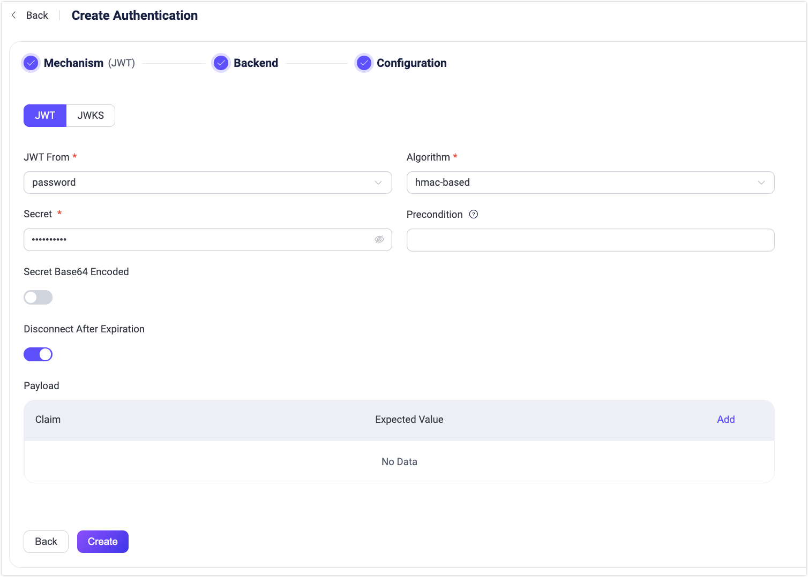
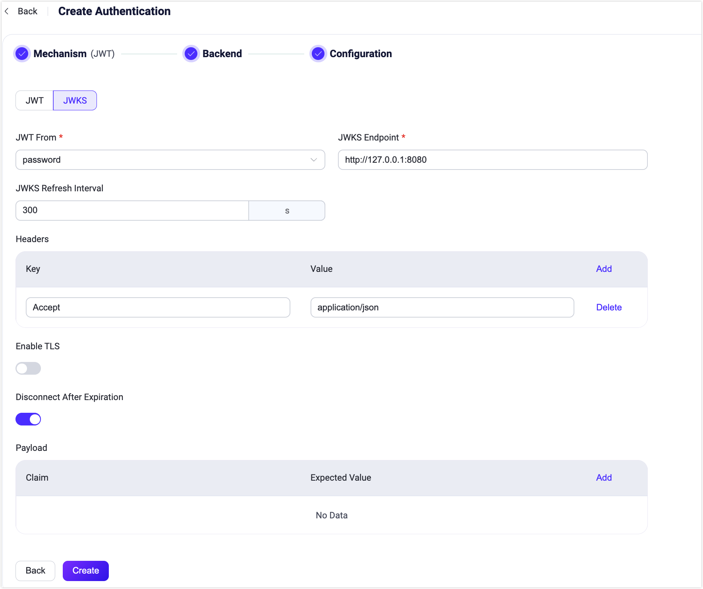

# JWT認証

[JSON Web Token (JWT)](https://jwt.io/) はトークンベースの認証機構です。サーバーがクライアントの認証情報やセッション情報を保持する必要がありません。EMQXはユーザー認証にJWTを使用することをサポートしています。

::: tip 前提条件

[EMQX認証の基本概念](./authn.md)の知識

:::

## 認証の原理

クライアントは接続リクエストにJWTを含め、EMQXは事前に設定されたシークレットまたは公開鍵を使ってJWTの署名を検証します。ユーザーがJWKSエンドポイントを設定している場合、JWT認証器はJWKSエンドポイントから取得した公開鍵リストを用いてJWTの署名を検証します。

署名検証に成功すると、JWT認証器はクレームの検証に進みます。JWT認証器は`iat`（発行時刻）、`nbf`（有効開始時刻）、`exp`（有効期限）などのクレームに基づいてJWTの有効性を積極的にチェックします。追加のカスタムクレームも検証対象として指定可能です。署名とクレームの両方の検証に成功した場合にのみ、クライアントはアクセスを許可されます。

EMQXバージョン5.7.0以降では、JWT認証にJWTの有効期限切れ後にクライアントを切断するオプションが追加されました。設定パラメータ`disconnect_after_expire`はデフォルトで`true`に設定されています。JWTの有効期限切れ後もクライアントを接続状態に保つには、このパラメータを`false`に設定してください。

## ベストプラクティス

JWT認証器は基本的にJWTの署名のみを検証するため、JWT認証器単体ではクライアントの正当性を保証しません。

ベストプラクティスとしては、独立した認証サーバーをデプロイし、クライアントはまず認証サーバーにアクセスして認証サーバーがクライアントの正当性を検証し、正当なクライアントに対してJWTを発行します。その後、クライアントは取得したJWTを使ってEMQXに接続します。

:::tip

JWTのペイロードはBase64エンコードされているだけなので、JWTを入手した誰でもBase64デコードにより元の情報を取得できます。そのため、JWTのペイロードに機密データを格納することは推奨されません。

JWTの漏洩や盗難のリスクを減らすために、適切な有効期限を設定し、クライアント接続を暗号化するTLSの有効化も推奨されます。

:::

## アクセス制御リスト（オプション）

アクセス制御リスト（ACL）は認証結果の拡張機能であり、ログイン後のクライアントの権限を制御します。JWTには`acl`フィールドを含めてクライアントの権限を指定できます。

詳細は[アクセス制御リスト（ACL）](./acl.md)をご参照ください。

## クライアント属性

EMQX v5.7.0以降では、JWTペイロードのオプションフィールド`client_attrs`を使って[クライアント属性](../../../develop/client-attributes/client-attributes.md)を設定できます。キーと値は両方とも文字列型である必要があります。

例：

```json
{
  "exp": 1654254601,
  "username": "emqx_u",
  "client_attrs": {
      "role": "admin",
      "sn": "10c61f1a1f47"
  }
}
```

## ダッシュボードでのJWT認証設定

1. 左側のナビゲーションメニューから **アクセス制御** -> **認証** を選択します。

2. **認証** ページの右上にある **作成** をクリックします。**メカニズム**として **JWT** を選択し、**次へ** をクリックします。バックエンドの選択はスキップして、**設定** タブに進みます。

   

3. 以下のオプションを設定します：

   - **JWT From**：クライアント接続リクエスト内のJWTの位置を指定します。`password` と `username` のいずれかを選択でき、MQTTクライアントの`CONNECT`パケット内の`Password`または`Username`フィールドに対応します。

   - **Algorithm**：JWTの暗号化アルゴリズムを指定します。選択肢は`hmac-based`と`public-key`で、それぞれ設定内容が異なります。

     - `hmac-based`：対称鍵を使ってJWTの署名生成と検証を行います。サポートされるアルゴリズムはHS256、HS384、HS512です。設定には以下が必要です：
       - `Secret`：署名検証に使う鍵で、署名生成時と同じものを指定します。
       - `Secret Base64 Encode`：`Secret`がBase64エンコードされているかどうかを設定し、EMQXが署名検証時に秘密鍵をデコードするかを決定します。

     - `public-key`：秘密鍵でJWTの署名を生成し、公開鍵で検証します。サポートされるアルゴリズムはRS256、RS384、RS512、ES256、ES384、ES512です。設定には以下が必要です：
        - `Public Key`：署名検証に使うPEM形式の公開鍵を指定します。

   - **Precondition**：[Variform式](../../configuration/configuration.md#variform-expressions)で、このJWT認証器をクライアント接続に適用するかどうかを制御します。クライアントの属性（`username`、`password`、`clientid`、`listener`など）に対して式が評価され、結果が文字列の"true"の場合のみ認証器が呼び出されます。そうでなければスキップされます。詳細は[認証器の前提条件](./authn.md#authenticator-preconditions)を参照してください。

     例：JWTクライアントとパスワード認証クライアントが同じ認証チェーンを使う場合、`is_jwt(password)`を使います。

     EMQX 6.2.3以降、`is_jwt(password)`はパスワードが構造的にJWTである場合にのみ`true`を返します。平文パスワード、未設定パスワード、不正な値は`false`を返し、EMQXはJWT認証器をスキップして次の認証器に処理を委ねます。構造的に有効なJWTで署名またはクレーム検証に失敗した場合はJWT認証器で処理され拒否されます。

   - **Disconnect After Expiration**：JWTの有効期限切れ後にクライアントを切断するかどうかを設定します。デフォルトで有効です。

   - **Payload**：ユーザーが追加で検証したいクレームを指定します。複数のキーと値のペアを**Claim**と**Expected Value**フィールドで定義でき、キーはJWT内のクレーム名と一致させる必要があります。値はクレームの実際の値と比較されます。現在サポートされているプレースホルダーは`${clientid}`と`${username}`です。

4. **作成** をクリックして設定を完了します。

EMQXはJWKSエンドポイントから最新のJWKSを定期的に取得することもサポートしています。JWKSは認可サーバーが発行しRSAまたはECDSAアルゴリズムで署名された任意のJWTを検証するための公開鍵の集合です。この機能を使う場合は、**JWKS**設定ページに切り替えてください。



JWKS固有の設定項目は以下の通りです：

- **JWKS Server**：EMQXがJWKSを問い合わせるサーバーのエンドポイントアドレスを指定します。GETリクエストをサポートし、仕様に準拠したJWKSを返す必要があります。
- **JWKS Refresh Interval**：JWKSの更新間隔、すなわちEMQXがJWKSを問い合わせる間隔を指定します。
- **Headers**：JWKSサーバーへのリクエストに含める必要がある追加のHTTPヘッダーを指定します。これにより、サーバーの要件に応じて適切にフォーマットされたリクエストが送信されます。キーと値のペアを追加可能です。例：
  - **Key**: `Accept`
  - **Value**: `application/json`

**作成** をクリックして設定を完了します。

<!-- ## 設定項目による設定

設定項目による設定も可能です。詳細な手順は[authn-jwt:*](../../configuration/configuration-manual.html#authn-jwt:hmac-based)を参照してください。 -->
