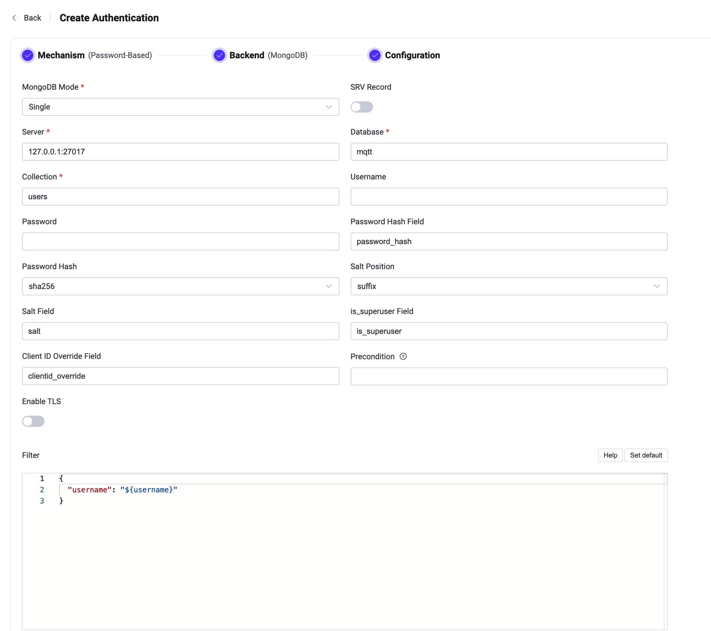

# MongoDBとの統合

EMQXはパスワード認証のためにMongoDBとの統合をサポートしています。EMQXのMongoDB認証機能は、現在、Single、[レプリカセット](https://www.mongodb.com/docs/manual/reference/replica-configuration/)、および[シャーディング](https://www.mongodb.com/docs/manual/sharding/)の3つの異なるモードで動作するMongoDBへの接続をサポートしています。本ページでは、サポートされるデータスキーマの詳細と、EMQXダッシュボードおよび設定ファイルでの設定方法について説明します。

::: tip

[基本的なEMQX認証の概念](./authn.md)についての知識

:::

## データスキーマとクエリ文

EMQXのMongoDB認証機能は、認証データをMongoDBドキュメントとして保存することをサポートしています。ユーザーはクエリ文のテンプレートを提供し、以下のフィールドが含まれていることを確認する必要があります。

- `password_hash`：必須。データベースに保存されるパスワード（プレーンテキストまたはハッシュ化されたもの）。このフィールドは名前の変更が可能です。
- `salt`：任意。`salt = ""` またはこのフィールドを削除すると、ソルト値が追加されないことを示します。このフィールドは名前の変更が可能です。
- `is_superuser`：任意。現在のクライアントがスーパーユーザーかどうかのフラグ。デフォルトは `false`。このフィールドは名前の変更が可能です。

例えば、ユーザー名が `user123`、パスワードが `secret`、サフィックスとしてのソルトが `salt_foo123`、パスワードハッシュが `sha256` のスーパーユーザー（`is_superuser`: `true`）のドキュメントを追加したい場合、クエリ文は以下のようになります。

```
> db.mqtt_user.insertOne(
  {
      "username": "emqx_u",
      "salt": "slat_foo123",
      "is_superuser": true,
      "password_hash": "44edc2d57cde8d79c98145003e105b90a14f1460b79186ea9cfe83942fc5abb5"
  }
);
{
  "acknowledged" : true,
  "insertedId" : ObjectId("631989e20a33e26b05b15abe")
}
```

:::tip

システム内のユーザー数が多い場合は、クエリ応答時間を短縮しEMQXへの負荷を軽減するために、事前にテーブルの最適化およびインデックス作成を行ってください。

:::

このMongoDBデータスキーマに対応するダッシュボードの設定パラメータは以下の通りです。

- **Password Hash**: `sha256`
- **Salt Position**: `suffix`
- **Collection**: `mqtt_user`
- **Filter**: `{ username = "${username}" }`
- **Password Hash field**: `password_hash`
- **Salt Field**: `salt`
- **is_superuser Field**： `is_superuser`

::: tip 読み取り専用のデータベース権限を付与する

EMQXはクライアント認証時にMongoDBへの読み取りアクセスのみを必要とします。設定されたコレクションに対して `find_one` クエリを1回実行し、ドキュメントの挿入、更新、削除は行いません。

MongoDBには組み込みの `read` ロールを持つ専用のデータベースユーザーを作成し、EMQXにそのユーザーを使用させてください。書き込みや管理者権限は付与しないでください。

```js
db.getSiblingDB("mqtt").createUser({
  user: "emqx_auth",
  pwd: "PASSWORD",
  roles: [ { role: "read", db: "mqtt" } ]
})
```

コレクションの作成やユーザーレコードの管理は別の管理ユーザーで行ってください。EMQX設定のデータベース認証情報が漏洩しても、読み取り専用ユーザーでは認証データの変更や削除はできません。

:::

## ダッシュボードでの設定

EMQXダッシュボードを使用して、MongoDBをパスワード認証に利用する設定が可能です。

1. EMQXダッシュボードの左側ナビゲーションメニューから **アクセス制御** -> **認証** をクリックします。
2. **認証** ページの右上にある **作成** をクリックします。
3. **メカニズム** に **パスワードベース** を選択し、**バックエンド** に **MongoDB** を選択すると、以下のように **設定** タブに遷移します。



4. 以下の手順に従って認証バックエンドを設定してください。

   - MongoDB接続情報を入力します：
     - **MongoDBモード**：MongoDBの展開形態を選択します。`Single`、`Replica Set`、`Sharding` があります。
     - **サーバー**：EMQXが接続するMongoDBサーバーのアドレスを指定します。**MongoDBモード**が `Replica Set` または `Sharding` の場合は、接続する全てのMongoDBサーバーをカンマ区切りで入力してください。
     - **レプリカセット名**：`Replica Set` モードの場合に指定するレプリカセット名。文字列型です。
     - **データベース**：MongoDBのデータベース名。文字列型です。
     - **コレクション**：認証ルールを保存するMongoDBコレクション名。文字列型です。
     - **ユーザー名**：MongoDBのユーザー名を指定します。
     - **パスワード**：MongoDBのユーザーパスワードを指定します。
     - **読み取りモード**（任意）：`Replica Set` モードの場合に指定。デフォルトは `master`。選択肢は `master`、`slave_ok`。
       - **master**：クエリはすべてマスター（プライマリ）サーバーから最新データを読み取ります。接続先がマスターでない場合、最初の読み取りが失敗し、その後の操作は中止されます。
       - **slave_ok**：セカンダリ（スレーブ）サーバーからの古いデータまたはマスターからの最新データの読み取りを許可します。
     - **書き込みモード**（任意）：`Replica Set` モードの場合に指定。選択肢は `unsafe`、`safe`。デフォルトは `safe`。

   - 認証に関する設定を行います：
     - **パスワードハッシュフィールド**：パスワードのフィールド名を指定します。
     - **パスワードハッシュ**：プレーンテキストパスワードに適用され、データベースに保存されるハッシュアルゴリズムを選択します。選択肢は `plain`、`md5`、`sha`、`sha256`、`sha512`、`bcrypt`、`pbkdf2` です。選択したアルゴリズムに応じて追加設定があります。
       - `md5`、`sha`、`sha256`、`sha512` の場合：
         - **ソルト位置**：ソルト（ランダムデータ）をパスワードにどのように混ぜるかを指定します。`suffix`（後置）、`prefix`（前置）、`disable`（無効）のいずれかです。外部ストレージからEMQX内蔵データベースにユーザー資格情報を移行する場合を除き、デフォルト値のままで問題ありません。
         - ハッシュ結果は16進数文字列として表現され、大文字小文字を区別せずに保存された資格情報と比較されます。
       - `plain` の場合：
         - **ソルト位置**：`disable` に設定してください。
       - `bcrypt` の場合：
         - **ソルトラウンド数**：ハッシュ関数を適用する回数を定義します。値は _2^ソルトラウンド数_ で表され、「コストファクター」とも呼ばれます。デフォルトは `10`、許容範囲は `5` から `10` です。セキュリティを高めるためには高い値が推奨されます。注意：コストファクターを1増やすと認証にかかる時間が約2倍になります。
       - `pbkdf2` の場合：
         - **疑似乱数関数**：鍵生成に用いるハッシュ関数を選択します（例：`sha256`）。
         - **反復回数**：ハッシュ関数の実行回数を設定します。デフォルトは `4096`。
         - **派生鍵長**（任意）：生成される鍵の長さ（バイト単位）を指定します。空欄の場合は疑似乱数関数により決定される長さになります。
         - ハッシュ結果は16進数文字列として表現され、大文字小文字を区別せずに保存された資格情報と比較されます。
     - **ソルトフィールド**：MongoDB内のソルトフィールドを指定します。
     - **is_superuserフィールド**：ユーザーがスーパーユーザーかどうかを判定するフィールドを指定します。
     - **クライアントID上書きフィールド**：MongoDB認証結果内のフィールド名を指定し、MQTTクライアント接続のクライアントIDを上書きします。これにより認証データに基づいてユニークなクライアントIDを割り当て、多重テナントなどのセッション競合を防止できます。
     - **前提条件**：[Variform式](../../configuration/configuration.md#variform-expressions)を用いて、このMongoDB認証機能をクライアント接続に適用するかどうかを制御します。式はクライアントの属性（`username`、`clientid`、`listener`など）に対して評価され、結果が文字列 `"true"` の場合のみ認証機能が呼び出されます。それ以外はスキップされます。詳細は[認証機能の前提条件](./authn.md#authenticator-preconditions)を参照してください。
     - **TLSを有効化**：TLSを有効にする場合はトグルスイッチをオンにします。TLS有効化の詳細は[ネットワークとTLS](../../network/overview.md)を参照してください。
     - **フィルター**：認証情報検索のためのMongoDBセレクターとして解釈されるマップ。[プレースホルダー](./authn.md#authentication-placeholders)が利用可能です。
     - **詳細設定**：以下の任意の接続設定を行います。
       - **認証ソース**：ユーザー認証資格情報が保存されているMongoDBデータベース名を指定します。例：ユーザーが `admin` データベースで作成されている場合は `admin` を入力します。
       - **レガシープロトコルを使用**：EMQXがMongoDBのレガシープロトコルを使用する方法を選択します。`auto` はサーバーがサポートするプロトコルを自動検出、`true` はレガシープロトコルを使用、`false` は使用しません。デフォルトは `auto`。
       - **接続プールサイズ**：EMQXノードからMongoDBサーバーへの同時接続数を指定します。デフォルトは `8`。
       - **接続タイムアウト**：接続確立までの待機時間を指定します。単位はミリ秒、秒、分、時間がサポートされています。デフォルトは `20` 秒。

5. 設定が完了したら、**作成** をクリックしてください。

## 設定項目による構成

EMQXのMongoDB認証機能は、設定項目によっても構成可能です。 <!--詳細な操作手順は [authn-mongodb:standalone](../../configuration/configuration-manual.html#authn-mongodb:standalone)、[authn-mongodb:sharded-cluster](../../configuration/configuration-manual.html#authn-mongodb:sharded-cluster)、[authn-mongodb:replica-set](../../configuration/configuration-manual.html#authn-mongodb:replica-set) を参照してください。-->

以下は参考となるコード例です。

:::: tabs type:card

::: tab Single mode

```bash
{
  mechanism = password_based
  backend = mongodb

  password_hash_algorithm {
    name = sha256
    salt_position = suffix
  }

  collection = "mqtt_user"
  filter { username = "${username}" }

  mongo_type = single
  server = "127.0.0.1:27017"

  database = "mqtt"
  username = "emqx"
  password = "secret"
}
```

:::

::: tab Replica set

```bash
{
  mechanism = password_based
  backend = mongodb

  password_hash_algorithm {
    name = sha256
    salt_position = suffix
  }

  collection = "mqtt_user"
  filter { username = "${username}" }

  mongo_type = rs
  servers = "10.123.12.10:27017,10.123.12.11:27017,10.123.12.12:27017"
  replica_set_name = "rs0"

  database = "mqtt"
  username = "emqx"
  password = "secret"
}
```

:::

::: tab Sharding

```bash
{
  mechanism = password_based
  backend = mongodb
  enable = true

  password_hash_algorithm {
    name = sha256
    salt_position = suffix
  }

  collection = "mqtt_user"
  filter { username = "${username}" }

  mongo_type = sharded
  servers = "10.123.12.10:27017,10.123.12.11:27017,10.123.12.12:27017"

  database = "mqtt"
  username = "emqx"
  password = "secret"
}
```

:::

::::
