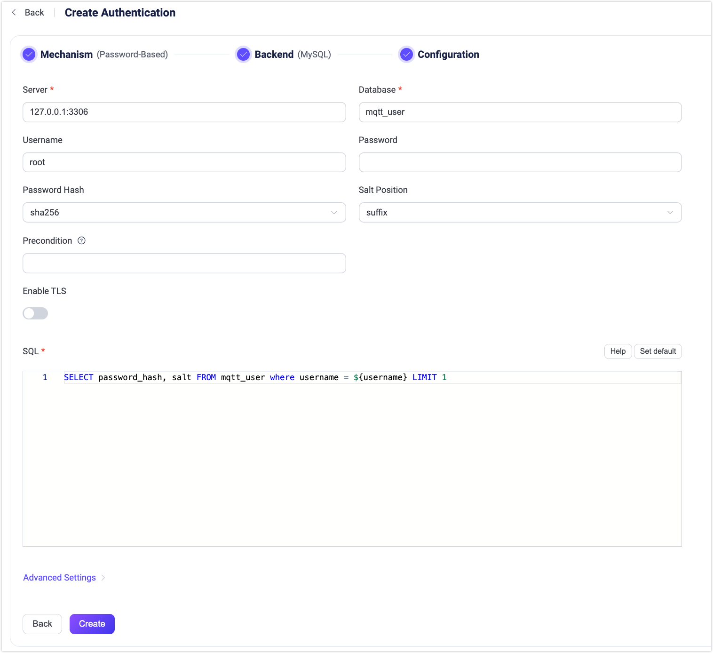

# MySQLとの統合

EMQXはパスワード認証のためにMySQLとの統合をサポートしています。

::: tip

[基本的なEMQX認証の概念](../authn/authn.md)についての知識

:::

## データスキーマとクエリ文

MySQL認証機能はほぼすべてのMySQLストレージスキーマに対応しています。認証情報の保存方法やアクセス方法は、ビジネスニーズに応じて、単一または複数のテーブル、ビューなどを利用して決定できます。

ユーザーはクエリ文のテンプレートを提供し、以下のフィールドが含まれていることを確認してください。

- `password_hash`：必須。データベースに保存されているパスワード（プレーンテキストまたはハッシュ化されたもの）。
- `salt`：任意。`salt = ""` またはこのフィールドを削除することで、ソルト値が追加されないことを示します。
- `is_superuser`：任意。現在のクライアントがスーパーユーザーかどうかを示すフラグ。デフォルトは `false`。

認証情報を保存するためのテーブル構造の例：

```sql
CREATE TABLE `mqtt_user` (
  `id` int(11) unsigned NOT NULL AUTO_INCREMENT,
  `username` varchar(100) DEFAULT NULL,
  `password_hash` varchar(100) DEFAULT NULL,
  `salt` varchar(35) DEFAULT NULL,
  `is_superuser` tinyint(1) DEFAULT 0,
  `created` datetime DEFAULT NULL,
  PRIMARY KEY (`id`),
  UNIQUE KEY `mqtt_username` (`username`)
) ENGINE=InnoDB DEFAULT CHARSET=utf8mb4;
```

::: tip
上記の例では、クエリに役立つ暗黙の`UNIQUE`インデックスフィールド（username）が作成されています。
システム内のユーザー数が多い場合は、クエリの応答時間を短縮し、EMQXの負荷を軽減するために、事前にテーブルの最適化とインデックス作成を行ってください。
:::

このテーブルでは、MQTTユーザーは`username`で識別されます。

例えば、スーパーユーザー（`is_superuser`: `true`）として、ユーザー名`emqx_u`、パスワード`public`、サフィックスのソルト`salt_foo123`、パスワードハッシュ`sha256`を追加する場合、クエリ文は以下のようになります。

```bash
mysql> INSERT INTO mqtt_user(username, password_hash, salt, is_superuser) VALUES ('emqx_u', SHA2(concat('public', 'slat_foo123'), 256), 'slat_foo123', 1);
Query OK, 1 row affected (0,01 sec)
```

対応する設定パラメータは以下の通りです。

```sql
password_hash_algorithm {
    name = sha256
    salt_position = suffix
}

query = "SELECT password_hash, salt, is_superuser FROM mqtt_user WHERE username = ${username} LIMIT 1"
```

::: tip 読み取り専用データベース権限の付与

EMQXはクライアント認証時にデータベースへの読み取りアクセスのみを必要とします。`query`は`SELECT`文として設定してください。EMQXはこのクエリをプリペアドステートメントとして実行します。

EMQXが使用するデータベースアカウントには、クエリが読み取るテーブルに対する`SELECT`権限のみを付与し、書き込みや管理権限は付与しないでください。

```sql
GRANT SELECT ON mqtt.mqtt_user TO 'emqx_auth'@'%';
```

テーブル作成やユーザー管理は別の管理用アカウントで行ってください。EMQX設定のデータベース認証情報が漏洩しても、読み取り専用アカウントでは認証データの変更や削除はできません。
:::

## ダッシュボードでの設定

EMQXダッシュボードを使ってMySQLをパスワード認証に利用する設定が可能です。

1. EMQXダッシュボードの左側ナビゲーションメニューから **アクセス制御** -> **認証** をクリックします。
2. **認証** ページの右上にある **作成** をクリックします。
3. **メカニズム**に **パスワードベース**、**バックエンド**に **MySQL** を選択し、**設定**タブに進みます。以下のように表示されます。



4. 以下の手順に従って認証バックエンドを設定してください。

   - **接続**：MySQLへの接続情報を入力します。

     - **サーバー**：EMQXが接続するサーバーのアドレス（`host:port`）を指定します。

     - **データベース**：MySQLのデータベース名。

     - **ユーザー名**：ユーザー名を指定します。

     - **パスワード**：ユーザーパスワードを指定します。
   
   
      - **認証設定**：認証に関する設定を行います。
        - **パスワードハッシュ**：プレーンテキストのパスワードに適用し、結果をデータベースに保存する際のハッシュアルゴリズムを選択します。選択肢は`plain`、`md5`、`sha`、`sha256`、`sha512`、`bcrypt`、`pbkdf2`です。選択したアルゴリズムによって追加設定が異なります。
          - `md5`、`sha`、`sha256`、`sha512`の場合：
            - **ソルト位置**：ソルト（ランダムデータ）をパスワードにどのように混ぜるかを指定します。`suffix`、`prefix`、`disable`のいずれかです。外部ストレージからEMQX組み込みデータベースにユーザー認証情報を移行する場合を除き、デフォルト値のままで問題ありません。
            - ハッシュ結果は16進数文字列で表され、大文字小文字を区別せずに保存された認証情報と比較されます。
          - `plain`の場合：
            - **ソルト位置**は`disable`に設定してください。
          - `bcrypt`の場合：
            - **ソルトラウンド**：ハッシュ関数の適用回数を2の累乗で表す「コストファクター」です。デフォルトは`10`で、許容範囲は`5`から`10`です。セキュリティ向上のため値を大きくすることが推奨されます。コストファクターを1増やすと認証にかかる時間が約2倍になります。
          - `pbkdf2`の場合：
            - **疑似乱数関数**：キー生成に使用するハッシュ関数を選択します（例：`sha256`）。
            - **イテレーション回数**：ハッシュ関数の実行回数。デフォルトは`4096`です。
            - **派生キー長**（任意）：生成されるキーのバイト長。空欄の場合は疑似乱数関数により決定される長さになります。
            - ハッシュ結果は16進数文字列で表され、大文字小文字を区別せずに保存された認証情報と比較されます。
   
      - **前提条件**：[Variform式](../../configuration/configuration.md#variform-expressions)を使用し、このMySQL認証機能をクライアント接続に適用するか制御します。式はクライアントの属性（`username`、`clientid`、`listener`など）に対して評価され、結果が文字列の`"true"`の場合にのみ認証機能が呼び出されます。そうでなければスキップされます。詳細は[認証機能の前提条件](./authn.md#authenticator-preconditions)をご覧ください。
   
   
      - **TLSを有効化**：TLSを有効にする場合はトグルスイッチをオンにします。TLS有効化の詳細は[ネットワークとTLS](../../network/overview.md#tls-for-external-resource-access)をご参照ください。
   
   
      - **SQL**：データスキーマに従ってクエリ文を入力します。詳細は[SQLデータスキーマとクエリ文](#sql-table-structure-and-query-statement)をご覧ください。
   
   
      - **詳細設定**：接続プール、タイムアウト、プリペアドステートメントの動作を設定します。
        - **接続プールサイズ**（任意）：EMQXノードからMySQLへの同時接続数を整数で指定します。デフォルトは`8`です。
        - **クエリタイムアウト**（任意）：EMQXがクエリのタイムアウトと判断するまでの待機時間を指定します。単位はミリ秒、秒、分、時間が利用可能です。デフォルトは`5`秒です。
        - **接続タイムアウト**（任意）：EMQXが接続試行のタイムアウトと判断するまでの待機時間を指定します。単位はミリ秒、秒、分、時間が利用可能です。デフォルトは`15`秒です。
        - **プリペアドステートメントを無効化**（任意）：データベースクエリでプリペアドステートメントの使用を無効にします。MySQLプロキシやミドルウェア（例：PGBouncerやSupabaseのトランザクションモード）がセッションレベルの機能（プリペアドステートメントなど）をサポートしない場合に有効にしてください。デフォルトは無効です。
   
5. 設定が完了したら、**作成**をクリックします。

## 設定項目による構成

EMQXの設定項目を使ってMySQL認証機能を構成できます。設定パラメータの完全な一覧は[EMQX Enterprise設定マニュアル](https://docs.emqx.com/en/enterprise/v@EE_VERSION@/hocon/)をご参照ください。

MySQL認証は`mechanism = password_based`かつ`backend = mysql`で識別されます。

設定例：

```bash
{
  backend = "mysql"
  mechanism = "password_based"

  server = "127.0.0.1:3306"
  username = "root"
  database = "mqtt_user"
  password = ""
  pool_size = 8

  password_hash_algorithm {name = "sha256", salt_position = "suffix"}
  query = "SELECT password_hash, salt FROM mqtt_user where username = ${username} LIMIT 1"
  query_timeout = "5s"
  connect_timeout = "15s"
  disable_prepared_statements = false
}
```
