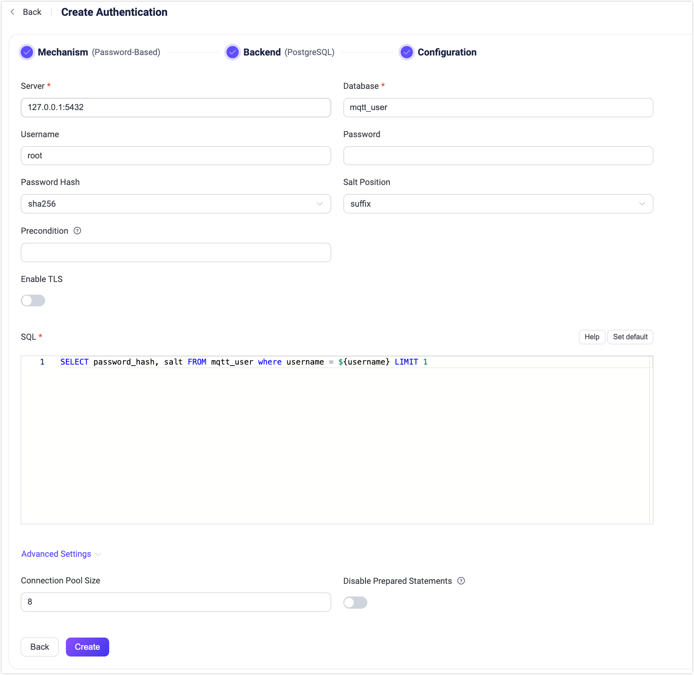

# PostgreSQLとの統合

EMQXは、パスワード認証のためにPostgreSQLとの統合をサポートしています。

::: tip

[基本的なEMQX認証の概念](./authn.md)についての知識

:::

## データスキーマとクエリ文

EMQXのPostgreSQL認証機能は、ほぼあらゆるストレージスキーマに対応しています。認証情報の保存方法やアクセス方法は、ビジネスニーズに応じて、単一または複数のテーブル、ビューなどを使用して自由に決定できます。

ユーザーはクエリ文のテンプレートを提供し、以下のフィールドが含まれていることを確認する必要があります。

- `password_hash`：必須。データベースに保存されているパスワード（プレーンテキストまたはハッシュ化されたもの）。
- `salt`：任意。`salt = ""` またはこのフィールドを削除すると、ソルト値が追加されないことを示します。
- `is_superuser`：任意。現在のクライアントがスーパーユーザーかどうかを示すフラグ。デフォルトは `false`。

認証情報を保存するためのテーブル構造の例：

```sql
CREATE TABLE mqtt_user (
    id serial PRIMARY KEY,
    username text NOT NULL UNIQUE,
    password_hash  text NOT NULL,
    salt text NOT NULL,
    is_superuser boolean DEFAULT false,
    created timestamp with time zone DEFAULT NOW()
);
```

::: tip
上記の例では、クエリに役立つ暗黙の `UNIQUE` インデックス（username）が作成されています。
システム内のユーザー数が多い場合は、クエリの応答時間を短縮し、EMQXの負荷を軽減するために、事前にテーブルの最適化やインデックス付けを行ってください。
:::

このテーブルでは、MQTTユーザーは `username` で識別されます。

例えば、スーパーユーザー（`is_superuser`: `true`）で、ユーザー名が `user123`、パスワードが `secret`、ソルトが `salt` のドキュメントを追加したい場合、クエリ文は以下のようになります。

```bash
INSERT INTO mqtt_user(username, password_hash, salt, is_superuser) VALUES ('user123', 'f84fa2149dbb62ed4e0cf1f550d2949b33a6513d3a7707e08502511c79ccb0ee', 'salt', true);
INSERT 0 1
```

対応する設定パラメータは以下の通りです。

- password_hash_algorithm: `sha256`
- salt_position: `suffix`

SQL:

```sql
query = "SELECT password_hash, salt, is_superuser FROM mqtt_user WHERE username = ${username} LIMIT 1"
```

::: tip 読み取り専用データベース権限の付与

EMQXはクライアント認証時にデータベースへの読み取りアクセスのみを必要とします。`query`は`SELECT`文として設定してください。EMQXはこのクエリをプリペアドステートメントとして実行します。

EMQXが使用するデータベースアカウントには、クエリが参照するテーブルに対する`SELECT`権限のみを付与し、書き込みや管理権限は付与しないでください。

```sql
GRANT USAGE ON SCHEMA public TO emqx_auth;
GRANT SELECT ON mqtt_user TO emqx_auth;
```

テーブルの作成やユーザー管理は別の管理用アカウントで行ってください。EMQX設定内のデータベース認証情報が漏洩しても、読み取り専用アカウントでは認証データの変更や削除はできません。
:::

## ダッシュボードでの設定

EMQXダッシュボードを使って、PostgreSQLをパスワード認証に利用する設定ができます。

1. EMQXダッシュボードの左側ナビゲーションメニューから **アクセス制御** -> **認証** をクリックします。
2. **認証** ページの右上にある **作成** をクリックします。
3. **メカニズム**で **Password-Based** を選択し、**バックエンド**で **PostgreSQL** を選択すると、以下のように **設定** タブが表示されます。



4. 以下の手順に従って認証バックエンドを設定します：
   - PostgreSQLへの接続情報を入力します。

     - **サーバー**：EMQXが接続するサーバーのアドレス（`host:port`）を指定します。
     - **データベース**：PostgreSQLのデータベース名。
     - **ユーザー名**：ユーザー名を指定します。
     - **パスワード**：ユーザーパスワードを指定します。
   - 認証に関する設定を行います：
     - **パスワードハッシュ**：プレーンテキストのパスワードをデータベースに保存する前に適用するハッシュアルゴリズムを選択します。選択肢は `plain`、`md5`、`sha`、`sha256`、`sha512`、`bcrypt`、`pbkdf2` です。選択したアルゴリズムによって追加設定が異なります。
       - `md5`、`sha`、`sha256`、`sha512` の場合：
         - **ソルト位置**：ソルト（ランダムデータ）をパスワードにどのように混ぜるかを指定します。`suffix`、`prefix`、`disable` のいずれかです。外部ストレージからEMQX組み込みデータベースにユーザー認証情報を移行する場合を除き、デフォルト値のままで問題ありません。
         - 生成されるハッシュは16進数文字列で表され、大文字小文字を区別せずに保存された認証情報と比較されます。
       - `plain` の場合：
         - **ソルト位置**は `disable` にしてください。
       - `bcrypt` の場合：
         - **ソルトラウンド数**：ハッシュ関数を適用する回数を、2のべき乗（2^ソルトラウンド数）で表します。デフォルトは `10`、許容範囲は `5` から `10` です。セキュリティ強化のために値を大きくすることが推奨されます。注意：コストファクターを1増やすごとに認証にかかる時間が倍増します。
       - `pbkdf2` の場合：
         - **疑似乱数関数**：キー生成に用いるハッシュ関数を選択します（例：`sha256`）。
         - **反復回数**：ハッシュ関数を実行する回数。デフォルトは `4096`。
         - **導出キー長**（任意）：生成されるキーのバイト長。空欄の場合は疑似乱数関数により決定される長さになります。
         - 生成されるハッシュは16進数文字列で表され、大文字小文字を区別せずに保存された認証情報と比較されます。
   - **前提条件**：[Variform式](../../configuration/configuration.md#variform-expressions)で記述し、このPostgreSQL認証機能をクライアント接続に適用するか制御します。式はクライアントの属性（`username`、`clientid`、`listener`など）に対して評価され、結果が文字列 `"true"` の場合のみ認証機能が呼び出されます。詳細は[認証機能の前提条件](./authn.md#authenticator-preconditions)を参照してください。
   - **TLSを有効化**：TLSを有効にする場合はスイッチをオンにします。TLSの有効化方法は[ネットワークとTLS](../../network/overview.md)を参照してください。
   - **詳細設定**：
     - **接続プールサイズ**（任意）：EMQXノードからPostgreSQLサーバーへの同時接続数を指定します。デフォルトは `8`。
     - **プリペアドステートメントを無効化**（任意）：トランザクションモードのPGBouncerやSupabaseなど、プリペアドステートメントをサポートしないPostgreSQLサービスを利用する場合に有効にします。このオプションはEMQX v5.7.1で追加されました。
   - **SQL**：データスキーマに合わせてクエリ文を入力します。詳細は[SQLデータスキーマとクエリ文](#データスキーマとクエリ文)を参照してください。

設定が完了したら、**作成** をクリックします。

## 設定項目による設定

EMQXの設定項目を使ってPostgreSQL認証機能を設定できます。 <!--詳細な操作手順は[authn-postgresql:authentication](../../configuration/configuration-manual.html#authn-postgresql:authentication)を参照してください。-->

PostgreSQL認証は、`mechanism = password_based` と `backend = postgresql` で識別されます。

設定例：

```bash
{
  mechanism = password_based
  backend = postgresql

  password_hash_algorithm {
    name = sha256
    salt_position = suffix
  }

  database = mqtt
  username = postgres
  password = public
  server = "127.0.0.1:5432"
  query = "SELECT password_hash, salt, is_superuser FROM users where username = ${username} LIMIT 1"
}
```
