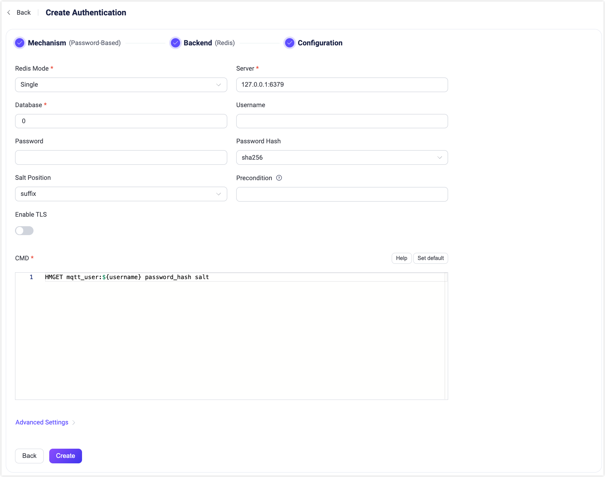

# Redisとの連携

EMQXはパスワード認証のためにRedisとの連携をサポートしています。EMQXのRedis認証機能は、Single、[Redis Sentinel](https://redis.io/docs/latest/operate/oss_and_stack/management/sentinel/)、および[Redis Cluster](https://redis.io/docs/latest/operate/oss_and_stack/management/scaling/)の3つの異なるモードで動作するRedisに接続可能です。本セクションでは、サポートされるデータスキーマの詳細と、EMQXダッシュボードおよび設定ファイルでの設定方法について説明します。

::: tip 前提条件：

[EMQX認証の基本概念](./authn.md)についての知識

:::

## データスキーマとクエリ文

Redis認証は、あらかじめ定義されたフィールド名を持つ[Redisハッシュ](https://redis.io/docs/latest/develop/data-types/hashes/)として保存された認証情報を用いて動作します。

- `password_hash`：必須；データベースに保存されるパスワード（平文またはハッシュ化済み）；
- `salt`：任意；`salt = ""` またはこのフィールドを削除するとソルト値なしを示す；
- `is_superuser`：任意；現在のクライアントがスーパーユーザーかどうかのフラグ；デフォルトは `false`。

例えば、ユーザー名 `user123`、パスワード `secret`、接頭辞としてのソルト `salt`、パスワードハッシュ `sha256` を持つスーパーユーザー（`is_superuser`: `true`）のドキュメントを追加する場合、クエリ文は以下のようになります。

```bash
>redis-cli
127.0.0.1:6379> HSET mqtt:user123 is_superuser 1 salt salt password_hash ac63a624e7074776d677dd61a003b8c803eb11db004d0ec6ae032a5d7c9c5caf
(integer) 3
```

対応する設定パラメータは以下の通りです。

```
password_hash_algorithm {
    name = sha256
    salt_position = prefix
}

cmd = "HMGET mqtt:${username} password_hash salt is_superuser"
```

::: tip
`password_hash` という名前はハッシュ化されたパスワードの保存を推奨するために使われています。しかし、RedisにはMySQLのような `as` 構文がないため、EMQX 5.0では互換性を保つためにEMQX 4.xで使われていた `password` フィールドもサポートしています。

したがって、`cmd` を `HMGET mqtt:${username} password salt is_superuser` と設定することも可能です。
:::

::: tip 読み取り専用のデータベース権限を付与する

EMQXはクライアント認証時にRedisへの読み取りアクセスのみを必要とします。`cmd` で許可されるコマンドは `HGET` と `HMGET` のみであり、その他のコマンドは拒否されるため、認証時にRedisへの書き込みは行いません。

Redis 6.0以降では、EMQX用に専用ユーザーを設定してください。ユーザーにはEMQXが実行するヘルスチェックおよびクエリコマンドと、`cmd` で読み取るキーのみのアクセス権を制限します。

```bash
redis-cli ACL SETUSER emqx_auth reset on '>PASSWORD' '~mqtt:*' +ping +hget +hmget
```

Redis Clusterの場合、EMQXはハッシュスロットとRedisノード間のマッピングを取得・更新するために `CLUSTER SLOTS` コマンドを実行するため、`+cluster|slots` 権限も付与してください。

```bash
redis-cli ACL SETUSER emqx_auth '+cluster|slots'
```

SingleまたはSentinelモードで、`database` が0以外に設定されている場合、EMQXは接続後に `SELECT` コマンドを実行するため、Redisデータノードユーザーに `+select` 権限を付与してください。デフォルトのデータベース0を使用する場合は不要です。

SentinelモードでSentinelノードに認証が有効な場合は、Sentinel接続用の認証情報を `sentinel_username` と `sentinel_password` で設定してください。これらはRedisデータノード接続用の `username` と `password` とは別の認証情報です。

ユーザー情報の管理には別の管理ユーザーを使用してください。EMQX設定内のRedis認証情報が漏洩しても、読み取り専用ユーザーでは認証データの変更や削除はできません。
:::

## ダッシュボードでの設定

EMQXダッシュボードを使ってRedisをパスワード認証に利用する設定が可能です。

1. EMQXダッシュボードの左ナビゲーションメニューから **アクセス制御** -> **認証** をクリックします。
2. **認証** ページの右上にある **作成** をクリックします。
3. **メカニズム** に **パスワードベース** を選択し、**バックエンド** に **Redis** を選択して、**設定** タブに進みます。以下のように表示されます。



以下の指示に従って認証の設定を行ってください。

**接続**：Redisへの接続情報を入力します。

- **Redisモード**：Redisの展開形態を選択します。`Single`、`Sentinel`、`Cluster` から選択可能です。

- **サーバー**：EMQXが接続するRedisサーバーのアドレスを指定します。**Redisモード** が `Sentinel` または `Cluster` の場合、接続するすべてのRedisサーバーをカンマ区切りで入力してください。

- **Sentinel名**：使用する名前を指定します。文字列型で、**Redisモード** が `Sentinel` の場合のみ必要です。

- **データベース**：Redisのデータベース名。文字列型です。

- **ユーザー名**：Redis接続に使用するユーザー名を指定します。このフィールドはRedis 6.0以降で導入された[Redis ACL](https://redis.io/docs/latest/operate/oss_and_stack/management/security/acl/#create-and-edit-user-acls-with-the-acl-setuser-command)を使用している場合に必須です。Redisサーバーがデフォルトユーザー（ACL無効または未適用）を使用している場合は空欄のままで構いません。

  ::: tip

  `username` フィールドはEMQX 5.2.0以降でサポートされています。Redis ACLを利用する場合はこのバージョン以降を使用してください。

  :::

- **パスワード**：Redisユーザーのパスワードを指定します。認証が有効なRedisインスタンスに接続する場合は必須です。

  - ユーザー名を入力した場合、このパスワードはRedis ACL設定に合わせてください。
  - ユーザー名が未入力の場合、このパスワードは `default` ユーザーの認証に使用されます（有効な場合）。


**TLS設定**：TLSを有効にする場合はスイッチをオンにします。TLS有効化の詳細は[ネットワークとTLS](../../network/overview.md)を参照してください。

**接続設定**：同時接続数を設定します。

- **プールサイズ**（任意）：EMQXノードからRedisサーバーへの同時接続数を指定します。デフォルトは `8` です。

**認証設定**：認証に関する設定を行います。

- **パスワードハッシュ**：平文パスワードに適用し、データベースに保存する前のハッシュアルゴリズムを選択します。利用可能なオプションは `plain`、`md5`、`sha`、`sha256`、`sha512`、`bcrypt`、`pbkdf2` です。選択したアルゴリズムによって追加設定が異なります。
  - `md5`、`sha`、`sha256`、`sha512` の場合：
    - **ソルト位置**：ソルト（ランダムデータ）をパスワードにどのように混ぜるかを指定します。`suffix`、`prefix`、`disable` のいずれかです。外部ストレージからユーザー認証情報を移行する場合を除き、デフォルト値のままで問題ありません。
    - ハッシュ結果は16進数文字列で表され、大文字小文字を区別せずに保存された認証情報と比較されます。
  - `plain` の場合：
    - **ソルト位置** は `disable` にしてください。
  - `bcrypt` の場合：
    - **ソルトラウンド**：ハッシュ関数の適用回数を定義します。値は _2^ソルトラウンド_ で表され、「コストファクター」とも呼ばれます。デフォルトは `10`、許容範囲は `5` から `10` です。セキュリティ強化のためには高い値を推奨します。なお、コストファクターを1増やすと認証にかかる時間が倍になります。
  - `pbkdf2` の場合：
    - **疑似乱数関数**：キー生成に使用するハッシュ関数を選択します（例：`sha256`）。
    - **反復回数**：ハッシュ関数の実行回数を設定します。デフォルトは `4096` です。
    - **派生キー長**（任意）：生成されるキーのバイト長を指定します。空欄の場合は疑似乱数関数により決定される長さになります。
    - ハッシュ結果は16進数文字列で表され、大文字小文字を区別せずに保存された認証情報と比較されます。
- **CMD**：Redisクエリコマンド。

設定が完了したら、**作成** をクリックしてください。

## 設定項目による設定

EMQXの設定項目を使ってRedis認証機能を設定できます。 <!--詳細な操作手順は [authn-redis:standalone](../../configuration/configuration-manual.html#authn-redis:standalone)、[authn-redis:sentinel](../../configuration/configuration-manual.html#authn-redis:sentinel)、および [authn-redis:cluster](../../configuration/configuration-manual.html#authn-redis:cluster) を参照してください。-->

Redis認証は `mechanism = password_based` と `backend = redis` で識別されます。

EMQXは3種類のRedisインストール形態に対応しています。

:::: tabs type:card

::: tab Standalone Redis

```bash
{
  mechanism = password_based
  backend = redis

  redis_type = single
  server = "127.0.0.1:6379"

  password_hash_algorithm {
      name = sha256
      salt_position = suffix
  }

  cmd = "HMGET mqtt_user:${username} password_hash salt is_superuser"
  database = 1
  password = "public"
  auto_reconnect = true
}
```

:::

::: tab Redis Sentinel

```bash
{
  mechanism = password_based
  backend = redis

  redis_type = sentinel
  servers = "10.123.13.11:6379,10.123.13.12:6379"
  sentinel = "mymaster"

  password_hash_algorithm {
      name = sha256
      salt_position = suffix
  }

  cmd = "HMGET mqtt_user:${username} password_hash salt is_superuser"
  database = 1
  password = "public"
  auto_reconnect = true
}
```

:::

::: tab Redis Cluster

```bash
{
  mechanism = password_based
  backend = redis

  redis_type = cluster
  servers = "10.123.13.11:6379,10.123.13.12:6379"

  password_hash_algorithm {
      name = sha256
      salt_position = suffix
  }

  cmd = "HMGET mqtt_user:${username} password_hash salt is_superuser"
  password = "public"
  auto_reconnect = true
}
```

:::

::::
