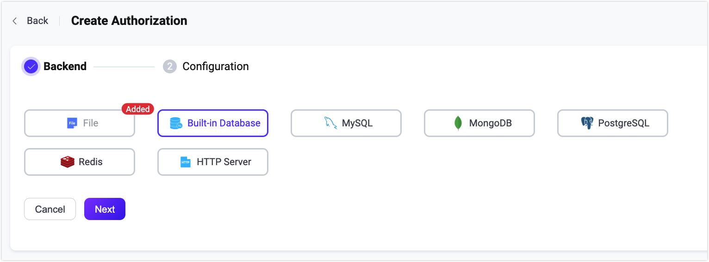

# 認可

EMQXにおける認可とは、MQTTクライアントのパブリッシュ／サブスクライブ操作に対する権限管理を指します。クライアントがパブリッシュ／サブスクライブ操作を行う際、EMQXは特定の手順に従うか、ユーザー指定のクエリ文を使用して、設定されたデータソースからクライアントの権限リストを照会します。照会結果に基づき、EMQXは現在の操作を許可または拒否します。

クライアントの単一の権限データは以下の要素で構成されます：

| **権限**       | **クライアント**           | **操作**                            | **操作の詳細**                |
| -------------- | -------------------------- | ---------------------------------- | ----------------------------- |
| Allow/Deny     | クライアントID／ユーザー名／IP | パブリッシュ／サブスクライブ／パブリッシュ-サブスクライブ | トピック／QoS／保持メッセージ |

::: tip
EMQX 5.1.1以降、操作の詳細におけるQoSおよび保持メッセージのチェックがサポートされています。
:::

クライアントの権限リストは、事前に特定のデータソース（データベース、ファイルなど）に保存しておく必要があります。対応するデータレコードを更新することで、実行時にリストを更新可能です。更新されたルールの適用タイミングについては、[認可ルールの変更が反映されるタイミング](#when-authorization-rule-changes-take-effect)を参照してください。

EMQXではデフォルトでファイルベースのオーソライザーが設定されており、直接利用可能です。認可はACLファイルに設定された事前定義ルールに基づいて処理されます。

## データストレージオブジェクトとの統合

EMQXの認可機構は、組み込みデータベース、ファイル、MySQL、PostgreSQL、MongoDB、Redisなど、さまざまなデータストレージオブジェクトとの統合をサポートしています。権限データはREST APIまたはEMQXダッシュボードを通じて管理可能です。<!-- CSVやJSONファイルを用いたバッチインポートは現時点でサポートされていません。-->

さらに、EMQXはユーザーが開発したHTTPサービスにも接続でき、多様な認可要件に対応可能です。

使用するバックエンドデータストレージに応じて、以下のように異なるタイプのEMQXオーソライザーがあります。各オーソライザーには独自の設定オプションがあり、表中のリンクから詳細を確認できます。

| データベース       | 説明                                                         |
| ------------------ | ------------------------------------------------------------ |
| ACLファイル         | [ファイルに設定された静的ルールによる認可](./file.md)         |
| 組み込みデータベース | [組み込みデータベースをルールストレージとした認可](./mnesia.md) |
| MySQL              | [MySQLをルールストレージとした認可](./mysql.md)               |
| PostgreSQL         | [PostgreSQLをルールストレージとした認可](./postgresql.md)     |
| MongoDB            | [MongoDBをルールストレージとした認可](./mongodb.md)           |
| Redis              | [Redisをルールストレージとした認可](./redis.md)               |
| LDAP               | [LDAPディレクトリをルールストレージとした認可](./ldap.md)      |
| HTTP               | [外部HTTPサービスによる認可](./http.md)                       |

以下はEMQXのMySQLオーソライザーの設定例です。

例：

```bash
{

    type = mysql
    database = "mqtt"
    username = "root"
    password = "public"

    query = "SELECT permission, action, topic FROM mqtt_acl WHERE username = ${username}"
    server = "10.12.43.12:3306"
}
```

## 認可チェーン

EMQXは単一のオーソライザーではなく、複数のオーソライザーを設定して認可チェーンを作成することにより、認可をより柔軟に行えます。EMQXはチェーン内のオーソライザーの位置に従って順次認可処理を実行します。認可チェーンが設定されている場合、最初のオーソライザーで該当する認可情報が取得できないときは、次のオーソライザーに切り替えて処理を継続します。

オーソライザーはプレコンディション（前提条件）もサポートしています。オーソライザーに`precondition`が設定されている場合、EMQXはオーソライザーのデータソースを呼び出す前にその式を評価します。式の評価結果が`true`のときのみオーソライザーを呼び出します。結果が`true`でないか、実行時に評価失敗した場合は、そのオーソライザーをスキップし、認可チェーン内の次の有効なオーソライザーへ進みます。

認可チェックの処理フローは以下の通りです：

1. 現在のオーソライザーに`precondition`が設定されている場合、EMQXはまずその式を評価します。結果が`true`でなければ、当該オーソライザーをスキップします。
2. EMQXがクライアントの権限情報を正常に取得した場合、クライアントの操作と取得した権限リストを照合します。
   - 一致すれば、権限設定に基づき操作を許可または拒否します。
   - 一致しなければ、次のオーソライザーに切り替えて処理を続行します。

3. 現在のオーソライザーで該当する権限情報が見つからなければ、次のオーソライザーをチェックします。どのオーソライザーも一致しなければ、`no_match`の設定に従い操作を許可または拒否します。
4. 認可バックエンドが障害を起こした場合、EMQXは設定された[障害時の処理](#configure-authorization-failure-handling)に従い、次の認可ソースに進むか操作を拒否します。

::: warning 注意

認可に問題が生じないよう、ACLファイルオーソライザーは必要に応じて無効化または削除してください。ACLファイルはデフォルトで末尾に`{allow, all}`があり、すべての認可リクエストを許可してしまいます。

:::

認可チェーン内のオーソライザーの順序変更方法や実行中のメトリクス確認方法については、[オーソライザーの管理](#manage-authorizers)を参照してください。

### オーソライザーのプレコンディション

EMQX 6.3以降、各オーソライザーにプレコンディションを割り当て、特定の認可リクエストに対して呼び出すかどうかを制御できます。

プレコンディションは[Variform式](../../configuration/configuration.md#variform-expressions)で、`listener`、`username`、`clientid`、`action`、`topic`などのクライアントおよび認可リクエスト情報を評価します。式の評価結果が`true`でなければ、そのオーソライザーはスキップされます。

例えば、ビジネスラインやクライアント属性、パブリッシュ／サブスクライブの操作、トピック範囲に基づいて認可リクエストを異なるバックエンドにルーティングできます。空の`precondition`はプレコンディションなしを意味し、認可チェーン内の位置に従って通常通り実行されます。

`precondition`で利用可能なクライアント変数は以下の通りです：

- `username`: クライアントのユーザー名
- `clientid`: クライアントID
- `client_attrs.*`: クライアント属性（例：`client_attrs.tenant`）。クライアント属性の詳細は[MQTTクライアント属性](../../../develop/client-attributes/client-attributes.md)を参照してください。
- `cert_common_name`: クライアントTLS証明書のCommon Name (CN)
- `cert_subject`: クライアントTLS証明書のSubject
- `peersni`: TLSクライアントが送信したSNI（Server Name Indication）
- `listener`: クライアントが使用するリスナーID（例：`tcp:default`）
- `zone`: クライアントに関連付けられた設定ゾーン

認可リクエスト変数は以下の通りです：

- `action`: 現在の認可アクション。値は`publish`または`subscribe`
- `topic`: 現在チェック中のパブリッシュトピックまたはサブスクリプショントピックフィルター

以下の例は`precondition`に関連するフィールドのみを示しています。HTTPオーソライザーは`orders`ビジネスクライアントのパブリッシュリクエストのみを処理し、Redisオーソライザーはトピックが`devices/${clientid}/#`のトピックフィルターにマッチするリクエストのみを処理します：

```hcl
authorization {
  sources = [
    {
      type = http
      precondition = "iif(str_eq(client_attrs.biz, 'orders'), str_eq(action, 'publish'), false)"
      ...
    },
    {
      type = redis
      precondition = "topic_match(topic, topic_join(['devices', clientid, '#']))"
      ...
    }
  ]
}
```

この例での解説：

- `iif(str_eq(client_attrs.biz, 'orders'), str_eq(action, 'publish'), false)`: クライアント属性`client_attrs.biz`が`orders`かつ現在の認可アクションが`publish`のときに`true`となる式。
- `topic_match(topic, topic_join(['devices', clientid, '#']))`: 現在の認可リクエストのトピックが`devices/${clientid}/#`のトピックフィルターにマッチすると`true`となる式。

### 認可障害時の処理設定 <Badge type="tip" text="6.3.3+" />

`authorization.ignore_backend_failures`設定は、EMQXが認可バックエンドの障害（バックエンドエラー、不正なレスポンス、データベース接続不能、タイムアウトなど）をどのように扱うかを決定します。この設定は両方の[セキュリティプロファイル](../security-profile.md)に適用されます。認可バックエンド障害時の動作は以下の通りです：

| 値                      | `legacy`                            | `hardened`                        |
| ----------------------- | --------------------------------- | -------------------------------- |
| `per_security_profile`（デフォルト） | 障害を無視し次の認可ソースへ継続 | 操作を拒否                       |
| `true`                  | 障害を無視し次の認可ソースへ継続 | 障害を無視し次の認可ソースへ継続 |
| `false`                 | 操作を拒否                       | 操作を拒否                       |

この設定は、プレースホルダー値の欠落やトピックテンプレート置換時の不許可文字など、認可ルールのレンダリング失敗時の処理にも影響します。ルールレンダリング失敗はEMQXがルールを評価中に発生し、認可バックエンド障害とは異なります。トピックテンプレート置換の詳細は[トピックプレースホルダー](#topic-placeholders)を参照してください。

例えば、上位の設定ソースでこの設定を上書きしていなければ、`base.hocon`に以下を追加してアクティブなセキュリティプロファイルの動作を維持します：

```hocon
authorization.ignore_backend_failures = per_security_profile
```

`GET /api/v5/authorization/settings`は`ignore_backend_failures`をJSON文字列の`"per_security_profile"`またはJSONブール値の`true`や`false`で返します。`PUT /api/v5/authorization/settings`は同じ値を受け入れます。設定がない場合、`GET`は`"per_security_profile"`を返します。EMQX 6.3.3以前はこのフィールドはブール値で、デフォルトは`false`でした。

::: warning アップグレード後の保存値の確認

EMQX 6.3.3以前では、REST APIやダッシュボード経由で認可設定を保存すると、ユーザーが変更していなくても`false`が保存される場合がありました。EMQX 6.3.3にアップグレード後、保存値が`false`の場合、`legacy`プロファイルでは認可バックエンド障害やルールレンダリング失敗時に操作を拒否します。以前の`legacy`動作を維持するには、すべてのノードがアップグレード完了後に値を`per_security_profile`に設定してください。

ローリングアップグレード時は[ローリングアップグレードの注意点](../security-profile.md#rolling-upgrade)に従ってください。

:::

## 認可ルールの変更が反映されるタイミング

ルールの変更は、EMQXが更新されたルールを次回評価した際に反映されます。クライアント認可キャッシュに一致結果が存在する場合、キャッシュの有効期限切れまたはクリアまでキャッシュ結果を使用し続けます。ルール変更は既に確立されたサブスクリプションを取り消しません：

- 接続中のクライアントは、許可されたトピックのメッセージを接続期間中受信し続けます。`deny_action`は適用されません。メッセージ配信はパブリッシュやサブスクライブの試行ではないためです。
- 永続セッション（`clean_start = false`）で再接続するクライアントは、ブローカーにより保存されたサブスクリプションが復元され、オフライン中にキューイングされたメッセージを受信します。

既にサブスクライブ済みのクライアントから読み取り権限を取り消すには、ルールを変更し、クライアントのセッションを削除してください。例えば、`DELETE /api/v5/clients/{clientid}`でクライアントを切断し、セッション状態を削除します。

## クライアント認可キャッシュ

EMQXはセッションベースの認可データキャッシュ機構を提供しています。このキャッシュはクライアントのセッション状態に認可結果を保存し、同一接続中の認可ルール評価の繰り返しを減らします。クライアント認可キャッシュ機構はクライアントのパブリッシュ／サブスクライブ操作の権限チェック効率を向上させ、多数のクライアントリクエストによる認可データバックエンドへのアクセス負荷を軽減します。

### クライアント認可キャッシュの動作

クライアントが接続しパブリッシュ／サブスクライブ操作を行う際：

1. EMQXは現在のセッションに保存された認可キャッシュを確認します。
2. セッションキャッシュに一致するルールがあれば、それを直接使用します。
3. キャッシュが存在しないか期限切れの場合、設定されたオーソライザーで完全な認可チェックを実行します。
4. 結果はセッションにキャッシュされ、接続中の再利用に供されます。

::: tip

キャッシュはクライアントセッション固有で、クライアントの切断や再接続時にクリアされます。キャッシュクリアは既に確立されたサブスクリプションのルール再評価を行いません。詳細は[認可ルールの変更が反映されるタイミング](#when-authorization-rule-changes-take-effect)を参照してください。

:::

### ダッシュボードでのクライアント認可キャッシュ設定

EMQXダッシュボードでクライアント認可キャッシュを有効化または設定できます：

1. **アクセス制御** -> **認可** -> **設定**に移動します。

2. 以下のオプションを設定します：

   | フィールド名                         | 説明                                                         |
   | ---------------------------------- | ------------------------------------------------------------ |
   | **キャッシュを有効にする**          | クライアントセッションごとの認可キャッシュを有効／無効に切り替えます。 |
   | **キャッシュ最大件数**              | クライアントごとのキャッシュエントリ最大数。デフォルトは`32`。          |
   | **キャッシュの有効期限**            | 各キャッシュエントリの有効期間。デフォルトは`1分`。                   |
   | **除外トピック**                    | キャッシュ対象外とするトピックのリスト。                             |
   | **一致なし時の動作**                | オーソライザーが一致しなかった場合の動作。`allow`（操作許可）または`deny`（操作拒否）。デフォルトは`allow`。 |
   | **拒否時の動作**                    | 操作拒否時の動作。`ignore`（操作要求を無視）または`disconnect`（クライアント接続を切断）。デフォルトは`ignore`。 |
   | **キャッシュクリア**                | 手動で全アクティブセッションの認可キャッシュをクリアするボタン。           |

3. **保存**をクリックして設定を反映します。

これらのオプションは設定ファイルでも設定可能です。詳細は[設定ファイル](../../configuration/configuration.md)を参照してください。

::: tip

適切に設定すればキャッシュはパフォーマンスを大幅に向上させます。システムのパフォーマンスに応じて適時調整することを推奨します。

:::

## 外部リソースキャッシュ

セッションベースのキャッシュに加え、EMQXはMySQL、MongoDB、Redisなどの外部バックエンドから取得した認可結果をノードレベルでキャッシュする機能もサポートしています。これによりリモートデータソースへの繰り返しアクセスを減らし、パフォーマンスが向上します。

::: tip 注意

外部リソースキャッシュは外部データソースにのみ適用されます。組み込みデータベースやファイルベースのオーソライザーなどローカルソースには適用されません。

:::

### 外部リソースキャッシュの動作

パブリッシュ／サブスクライブ操作が外部バックエンド照会をトリガーした場合：

1. EMQXは外部リソースキャッシュ（ノード内の全クライアント共有）を確認します。
2. キャッシュに有効な結果があれば**キャッシュヒット**となり、外部バックエンド呼び出しは行いません。
   - 結果がなければ**キャッシュミス**となり、EMQXは外部バックエンドを照会します。
3. バックエンドから返された結果はキャッシュに保存され、将来の利用に備えます。これにより**キャッシュ挿入**メトリクスが増加します。

::: tip 注意

セッションベースの認可キャッシュと異なり、外部リソースキャッシュはノード全体で共有され、クライアントセッションをまたいで持続します。

:::

### 外部リソースキャッシュの有効化と設定

EMQXダッシュボードで外部リソースキャッシュを有効化および設定できます：

1. **アクセス制御** -> **認可**に移動します。

2. 右上の**外部リソースキャッシュ設定**ボタンをクリックすると、右側からサイドパネルが表示されます。

3. パネル内の**外部リソースキャッシュを有効にする**ボタンでキャッシュ機能をオン／オフ切り替えます。有効化後、以下のキャッシュ設定を行います：

   | フィールド名                     | 説明                                                         |
   | -------------------------------- | ------------------------------------------------------------ |
   | **キャッシュ最大件数**            | ノードごとのキャッシュエントリ最大数。デフォルトは`1,000,000`。 |
   | **最大メモリ使用量**              | キャッシュのメモリ使用上限。デフォルトは`100 MB`。              |
   | **キャッシュTTL**                | キャッシュエントリの有効期間。デフォルトは`1分`。               |

4. **更新**をクリックして設定を反映します。

これらの設定はクラスター全体に適用され、全ノードで一貫した動作を保証します。

### 外部リソースキャッシュの状態監視

<!--@include: ../monitor-cache-status.md-->

## 認可プレースホルダー

EMQXのオーソライザー設定ではプレースホルダーを使用可能です。認可処理時に、これらのプレースホルダーは実際のクライアント情報に置換され、現在のクライアントに合致するクエリやHTTPリクエストを構築します。

有効なプレースホルダーは`${PATH.TO.VALUE}`形式で、PATH.TO.VALUEはオブジェクト内の値へのドット区切りパスです。使用可能な文字は英数字、ドット（`.`）、アンダースコア（`_`）です。サポートされない文字を含むプレースホルダーはプレーンテキストとして扱われます。

### データクエリ内のプレースホルダー

プレースホルダーはクエリ文の構築に使われます。例えば、EMQXのMySQLオーソライザーのデフォルトクエリSQLは`${username}`プレースホルダーを使用しています：

```sql
SELECT action, permission, topic FROM mqtt_acl where username = ${username}
```

クライアント名が`emqx_u`の場合、接続リクエスト時に構築されるクエリは以下のようになります：

```sql
SELECT action, permission, topic FROM mqtt_acl where username = 'emqx_u'
```

クエリ文でサポートされるプレースホルダーは以下の通りです：

* `${username}`: 実行時にユーザー名に置換されます。ユーザー名は`CONNECT`パケットの`Username`フィールドから取得されます。`peer_cert_as_username`が有効な場合は証明書のフィールドや内容で上書きされます。
* `${clientid}`: 実行時にクライアントIDに置換されます。通常は`CONNECT`パケットでクライアントが指定します。`use_username_as_clientid`や`peer_cert_as_clientid`が有効な場合はユーザー名や証明書のフィールド・内容で上書きされます。
* `${peerhost}`: 実行時にクライアントの送信元IPアドレスに置換されます。Proxy Protocolが有効な場合はプロキシが報告する送信元IPを使用します。
* `${peerport}`: EMQX 6.3.0以降、実行時にクライアントの送信元ポート番号（例：`51544`）に置換されます。Proxy Protocolが有効な場合はプロキシが報告する送信元ポートを使用します。
* `${peername}`: EMQX 6.3.0以降、実行時にクライアントの送信元IPアドレスとポート番号に置換されます。IPv4の場合は`IP:port`形式（例：`192.168.0.1:51544`）、IPv6の場合は角括弧なし（例：`2001:db8::1:51544`）です。Proxy Protocolが有効な場合はプロキシが報告するIPとポートを使用します。
* `${cert_common_name}`: 実行時にクライアントTLS証明書のCommon Nameに置換されます。ロードバランサーがTCPリスナーにクライアント証明書情報を送信する場合はProxy Protocol v2の使用を推奨します。
* `${cert_subject}`: 実行時にクライアントTLS証明書のSubjectに置換されます。ロードバランサーがTCPリスナーにクライアント証明書情報を送信する場合はProxy Protocol v2の使用を推奨します。
* `${client_attrs.NAME}`: クライアント属性。`NAME`は事前設定された属性名に置換されます。クライアント属性の詳細は[MQTTクライアント属性](../../../develop/client-attributes/client-attributes.md)を参照してください。
* `${zone}`: 実行時にクライアントのゾーンに置換されます。`${zone}`は認可テンプレートで直接使用可能です。ゾーン設定の詳細は[ゾーンオーバーライド](../../configuration/configuration.md#zone-override)を参照してください。

::: tip
`${peerhost}`および`${peerport}`プレースホルダーは非推奨ですが、後方互換のためサポートされています。新規テンプレートでは`${peername}`を使用してください。
:::

LDAPオーソライザーは`${peerport}`および`${peername}`プレースホルダーをサポートしていません。

### トピックプレースホルダー

EMQXはトピック内でもプレースホルダーを使用可能で、動的トピックをサポートします。サポートされるプレースホルダーは以下の通りです：

* `${clientid}`
* `${username}`
* `${client_attrs.NAME}`: クライアント属性。`NAME`は`mqtt.client_attrs_init`で設定された属性名に置換されます。

プレースホルダーはトピックのセグメントとして使用可能で、例：`a/b/${username}/c/d`のように記述します。

EMQX 6.3.0以降、認可トピックテンプレートに挿入される値の検証が行われます。デフォルトでは、挿入値にトピックレベル区切り文字（`/`）やMQTTトピックフィルターのワイルドカード（`+`、`#`）を含めることはできません。この制限はテンプレート内に直接記述された区切り文字やワイルドカードには適用されません。

例えば、クライアントIDが`device-001`の場合、`devices/${clientid}/#`は`devices/device-001/#`にレンダリングされます。クライアントIDが`tenant-a/device-001`の場合、挿入値に`/`が含まれるためレンダリングできません。

デフォルトの`authorization.ignore_backend_failures = per_security_profile`設定では、不許可文字（`/`、`+`、`#`）によるレンダリング失敗はアクティブなセキュリティプロファイルに従い処理されます：

- `legacy`プロファイルでは、レンダリング失敗したトピックフィルターをスキップし、同一ルール内の残りのフィルターをチェックします。どれも一致しなければ、残りの認可ルールやソースを継続してチェックします。
- `hardened`プロファイルでは、パブリッシュまたはサブスクライブ操作を拒否します。

EMQX 6.3.3以降、`authorization.ignore_backend_failures`は両プロファイルでのルールレンダリング失敗の処理を制御します。`true`に設定すると両プロファイルでレンダリング失敗したトピックフィルターをスキップし残りをチェックします。`false`に設定すると両プロファイルで操作を拒否します。EMQX 6.3.3では同一設定で両ケースを制御しますが、ルールレンダリング失敗は認可バックエンド障害ではありません。詳細な値の組み合わせやアップグレード時の考慮点は[認可障害時の処理設定](#configure-authorization-failure-handling)を参照してください。

EMQX 6.3.0以前からアップグレードする際は、既存の認可トピックテンプレートを確認してください。挿入値にデフォルトで許可されない文字が含まれる場合、上記のレンダリング失敗処理に従います。失敗が無視される場合、最終結果は同一ルール内の残りのトピックフィルター、後続のルールや認可ソース、`authorization.no_match`に依存します。

`authorization.topic_template_allow`設定は挿入値に許可する文字を制御し、すべてデフォルトは`false`です：

```hocon
authorization.topic_template_allow {
  plus = false
  hash = false
  slash = false
}
```

`authorization.topic_template_allow.slash`を`true`に設定すると挿入値に`/`を許可します。`plus`を`true`にすると`+`、`hash`を`true`にすると`#`を許可します。挿入値に対応する文字が必要な場合のみ有効化してください。これらのオプションを有効化すると、クライアント由来の値で認可ルールのトピックフィルターが広がる可能性があります。ユーザー名、クライアントID、クライアント属性の値はトピックテンプレートで使用する前に検証してください。

プレースホルダーの展開を回避するには、EMQX 5.4以降、`$`を`${$}`とエスケープできます。例：`t/${$}{username}`は`username`を置換せず文字通り`t/${username}`として扱われます。

::: tip

クエリ文で`eq`構文を使用する場合、`eq`の後に続くトピックはプレースホルダー展開をサポートしません。この挙動は将来のバージョンで変更される可能性があります。

`eq`構文はトピックフィルターを完全一致でマッチさせるためのもので、フィルターにマッチする任意のトピックをマッチさせるものではありません。例：`eq t/#`は`t/#`にのみマッチし、`t/1`や`t/2`にはマッチしません。

:::

## 認可チェックの優先順位

キャッシュや認可チェッカーに加え、認可結果は認証フェーズの[スーパーユーザーロールと権限セット](../authn/authn.md#super-user)の影響も受けます。

スーパーユーザーの場合、すべての操作は認可チェックをスキップします。[アクセス制御リスト（ACL）](../authn/acl.md)が設定されている場合、EMQXは認可チェッカーを実行する前にクライアントの権限データを優先します。優先順位は以下の通りです：

```bash
スーパーユーザー > 権限データ > 認可チェック
```

## 認可機構の設定

EMQXは認可の設定方法として、ダッシュボード、設定ファイル、HTTP APIの3つを提供しています。

### ダッシュボードでの認可設定

EMQXダッシュボードは直感的にEMQXオーソライザーを設定できる方法で、関連パラメータの設定、動作状況の確認、認可チェーン内の位置調整が可能です。



### 設定ファイルでの認可設定

設定ファイルの`authorization`フィールドで認可を設定できます。一般的な設定構造は以下の通りです：

```bash
authorization {
  sources = [
    { ...   },
    { ...   }
  ]
  no_match = deny
  deny_action = ignore
  cache {
    max_size = 32
    excludes = ["t/1", "t/2"]
    ttl = 1m
  }
}
```

各項目の説明：

- `sources`（省略可能）：順序付き配列。各要素は対応するオーソライザーのデータソースを定義します。詳細な設定は各オーソライザーの設定ファイルを参照してください。
  - `sources[].precondition`：オーソライザー呼び出し前にスキップ判定するVariform式。空の場合はプレコンディションなし。

- `no_match`：設定されたオーソライザーがいずれも認可ルールを見つけられなかった場合のデフォルト動作。省略可能で`allow`または`deny`。EMQX 6.0以降、デフォルトは`deny`に変更されました。

- `deny_action`：パブリッシュ／サブスクライブ操作が拒否された場合の次の処理。省略可能で`ignore`または`disconnect`。デフォルトは`ignore`。`ignore`は操作を静かに無視し、`disconnect`はクライアント接続を切断します。

- `cache`：クライアント認可キャッシュの設定。内容は以下の通り：

  * `cache.enable`：クライアント認可キャッシュの有効化指定。デフォルトは`true`。認可がJWTパケットのみの場合は`false`に設定することを推奨します。
    
  * `cache.max_size`：キャッシュ内の最大要素数。デフォルトは32。超過した古いレコードは削除されます。
    
  * `cache.excludes`：キャッシュ対象外のトピックリスト。デフォルトは空`[]`。
    
  * `cache.ttl`：キャッシュ値の有効期間。デフォルトは`1m`（1分）。

::: tip

信頼できないネットワークやパブリックネットワークに公開するブローカーでは、`deny_action`を`disconnect`に設定すると、同一接続での不正なパブリッシュやサブスクライブ試行を停止できます。[フラッピング検出](../flapping-detect.md)と組み合わせると、繰り返し再接続して認可拒否を引き起こすクライアントを一定期間自動的に禁止できます。

`deny_action`はグローバル設定でリスナーごとに設定できません。正当なクライアントが拒否操作を試みた場合も接続を切断します。クライアントが通常は認可されたトピックのみで操作する場合に`disconnect`を使用し、正常な再接続時の禁止を避けるためフラッピング検出の閾値を調整してください。

:::

### HTTP APIでの認可設定

認可管理用のAPIエンドポイントは以下の通りです：

* `/api/v5/authorization/settings`：一般パラメータ、`no_match`、`deny_action`、`cache`の管理
* `/api/v5/authorization/sources`：オーソライザーの管理と順序調整
* `/api/v5/authorization/cache`：クライアント認可キャッシュのクリア
* `/api/v5/authorization/sources/built_in_database`：`built_in_database`オーソライザーの認可ルール管理

詳細な操作手順は[HTTP API](../../api.md)を参照してください。

## オーソライザーの管理

ダッシュボードの**アクセス制御**->**認可**ページでオーソライザーを閲覧・管理できます。

### オーソライザーの順序調整

[認可チェーン](#authorization-chain)で述べたように、オーソライザーは設定された順序で実行されます。**詳細**ドロップダウンから**上へ移動**、**下へ移動**、**先頭へ移動**、**末尾へ移動**を選択して順序を変更できます。`authorization.sources`設定項目でも調整可能です。

### オーソライザーの状態確認

**状態**列で接続状況を確認できます：

| 状態           | 意味                                                         | トラブルシューティング                                     |
| -------------- | ------------------------------------------------------------ | -------------------------------------------------------- |
| 接続済み       | すべてのノードがデータソースに正常接続済み                   | -                                                        |
| 未接続         | 一部または全ノードがデータソース（データベース、ファイル）に接続できていない | データソースの稼働状況を確認；<br />問題解決後にオーソライザーを手動で再起動（**無効化**→**有効化**） |
| 接続中         | 一部または全ノードがデータソースに再接続中                   | データソースの稼働状況を確認；<br />問題解決後にオーソライザーを手動で再起動（**無効化**→**有効化**） |

### 実行中のメトリクス

オーソライザーの概要ページで統計メトリクスを確認できます。主なメトリクスは以下の通りです：

- **許可数**：認可成功回数
- **拒否数**：認可失敗回数
- **一致なし数**：クライアント認可データが見つからなかった回数
- **無視数**：認可クエリが無視された回数（例：オーソライザーの`precondition`が`true`でない場合や、認可ソースが適用外・エラーで判定不可となった場合）
- **レート（tps）**：認可実行の秒間処理数

また、**ノード状態**で各ノードの認可状態や実行状況も確認可能です。

認可全体の実行メトリクスを確認したい場合は、[メトリクス - 認証＆認可](../../observability/metrics-and-stats.md#Metrics+-+Authentication+%26+Authorization)を参照してください。
