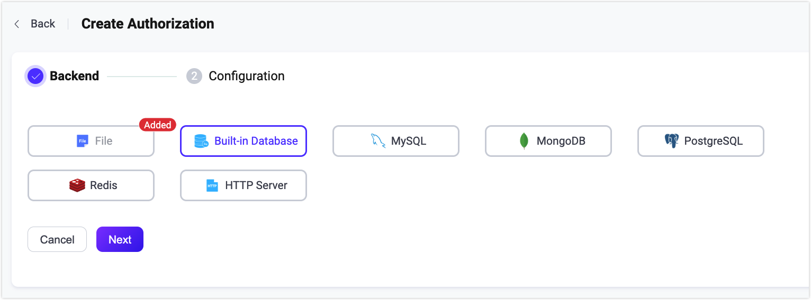

# 認可

EMQXにおける認可とは、MQTTクライアントのパブリッシュ／サブスクライブ操作に対する権限管理を指します。クライアントがパブリッシュ／サブスクライブ操作を行う際、EMQXは特定の手順に従うか、ユーザー指定のクエリ文を用いて設定されたデータソースからクライアントの権限リストを照会します。照会結果に基づき、EMQXは現在の操作を許可または拒否します。

クライアントの単一の権限データは以下の要素で構成されます。

| **権限**       | **クライアント**           | **操作**                            | **操作の詳細**                 |
| -------------- | -------------------------- | ---------------------------------- | ------------------------------ |
| Allow/Deny     | クライアントID／ユーザー名／IP | パブリッシュ／サブスクライブ／パブリッシュ・サブスクライブ | トピック／QoS／保持メッセージ |

::: tip
EMQX 5.1.1以降、操作の詳細におけるQoSおよび保持メッセージのチェックがサポートされました。
:::

クライアントの権限リストは事前に特定のデータソース（データベース、ファイルなど）に保存しておく必要があります。対応するデータレコードを更新することで、実行時にリストを更新できます。更新されたルールの適用タイミングについては、[認可ルール変更の適用タイミング](#when-authorization-rule-changes-take-effect)を参照してください。

EMQXではデフォルトでファイルベースのオーソライザーが設定されており、そのまま利用可能です。認可はACLファイルに設定された事前定義ルールに基づいて処理されます。

## データストレージオブジェクトとの連携

EMQXの認可機構は、組み込みデータベース、ファイル、MySQL、PostgreSQL、MongoDB、Redisなど、さまざまなデータストレージオブジェクトとの連携をサポートしています。REST APIやEMQXダッシュボードを通じて権限データの管理が可能です。<!-- CSVやJSONファイルによるバッチインポートは現時点ではサポートされていません。-->

さらに、EMQXはユーザーが開発したHTTPサービスとも接続でき、多様な認可要件に対応可能です。

バックエンドのデータストレージに応じて、以下のような種類のEMQXオーソライザーが存在します。各オーソライザーは独自の設定オプションを持ちます。詳細は表中のリンクを参照してください。

| データベース       | 説明                                                         |
| ------------------ | ------------------------------------------------------------ |
| ACLファイル        | [ファイルに設定された静的ルールによる認可](./file.md)         |
| 組み込みデータベース | [組み込みデータベースをルールストレージとした認可](./mnesia.md) |
| MySQL              | [MySQLをルールストレージとした認可](./mysql.md)               |
| PostgreSQL         | [PostgreSQLをルールストレージとした認可](./postgresql.md)     |
| MongoDB            | [MongoDBをルールストレージとした認可](./mongodb.md)           |
| Redis              | [Redisをルールストレージとした認可](./redis.md)               |
| LDAP               | [LDAPディレクトリをルールストレージとした認可](./ldap.md)      |
| HTTP               | [外部HTTPサービスによる認可](./http.md)                       |

以下はEMQXのMySQLオーソライザー設定例です。

例:

```bash
{

    type = mysql
    database = "mqtt"
    username = "root"
    password = "public"

    query = "SELECT permission, action, topic FROM mqtt_acl WHERE username = ${username}"
    server = "10.12.43.12:3306"
}
```

## 認可チェーン

EMQXは単一のオーソライザーではなく複数のオーソライザーを設定して認可チェーンを作成することができ、認可処理の柔軟性を高めています。EMQXはチェーン内のオーソライザーの順序に従って認可を順次実行します。認可チェーンが設定されている場合、EMQXが最初のオーソライザーで一致する認証情報を取得できなければ、次のオーソライザーに切り替えて処理を続行します。

認可チェックの流れは以下の通りです。

1. EMQXがクライアントの権限情報を正常に取得した場合、クライアントの操作と取得した権限リストを照合します。
   - 一致すれば、権限設定に基づき操作を許可または拒否します。
   - 一致しなければ、次のオーソライザーに切り替えて処理を続行します。

2. EMQXがクライアントの権限情報を取得できなかった場合、他のオーソライザーが設定されているか確認します。
   - 設定されていれば、次のオーソライザーに切り替えて処理を続行します。
   - 最後のオーソライザーであれば、`no_match`の設定に従いクライアントの操作を許可または拒否します。

::: warning 注意

認可に問題が生じないよう、必要に応じてACLファイルオーソライザーを無効化または削除してください。デフォルトで末尾に`{allow, all}`があり、すべての認可リクエストを許可してしまいます。

:::

オーソライザーの順序調整方法や実行中のメトリクス確認方法については、[オーソライザーの管理](#manage-authorizers)を参照してください。

## 認可ルール変更の適用タイミング

ルール変更はEMQXが更新ルールを次回評価した際に適用されます。クライアント認可キャッシュに一致結果が存在する場合、キャッシュの有効期限切れまたはクリアされるまでキャッシュ結果を使用し続けます。ルール変更は既に確立されたサブスクリプションを取り消しません。

- 接続中のクライアントは、許可されたトピックのメッセージを接続期間中受信し続けます。`deny_action`は適用されません。メッセージ配信はパブリッシュやサブスクライブの試行を伴わないためです。
- 永続セッション（`clean_start = false`）で再接続したクライアントは、ブローカーによって保存されたサブスクリプションが復元され、オフライン時にキューイングされたメッセージを受信します。

すでにサブスクライブ済みのクライアントから読み取りアクセスを取り消すには、ルールを変更しクライアントのセッションを削除してください。例えば、`DELETE /api/v5/clients/{clientid}`を使用してクライアントを切断し、セッション状態を削除します。

## クライアント認可キャッシュ

EMQXはセッションベースの認可データキャッシュ機構を提供しています。このキャッシュはクライアントのセッション状態に認可結果を保存し、同一接続中の認可ルール評価の繰り返しを減らします。クライアント認可キャッシュ機構はクライアントのパブリッシュ／サブスクライブ操作の権限チェック効率を向上させ、多数のクライアントリクエストによる認可データバックエンドへのアクセス負荷を軽減します。

### クライアント認可キャッシュの動作

クライアントが接続しパブリッシュ／サブスクライブ操作を行う際：

1. EMQXは現在のセッションに保存された認可キャッシュを確認します。
2. セッションキャッシュに一致するルールがあれば、それを直接使用します。
3. キャッシュされたルールが存在しない（または期限切れ）場合、設定されたオーソライザーを用いて完全な認可チェックを実行します。
4. 結果は接続中の再利用のためセッションにキャッシュされます。

::: tip

キャッシュはクライアントセッション固有であり、クライアントの切断や再接続時にクリアされます。キャッシュクリアは既に確立されたサブスクリプションのルール再評価を行いません。詳細は[認可ルール変更の適用タイミング](#when-authorization-rule-changes-take-effect)を参照してください。

:::

### ダッシュボードでのクライアント認可キャッシュ設定

EMQXダッシュボードでクライアント認可キャッシュを有効化または設定できます。

1. **アクセス制御** -> **認可** -> **設定** に移動します。

2. 以下のオプションを設定します：

   | 項目名                              | 説明                                                         |
   | ---------------------------------- | ------------------------------------------------------------ |
   | **キャッシュ有効化**                | クライアントセッションごとに認可キャッシュを有効または無効にします。 |
   | **キャッシュ最大件数**              | クライアントごとのキャッシュ最大件数。デフォルト：`32`。     |
   | **キャッシュ有効期限**              | 各キャッシュエントリの有効期間。デフォルト：`1分`。          |
   | **除外トピック**                    | キャッシュを無効化するトピックのリスト。                      |
   | **一致なし時の動作**                | オーソライザーが一致しなかった場合の動作。`allow`（許可）／`deny`（拒否）。デフォルト：`allow`。 |
   | **拒否時の動作**                    | 操作拒否時の動作。`ignore`（操作リクエストを無視）／`disconnect`（クライアント接続を切断）。デフォルト：`ignore`。 |
   | **キャッシュクリア**                | アクティブなセッション認可キャッシュを手動で全てクリアするボタン。 |

3. **保存** をクリックして設定を適用します。

設定ファイルでもこれらのオプションを設定可能です。詳細は[設定ファイル](../../configuration/configuration.md)を参照してください。

::: tip

適切に設定すればキャッシュはパフォーマンスを大幅に向上させます。システム性能に応じて適時調整することを推奨します。

:::

## 外部リソースキャッシュ

セッションベースのキャッシュに加え、EMQXはMySQL、MongoDB、Redisなどの外部バックエンドから取得した認可結果をノードレベルでキャッシュする機能も備えています。これによりリモートデータソースへの繰り返しアクセスを減らし、パフォーマンスを向上させます。

::: tip 注意

外部リソースキャッシュは外部データソースにのみ適用されます。組み込みデータベースやファイルベースのオーソライザーなどローカルソースには適用されません。

:::

### 外部リソースキャッシュの動作

パブリッシュ／サブスクライブ操作が外部バックエンドへのクエリをトリガーする際：

1. EMQXは外部リソースキャッシュ（ノード内の全クライアントで共有）を確認します。
2. キャッシュに以前の結果があるか確認します：
   - 有効な結果があれば**キャッシュヒット**とカウントし、外部バックエンドへの呼び出しは行いません。
   - 結果がなければ**キャッシュミス**とカウントし、外部バックエンドにクエリを送ります。
3. バックエンドから返された結果は将来の利用のためキャッシュに保存され、**キャッシュ挿入**メトリクスが増加します。

::: tip 注意

セッションベースの認可キャッシュと異なり、外部リソースキャッシュはノード全体で共有され、クライアントセッションをまたいで持続します。

:::

### 外部リソースキャッシュの有効化と設定

EMQXダッシュボードで外部リソースキャッシュを有効化および設定できます。

1. **アクセス制御** -> **認可** に移動します。

2. 右上の **外部リソースキャッシュ設定** ボタンをクリックすると、右側から設定パネルが表示されます。

3. パネル内の **外部リソースキャッシュ有効化** ボタンで機能をオン／オフします。有効化後、以下のキャッシュ設定を行います：

   | 項目名                      | 説明                                                         |
   | --------------------------- | ------------------------------------------------------------ |
   | **キャッシュ最大件数**       | ノードごとのキャッシュ最大件数。デフォルト：`1,000,000`。     |
   | **最大メモリ使用量**         | キャッシュのメモリ使用上限。デフォルト：`100 MB`。           |
   | **キャッシュTTL**            | キャッシュエントリの有効期間。デフォルト：`1分`。            |

4. **更新** をクリックして設定を適用します。

これらの設定はクラスター全体に適用され、全ノードで一貫した動作を保証します。

### 外部リソースキャッシュの状態監視

<!--@include: ../monitor-cache-status.md-->

## 認可プレースホルダー

EMQXオーソライザーは設定内でプレースホルダーを使用可能です。認可処理時にこれらは実際のクライアント情報に置き換えられ、現在のクライアントに合致するクエリやHTTPリクエストが構築されます。

有効なプレースホルダーは`${PATH.TO.VALUE}`形式で、PATH.TO.VALUEはオブジェクト内の値へのドット区切りパスです。使用可能な文字は英数字、ドット（`.`）、アンダースコア（`_`）です。サポートされない文字を含むプレースホルダーはプレーンテキストとして扱われます。

### データクエリ内のプレースホルダー

プレースホルダーはクエリ文の構築に用いられます。例えば、EMQXのMySQLオーソライザーのデフォルトクエリSQLは`${username}`プレースホルダーを使用します。

```sql
SELECT action, permission, topic FROM mqtt_acl where username = ${username}
```

クライアント（名前：`emqx_u`）が接続要求を送ると、構築されるクエリ文は以下のようになります。

```sql
SELECT action, permission, topic FROM mqtt_acl where username = 'emqx_u'
```

クエリ文でサポートされるプレースホルダーは以下の通りです。

* `${username}`: 実行時にユーザー名に置き換えられます。ユーザー名は`CONNECT`パケットの`Username`フィールドから取得します。`peer_cert_as_username`が有効な場合は証明書のフィールドまたは内容で上書きされます。
* `${clientid}`: 実行時にクライアントIDに置き換えられます。通常は`CONNECT`パケットでクライアントが明示的に指定します。`use_username_as_clientid`または`peer_cert_as_clientid`が有効な場合は、ユーザー名や証明書のフィールド・内容で上書きされます。
* `${peerhost}`: 実行時にクライアントの送信元IPアドレスに置き換えられます。[Proxy Protocol](http://www.haproxy.org/download/1.8/doc/proxy-protocol.txt)が有効な場合は、プロキシから報告された送信元IPアドレスが使用されます。
* `${peerport}`: EMQX 6.0.4以降、実行時にクライアントの送信元ポート番号（例：`51544`）に置き換えられます。Proxy Protocolが有効な場合はプロキシから報告された送信元ポートが使用されます。
* `${peername}`: EMQX 6.0.4以降、実行時にクライアントの送信元IPアドレスとポート番号に置き換えられます。IPv4の場合は`IP:port`形式（例：`192.168.0.1:51544`）、IPv6の場合は角括弧なし（例：`2001:db8::1:51544`）で表現されます。Proxy Protocolが有効な場合はプロキシから報告されたIPアドレスとポートが使用されます。
* `${cert_common_name}`: 実行時にクライアントTLS証明書のCommon Nameに置き換えられます。ロードバランサーがTCPリスナーにクライアント証明書情報を送信する場合、Proxy Protocol v2の使用を推奨します。
* `${cert_subject}`: 実行時にクライアントTLS証明書のSubjectに置き換えられます。ロードバランサーがTCPリスナーにクライアント証明書情報を送信する場合、Proxy Protocol v2の使用を推奨します。
* `${client_attrs.NAME}`: クライアント属性。`NAME`は事前定義された設定に基づく属性名に置き換えられます。クライアント属性の詳細は[MQTTクライアント属性](../../../develop/client-attributes/client-attributes.md)を参照してください。
* `${zone}`: 実行時にクライアントのゾーンに置き換えられます。`${zone}`プレースホルダーは認可テンプレート内で直接使用可能です。ゾーン設定の詳細は[ゾーンオーバーライド](../../configuration/configuration.md#zone-override)を参照してください。

::: tip
`${peerhost}`および`${peerport}`プレースホルダーは非推奨です。後方互換性のため残されています。新規テンプレートでは対応する場合`${peername}`を使用してください。
:::

LDAPオーソライザーは`${peerport}`および`${peername}`プレースホルダーをサポートしていません。

### トピック内のプレースホルダー

EMQXはトピック内でもプレースホルダーを使用可能で、動的なトピック名をサポートします。サポートされるプレースホルダーは以下の通りです。

* `${clientid}`
* `${username}`
* `${client_attrs.NAME}`: クライアント属性。`NAME`は`mqtt.client_attrs_init`で設定された属性抽出ルールに基づき置き換えられます。

プレースホルダーはトピックのセグメントとして使用可能で、例：`a/b/${username}/c/d`のように記述します。

プレースホルダーの展開を避けるため、EMQX 5.4以降は`$`を`${$}`とエスケープ可能です。例えば、`t/${$}{username}`は`username`が置き換えられず文字通り`t/${username}`として扱われます。

::: tip

クエリ文で`eq`構文を使用する場合、`eq`の後に続くトピックはプレースホルダー展開をサポートしません。この挙動は将来変更される可能性があります。

`eq`構文はトピックフィルターに完全一致する場合のみマッチします。例えば、`eq t/#`は`t/#`にのみマッチし、`t/1`や`t/2`にはマッチしません。

:::

## 認可チェックの優先順位

キャッシュや認可チェッカーに加え、認可結果は認証フェーズの[スーパーユーザーロールと権限セット](../authn/authn.md#super-user)にも影響されます。

スーパーユーザーの場合、すべての操作は認可チェックをスキップします。[アクセス制御リスト（ACL）](../authn/acl.md)が設定されている場合、EMQXは認可チェッカーを実行する前にクライアントの権限データを優先します。優先順位は以下の通りです。

```bash
スーパーユーザー > 権限データ > 認可チェック
```

## 認可機構の設定

EMQXは認可を設定する方法として、ダッシュボード、設定ファイル、HTTP APIの3通りを提供しています。

### ダッシュボードでの認可設定

EMQXダッシュボードは直感的にEMQXオーソライザーを設定できるツールで、関連パラメータの設定、稼働状況の確認、認可チェーン内での位置調整が可能です。



### 設定ファイルでの認可設定

設定ファイルの`authorization`フィールドで認可を設定することも可能です。一般的な構成は以下の通りです。

```bash
authorization {
  sources = [
    { ...   },
    { ...   }
  ]
  no_match = deny
  deny_action = ignore
  cache {
    max_size = 32
    excludes = ["t/1", "t/2"]
    ttl = 1m
  }
}
```

ここで、

- `sources`（任意）：順序付けられた配列で、各要素が対応するオーソライザーのデータソースを定義します。詳細な設定は各オーソライザーの設定ファイルを参照してください。

- `no_match`：設定されたオーソライザーのいずれも認可ルールを見つけられなかった場合のデフォルト動作を決定します。値は`allow`または`deny`。EMQX 6.0以降、デフォルトは`deny`に変更されました。

- `deny_action`：パブリッシュ／サブスクライブ操作が拒否された場合の次の動作を決定します。値は`ignore`または`disconnect`。デフォルトは`ignore`。`ignore`の場合は操作リクエストを静かに無視し、`disconnect`の場合はクライアント接続を切断します。

- `cache`：クライアント認可キャッシュの設定を定義します。

  * `cache.enable`：クライアント認可キャッシュを有効化するかどうか。デフォルトは`true`。認可がJWTパケットのみに基づく場合は`false`に設定することを推奨します。
    
  * `cache.max_size`：キャッシュ内の最大要素数。デフォルトは`32`。指定数を超えると古いレコードから削除されます。
    
  * `cache.excludes`：認可キャッシュを生成しない除外トピックのリスト。デフォルトは空配列`[]`。
    
  * `cache.ttl`：キャッシュの有効期間。デフォルトは`1m`（1分）。

::: tip

信頼できないまたはパブリックネットワークに公開されたブローカーでは、`deny_action`を`disconnect`に設定すると、同一接続での不正なパブリッシュやサブスクライブ試行を停止できます。[フラッピング検出](../flapping-detect.md)と併用すると、繰り返し再接続し認可拒否を引き起こすクライアントを一定期間自動的に禁止できます。

`deny_action`設定はグローバルでありリスナーごとに設定できません。拒否された操作を試みる正当なクライアントも切断されます。クライアントが通常許可されたトピックのみでパブリッシュ／サブスクライブする場合に`disconnect`を使用し、フラッピング検出の閾値を調整して正常な再接続時の禁止を避けてください。

:::

### HTTP APIでの認可設定

認可管理用のAPIエンドポイントは以下の通りです。

* `/api/v5/authorization/settings`：一般パラメータ（`no_match`、`deny_action`、`cache`）用
* `/api/v5/authorization/sources`：オーソライザーの管理・配置用
* `/api/v5/authorization/cache`：クライアント認可キャッシュのクリア用
* `/api/v5/authorization/sources/built_in_database`：`built_in_database`オーソライザーの認可ルール管理用

詳細な操作手順は[HTTP API](../../api.md)を参照してください。

## オーソライザーの管理

ダッシュボードの**アクセス制御**->**認可**ページでオーソライザーの閲覧・管理が可能です。

### オーソライザーの順序調整

[認可チェーン](#authorization-chain)で述べたように、オーソライザーは設定された順序に従って実行されます。**その他**ドロップダウンリストから**上へ移動**、**下へ移動**、**先頭へ移動**、**末尾へ移動**を選択してオーソライザーの位置を変更できます。`authorization.sources`設定項目でも順序調整が可能です。

### オーソライザーの状態確認

**状態**列で接続状況を確認できます。

| 状態           | 意味                                                         | トラブルシューティング                                     |
| -------------- | ------------------------------------------------------------ | --------------------------------------------------------- |
| 接続済み       | すべてのノードがデータソースに正常に接続されている。         | -                                                         |
| 切断済み       | 一部またはすべてのノードがデータソース（データベース、ファイル）に接続できていない。 | データソースの稼働状況を確認；<br />トラブルシューティング後、オーソライザーを手動で再起動（**無効化**→**有効化**） |
| 接続中         | 一部またはすべてのノードがデータソースに再接続中。            | データソースの稼働状況を確認；<br />トラブルシューティング後、オーソライザーを手動で再起動（**無効化**→**有効化**） |

### 実行中のメトリクス

オーソライザーの概要ページで各種統計メトリクスを確認できます。以下のメトリクスが表示されます。

- **許可数**：認可が通った回数
- **拒否数**：認可が拒否された回数
- **一致なし数**：クライアント認可データが見つからなかった回数
- **無視数**：認可が適用されなかったかエラーにより判定不能となった認可クエリの回数
- **レート（tps）**：認可実行の処理速度

また、**ノード状態**から各ノードの認可状態や実行状況を確認できます。

認可全体の実行メトリクスを確認したい場合は、[メトリクス - 認証＆認可](../../observability/metrics-and-stats.md#Metrics+-+Authentication+%26+Authorization)を参照してください。
