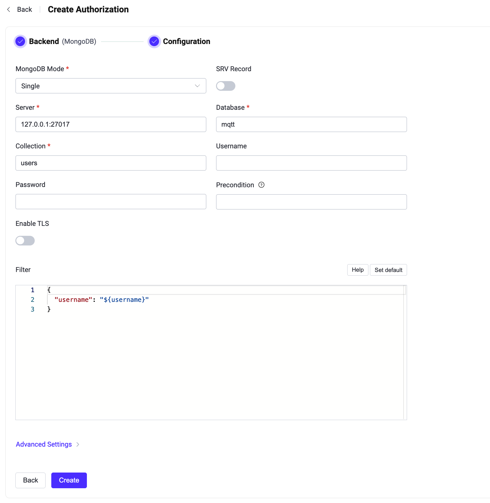

# MongoDBとの統合

このオーソライザーは、MongoDBデータベースに格納されたルールリストとパブリッシュ／サブスクライブ要求を照合することで認可チェックを実装します。

::: tip 前提条件

[基本的なEMQX認可の概念](./authz.md)に関する知識

:::

## データスキーマとクエリ文

MongoDBオーソライザーは、認可ルールをMongoDBドキュメントとして保存することをサポートしています。ユーザーは、結果に以下のフィールドが含まれることを保証するためのクエリテンプレートを提供する必要があります。

* `permission`：ルールが一致した場合に適用されるアクションを指定します。利用可能な値は`deny`または`allow`です。
* `action`：ルールが関連する要求を指定します。可能な値は`publish`、`subscribe`、または`all`です。
* `topic` / `topics`：ルールが適用される単一または複数のトピックを指定します。トピックフィルターおよび[トピックプレースホルダー](./authz.md#topic-placeholders)をサポートします。
* `qos`（オプション）：現在のルールが適用されるQoSレベルを指定します。値の選択肢は`0`、`1`、`2`です。複数のQoSレベルを指定する場合は数値の配列も可能です。デフォルトはすべてのQoSレベルです。
* `retain`（オプション）：ルールがリテインドメッセージのパブリッシュを許可するかどうかを示します。値の選択肢は`0`、`1`、または`true`、`false`です。デフォルトではリテインドメッセージは許可されています。

ユーザー名`emqx_u`のクライアントがQoS 1でトピック`t/1`にパブリッシュすることを拒否する例：

```js
> db.mqtt_acl.insertOne(
  {
      "username": "emqx_u",
      "clientid": "emqx_c",
      "ipaddress": "127.0.0.1",
      "permission": "deny",
      "action": "publish",
      "qos": 1,
      "topics": ["t/1"]
  }
);
{
  acknowledged: true,
  insertedId: ObjectId("62b4a1a0e693ae0233bc3e98")
}
```

対応する設定パラメータは以下の通りです：
```bash
collection = "mqtt_acl"
filter { username = "${username}" }
```

::: tip
システム内のユーザー数が多い場合は、クエリ応答時間を短縮しEMQXへの負荷を軽減するために、事前にコレクションを最適化およびインデックス化してください。
:::

このMongoDBデータスキーマに対して、対応するダッシュボードの設定パラメータは**Filter**：`{ username = "${username}" }`です。

::: tip 読み取り専用のデータベース権限を付与する

EMQXはパブリッシュまたはサブスクライブ操作の認可時にMongoDBへの読み取りアクセスのみを必要とします。設定されたコレクションに対して`find`クエリを実行し、ドキュメントの挿入、更新、削除は行いません。

MongoDBに対して組み込みの`read`ロールを持つ専用のデータベースユーザーを使用するようにEMQXを設定してください。書き込みや管理者ロールは付与しないでください：

```js
db.getSiblingDB("mqtt").createUser({
  user: "emqx_auth",
  pwd: "PASSWORD",
  roles: [ { role: "read", db: "mqtt" } ]
})
```

コレクションの作成や認可ルールの管理は別の管理ユーザーで行ってください。EMQX設定のデータベース認証情報が漏洩しても、読み取り専用ユーザーでは認可ルールの変更や削除はできません。
:::

## ダッシュボードでの設定

EMQXダッシュボードを使ってMongoDBをユーザー認可に利用する設定が可能です。

1. [EMQXダッシュボード](http://127.0.0.1:18083/#/authentication)で、左側のナビゲーションツリーから**アクセス制御** -> **認可**をクリックし、**認可**ページに入ります。

2. 右上の**作成**をクリックし、**バックエンド**として**MongoDB**を選択します。**次へ**をクリックすると、以下の**設定**タブが表示されます。

   

3. 以下の指示に従って設定を行います。

   **接続**：MongoDBに接続するための情報を入力します。

   - **MongoDBモード**：MongoDBの展開形態を選択します。`Single`、`Replica Set`、`Sharding`があります。
   - **サーバー**：EMQXが接続するサーバーのアドレスを指定します（`host:port`）。
   - **データベース**：MongoDBのデータベース名。
   - **コレクション**：認可ルールが格納されているMongoDBコレクション名。データ型は文字列です。
   - **ユーザー名**：MongoDBのユーザー名を指定します。
   - **パスワード**：MongoDBのユーザーパスワードを指定します。

   **前提条件**：任意のVariform式を入力します。式が`true`と評価された場合にのみEMQXはこのオーソライザーを呼び出します。詳細は[オーソライザの前提条件](./authz.md#authorizer-preconditions)を参照してください。

   **TLS設定**：TLSを有効にする場合はトグルスイッチをオンにします。

   **Filter**：認証情報の検索に使われるMongoDBセレクターとして解釈されるマップです。[プレースホルダー](./authz.md#authorization-placeholders)がサポートされています。

   **詳細設定**：

   - **認証ソース**：MongoDB接続時に使用する認証ソースを指定します。特定のデータベースやユーザー認証を管理するMongoDB認証データベースを指定可能です。
   - **レガシープロトコルを使用**：MongoDBとの通信にレガシープロトコルを使用するかどうかを選択します。`auto`、`true`、`false`の選択肢があり、デフォルトは`auto`で新しいプロトコルのサポートを自動判別します。
   - **レコード制限**：MongoDBから取得する認可レコード数の上限を設定します。
   - **スキップ**：認可レコードの取得時にスキップするレコード数を設定します。

   - **プールサイズ**（オプション）：EMQXノードからMongoDBへの同時接続数を整数で指定します。デフォルトは`8`です。
   - **接続タイムアウト**（オプション）：EMQXが接続タイムアウトと判断するまでの待機時間を指定します。単位はミリ秒、秒、分、時間が利用可能です。

4. **作成**をクリックして設定を完了します。

## 設定項目による構成

EMQXの設定項目を使ってMongoDBオーソライザーを構成できます。

MongoDBオーソライザーは`mongodb`タイプで識別されます。オーソライザーは3種類のMongoDB展開モードに対応しています。<!---詳細な設定情報は以下を参照してください：[authz:mongo_single](../../configuration/configuration-manual.html#authz:mongo_single)、[authz:mongo_sharded](../../configuration/configuration-manual.html#authz:mongo_sharded)、[authz:mongo_rs](../../configuration/configuration-manual.html#authz:mongo_rs)-->

オプションの`precondition`設定項目はVariform式を受け入れます。式が`true`と評価された場合にのみEMQXはこのオーソライザーを呼び出します。`precondition`が省略または空の場合は前提条件は適用されません。詳細は[オーソライザの前提条件](./authz.md#authorizer-preconditions)を参照してください。

設定例：

:::: tabs type:card

::: tab Single 

```bash
{
  type = mongodb

  collection = "mqtt_user"
  filter { username = "${username}" }

  mongo_type = single
  server = "127.0.0.1:27017"

  database = "mqtt"
  username = "emqx"
  password = "secret"
}
```

:::

::: tab Replica set

```bash
{
  type = mongodb

  collection = "mqtt_user"
  filter { username = "${username}" }

  mongo_type = rs
  servers = "10.123.12.10:27017,10.123.12.11:27017,10.123.12.12:27017"
  replica_set_name = "rs0"

  database = "mqtt"
  username = "emqx"
  password = "secret"
}
```
:::

::: tab Sharding

```bash
{
  type = mongodb
  enable = true

  collection = "mqtt_user"
  filter { username = "${username}" }

  mongo_type = sharded
  servers = "10.123.12.10:27017,10.123.12.11:27017,10.123.12.12:27017"

  database = "mqtt"
  username = "emqx"
  password = "secret"
}
```

:::

::::
