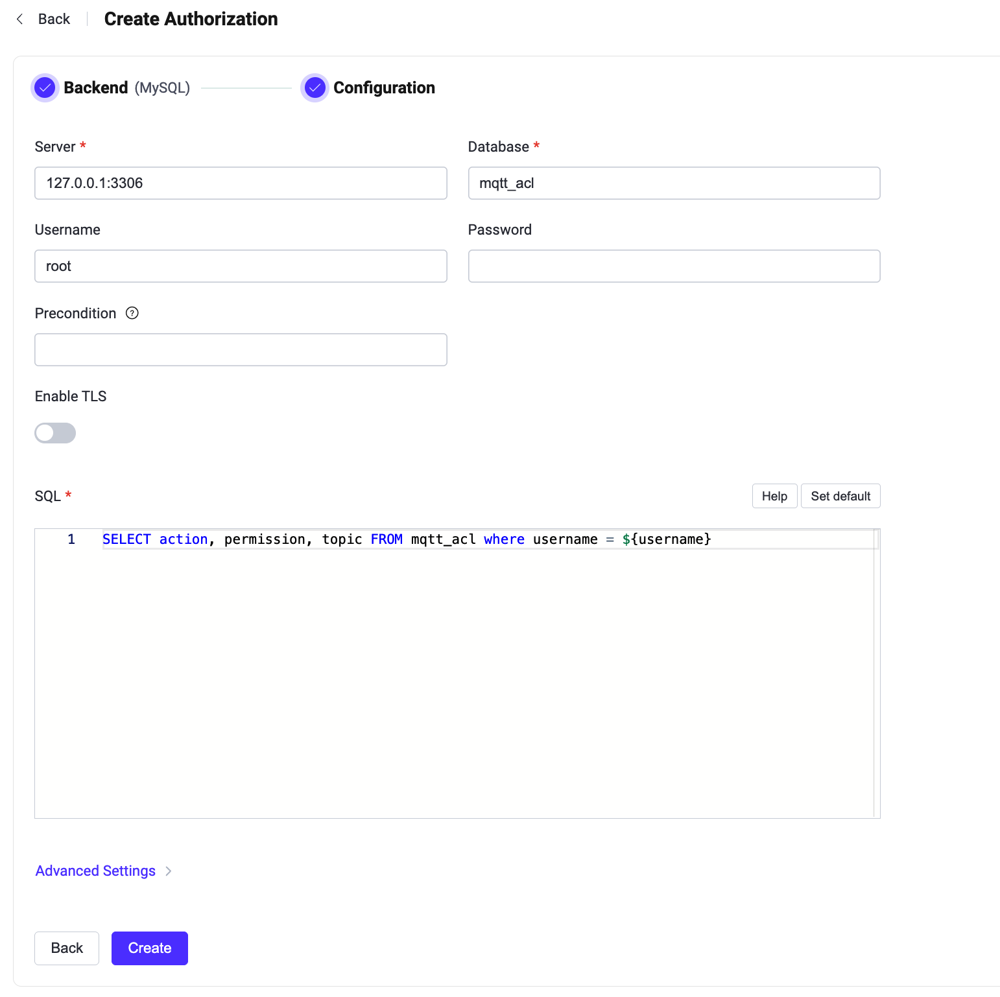

# MySQLとの統合

このオーソライザーは、MySQLデータベースに格納されたルールのリストとパブリッシュ／サブスクリプション要求を照合することで認可チェックを実装します。

::: tip 前提条件

[EMQXの基本的な認可の概念](./authz.md)についての知識

:::

## データスキーマとクエリ文

MySQLオーソライザーはほぼあらゆるストレージスキーマをサポートします。ビジネスニーズに応じて、認証情報の保存方法やアクセス方法を決定できます。例えば、1つまたは複数のテーブル、ビューなどを使用できます。

ユーザーはクエリ文のテンプレートを提供し、以下のフィールドを含むことを保証する必要があります：
* `permission` の値はルールが一致した場合に適用されるアクションを指定します。`deny` または `allow` のいずれかである必要があります。
* `action` の値はルールが関連するリクエストを指定します。`publish`、`subscribe`、または `all` のいずれかである必要があります。
* `topic` の値はルールに関連するトピックフィルターを指定します。ワイルドカードや[トピックプレースホルダー](./authz.md#topic-placeholders)をサポートする文字列である必要があります。
* `qos`（オプション）はルールが適用されるQoS（サービス品質）レベルを指定します。値は `0`、`1`、`2` のいずれか、または `,` で区切った複数のQoSレベル（例：`0,1`）の文字列です。デフォルトはすべてのQoSレベルです。
* `retain`（オプション）は現在のルールが保持メッセージをサポートするかどうかを指定します。値は `0` または `1` です。デフォルトは保持メッセージを許可します。

認証情報を保存するためのテーブル構造の例：

```sql
CREATE TABLE `mqtt_acl` (
  `id` int(11) unsigned NOT NULL AUTO_INCREMENT,
  `ipaddress` VARCHAR(60) NOT NULL DEFAULT '',
  `username` VARCHAR(255) NOT NULL DEFAULT '',
  `clientid` VARCHAR(255) NOT NULL DEFAULT '',
  `action` ENUM('publish', 'subscribe', 'all') NOT NULL,
  `permission` ENUM('allow', 'deny') NOT NULL,
  `topic` VARCHAR(255) NOT NULL DEFAULT '',
  `qos` tinyint(1),
  `retain` tinyint(1),
  PRIMARY KEY (`id`)
) ENGINE=InnoDB DEFAULT CHARSET=utf8mb4;
```

::: tip
システム内のユーザー数が多い場合は、クエリ応答時間を短縮しEMQXの負荷を軽減するために、事前にテーブルの最適化とインデックス付けを行ってください。
:::

このテーブルでは、MQTTユーザーは `username` で識別されます。

例えば、ユーザー `user123` に対してトピック `data/user123/#` のパブリッシュを許可する認可ルールを追加したい場合、クエリ文は以下のようになります：

```bash
mysql> INSERT INTO mqtt_acl(username, permission, action, topic, ipaddress) VALUES ('user123', 'allow', 'publish', 'data/user123/#', '127.0.0.1');
Query OK, 1 row affected (0,01 sec)
```

対応する設定パラメータは以下の通りです：

```bash
query = "SELECT action, permission, topic, ipaddress, qos, retain FROM mqtt_acl where username = ${username} and ipaddress = ${peerhost}"
```

## ダッシュボードでの設定

EMQXダッシュボードを使用して、MySQLをユーザー認可に利用する方法を設定できます。

1. [EMQXダッシュボード](http://127.0.0.1:18083/#/authentication)の左側ナビゲーションツリーで **Access Control** -> **Authorization** をクリックし、**Authorization** ページに入ります。

2. 右上の **Create** をクリックし、次に **Backend** で **MySQL** を選択します。**Next** をクリックすると、**Configuration** タブが表示されます。

   

3. 以下の指示に従って認可バックエンドを設定します：

   - MySQLへの接続情報を入力します。

     - **Server**：EMQXが接続するサーバーアドレス（`host:port`）を指定します。
     - **Database**：MySQLのデータベース名。
     - **Username**：ユーザー名を指定します。
     - **Password**：ユーザーパスワードを指定します。

   - **Enable TLS**：TLSを有効にする場合はトグルスイッチをオンにします。TLS有効化の詳細は[Network and TLS](../../network/overview.md#tls-for-external-resource-access)を参照してください。

   - **SQL**：データスキーマに従ってクエリ文を入力します。詳細は[データスキーマとクエリ文](#データスキーマとクエリ文)を参照してください。

   - **Advanced Settings**：接続プール、タイムアウト、プリペアドステートメントの動作を設定します。
     - **Connection Pool Size**（オプション）：EMQXノードからMySQLへの同時接続数を整数値で指定します。デフォルトは `8`。
     - **Connect Timeout**（オプション）：EMQXが接続試行をタイムアウトと判断するまでの待機時間を指定します。ミリ秒、秒、分、時間の単位が利用可能です。デフォルトは `15` 秒。
     - **Disable Prepared Statements**（オプション）：データベースクエリでプリペアドステートメントの使用を無効にします。MySQLプロキシやミドルウェア（例：PGBouncerやトランザクションモードのSupabase）がセッションレベルの機能（プリペアドステートメントなど）をサポートしない場合に有効にしてください。デフォルトは無効。

4. **Create** をクリックして設定を完了します。

## 設定項目による設定

EMQXの設定項目を使ってMySQLオーソライザーを設定することも可能です。

MySQLオーソライザーはタイプ `mysql` で識別されます。設定パラメータの完全なリストは[EMQX Enterprise設定マニュアル](https://docs.emqx.com/en/enterprise/v@EE_VERSION@/hocon/)を参照してください。

設定例：

```bash
{
  type = mysql

  database = "mqtt"
  username = "root"
  password = "public"
  server = "127.0.0.1:3306"
  query = "SELECT permission, action, topic FROM mqtt_acl WHERE username = ${username}"
  connect_timeout = "15s"
  disable_prepared_statements = false
}
```
