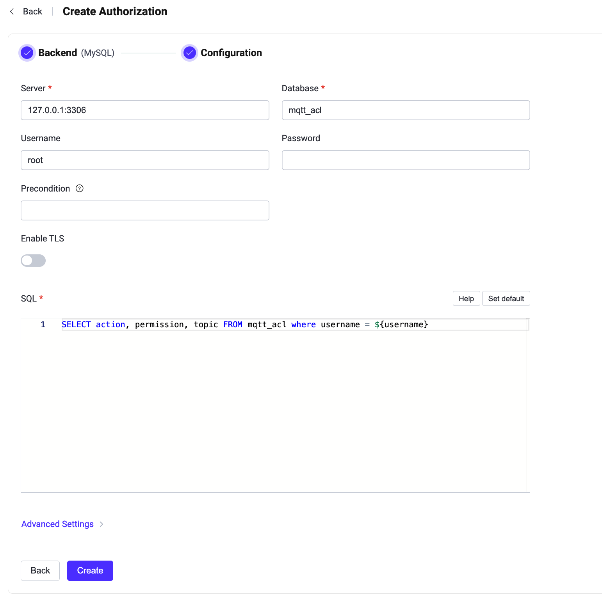

# MySQLとの統合

このオーソライザーは、MySQLデータベースに保存されたルールのリストとパブリッシュ／サブスクライブ要求を照合することで認可チェックを実装します。

::: tip 前提条件

[EMQXの基本的な認可の概念](./authz.md)についての知識

:::

## データスキーマとクエリ文

MySQLオーソライザーはほぼあらゆるストレージスキーマをサポートします。認証情報の保存方法やアクセス方法はビジネスニーズに応じて決定できます。例えば、1つまたは複数のテーブルやビューを使用することが可能です。

ユーザーはクエリ文のテンプレートを提供し、以下のフィールドが含まれていることを確認してください：
* `permission` はルールがマッチした場合に適用されるアクションを指定します。`deny` または `allow` のいずれかである必要があります。
* `action` はルールが関連するリクエストを指定します。`publish`、`subscribe`、または `all` のいずれかである必要があります。
* `topic` はルールに関連するトピックのフィルターを指定します。ワイルドカードおよび[トピックプレースホルダー](./authz.md#topic-placeholders)をサポートする文字列である必要があります。
* `qos`（オプション）はルールが適用されるQoSレベルを指定します。値は `0`、`1`、`2` のいずれか、または複数のQoSレベルをカンマ区切りで指定する文字列（例：`0,1`）です。デフォルトはすべてのQoSレベルです。
* `retain`（オプション）は現在のルールがリテインドメッセージをサポートするかどうかを指定します。値は `0` または `1` です。デフォルトはリテインドメッセージを許可します。

認証情報を保存するためのテーブル構造の例：

```sql
CREATE TABLE `mqtt_acl` (
  `id` int(11) unsigned NOT NULL AUTO_INCREMENT,
  `ipaddress` VARCHAR(60) NOT NULL DEFAULT '',
  `username` VARCHAR(255) NOT NULL DEFAULT '',
  `clientid` VARCHAR(255) NOT NULL DEFAULT '',
  `action` ENUM('publish', 'subscribe', 'all') NOT NULL,
  `permission` ENUM('allow', 'deny') NOT NULL,
  `topic` VARCHAR(255) NOT NULL DEFAULT '',
  `qos` tinyint(1),
  `retain` tinyint(1),
  PRIMARY KEY (`id`)
) ENGINE=InnoDB DEFAULT CHARSET=utf8mb4;
```

::: tip
システム内のユーザー数が多い場合は、クエリの応答時間を短縮しEMQXの負荷を軽減するために、事前にテーブルの最適化とインデックス作成を行ってください。
:::

このテーブルでは、MQTTユーザーは `username` で識別されます。

例えば、ユーザー `user123` に対してトピック `data/user123/#` のパブリッシュを許可する認可ルールを追加したい場合、クエリ文は次のようになります：

```bash
mysql> INSERT INTO mqtt_acl(username, permission, action, topic, ipaddress) VALUES ('user123', 'allow', 'publish', 'data/user123/#', '127.0.0.1');
Query OK, 1 row affected (0,01 sec)
```

対応する設定パラメータは以下の通りです：
```bash
query = "SELECT action, permission, topic, ipaddress, qos, retain FROM mqtt_acl where username = ${username} and ipaddress = ${peerhost}"
```

::: tip 読み取り専用のデータベース権限を付与する

EMQXはパブリッシュまたはサブスクライブ操作の認可時にデータベースへの読み取りアクセスのみを必要とします。`query` は `SELECT` 文として設定してください。EMQXはプリペアドステートメントとしてクエリを実行します。

EMQXが使用するデータベースアカウントには、クエリが読み取るテーブルに対する `SELECT` 権限のみを付与し、書き込みや管理権限は付与しないでください：

```sql
GRANT SELECT ON mqtt_user.mqtt_acl TO 'emqx_auth'@'%';
```

テーブルの作成や認可ルールの管理は別の管理用アカウントで行ってください。EMQX設定のデータベース認証情報が漏洩した場合でも、読み取り専用アカウントでは認可ルールの変更や削除はできません。
:::

## ダッシュボードでの設定

EMQXダッシュボードを使ってMySQLをユーザー認可に利用する設定ができます。

1. [EMQXダッシュボード](http://127.0.0.1:18083/#/authentication)の左ナビゲーションツリーで **アクセス制御** -> **認可** をクリックし、**認可** ページに入ります。

2. 右上の **作成** をクリックし、**バックエンド** に **MySQL** を選択してから **次へ** をクリックします。以下の **設定** タブが表示されます。

   

3. 以下の手順に従って設定を行います。

   **接続**：MySQLに接続するための情報を入力します。

   - **サーバー**：EMQXが接続するサーバーアドレス（`host:port`）を指定します。
   - **データベース**：MySQLのデータベース名を指定します。
   - **ユーザー名**：ユーザー名を指定します。
   - **パスワード**：ユーザーパスワードを指定します。

   **TLS設定**：TLSを有効にする場合はトグルスイッチをオンにします。

   **接続設定**：同時接続数と接続タイムアウトまでの待機時間を設定します。

   - **プールサイズ**（任意）：EMQXノードからMySQLへの同時接続数を整数で入力します。デフォルトは **8** です。

   **認可設定**：認可に関する設定を入力します。

   - **SQL**：データスキーマに基づいたクエリ文を入力します。詳細は[データスキーマとクエリ文](#データスキーマとクエリ文)を参照してください。

4. **作成** をクリックして設定を完了します。

## 設定項目による設定

EMQXの設定項目を使ってMySQLオーソライザーを設定できます。

MySQLオーソライザーはタイプ `mysql` で識別されます。 <!--詳細な設定は[authz:mysql](../../configuration/configuration-manual.html#authz:mysql)を参照してください。-->

設定例：

```bash
{
  type = mysql

  database = "mqtt"
  username = "root"
  password = "public"
  server = "127.0.0.1:3306"
  query = "SELECT permission, action, topic FROM mqtt_acl WHERE username = ${username}"
}
```
