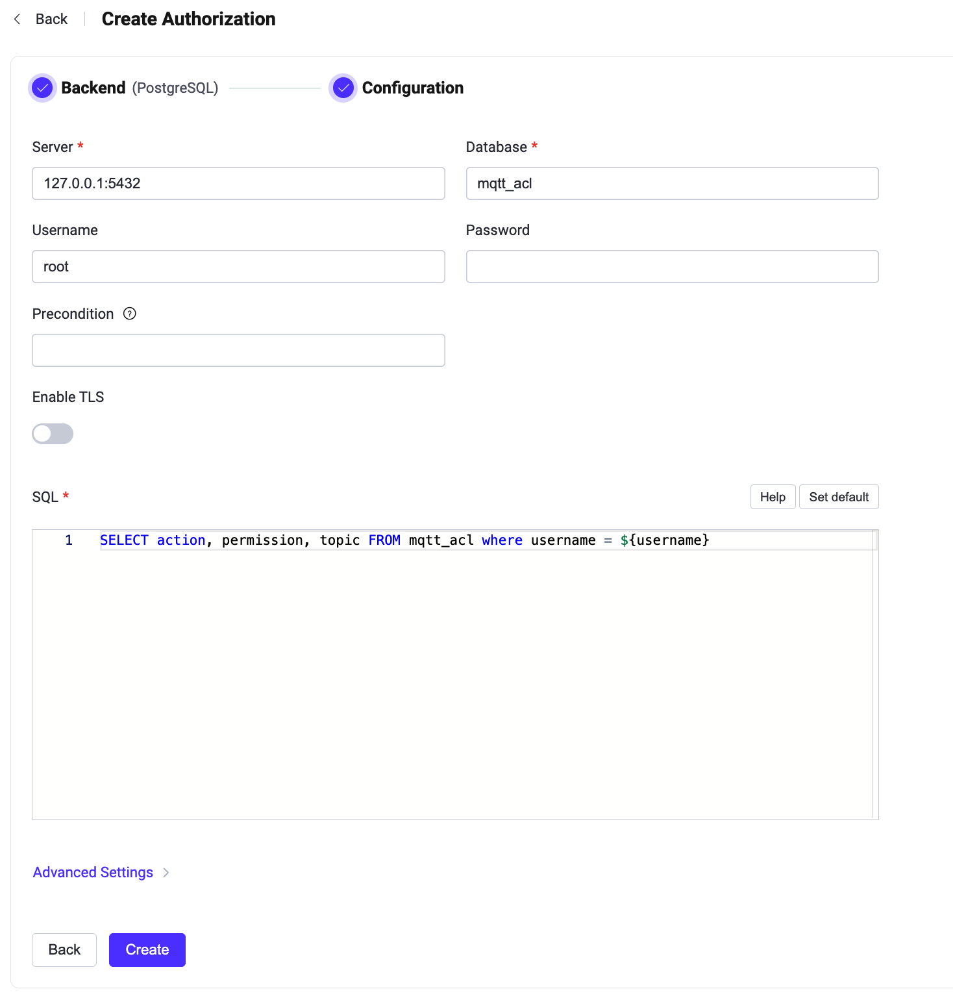

# PostgreSQLとの統合

このオーソライザーは、パブリッシュ／サブスクリプションリクエストをPostgreSQLデータベースに格納されたルールリストと照合することで認可チェックを実装しています。

::: tip 前提条件

[EMQX認可の基本概念](./authz.md)の知識が必要です。

:::

## データスキーマとクエリ文

PostgreSQLオーソライザーはほぼあらゆるストレージスキーマをサポートします。ACLルールの保存方法やアクセス方法は、ユーザーが1つまたは複数のテーブル、ビューなどを用いて自由に決定できます。

ユーザーはクエリ文のテンプレートを提供し、以下のフィールドが含まれていることを保証する必要があります：
* `permission` はルールがマッチした場合に適用されるアクションを指定します。`deny` または `allow` のいずれかである必要があります。
* `action` はルールが関連するリクエストを指定します。`publish`、`subscribe`、または `all` のいずれかである必要があります。
* `topic` はルールに関連するトピックフィルターを指定します。ワイルドカードおよび[トピックプレースホルダー](./authz.md#topic-placeholders)をサポートする文字列である必要があります。
* `qos`（任意）はルールが適用されるQoSレベルを指定します。値は `0`、`1`、`2` のいずれか、またはカンマ区切りの文字列（例：`0,1`）で複数指定可能です。デフォルトはすべてのQoSレベルです。
* `retain`（任意）は現在のルールが保持メッセージをサポートするかどうかを指定します。値は `0` または `1` で、デフォルトは保持メッセージを許可します。

認証情報を格納するためのテーブル構造の例：

```sql
CREATE TABLE mqtt_acl(
  id serial PRIMARY KEY,
  username text NOT NULL,
  permission text NOT NULL,
  action text NOT NULL,
  topic text NOT NULL,
  qos smallint,
  retain smallint
);
CREATE INDEX mqtt_acl_username_idx ON mqtt_acl(username);
```

このテーブルでは、MQTTユーザーは `username` によって識別されます。

例えば、ユーザー `user123` に対してトピック `data/user123/#` のパブリッシュを許可する認可ルールを追加したい場合、クエリ文は以下のようになります：

```bash
postgres=# INSERT INTO mqtt_acl(username, permission, action, topic, ipaddress) VALUES ('user123', 'allow', 'publish', 'data/user123/#', '127.0.0.1');
INSERT 0 1
```

対応する設定パラメータは以下の通りです：

```bash
query = "SELECT permission, action, topic, ipaddress, qos, retain FROM mqtt_acl WHERE username = ${username} and ipaddress = ${peerhost}"
```

::: tip 読み取り専用のデータベース権限を付与する

EMQXはパブリッシュやサブスクライブ操作の認可時にデータベースへの読み取りアクセスのみを必要とします。`query` は `SELECT` 文として設定してください。EMQXはプリペアドステートメントとしてクエリを実行します。

EMQXが使用するデータベースアカウントには、クエリが読み取るテーブルに対する `SELECT` 権限のみを付与し、書き込みや管理権限は付与しないでください。

```sql
GRANT USAGE ON SCHEMA public TO emqx_auth;
GRANT SELECT ON mqtt_acl TO emqx_auth;
```

テーブル作成や認可ルール管理には別の管理アカウントを使用してください。EMQX設定のデータベース認証情報が漏洩しても、読み取り専用アカウントでは認可ルールの変更や削除はできません。
:::

## ダッシュボードでの設定

EMQXダッシュボードを使用して、PostgreSQLをユーザー認可に利用する設定が可能です。

1. [EMQXダッシュボード](http://127.0.0.1:18083/#/authentication)で、左のナビゲーションツリーから **アクセス制御** -> **認可** をクリックし、**認可** ページに入ります。

2. 右上の **作成** をクリックし、**バックエンド** に **PostgreSQL** を選択してから **次へ** をクリックします。**設定** タブが表示されます。

   

3. 以下の指示に従って認可バックエンドを設定します：

   - PostgreSQL接続情報を入力します。

     - **サーバー**：EMQXが接続するサーバーのアドレス（`host:port`）を指定します。
     - **データベース**：PostgreSQLのデータベース名。
     - **ユーザー名**：ユーザー名を指定します。
     - **パスワード**：ユーザーパスワードを指定します。

   - **TLSを有効化**：TLSを有効にする場合はトグルスイッチをオンにします。TLS有効化の詳細は[ネットワークとTLS](../../network/overview.md#tls-for-external-resource-access)を参照してください。

   - **SQL**：データスキーマに従ってクエリ文を入力します。詳細は[データスキーマとクエリ文](#データスキーマとクエリ文)を参照してください。

   - **詳細設定**：接続プール、タイムアウト、プリペアドステートメントの動作を設定します。
     - **接続プールサイズ**（任意）：EMQXノードからPostgreSQLへの同時接続数を整数で指定します。デフォルトは `8`。
     - **接続タイムアウト**（任意）：EMQXが接続試行のタイムアウトと判断するまでの待機時間を指定します。単位はミリ秒、秒、分、時間が利用可能です。デフォルトは `15` 秒。
     - **プリペアドステートメントを無効化**（任意）：データベースクエリでプリペアドステートメントの使用を無効にします。PostgreSQLのプロキシやミドルウェア（例：PGBouncerやSupabaseのトランザクションモード）がセッションレベルの機能（プリペアドステートメントなど）をサポートしない場合に有効にしてください。デフォルトは無効。

4. **作成** をクリックして設定を完了します。

## 設定項目による設定

EMQXの設定項目を使ってPostgreSQLオーソライザーを設定することも可能です。

PostgreSQLオーソライザーは `type` に `postgresql` を指定して識別されます。設定パラメータの全リストは[EMQX Enterprise設定マニュアル](https://docs.emqx.com/en/enterprise/v@EE_VERSION@/hocon/)を参照してください。

設定例：

```bash
{
  type = postgresql

  database = "mqtt"
  username = "postgres"
  password = "public"
  server = "127.0.0.1:5432"
  query = "SELECT permission, action, topic FROM mqtt_acl WHERE username = ${username}"
  connect_timeout = "15s"
  disable_prepared_statements = false
}
```
