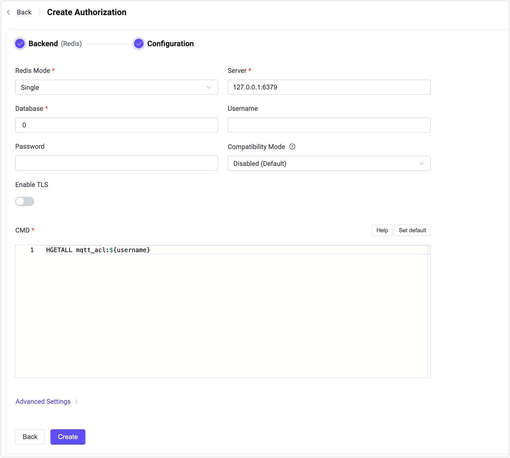

# Redisとの連携

このオーソライザーは、Redisデータベースに格納されたルールリストとパブリッシュ／サブスクリプション要求を照合することで認可チェックを実装しています。

::: tip 前提条件

[EMQXの基本的な認可概念](./authz.md)の知識が必要です。

:::

## データスキーマとクエリ文

ユーザーは以下のデータを返すクエリテンプレートを提供する必要があります。

- `topic`：ルールが適用されるトピックを指定します。トピックフィルターや[トピックプレースホルダー](./authz.md#topic-placeholders)を使用できます。
- `action`：ルールが適用されるアクションを指定します。利用可能なオプションは `publish`、`subscribe`、および `all` です。
- `qos`（オプション）：現在のルールが適用されるQoSレベルを指定します。値のオプションは `0`、`1`、`2` です。複数のQoSレベルを指定する場合は数値の配列も可能です。デフォルトはすべてのQoSレベルです。
- `retain`（オプション）：ルールがリテインドメッセージをサポートするかどうかを指定します。値のオプションは `true`、`false` です。デフォルトはリテインドメッセージを許可します。

例えば、ルールは[Redisのハッシュ](https://redis.io/docs/latest/develop/data-types/hashes/)として格納できます。

ユーザー `emqx_u` にトピック `t/1` のサブスクライブ権限を追加する例：

```bash
HSET mqtt_acl:emqx_u t/1 subscribe
```

Redisの構造上の制約により、`qos` と `retain` フィールドを使用する場合、トピック以外のフィールドはJSON文字列で格納する必要があります。例：

- ユーザー `emqx_u` にトピック `t/2` のQoS 1およびQoS 2でのサブスクライブ権限を追加する場合：

```bash
HSET mqtt_acl:emqx_u t/2 '{ "action": "subscribe", "qos": [1, 2] }'
```

- ユーザー `emqx_u` にトピック `t/3` へのリテインドメッセージのパブリッシュを拒否する権限を追加する場合：

```bash
HSET mqtt_acl:emqx_u t/3 '{ "action": "publish", "retain": false }'
```

対応する設定パラメータは以下の通りです：

```bash
cmd = "HGETALL mqtt_acl:${username}"
```

取得したルールは許可ルールとして扱われます。つまり、トピックフィルターとアクションが一致すればリクエストは許可されます。

:::tip
Redisオーソライザーに追加されるすべてのルールは**許可ルール**です。したがってRedisオーソライザーはホワイトリストモードで使用する必要があります。
:::

::: tip 読み取り専用のデータベース権限を付与する

EMQXはパブリッシュまたはサブスクライブ操作の認可時にRedisへの読み取りアクセスのみを必要とします。`cmd`で許可されるのは `HMGET` と `HGETALL` のみで、それ以外のコマンドは拒否されるため、認可処理でRedisへの書き込みは行いません。

Redis 6.0以降では、EMQX用に専用ユーザーを設定し、EMQXが実行するヘルスチェックやクエリコマンド、`cmd`で指定したキーへのアクセスに限定してください。

```bash
redis-cli ACL SETUSER emqx_auth reset on '>PASSWORD' '~mqtt_acl:*' +ping +hmget +hgetall
```

Redisクラスターの場合、EMQXはハッシュスロットとRedisノードのマッピングを取得・更新するために `CLUSTER SLOTS` を実行します。これにより各クエリが正しいノードに送信されるため、`+cluster|slots` 権限も付与してください。

```bash
redis-cli ACL SETUSER emqx_auth '+cluster|slots'
```

シングルまたはセンチネルモードで `database` が0以外の場合、EMQXは接続後に `SELECT` を実行するため、Redisデータノードユーザーに `+select` 権限を付与してください。デフォルトのデータベース0を使用する場合は不要です。

センチネルモードでセンチネルノードに認証が有効な場合、`sentinel_username` と `sentinel_password` でセンチネル接続用の認証情報を設定してください。これらはRedisデータノード接続用の `username` と `password` とは別の認証情報です。

認可ルールの管理には別の管理ユーザーを使用してください。EMQX設定のRedis認証情報が漏洩しても、読み取り専用ユーザーでは認可ルールの変更や削除ができません。
:::

## ダッシュボードでの設定

EMQXダッシュボードからRedisを用いたユーザー認可の設定が可能です。

1. EMQXダッシュボードの左側ナビゲーションツリーで **アクセス制御** -> **認可** をクリックし、**認可**ページに入ります。

2. 右上の **作成** をクリックし、**バックエンド**で **Redis** を選択します。次に **次へ** をクリックします。**設定**タブが表示されます。

   

3. 以下の指示に従って設定を行います。

   - **Redisモード**：Redisのデプロイ方式を選択します。`Single`、`Sentinel`、`Cluster`から選択可能です。

   - **サーバー**：EMQXが接続するサーバーアドレスを指定します（`host:port`形式）。

   - **データベース**：Redisのデータベース名を指定します。

   - **ユーザー名**：Redis接続に使用するユーザー名を指定します。Redis 6.0以降で導入された[Redis ACL](https://redis.io/docs/latest/operate/oss_and_stack/management/security/acl/#create-and-edit-user-acls-with-the-acl-setuser-command)を利用している場合は必須です。ACLが無効または適用されていないデフォルトユーザーを使う場合は空欄のままで構いません。

     ::: tip

     `username` フィールドはEMQX 5.2.0以降でサポートされています。Redis ACLを利用する場合はこのバージョン以降を使用してください。

     :::

   - **パスワード**：Redisユーザーのパスワードを指定します。認証が有効なRedisインスタンスに接続する場合は必須です。

     - ユーザー名を入力した場合は、Redis ACL設定の認証情報と一致する必要があります。
     - ユーザー名が未指定の場合は、`default`ユーザーとして認証に使用されます（有効な場合）。

   - **前提条件**：任意のVariform式を入力します。式が `true` と評価された場合のみこのオーソライザーが呼び出されます。詳細は[オーソライザーの前提条件](./authz.md#authorizer-preconditions)を参照してください。

   - **互換モード**：EMQX 4.xのRedis ACLデータ形式との互換性を有効にするかどうかを制御します。

     - `Disabled (Default)`：現在のルール形式を使用します。
     - `v4`：レガシーなEMQX 4.x Redis ACLデータとの互換性を有効にし、アップグレード時に既存データを変更せずに再利用可能にします。

     ::: tip

     このオプションはEMQX 4.xからのアップグレード時に既存のRedis ACLデータを変更せずに再利用する場合に使用します。新規導入では無効のまま現在のルール形式を使うことを推奨します。

     :::

   - **TLSを有効化**：TLSを有効にする場合はトグルスイッチをオンにします。

   - **CMD**：データスキーマに従ったクエリコマンドを入力します。

   - **詳細設定**：同時接続数や接続タイムアウトまでの待機時間を設定します。
     - **プールサイズ**（任意）：EMQXノードからRedisへの同時接続数を整数で指定します。デフォルトは `8` です。

4. **作成**をクリックして設定を完了します。

## 設定項目による設定

EMQXの設定項目でRedisオーソライザーを構成できます。

Redisオーソライザーはタイプ `redis` で識別されます。Redisは3種類のデプロイモードに対応しています。

オプションの `precondition` 設定項目はVariform式を受け付けます。式が `true` と評価された場合のみこのオーソライザーが呼び出されます。省略または空の場合は前提条件なしとみなされます。詳細は[オーソライザーの前提条件](./authz.md#authorizer-preconditions)を参照してください。

設定例：

:::: tabs type: card

::: tab Single

```hocon
{
    type = redis

    redis_type = single
    server = "127.0.0.1:6379"

    cmd = "HGETALL mqtt_user:${username}"
    database = 1
    password = public
    
    compatibility_mode = disabled
}
```

:::

::: tab Sentinel

```hocon
{
    type = redis

    redis_type = sentinel
    servers = "10.123.13.11:6379,10.123.13.12:6379"
    sentinel = "mymaster"

    cmd = "HGETALL mqtt_user:${username}"
    database = 1
    password = public
    
    compatibility_mode = disabled
}
```

:::

::: tab Cluster

```hocon
{
    type = redis

    redis_type = cluster
    servers = "10.123.13.11:6379,10.123.13.12:6379"

    cmd = "HGETALL mqtt_user:${username}"
    password = public
    
    compatibility_mode = disabled
}
```

:::

::::

> `compatibility_mode` はEMQX 4.xからのアップグレードでレガシーなRedis ACLデータを再利用する場合に `v4` に設定できます。
