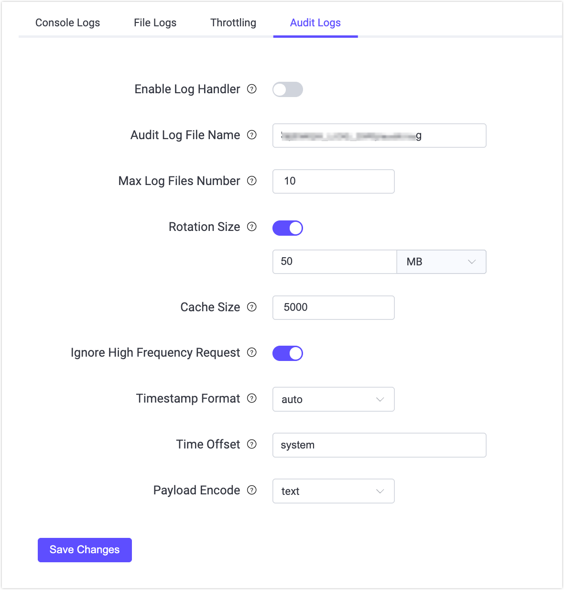

# 監査ログ

監査ログ機能は、EMQXクラスターにおける重要な運用変更をリアルタイムで追跡できるようにします。監査ログを通じて、エンタープライズユーザーは誰がどの重要な操作をどのように、いつ実行したかを簡単に把握できます。これは、エンタープライズユーザーが規制要件に準拠し、運用時のデータセキュリティ監査を確実に行うための重要なツールです。

EMQX監査ログは、[ダッシュボード](./introduction.md)、[REST API](../api.md)、および[CLI](../cli.md)からの変更関連操作の記録をサポートしており、ダッシュボードのユーザーログインやクライアント、アクセス制御、データ統合の変更などが含まれます。ダッシュボードおよびREST APIに関しては、メトリクス取得やクライアントリストのクエリなどの読み取り専用操作は記録されません。CLIコマンドは、データを変更するかどうかに関わらず記録されますが、[CLIまたはErlangコンソールからの操作記録](#operation-records-from-cli-or-erlang-console)に記載の例外があります。

EMQXは、ダッシュボードのビューおよびログシステムとの連携を提供し、エンタープライズが監査ログを管理しやすくしています。これらの方法を通じて、EMQXは柔軟かつ包括的に監査ログをサポートし、エンタープライズユーザーがニーズに応じて最適な監査ログの管理・閲覧方法を選択できるようにしています。

## 監査ログへのアクセス

ダッシュボードまたは `GET /api/v5/audit` を通じてクラスター全体の監査ログを閲覧できるのは、グローバル管理者およびグローバル閲覧者のみです。監査ログにはすべてのネームスペースの操作が含まれ、呼び出し元のネームスペースによるフィルタリングは行われません。ネームスペース付きダッシュボードユーザーやネームスペース付きAPIキーからのリクエストは、役割や割り当てられたスコープに関わらずHTTP `403` と `UNAUTHORIZED_ROLE` エラーコードを返します。[`audit` スコープ](../api.md#built-in-api-key-scopes)はこの制限を上書きしません。

## 監査ログの有効化

監査ログ機能は、ダッシュボードおよび設定ファイルの両方から有効化および設定パラメータの調整が可能です。

### ダッシュボードから監査ログを有効化

監査ログを有効化し、設定パラメータを変更するには、ダッシュボードの **Management** -> **Logging** -> **Audit Log** または **System** -> **Audit Log** に移動します。



監査ログに対して以下のオプションを設定できます：

- **Enable Log Handler**：監査ログ処理プロセスの有効化・無効化。デフォルトで有効です。
- **Audit Log File Name**：監査ログファイルのパスおよびファイル名を指定します。デフォルトは `${EMQX_LOG_DIR}/audit.log` で、`${EMQX_LOG_DIR}` は変数でありデフォルトは `./log`、つまり最終的に `./log/audit.log.1` に保存されます。
- **Maximum Log Files Number**：ローテーションされるログファイルの最大数。デフォルトは `10` です。
- **Rotation Size**：ログファイルのサイズを設定し、指定サイズに達するとログファイルがローテーションされます。無効にするとログファイルは無制限に増加します。テキストボックスに希望の値を入力し、ドロップダウンリストから `MB`、`GB`、`KB` などの単位を選択できます。デフォルトは `50MB` です。
- **Cache Size**：データベースに保存され、ダッシュボードおよび `/audit` API からアクセス・取得可能な最大レコード数を決定します。デフォルトは `5000` です。

  ::: tip 注意
  `log.audit.max_filter_size` は後方互換性のためエイリアスとして残されています。
  :::

- **Ignore High Frequency Request**：パブリッシュ／サブスクライブやクライアントのキックアウトなどの高頻度リクエストを無視し、監査ログの洪水を防ぐかどうかを制御します。デフォルトで有効です。
- **Timestamp Format**：ログエントリのタイムスタンプに使用するフォーマット。選択肢は以下の通りです：
  - `auto`：ログフォーマッターに基づいて最適なフォーマットを自動選択（JSONは `epoch`、テキストは `rfc3339`）。
  - `epoch`：マイクロ秒単位のUnixエポック時間。
  - `rfc3339`：RFC3339形式。
- **Time Offset**：ログエントリのタイムスタンプをフォーマットする際の時間オフセット。選択肢は以下の通りです：
  - `system`：ローカルシステムの時間オフセット。
  - `utc`：UTC時間オフセット。
  - `+-[hh]:[mm]`：ユーザー指定の時間オフセット（例：`"-02:00"`、`"+00:00"`）。

  デフォルトは `system` です。
- **Payload Encode**：ログエントリ内のペイロードデータのエンコード方法。選択肢は `text`、`hex`、`hidden`。デフォルトは `text` です。

### 設定ファイルから監査ログを有効化

`base.hocon` ファイルの `log.audit` 以下に設定オプションを記述することでも、監査ログの有効化および設定変更が可能です。例は以下の通りです。

```hocon
log.audit {
  path = "./log/audit.log"
  rotation_count = 10
  rotation_size = 50MB
  cache_size = 5000
  ignore_high_frequency_request = true
  timestamp_format = auto
  time_offset = system
  payload_encode = text
}
```

## ダッシュボードで監査ログを閲覧

監査ログが有効化されると、ダッシュボードの **System** -> **Audit Log** でログエントリを閲覧できます。


### 検索フィルター

操作ログのフィルターおよび検索が可能で、サポートされる検索キーワードは以下の通りです：

- **開始時間** - **終了時間**：操作が発生した時間範囲。
- **ソースタイプ**：操作を実行した方法。選択肢は `Dashboard`、`REST API`、`CLI`、`Erlang Console`。ここで `Erlang Console` は通常EMQの現地技術サポート時に使用されるErlang Shellコンソールを指します。
- **オペレーター**：ダッシュボードのユーザー名またはREST API呼び出しに使用されたキー名。操作方法がダッシュボードまたはREST APIの場合のみ有効です。
- **IP**：ダッシュボードユーザーまたはREST APIを呼び出したクライアントの送信元IP。操作方法がダッシュボードまたはREST APIの場合のみ表示されます。
- **操作名**：監査ログでサポートされている操作名のドロップダウンリストから選択します。
- **操作結果**：`Success` または `Failure` のドロップダウンリストから選択します。

### リストの説明

表示される監査ログリストの各列の説明は以下の通りです：

- **操作時間**：操作が行われた時間。
- **情報**：
  - ダッシュボードまたはREST APIの場合、この列は操作名を表示します。
  - CLIおよびコンソールの場合、この列は実行されたコマンドを記録します。
- **オペレーター**：操作方法および対応するオペレーターを含みます。CLIおよびコンソールの操作では、オペレーターはコマンドが実行されたEMQXノードの名前です。
- **IP**：ダッシュボードユーザーまたはREST APIを呼び出したクライアントの送信元IP。操作方法がダッシュボードまたはREST APIの場合のみ表示されます。
- **操作結果**：`Success` または `Failure`。失敗にはフォーム検証エラーやリソース削除不能などのケースが含まれます。ダッシュボードまたはREST APIの操作方法にのみ表示され、CLIおよびコンソールでは操作結果は記録されません。

## ログファイルで監査ログを閲覧

EMQXで監査ログが有効化されると、変更関連操作は `./log/audit.log.1` ファイルにログ形式で保存されます。エンタープライズユーザーは監査記録の詳細な分析を容易に行え、既存のログ管理システムに統合してコンプライアンスおよびデータセキュリティ要件を満たせます。

::: warning 注意

コマンドライン操作の監査ログには機密情報が含まれる可能性があるため、ログコレクターへ送信する際は注意が必要です。ログ内容のフィルタリングや暗号化通信の利用など、不正な情報漏洩を防ぐ対策を推奨します。

:::

監査ログに含まれるフィールドは、操作記録のソースによって異なります。

### ダッシュボードまたはREST APIからの操作記録

ダッシュボードまたはREST APIの操作を記録する監査ログには、操作ユーザー、操作対象、操作結果の情報が含まれます。ログメッセージのフォーマット例は以下の通りです。

```bash
{"time":1702604675872987,"level":"info","source_ip":"127.0.0.1","operation_type":"mqtt","operation_result":"success","http_status_code":204,"http_method":"delete","operation_id":"/mqtt/retainer/message/:topic","duration_ms":4,"auth_type":"jwt_token","from":"dashboard","source":"admin","node":"emqx@127.0.0.1","http_request":{"method":"delete","headers":{"user-agent":"Mozilla/5.0 (Macintosh; Intel Mac OS X 10_15_7) AppleWebKit/537.36 (KHTML, like Gecko) Chrome/119.0.0.0 Safari/537.36","sec-fetch-site":"same-origin","sec-fetch-mode":"cors","sec-fetch-dest":"empty","sec-ch-ua-platform":"\"macOS\"","sec-ch-ua-mobile":"?0","sec-ch-ua":"\"Google Chrome\";v=\"119\", \"Chromium\";v=\"119\", \"Not?A_Brand\";v=\"24\"","referer":"http://localhost:18083/","origin":"http://localhost:18083","host":"localhost:18083","connection":"keep-alive","authorization":"******","accept-language":"zh-CN,zh;q=0.9,zh-TW;q=0.8,en;q=0.7","accept-encoding":"gzip, deflate, br","accept":"*/*"},"body":{},"bindings":{"topic":"$SYS/brokers/emqx@127.0.0.1/version"}}}
```

以下の表は、ダッシュボードまたはREST API操作によって生成される監査ログエントリに含まれる可能性のあるフィールドを説明しています。

| フィールド名           | 型       | 説明                                                         |
| ---------------------- | -------- | ------------------------------------------------------------ |
| time                   | 整数     | ログレコードのタイムスタンプ（マイクロ秒単位）。              |
| level                  | 文字列   | ログレベル。                                                 |
| source_ip              | 文字列   | 操作の送信元IPアドレス。                                     |
| operation_type         | 文字列   | 操作の機能モジュール。REST APIのタグに対応。                 |
| operation_result       | 文字列   | 操作結果。`success` または `failure` で成功・失敗を示す。    |
| http_status_code       | 整数     | HTTPレスポンスステータスコード。                             |
| http_method            | 文字列   | HTTPリクエストメソッド。                                     |
| duration_ms            | 整数     | 操作実行時間（ミリ秒単位）。                                 |
| auth_type              | 文字列   | 認証タイプ。認証に使用された方法や仕組みを示し、`jwt_token`（ダッシュボード）または`api_key`（REST API）で固定。 |
| from                   | 文字列   | リクエストの送信元。`dashboard`、`rest_api`はそれぞれダッシュボード、REST APIを示す。`cli`、`erlang_console`の場合はCLIまたはErlang Shellからの操作であり、このログ構造は該当しない。 |
| source                 | 文字列   | 操作を実行したダッシュボードのユーザー名またはAPIキー名。    |
| node                   | 文字列   | 操作が実行されたノード名。                                   |
| operation_id           | 文字列   | リクエストのREST APIパス。詳細は[REST API](../api.md)を参照。 |
| http_request           | オブジェクト | HTTPリクエストの詳細。                                      |
| http_request.method    | 文字列   | HTTPリクエストメソッド。`post`、`put`、`delete`のいずれか。  |
| http_request.bindings  | オブジェクト | `operation_id`内のプレースホルダーに対応するパスパラメータの値。 |
| http_request.headers   | オブジェクト | HTTPリクエストヘッダー。機密情報と認識されたキーの値はマスクされる。 |
| http_request.body      | オブジェクト | HTTPリクエストボディ。機密情報と認識されたキーの値はマスクされる。 |
| http_request.query_string | オブジェクト | 任意。URLクエリパラメータの解析結果。クエリパラメータがない場合は省略。機密情報と認識されたキーの値はマスクされる。 |
| http_request.namespace | 文字列   | 任意。操作対象の解決済みネームスペース。グローバルネームスペースの場合は `global`。 |

#### ネームスペースとクエリパラメータ

EMQX 6.3.0以降、監査記録にはデータバックアップリクエストの非空クエリパラメータが `http_request.query_string` に含まれます。データバックアップ操作では、リクエストに `namespace` クエリパラメータが含まれているかに関わらず、解決済みの対象ネームスペースが `http_request.namespace` に記録されます。

クエリパラメータの記録は、監査対象のすべてのダッシュボードおよびREST APIリクエストに適用されます。操作が対象ネームスペースを解決する場合、リクエストに `ns` または `namespace` クエリパラメータが含まれているかに関わらず、解決済みネームスペースが `http_request.namespace` に記録されます。以下の例は、グローバル管理者が明示的に `ns2` を対象にした場合です。

```json
{
  "http_request": {
    "method": "put",
    "bindings": {"name": "test"},
    "query_string": {"ns": "ns2"},
    "namespace": "ns2"
  }
}
```

ネームスペース管理者が自身のネームスペース内のリソースをクエリパラメータなしで対象にした場合、`http_request.query_string` は省略されますが、解決済みネームスペースは `http_request.namespace` に含まれます。

認証、認可、コネクター、ブリッジ、ルール、トレース、データバックアップ、A2Aレジストリ、トピックメトリクスに関わるネームスペース付き操作では、解決済み対象ネームスペースが記録されます。対象ネームスペースを解決しないエンドポイントでは `http_request.namespace` は省略されます。

### CLIまたはErlangコンソールからの操作記録

すべてのCLIコマンドは監査ログに記録されます。読み取り専用コマンド（例：`emqx ctl status`）も含まれます。唯一の例外はトップレベルの使用法表示で、コマンドなしまたは認識されないコマンドで `emqx ctl` を実行した場合は利用可能なコマンド一覧が表示され、記録されません。無効な引数を受け取り自身の使用法を表示するコマンド（例：`emqx ctl status bad-arg`）は、そのコマンドの呼び出しとして記録されます。

CLIまたはErlangコンソールからの操作を記録する監査ログには、実行されたコマンド、呼び出しパラメータなどの情報が含まれます。ログメッセージのフォーマット例は以下の通りです。

```bash
{"time":1695866030977555,"level":"info","msg":"from_cli","from": "cli","node":"emqx@127.0.0.1","duration_ms":0,"cmd":"retainer","args":["clean", "t/1"]}
```

以下の表は、上記ログメッセージサンプルに含まれるフィールドを示しています。

| フィールド名  | 型       | 説明                                                         |
| ------------ | -------- | ------------------------------------------------------------ |
| time         | 整数     | ログレコードのタイムスタンプ（マイクロ秒単位）。              |
| level        | 文字列   | ログレベル。                                                 |
| msg          | 文字列   | 操作の説明。                                                 |
| from         | 文字列   | リクエストの送信元。`cli`、`erlang_console` はそれぞれCLI、Erlang Shellを示す。`dashboard`、`rest_api` の場合はダッシュボードまたはREST APIの操作であり、このログ構造は該当しない。 |
| node         | 文字列   | 操作が実行されたノード名。                                   |
| duration_ms  | 整数     | 操作の実行時間（ミリ秒単位）。                               |
| cmd          | 文字列   | 実行された具体的なコマンド操作。対応コマンドは[CLI](../cli.md)を参照。 |
| args         | 配列     | コマンドに付随する追加パラメータ。複数パラメータは配列で区切られる。 |
