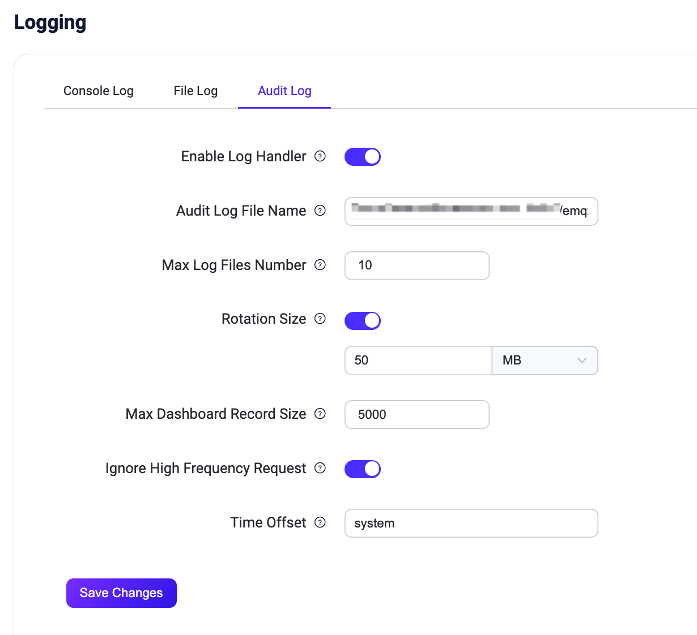
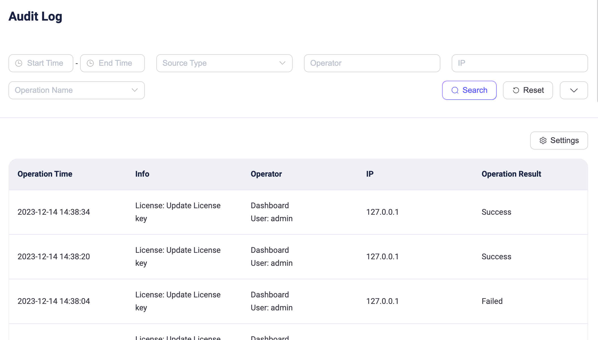

# Audit Log

Audit Log機能は、EMQXクラスターにおける重要な運用変更をリアルタイムで追跡することを可能にします。Audit Logを通じて、エンタープライズユーザーは誰がどの重要な操作をいつどのように実行したかを簡単に確認できます。これは、エンタープライズユーザーが規制要件を遵守し、運用中のデータセキュリティ監査を確実に行うための重要なツールです。

EMQX Audit Logは、[ダッシュボード](./introduction.md)、[REST API](../api.md)、および[CLI](../cli.md)からの変更関連操作の記録をサポートしています。例えば、ダッシュボードのユーザーログインやクライアント、アクセス制御、データ統合の変更などです。ただし、メトリクス取得やクライアントリストの照会などの読み取り専用操作は記録されません。

EMQXは、ダッシュボードビューとログシステムとの統合を提供し、エンタープライズがAudit Logを管理しやすくしています。これらの方法により、EMQXはAudit Logに対して柔軟かつ包括的なサポートを提供し、エンタープライズユーザーがニーズに応じて最適な管理・閲覧方法を選択できるようにしています。

## Audit Logへのアクセス

EMQX 6.0.4以降、クラスター全体のAudit Logはグローバル管理者およびグローバルビューアのみがダッシュボードで閲覧可能であり、`GET /api/v5/audit`を通じて読み取ることができます。Audit Logにはすべてのネームスペースの操作が含まれ、呼び出し元のネームスペースによるフィルタリングは行われません。ネームスペース付きのダッシュボードユーザーおよびネームスペース付きAPIキーからのリクエストは、役割や割り当てられたスコープに関係なくHTTP `403`で`UNAUTHORIZED_ROLE`エラーコードを返します。[`audit`スコープ](../api.md#built-in-api-key-scopes)はこの制限を上書きしません。

## Audit Logの有効化

Audit Log機能は、ダッシュボードおよび設定ファイルの両方から有効化および設定パラメータの調整が可能です。

### ダッシュボードによるAudit Logの有効化

ダッシュボードでAudit Logを有効化し、設定パラメータを変更するには、**管理** -> **ログ** -> **Audit Log**、または**システム** -> **Audit Log**に移動してください。



Audit Logに対して以下のオプションを設定できます。

- **ログハンドラーを有効にする**：Audit Logの処理プロセスを有効または無効にします。デフォルトで有効です。
- **Audit Logファイル名**：Audit Logファイルのパスと名前を指定します。デフォルト値は`${EMQX_LOG_DIR}/audit.log`で、`${EMQX_LOG_DIR}`は変数であり、デフォルトは`./log`です。つまり最終的には`./log/audit.log.1`に保存されます。
- **最大ログファイル数**：ローテーションされるログファイルの最大数です。デフォルトは`10`です。
- **ローテーションサイズ**：ログファイルのサイズを設定し、指定サイズに達するとログファイルがローテーションされます。無効にするとログファイルは無制限に成長します。テキストボックスに値を入力し、ドロップダウンリストから`MB`、`GB`、`KB`などの単位を選択できます。デフォルトは`50MB`です。
- **キャッシュサイズ**：データベースに保存される最大レコード数を決定し、ダッシュボードおよび`/audit` APIを通じてアクセス・取得可能です。デフォルトは`5000`です。

  ::: tip 補足
  `log.audit.max_filter_size`は後方互換性のためエイリアスとして残されています。
  :::

- **高頻度リクエストを無視**：パブリッシュ／サブスクライブやクライアントのキックアウトなどの高頻度リクエストを無視し、Audit Logの洪水を防ぐかどうかを制御します。デフォルトで有効です。
- **タイムスタンプ形式**：ログエントリのタイムスタンプに使用する形式です。選択肢は以下の通りです。
  - `auto`：ログフォーマッターに基づき最適な形式を自動選択します。JSONは`epoch`、テキストは`rfc3339`です。
  - `epoch`：マイクロ秒単位のUnixエポック時間。
  - `rfc3339`：RFC3339形式。
- **時間オフセット**：ログエントリのタイムスタンプをフォーマットする際の時間オフセットです。選択肢は以下の通りです。
  - `system`：ローカルシステムの時間オフセット。
  - `utc`：UTC時間オフセット。
  - `+-[hh]:[mm]`：ユーザー指定の時間オフセット（例：`"-02:00"`、`"+00:00"`）。

  デフォルトは`system`です。
- **ペイロードエンコード**：ログエントリ内のペイロードデータのエンコード方法です。選択肢は`text`、`hex`、`hidden`で、デフォルトは`text`です。

### 設定ファイルによるAudit Logの有効化

`base.hocon`ファイル内の`log.audit`セクションでAudit Logを有効化し、設定オプションを変更することも可能です。以下は例です。

```hocon
log.audit {
  path = "./log/audit.log"
  rotation_count = 10
  rotation_size = 50MB
  cache_size = 5000
  ignore_high_frequency_request = true
  timestamp_format = auto
  time_offset = system
  payload_encode = text
}
```

## ダッシュボードでのAudit Log閲覧

Audit Logを有効化すると、ダッシュボードの**システム** -> **Audit Log**でログエントリを閲覧できます。



### 検索フィルター

以下のキーワードを使ってログ操作をフィルター・検索できます。

- **開始時間** - **終了時間**：操作が発生した時間範囲。
- **ソースタイプ**：操作が実行された方法。選択肢は`Dashboard`、`REST API`、`CLI`、`Erlang Console`です。ここで`Erlang Console`はEMQによるオンサイト技術サポート時に使用されるErlang Shellコンソールを指します。
- **オペレーター**：ダッシュボードのユーザー名またはREST API呼び出しに使用されたキー名です。操作方法がDashboardまたはREST APIの場合のみ有効です。
- **IP**：ダッシュボードユーザーまたはREST APIを呼び出したクライアントのソースIPです。操作方法がDashboardまたはREST APIの場合のみ表示されます。
- **操作名**：Audit Logがサポートする操作名のドロップダウンリストから選択します。
- **操作結果**：`成功`または`失敗`のドロップダウンリストから選択します。

### リストの説明

表示されるAudit Logリストの各列の説明は以下の通りです。

- **操作時間**：操作が行われた時間。
- **情報**：
  - DashboardまたはREST APIの場合、操作名を表示します。
  - CLIおよびConsoleの場合、実行されたコマンドを記録します。
- **オペレーター**：操作方法と対応するオペレーターを含みます。CLIおよびConsole操作の場合、オペレーターはコマンドが実行されたEMQXノード名です。
- **IP**：ダッシュボードユーザーまたはREST APIを呼び出したクライアントのソースIPです。操作方法がDashboardまたはREST APIの場合のみ表示されます。
- **操作結果**：`成功`または`失敗`。失敗はフォーム検証失敗やリソース削除不可などのケースを含みます。DashboardまたはREST APIの操作方法にのみ表示され、CLIおよびConsoleは操作結果を記録できません。

## ログファイルによるAudit Logの閲覧

Audit LogがEMQXで有効化されると、変更関連操作は`./log/audit.log.1`ファイルにログ形式で保存されます。これによりエンタープライズユーザーはAudit記録を詳細に分析し、既存のログ管理システムに統合してコンプライアンスやデータセキュリティ要件を満たすことが容易になります。

::: warning 注意

コマンドライン操作のAudit Logには機密情報が含まれる可能性があるため、ログコレクターに送信する際は注意が必要です。情報漏洩を防ぐためにログ内容のフィルタリングや暗号化通信の利用を推奨します。

:::

Audit Logに含まれるフィールドは、操作記録のソースによって異なります。

### ダッシュボードまたはREST APIからの操作記録

ダッシュボードまたはREST API操作を記録するAudit Logは、操作ユーザー、操作対象、操作結果に関する情報を含みます。ログメッセージのフォーマット例は以下の通りです。

```bash
{"time":1702604675872987,"level":"info","source_ip":"127.0.0.1","operation_type":"mqtt","operation_result":"success","http_status_code":204,"http_method":"delete","operation_id":"/mqtt/retainer/message/:topic","duration_ms":4,"auth_type":"jwt_token","from":"dashboard","source":"admin","node":"emqx@127.0.0.1","http_request":{"method":"delete","headers":{"user-agent":"Mozilla/5.0 (Macintosh; Intel Mac OS X 10_15_7) AppleWebKit/537.36 (KHTML, like Gecko) Chrome/119.0.0.0 Safari/537.36","sec-fetch-site":"same-origin","sec-fetch-mode":"cors","sec-fetch-dest":"empty","sec-ch-ua-platform":"\"macOS\"","sec-ch-ua-mobile":"?0","sec-ch-ua":"\"Google Chrome\";v=\"119\", \"Chromium\";v=\"119\", \"Not?A_Brand\";v=\"24\"","referer":"http://localhost:18083/","origin":"http://localhost:18083","host":"localhost:18083","connection":"keep-alive","authorization":"******","accept-language":"zh-CN,zh;q=0.9,zh-TW;q=0.8,en;q=0.7","accept-encoding":"gzip, deflate, br","accept":"*/*"},"body":{},"bindings":{"topic":"$SYS/brokers/emqx@127.0.0.1/version"}}}
```

以下の表は、ダッシュボードまたはREST API操作によって生成されるAudit Logエントリに含まれるフィールドの説明です。

| フィールド名           | 型      | 説明                                                         |
| ---------------------- | ------- | ------------------------------------------------------------ |
| time                   | 整数    | ログレコードのタイムスタンプ（マイクロ秒単位）               |
| level                  | 文字列  | ログレベル                                                   |
| source_ip              | 文字列  | 操作のソースIPアドレス                                       |
| operation_type         | 文字列  | 操作の機能モジュール。REST APIのタグに対応                   |
| operation_result       | 文字列  | 操作結果。`success`は成功、`failure`は失敗を示す             |
| http_status_code       | 整数    | HTTPレスポンスステータスコード                               |
| http_method            | 文字列  | HTTPリクエストメソッド                                       |
| duration_ms            | 整数    | 操作実行時間（ミリ秒単位）                                   |
| auth_type              | 文字列  | 認証タイプ。認証に使用された方式や仕組みを示し、`jwt_token`（Dashboard）または`api_key`（REST API）で固定 |
| from                   | 文字列  | リクエストの発信元。`dashboard`、`rest_api`はそれぞれダッシュボード、REST APIを示す。`cli`、`erlang_console`の場合はCLIまたはErlang Shellからの操作であり、このログ構造は該当しない。 |
| source                 | 文字列  | 操作を実行したダッシュボードのユーザー名またはAPIキー名     |
| node                   | 文字列  | 操作が実行されたノード名                                     |
| operation_id           | 文字列  | リクエストのREST APIパス。詳細は[REST API](../api.md)を参照  |
| http_request           | オブジェクト | HTTPリクエストの詳細                                         |
| http_request.method    | 文字列  | HTTPリクエストメソッド                                       |
| http_request.bindings  | オブジェクト | `operation_id`内のプレースホルダーに対応するパスパラメータの値 |
| http_request.headers   | オブジェクト | HTTPリクエストヘッダー。機密情報と認識されるキーの値はマスクされる |
| http_request.body      | オブジェクト | HTTPリクエストボディ。機密情報と認識されるキーの値はマスクされる |
| http_request.query_string | オブジェクト（省略可能） | パース済みのURLクエリパラメータ。クエリパラメータがない場合は省略。機密情報と認識されるキーの値はマスクされる |
| http_request.namespace | 文字列（省略可能） | 操作対象として解決されたネームスペース。グローバルネームスペースの場合は`global` |

#### ネームスペースとクエリパラメータ

EMQX 6.0.4以降、Audit Logは監査対象のダッシュボードおよびREST APIリクエストの空でないクエリパラメータを`http_request.query_string`に含めます。データバックアップ操作では、リクエストに`namespace`クエリパラメータが含まれているかに関わらず、解決された対象ネームスペースが`http_request.namespace`に記録されます。以下はグローバル管理者が`ns2`にバックアップをインポートする例です。

```json
{
  "http_request": {
    "method": "post",
    "body": {"filename": "emqx-export.zip"},
    "query_string": {"namespace": "ns2"},
    "namespace": "ns2"
  }
}
```

ネームスペース管理者が自身のネームスペースでクエリパラメータなしにデータバックアップ操作を行った場合、`http_request.query_string`は省略されますが、解決されたネームスペースは`http_request.namespace`に含まれます。

エクスポート、インポート、アップロード、削除などのバックアップファイルに関するデータバックアップ操作では解決された対象ネームスペースが記録されます。対象ネームスペースを解決しない他のエンドポイントでは`http_request.namespace`は省略されます。

### CLIまたはErlang Consoleからの操作記録

CLIまたはErlang Console操作を記録するAudit Logは、実行されたコマンド、呼び出しパラメータなどの情報を含みます。ログメッセージのフォーマット例は以下の通りです。

```bash
{"time":1695866030977555,"level":"info","msg":"from_cli","from": "cli","node":"emqx@127.0.0.1","duration_ms":0,"cmd":"retainer","args":["clean", "t/1"]}
```

以下の表は上記ログメッセージに含まれるフィールドの説明です。

| フィールド名  | 型      | 説明                                                         |
| ------------ | ------- | ------------------------------------------------------------ |
| time         | 整数    | ログレコードのタイムスタンプ（マイクロ秒単位）               |
| level        | 文字列  | ログレベル                                                   |
| msg          | 文字列  | 操作の説明                                                   |
| from         | 文字列  | リクエストの発信元。`cli`、`erlang_console`はそれぞれCLI、Erlang Shellを示す。`dashboard`、`rest_api`の場合はダッシュボードまたはREST APIからの操作であり、このログ構造は該当しない。 |
| node         | 文字列  | 操作が実行されたノード名                                     |
| duration_ms  | 整数    | 操作の実行時間（ミリ秒単位）                                 |
| cmd          | 文字列  | 実行された具体的なコマンド操作。対応コマンドは[CLI](../cli.md)を参照 |
| args         | 配列    | コマンドに付随する追加パラメータ。複数パラメータは配列で区切られる |
