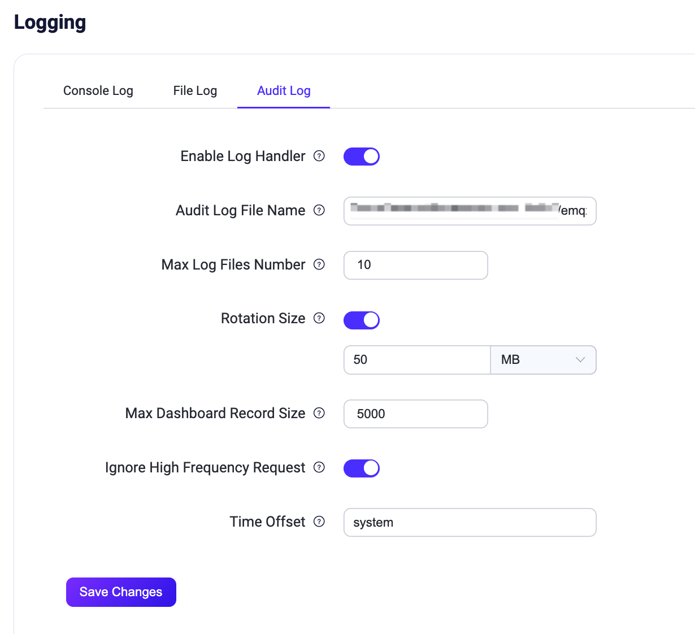
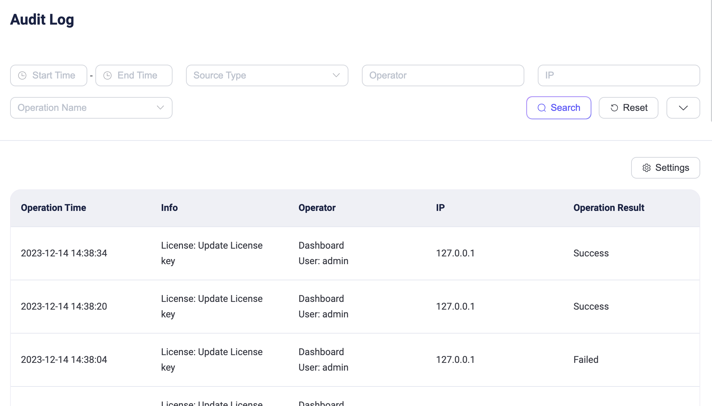

# 監査ログ

監査ログ機能は、EMQXクラスターにおける重要な運用変更をリアルタイムで追跡することを可能にします。監査ログを通じて、エンタープライズユーザーは誰がどの重要な操作をどのように、いつ行ったかを簡単に確認できます。これは、エンタープライズユーザーが規制要件を遵守し、運用中のデータセキュリティ監査を確実に行うための重要なツールです。

EMQX監査ログは、[ダッシュボード](./introduction.md)、[REST API](../api.md)、および[CLI](../cli.md)からの変更関連操作の記録をサポートしています。例えば、ダッシュボードのユーザーログインやクライアント、アクセス制御、データ統合の変更などです。ただし、メトリクス取得やクライアントリストの照会などの読み取り専用操作は記録されません。

EMQXは、監査ログの管理を支援するためにダッシュボードビューとログシステムとの連携を提供しています。これらの方法により、EMQXは柔軟かつ包括的に監査ログをサポートし、エンタープライズユーザーがニーズに応じて最適な監査ログの管理・閲覧方法を選択できるようにしています。

## 監査ログへのアクセス

EMQX 6.0.4以降、ダッシュボードでクラスター全体の監査ログを閲覧したり、`GET /api/v5/audit`で読み取れるのはグローバル管理者およびグローバルビューアのみです。監査ログにはすべてのネームスペースの操作が含まれ、呼び出し元のネームスペースによるフィルタリングは行われません。ネームスペース付きのダッシュボードユーザーやAPIキーからのリクエストは、役割や割り当てられたスコープに関わらずHTTP `403` と `UNAUTHORIZED_ROLE` エラーコードを返します。[`audit`スコープ](../api.md#built-in-api-key-scopes)はこの制限を上書きしません。

## 監査ログの有効化

監査ログ機能は、ダッシュボードおよび設定ファイルの両方から有効化および設定パラメータの調整が可能です。

### ダッシュボードから監査ログを有効化

監査ログを有効化し、設定パラメータを変更するには、ダッシュボードの **管理** -> **ログ** -> **監査ログ**、または **システム** -> **監査ログ** にアクセスしてください。



監査ログに対して以下のオプションを設定できます：

- **ログハンドラーを有効にする**：監査ログ処理プロセスの有効・無効を切り替えます。デフォルトで有効です。
- **監査ログファイル名**：監査ログファイルのパスと名前を指定します。デフォルトは `${EMQX_LOG_DIR}/audit.log` で、`${EMQX_LOG_DIR}` は変数でデフォルトは `./log`、最終的に `./log/audit.log.1` に保存されます。
- **最大ログファイル数**：ローテーションされるログファイルの最大数です。デフォルトは `10` です。
- **ローテーションサイズ**：ログファイルのサイズを設定し、指定サイズに達するとログファイルがローテーションされます。無効にするとログファイルは無制限に増加します。テキストボックスに値を入力し、ドロップダウンリストから `MB`、`GB`、`KB` などの単位を選択できます。デフォルトは `50MB` です。
- **キャッシュサイズ**：データベースに保存される最大レコード数を決定し、ダッシュボードや `/audit` API からアクセス・取得可能です。デフォルトは `5000` です。

  ::: tip 補足
  `log.audit.max_filter_size` は後方互換性のためエイリアスとして残されています。
  :::

- **高頻度リクエストを無視**：パブリッシュ／サブスクライブやクライアントのキックアウトなどの高頻度リクエストを無視し、監査ログの洪水を防ぐかどうかを制御します。デフォルトで有効です。
- **タイムスタンプ形式**：ログエントリのタイムスタンプに使用する形式です。選択肢は以下の通りです：
  - `auto`：ログフォーマッターに基づき最適な形式を自動選択します。JSONは `epoch`、テキストは `rfc3339` になります。
  - `epoch`：マイクロ秒単位のUnixエポック時間。
  - `rfc3339`：RFC3339形式。
- **時間オフセット**：ログエントリのタイムスタンプをフォーマットする際の時間オフセットです。選択肢は以下の通りです：
  - `system`：ローカルシステムの時間オフセット。
  - `utc`：UTC時間オフセット。
  - `+-[hh]:[mm]`：ユーザー指定の時間オフセット（例：`"-02:00"`、`"+00:00"`）。

  デフォルトは `system` です。
- **ペイロードエンコード**：ログエントリ内のペイロードデータのエンコード方法です。選択肢は `text`、`hex`、`hidden` で、デフォルトは `text` です。

### 設定ファイルから監査ログを有効化

`base.hocon` ファイルの `log.audit` セクションで監査ログを有効化し、設定オプションを変更することも可能です。以下は例です。

```hocon
log.audit {
  path = "./log/audit.log"
  rotation_count = 10
  rotation_size = 50MB
  cache_size = 5000
  ignore_high_frequency_request = true
  timestamp_format = auto
  time_offset = system
  payload_encode = text
}
```

## ダッシュボードで監査ログを閲覧

監査ログを有効化すると、ダッシュボードの **システム** -> **監査ログ** でログエントリを閲覧できます。



### 検索フィルター

以下の検索キーワードでログ操作をフィルタリング・検索できます：

- **開始時間** - **終了時間**：操作が行われた時間範囲。
- **ソースタイプ**：操作が行われた方法。選択肢は `Dashboard`、`REST API`、`CLI`、`Erlang Console` です。ここで `Erlang Console` はEMQによるオンサイト技術サポート時に使用されるErlang Shellコンソールを指します。
- **オペレーター**：ダッシュボードのユーザー名またはREST API呼び出しに使用されたキー名。操作方法がダッシュボードまたはREST APIの場合にのみ有効です。
- **IP**：ダッシュボードユーザーまたはREST APIを呼び出したクライアントの送信元IP。操作方法がダッシュボードまたはREST APIの場合にのみ表示されます。
- **操作名**：監査ログでサポートされている操作名のドロップダウンリストから選択。
- **操作結果**：`成功` または `失敗` のドロップダウンリストから選択。

### リストの説明

表示される監査ログリストの各列の説明は以下の通りです：

- **操作時間**：操作が行われた時間。
- **情報**：
  - ダッシュボードまたはREST APIの場合は操作名を表示。
  - CLIおよびコンソールの場合は実行されたコマンドを記録。
- **オペレーター**：操作方法と対応するオペレーターを含みます。CLIおよびコンソール操作の場合、オペレーターはコマンドが実行されたEMQXノード名です。
- **IP**：ダッシュボードユーザーまたはREST APIを呼び出したクライアントの送信元IP。操作方法がダッシュボードまたはREST APIの場合にのみ表示されます。
- **操作結果**：`成功` または `失敗`。失敗にはフォーム検証失敗やリソース削除不可などが含まれます。ダッシュボードまたはREST API操作のみ表示され、CLIおよびコンソールは操作結果を記録できません。

## ログファイルで監査ログを閲覧

監査ログを有効化すると、変更関連の操作は `./log/audit.log.1` ファイルにログ形式で保存されます。エンタープライズユーザーは監査記録の詳細な分析や既存のログ管理システムへの統合を容易に行うことができ、コンプライアンスやデータセキュリティ要件を満たせます。

::: warning 注意

コマンドライン操作の監査ログには機密情報が含まれる可能性があるため、ログコレクターに送信する際は注意が必要です。ログ内容のフィルタリングや暗号化通信の利用など、不正な情報漏洩を防ぐ対策を推奨します。

:::

監査ログに含まれるフィールドは、操作記録のソースによって異なります。

### ダッシュボードまたはREST APIからの操作記録

ダッシュボードまたはREST APIの操作を記録した監査ログには、操作ユーザー、操作対象、操作結果の情報が含まれます。ログメッセージの形式例は以下の通りです。

```bash
{"time":1702604675872987,"level":"info","source_ip":"127.0.0.1","operation_type":"mqtt","operation_result":"success","http_status_code":204,"http_method":"delete","operation_id":"/mqtt/retainer/message/:topic","duration_ms":4,"auth_type":"jwt_token","from":"dashboard","source":"admin","node":"emqx@127.0.0.1","http_request":{"method":"delete","headers":{"user-agent":"Mozilla/5.0 (Macintosh; Intel Mac OS X 10_15_7) AppleWebKit/537.36 (KHTML, like Gecko) Chrome/119.0.0.0 Safari/537.36","sec-fetch-site":"same-origin","sec-fetch-mode":"cors","sec-fetch-dest":"empty","sec-ch-ua-platform":"\"macOS\"","sec-ch-ua-mobile":"?0","sec-ch-ua":"\"Google Chrome\";v=\"119\", \"Chromium\";v=\"119\", \"Not?A_Brand\";v=\"24\"","referer":"http://localhost:18083/","origin":"http://localhost:18083","host":"localhost:18083","connection":"keep-alive","authorization":"******","accept-language":"zh-CN,zh;q=0.9,zh-TW;q=0.8,en;q=0.7","accept-encoding":"gzip, deflate, br","accept":"*/*"},"body":{},"bindings":{"topic":"$SYS/brokers/emqx@127.0.0.1/version"}}}
```

以下の表は、ダッシュボードまたはREST API操作によって生成される監査ログエントリに現れるフィールドの説明です。

| フィールド名           | 型       | 説明                                                         |
| ---------------------- | -------- | ------------------------------------------------------------ |
| time                   | 整数     | ログ記録のタイムスタンプ（マイクロ秒単位）。                 |
| level                  | 文字列   | ログレベル。                                                 |
| source_ip              | 文字列   | 操作の送信元IPアドレス。                                     |
| operation_type         | 文字列   | 操作の機能モジュール。REST APIのタグに対応。                 |
| operation_result       | 文字列   | 操作結果。`success`は成功、`failure`は失敗を示す。          |
| http_status_code       | 整数     | HTTPレスポンスステータスコード。                             |
| http_method            | 文字列   | HTTPリクエストメソッド。                                     |
| duration_ms            | 整数     | 操作実行時間（ミリ秒単位）。                                 |
| auth_type              | 文字列   | 認証タイプ。認証に使用された方法や仕組みを示し、`jwt_token`（ダッシュボード）または`api_key`（REST API）で固定。 |
| from                   | 文字列   | リクエストの送信元。`dashboard`、`rest_api`はそれぞれダッシュボード、REST APIを示す。`cli`、`erlang_console`の場合はCLIまたはErlang Shellからの操作であり、このログ構造は該当しない。 |
| source                 | 文字列   | 操作を行ったダッシュボードのユーザー名またはAPIキー名。     |
| node                   | 文字列   | ノード名。操作が実行されたノードまたはサーバーを示す。       |
| operation_id           | 文字列   | リクエストのREST APIパス。詳細は[REST API](../api.md)を参照。 |
| http_request           | オブジェクト | HTTPリクエストの詳細。                                      |
| http_request.method    | 文字列   | HTTPリクエストメソッド。                                     |
| http_request.bindings  | オブジェクト | `operation_id`内のプレースホルダーに対応するパスパラメーターの値。 |
| http_request.headers   | オブジェクト | HTTPリクエストヘッダー。機密情報と認識されるキーの値はマスクされる。 |
| http_request.body      | オブジェクト | HTTPリクエストボディ。機密情報と認識されるキーの値はマスクされる。 |
| http_request.query_string | オブジェクト（任意） | パース済みのURLクエリパラメーター。クエリパラメーターがない場合は省略。機密情報と認識されるキーの値はマスクされる。 |
| http_request.namespace | 文字列（任意） | 操作対象として解決されたネームスペース。グローバルネームスペースの場合は `global`。 |

#### ネームスペースとクエリパラメーター

EMQX 6.0.4以降、監査対象のダッシュボードおよびREST APIリクエストの非空クエリパラメーターは `http_request.query_string` に含まれます。データバックアップ操作では、リクエストに `namespace` クエリパラメーターが含まれているかに関わらず、解決された対象ネームスペースが `http_request.namespace` に記録されます。以下はグローバル管理者がバックアップを `ns2` にインポートする例です。

```json
{
  "http_request": {
    "method": "post",
    "body": {"filename": "emqx-export.zip"},
    "query_string": {"namespace": "ns2"},
    "namespace": "ns2"
  }
}
```

ネームスペース管理者が自身のネームスペースでクエリパラメーターなしにデータバックアップ操作を行う場合、`http_request.query_string` は省略されますが、解決されたネームスペースは `http_request.namespace` に含まれます。

解決された対象ネームスペースは、バックアップファイルのエクスポート、インポート、アップロード、削除を行うデータバックアップ操作で記録されます。対象ネームスペースを解決しない他のエンドポイントでは `http_request.namespace` は省略されます。

### CLIまたはErlangコンソールからの操作記録

CLIまたはErlangコンソールの操作を記録した監査ログには、実行されたコマンドや呼び出しパラメーターなどの情報が含まれます。ログメッセージの形式例は以下の通りです。

```bash
{"time":1695866030977555,"level":"info","msg":"from_cli","from": "cli","node":"emqx@127.0.0.1","duration_ms":0,"cmd":"retainer","args":["clean", "t/1"]}
```

以下の表は、上記ログメッセージに含まれるフィールドの説明です。

| フィールド名  | 型       | 説明                                                         |
| ------------ | -------- | ------------------------------------------------------------ |
| time         | 整数     | ログ記録のタイムスタンプ（マイクロ秒単位）。                 |
| level        | 文字列   | ログレベル。                                                 |
| msg          | 文字列   | 操作の説明。                                                 |
| from         | 文字列   | リクエストの送信元。`cli`、`erlang_console`はそれぞれCLI、Erlang Shellを示す。`dashboard`、`rest_api`の場合はダッシュボードまたはREST APIの操作であり、このログ構造は該当しない。 |
| node         | 文字列   | ノード名。操作が実行されたノードまたはサーバーを示す。       |
| duration_ms  | 整数     | 操作の実行時間（ミリ秒単位）。                               |
| cmd          | 文字列   | 実行された具体的なコマンド操作。対応コマンドは[CLI](../cli.md)を参照。 |
| args         | 配列     | コマンドに付随する追加パラメーター。複数パラメーターは配列で区切られる。 |
