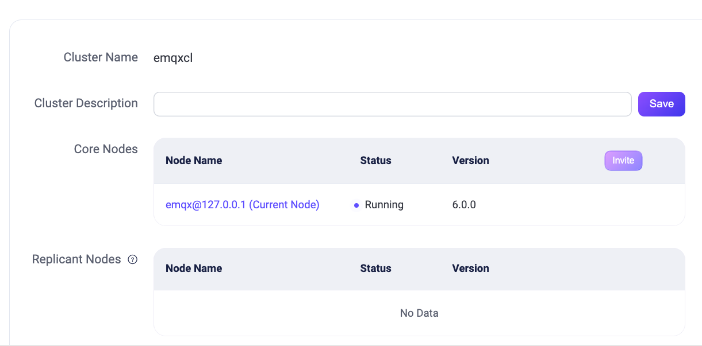
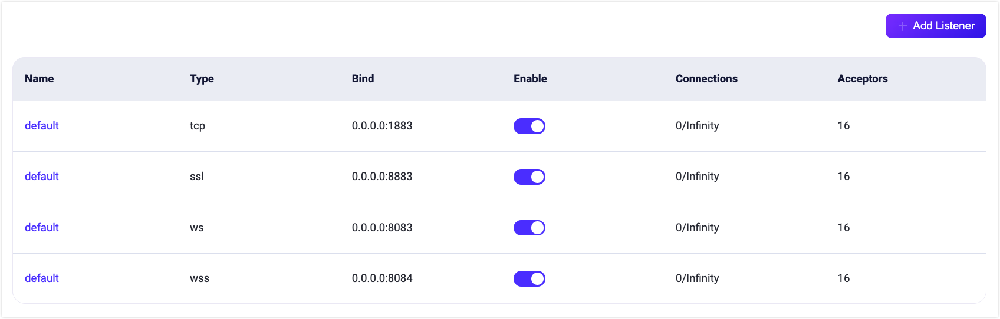
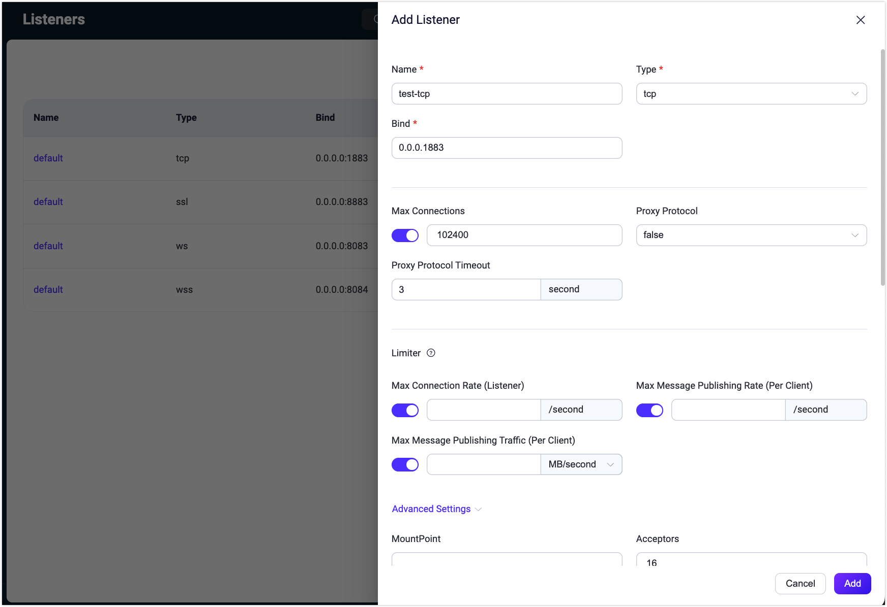
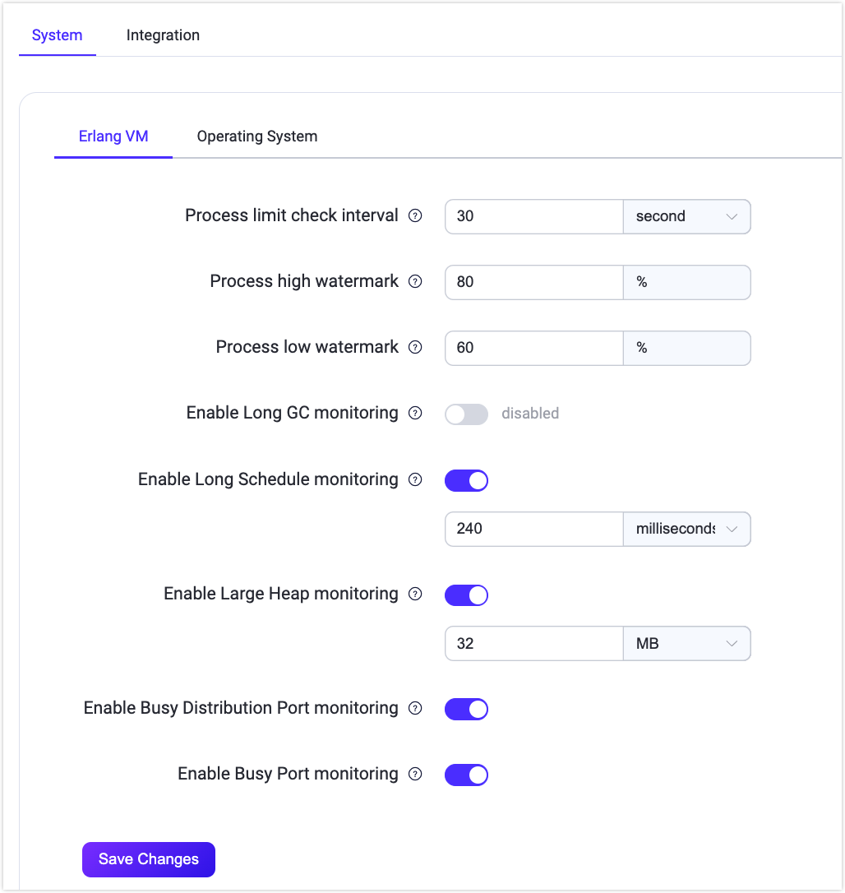
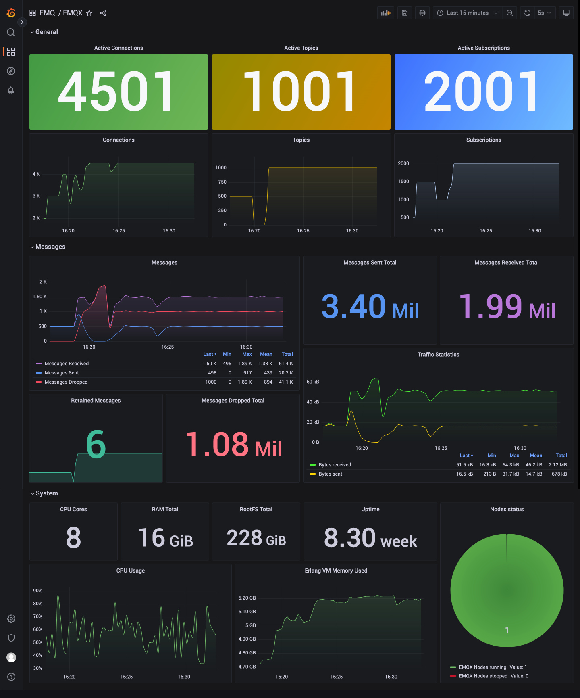

# クラスター設定

EMQXはホットコンフィギュレーション機能を提供しており、EMQXノードを再起動することなく、実行時に設定を動的に変更できます。EMQXダッシュボードはホットコンフィギュレーション機能を備えた視覚的な設定ページを提供しており、EMQXの設定を簡単に変更できます。

クラスター設定モジュールは以下のサブモジュールを提供します：

- MQTT設定
- クラスター
- ネームスペース
- ルールエンジンセキュリティ
- リスナー
- ロギング
- モニタリング
- クラスターリンク

## MQTT設定

**MQTT設定**ページでは、MQTTプロトコルに関連する設定機能を提供しています。このページでは以下のようなMQTT関連の各種パラメータを設定できます。

### 一般

**一般**タブページには、アイドルタイムアウト、最大パケットサイズ、最大クライアントID長、最大トピックレベル数、最大許容QoSレベルなど、MQTTプロトコルの一般的な基本設定項目が含まれています。

### セッション

**セッション**タブページには、MQTTセッション管理に関連する設定項目が含まれています。例えば、セッション有効期限間隔（MQTT 5.0以外の接続のみ対応、MQTT 5.0接続はクライアント側で設定が必要）、最大サブスクリプション数、最大フライトウィンドウ、QoS 0メッセージの保存有無などです。

### Durable Sessions

**Durable Sessions**タブページには、[MQTT Durable Sessions](../durability/durability_introduction.md)機能に関連する設定項目が含まれており、メッセージ保持期間、メッセージクエリバッチサイズ、アイドルポーリング間隔、セッションハートビート間隔などがあります。

### Retainer

**Retainer**タブページには、保持メッセージに関するMQTTプロトコル関連の設定項目が含まれています。例えば、保持メッセージの有効化、メッセージの保存タイプと方法、最大保持メッセージ数、保持メッセージのペイロードサイズ、メッセージ有効期限間隔などです。詳細は[保持メッセージの設定](./retained.md#retainer-settings)をご参照ください。

> 保持メッセージが無効化されている場合、既存の保持メッセージは削除されません。

### システムトピック

**システムトピック**タブページでは、EMQXの組み込みシステムトピックに関する設定項目を提供しています。EMQXは定期的に稼働状況、使用統計、リアルタイムクライアントイベントを`$SYS/`で始まるシステムトピックにパブリッシュします。クライアントがこれらのトピックをサブスクライブすると、関連情報がパブリッシュされます。設定項目にはメッセージパブリッシュ間隔、ハートビート間隔などがあります。

### 強制シャットダウン

**強制シャットダウン**タブでは、リソース使用率の閾値に基づく自動シャットダウンの動作を設定できます。この機能は、メッセージキューの長さやヒープサイズなどの過剰なリソース消費によるEMQXの不安定化を防止します。

**強制シャットダウン**タブページで設定可能な項目は以下の通りです：

- **強制シャットダウンを有効にする**：このトグルスイッチで強制シャットダウン機能の有効／無効を切り替えます。有効時は指定したリソース閾値を超えた場合にクライアントプロセスのシャットダウンが自動的にトリガーされます。デフォルトで有効です。
- **最大ヒープサイズ**：システムの最大許容ヒープサイズを指定します。ヒープサイズがこの制限を超えると、システムの安定性を保つために強制シャットダウンが開始されます。デフォルト値は`32 MB`です。
- **最大メールボックスサイズ**：メールボックスのメッセージキューの最大許容長さを定義します。キューがこの長さを超えると、システム過負荷を防ぐために強制シャットダウンがトリガーされます。デフォルト値は`1000`です。

## クラスター

**クラスター**設定ページでは、EMQXクラスターのノード管理が可能で、ノードの詳細表示、新規ノードの招待、既存ノードの削除が行えます。

::: tip 注意

EMQX Community Editionをご利用の場合、新規ノードの招待はサポートされていません。クラスター機能はトライアル期間中のみ利用可能で、トライアル終了後は商用ライセンスが必要です。ライセンスがない場合は機能が無効化されます。

:::

EMQX v6.0.0以降では、クラスターの目的や環境を識別しやすくするために**クラスター説明**を追加できるようになりました。入力欄に意味のある説明を入力し、**保存**をクリックして適用します。

保存後、クラスター説明はダッシュボードの上部に表示され、**クラスター**や**クラスター概要**などのページで素早く参照できます。編集アイコンをクリックすると**クラスター**ページに戻り、説明を更新できます。

- ノードの詳細を確認するには、ノード名をクリックしてください。**クラスタービュー**ページに遷移し、詳細情報が表示されます。

- ノードを招待するには、**招待**をクリックし、**ノード名**欄にノードのIPアドレスまたはホスト名を入力して、**確認**をクリックします。

- ノードを削除するには、**削除**をクリックします。削除前に確認ダイアログが表示されます。

EMQXはコマンドラインインターフェース（CLI）を使ったクラスターの作成および管理もサポートしています。詳細は[クラスターの作成と管理](../cluster/create-cluster.md)をご参照ください。

## ネームスペース

EMQXのネームスペース機能は、単一クラスター内で異なるクライアントグループの論理的な分離を提供します。ネームスペースは**ネームスペース**ページで管理できます。ネームスペースの管理および設定方法の詳細は[ネームスペース](../multi-tenancy/namespace-overview.md)をご覧ください。

## ルールエンジンセキュリティ

EMQXのコネクター、ブリッジ、アクションは外部サービスへのアウトバウンドネットワーク接続を開きます。制御がない場合、誤設定や悪意のあるターゲットにより、EMQXが内部や機密宛先に意図しないリクエストを送る可能性があり、これはサーバーサイドリクエストフォージェリ（SSRF）と呼ばれる脆弱性の一種です。

EMQX 6.0.3以降、**ルールエンジンセキュリティ**ページでダッシュボードから組み込みのSSRF保護ポリシーを設定できます。EMQX 6.0.4以降、このポリシーはHTTPコネクターの`url`フィールドとMQTTコネクターの`server`フィールドのみを、設定のテスト、作成、更新時に検証します。ブロックされたターゲットはその時点で拒否されます。

::: warning 重要なお知らせ
SSRFポリシーは他のコネクタータイプ、コネクターの有効化／無効化操作、コネクター削除、実行時のアウトバウンド接続は検証しません。保存済みのHTTPまたはMQTTコネクターは、作成後にターゲットがブロックされても有効化可能です。その他のコネクタータイプ、保存済みコネクター設定へのポリシー変更、DNSリバインディング、実行時のアドレス変更に対する保護が必要な場合は、`iptables`や`nftables`などのホストレベルのイグレス制御を使用してください。詳細は[ルールエンジンポリシーとファイアウォールルールによるSSRF緩和](../cluster/security.md#mitigate-ssrf-with-rule-engine-policy-and-firewall-rules)をご覧ください。
:::

### SSRF保護の有効化

**SSRF保護を有効にする**を切り替えてポリシーのオン／オフを設定します。有効時、EMQXはHTTPコネクターの`url`とMQTTコネクターの`server`を、設定のテスト、作成、更新時に評価します。評価の順序は以下の通りです：

1. **拒否ホスト名**と完全一致するか確認：一致すれば即座に拒否。
2. 解決されたIPが**許可CIDRレンジ**に含まれるか確認：含まれれば許可。
3. 解決されたIPが**拒否CIDRレンジ**に含まれるか確認：含まれれば拒否。

このポリシーは既存設定との互換性のためデフォルトで無効です。HTTPおよびMQTTコネクターの設定でブロックされたターゲットを持つものの接続テスト通過や作成・更新を防止したい場合に有効化してください。これらのコネクターが内部サービスにアクセスする必要がある場合は、ポリシー有効化前に許可および拒否CIDRレンジを見直し、調整してください。

### 許可CIDRレンジ

解決されたIPアドレスが常に許可されるCIDRレンジのリストです。拒否CIDRレンジに関係なく許可されます。HTTPまたはMQTTコネクターが到達すべき特定の内部サブネットを明示的に許可するために使用します。

解決されたIPがこのリストのいずれかに一致すると、拒否CIDRチェックをバイパスします。

### 拒否CIDRレンジ

HTTPまたはMQTTコネクターの設定のテスト、作成、更新時にEMQXが拒否するCIDRレンジのリストです。デフォルトセットはSSRF攻撃でよく悪用されるアドレスをカバーしています：

| CIDR | 説明 |
|---|---|
| `127.0.0.0/8` | IPv4ループバック |
| `::1/128` | IPv6ループバック |
| `169.254.0.0/16` | IPv4リンクローカル（AWS/Azureメタデータ含む） |
| `fe80::/10` | IPv6リンクローカル |
| `10.0.0.0/8` | プライベートネットワーク（RFC 1918） |
| `172.16.0.0/12` | プライベートネットワーク（RFC 1918） |
| `192.168.0.0/16` | プライベートネットワーク（RFC 1918） |
| `fc00::/7` | IPv6ユニークローカル |
| `0.0.0.0/32` | 未指定アドレス |
| `224.0.0.0/4` | IPv4マルチキャスト |
| `ff00::/8` | IPv6マルチキャスト |
| `100.100.100.200/32` | Alibaba Cloudメタデータサービス |

::: warning 重要なお知らせ
デフォルトの拒否CIDRリストからエントリを削除すると、EMQXがSSRF攻撃にさらされる可能性があります。特定の運用要件があり、セキュリティ上の影響を理解している場合のみ削除してください。
:::

HTTPまたはMQTTコネクターがデフォルト拒否リストのアドレスに到達する必要がある場合は、拒否リストから削除するのではなく、**許可CIDRレンジ**に追加してください。許可リストが優先されます。

### 拒否ホスト名

HTTPまたはMQTTコネクターの設定のテスト、作成、更新時にEMQXが拒否するホスト名のリストです。解決されたIPアドレスに関係なく拒否されます。ホスト名マッチは完全一致かつ大文字小文字を区別しません。既知のクラウドメタデータエンドポイントを名前でブロックする際に有用です。

変更を適用するには**変更を保存**をクリックしてください。

## リスナー

**リスナー**ページはデフォルトでリスナーの一覧を表示します。EMQXは以下の4種類の一般的なリスナーを提供しています：

- ポート1883を使用するTCPリスナー
- ポート8883を使用するSSL/TLSセキュア接続リスナー
- ポート8083を使用するWebSocketリスナー
- ポート8084を使用するWebSocketセキュアリスナー

通常は、対応するポートとプロトコルタイプを指定してこれらのデフォルトリスナーを使用します。別のタイプのリスナーを追加するには、右上の**+リスナー追加**ボタンをクリックして新規リスナーを作成します。

### リスナー追加

**リスナー追加**ポップアップパネルにはリスナー追加用のフォームが表示され、基本設定項目が含まれています。リスナーを識別するための名前を入力し、リスナータイプ（TCP、SSL、WS、WSS）を選択し、リスナーアドレス（IPアドレスとポート番号）を入力します。IPアドレスを指定するとリスナーのアクセス範囲を制限できますし、ポート番号のみを指定することも可能です。

#### レートリミット

**リスナー追加**フォームの**リミッター**セクションでは、EMQX稼働中のメッセージ受信およびパブリッシュレートを制限できます。例えば：

- 最大接続レート（リスナー単位）
- 最大メッセージパブリッシュレート（クライアント単位）
- 最大メッセージパブリッシュトラフィック（クライアント単位）

レートリミットを設定することで、メッセージデータの過負荷や過剰なクライアント要求発生時のシステムおよびネットワークの安定性を確保します。

レートリミットの詳細設定は[レートリミット](../rate-limit.md)をご参照ください。

リスナー設定の詳細は[EMQX Enterprise設定マニュアル](https://docs.emqx.com/en/enterprise/v@EE_VERSION@/hocon/)をご覧ください。

### リスナー管理

リスナーを追加すると一覧に表示されます。リスナー名をクリックすると編集ページに入り、設定の変更や削除が可能です。リスナー名、タイプ、リスナーアドレスは設定画面で変更できません。

編集ページの**削除**ボタンをクリックするとリスナーを削除できます。削除時にはリスナー名の入力による確認が必要です。また、有効スイッチを切り替えてリスナーの有効／無効を切り替えられます。リストには各リスナーの接続数も表示されます。

::: tip 警告

リスナーの変更および削除はリスクの高い操作です。慎重に行ってください。リスナーを更新または削除すると、そのリスナーに接続しているクライアントは切断されます。

:::

## ロギング

**ロギング**ページには**コンソールログ**、**ファイルログ**、**ログスロットリング**、**監査ログ**のタブがあります。

EMQXはコンソールログとファイルログの2種類のログ出力をサポートしており、必要に応じていずれかまたは両方を選択できます。対応する設定ページでログハンドラーの有効／無効、ログレベル、ログフォーマットタイプを設定でき、ファイルログの場合はログファイルのパスやログ名も指定可能です。ログの詳細な設定方法は[ダッシュボードによるロギング設定](../observability/log.md#configure-logging-via-dashboard)をご参照ください。

**ログスロットリング**タブページではログスロットリングの時間ウィンドウを設定できます。ログスロットリングの詳細は[ログレート制限](../observability/log.md#log-throttling)をご覧ください。

**監査ログ**ページではEMQXの監査ログ機能の有効／無効および設定が可能です。詳細な設定方法は[監査ログ](./audit-log.md)をご参照ください。

## モニタリング

::: tip 注意

モニタリング機能はEMQX Enterpriseエディションのみで利用可能です。

:::

**モニタリング**ページには以下の2つのタブがあります：

- **システム**：ユーザーのニーズに応じて、[アラーム](./alarm_dashboard.md)機能のアラーム閾値やチェック間隔などの設定をある程度調整可能です。
- **統合**：サードパーティのモニタリングプラットフォームとの統合設定を提供します。

### システム

現在のアラームトリガー閾値やアラーム監視チェック間隔のデフォルト値が実際のニーズに合わない場合、このページで設定を調整できます。現在の設定は**Erlang VM**と**オペレーティングシステム**の2つのモジュールに分かれており、各設定項目のデフォルト値と説明は[アラーム](../observability/alarms.md)に記載されています。

### 統合

このページは主にサードパーティモニタリングプラットフォームとの統合設定を提供します。現在、EMQXは**Prometheus**、**OpenTelemetry**、**Datadog**との統合をサポートしています。

`Prometheus`サードパーティモニタリングサービスを利用する場合、このページで設定を素早く有効化し、プッシュデータのアドレスやデータ報告間隔などのパラメータを設定できます。EMQXが提供するAPI `/prometheus/stats` を直接利用してモニタリングデータを取得可能で、このAPI利用時には認証情報は不要です。詳細は[Prometheus](../observability/prometheus.md)をご参照ください。

通常、EMQXのメトリクスデータを監視するために`Pushgateway`を使用する必要はありません。`Pushgateway`サービスのアドレスを設定してモニタリングデータを`Pushgateway`にプッシュし、`Pushgateway`が`Prometheus`サービスにデータを送信する方法も選択可能です。詳細は[Pushgatewayを使用する場合](https://prometheus.io/docs/practices/pushing/)をご覧ください。

ページ下部の**ヘルプ**ボタンをクリックし、デフォルトまたは`Pushgateway`方式を選択し、提供された手順に従って関連サービスのアドレスやAPI情報を設定すると、対応する`Prometheus`設定ファイルを素早く生成できます。最後にこの設定ファイルを使って`Prometheus`サービスを起動します。

ユーザーはニーズに応じて`Grafana`でモニタリングデータをカスタマイズおよび修正できます。`Prometheus`サービス起動後、ヘルプページの最後にある`Grafanaテンプレートをダウンロード`ボタンをクリックして、当社が提供するデフォルトダッシュボードの設定ファイルをダウンロード可能です。ファイルを`Grafana`にインポートすると、可視化パネルでEMQXのモニタリングデータを閲覧できます。テンプレートは[Grafana公式サイト](https://grafana.com/grafana/dashboards/17446-emqx/)からもダウンロード可能です。

OpenTelemetryおよびDatadogとの統合の詳細設定は[OpenTelemetryとの統合](../observability/opentelemetry/opentelemetry.md)および[Datadogとの統合](../observability/datadog.md)をご参照ください。

## クラスターリンク

クラスターリンク機能は複数の独立したEMQXクラスターを接続し、地理的に分散したクラスター間でクライアント同士が通信できるようにします。ユーザーはこのページでクラスターリンクの作成および設定が可能です。作成および設定の詳細な手順は[EMQXクラスターリンク](../../develop/cluster-linking/introduction.md)をご覧ください。
