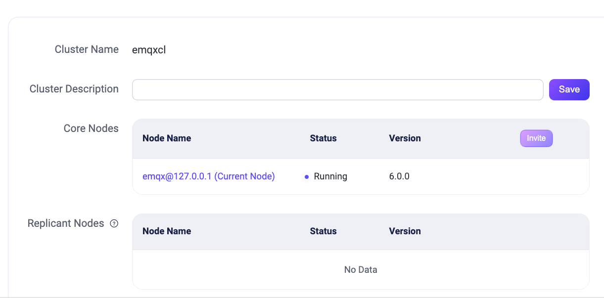
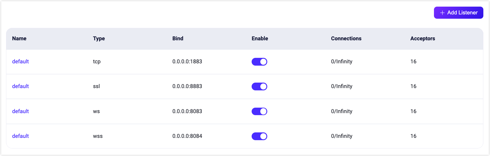
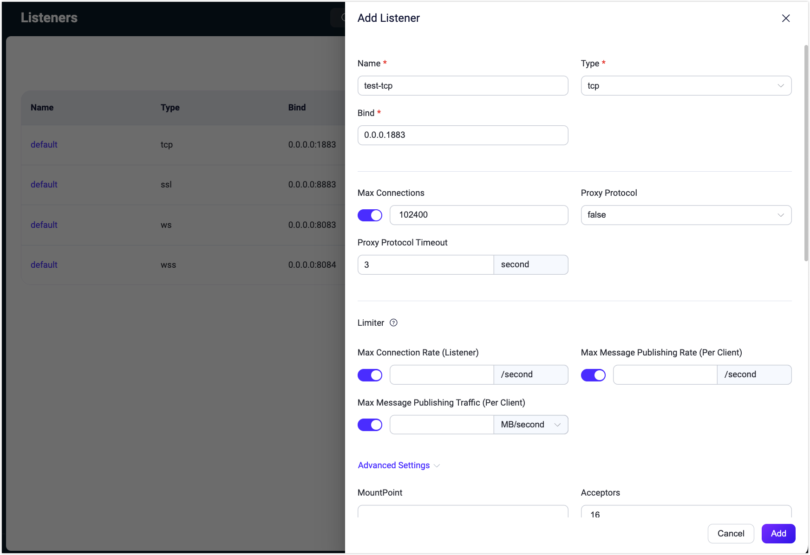
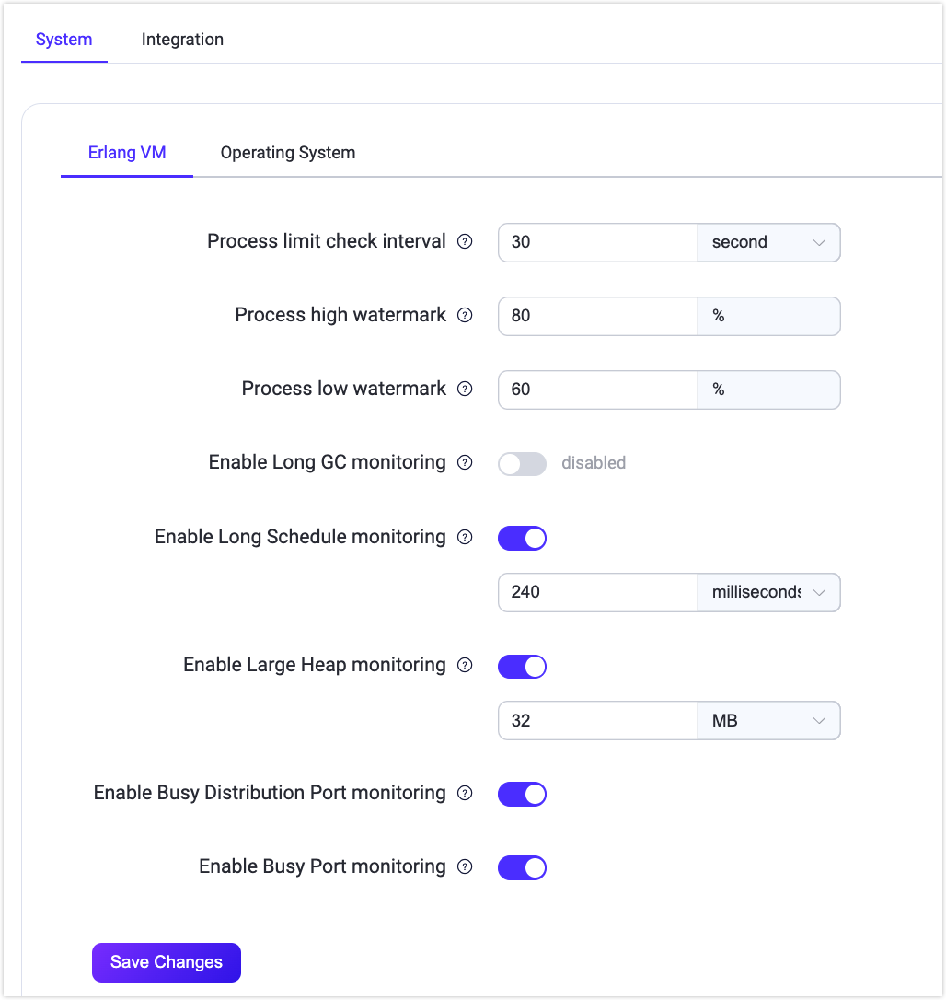
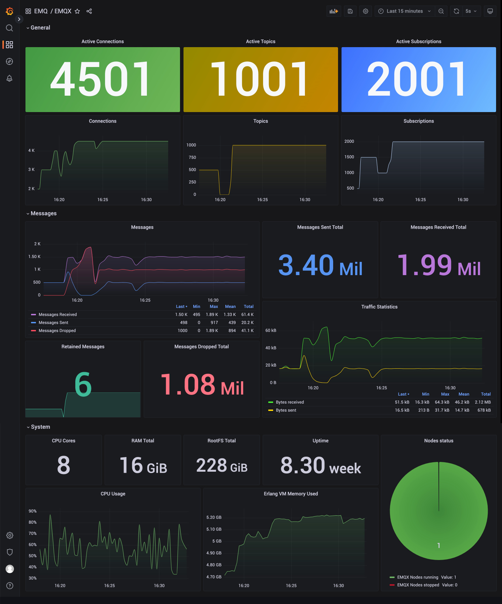

# クラスター設定

EMQXはホット設定機能を提供しており、EMQXノードを再起動することなくランタイムで設定を動的に変更できます。EMQXダッシュボードはホット設定機能を備えた視覚的な設定ページを提供し、EMQXの設定を簡単に変更できます。

クラスター設定モジュールは以下のサブモジュールを提供します。

- MQTT設定
- クラスター
- ネームスペース
- ルールエンジンセキュリティ
- リスナー
- ロギング
- モニタリング
- クラスターリンク

## MQTT設定

**MQTT設定**ページはMQTTプロトコルに関連する設定機能を提供します。このページでは以下を含む様々なMQTT関連パラメータを設定できます。

### 一般

**一般**タブページには、アイドルタイムアウト、最大パケットサイズ、最大クライアントID長、最大トピックレベル数、最大許容QoSレベルなど、MQTTプロトコルの基本的な一般設定項目が含まれています。

### セッション

**セッション**タブページには、MQTTセッション管理に関連する設定項目が含まれています。例えば、セッション有効期限間隔（MQTT 5.0以外の接続のみサポート。MQTT 5.0接続はクライアント側で設定が必要）、最大サブスクリプション数、最大フライトウィンドウ、QoS 0メッセージの保存有無などです。

### Durable Sessions

**Durable Sessions**タブページには、[MQTT Durable Sessions](../durability/durability_introduction.md)機能に関連する設定項目が含まれています。メッセージ保持期間、メッセージクエリバッチサイズ、アイドルポーリング間隔、セッションハートビート間隔などが設定可能です。

### Retainer

**Retainer**タブページには、保持メッセージに関するMQTTプロトコル関連の設定項目が含まれています。保持メッセージの有効化、メッセージ保存タイプと方法、最大保持メッセージ数、保持メッセージのペイロードサイズ、メッセージ有効期限間隔などです。詳細は[保持メッセージの設定](./retained.md#retainer-settings)を参照してください。

> 保持メッセージを無効にしても、既存の保持メッセージは削除されません。

### システムトピック

**システムトピック**タブページは、EMQXの組み込みシステムトピックに関する設定項目を提供します。EMQXは定期的に運用状況、使用統計、リアルタイムクライアントイベントを`$SYS/`で始まるシステムトピックにパブリッシュします。クライアントがこれらのトピックをサブスクライブすると、関連情報がパブリッシュされます。システムトピックの設定項目にはメッセージパブリッシュ間隔、ハートビート間隔などがあります。

### 強制シャットダウン

**強制シャットダウン**タブでは、リソース使用率の閾値に基づく自動シャットダウン動作を設定できます。この機能は、メッセージキューの長さやヒープサイズなどの過剰なリソース消費によるEMQXの不安定化を防ぎます。

**強制シャットダウン**タブで設定可能な項目は以下の通りです。

- **強制シャットダウンを有効にする**: このトグルスイッチで強制シャットダウン機能の有効／無効を切り替えます。有効時は指定したリソース閾値を超えた場合にクライアントプロセスのシャットダウンを自動的にトリガーします。デフォルトで有効です。
- **最大ヒープサイズ**: システムの最大許容ヒープサイズを指定します。ヒープサイズがこの値を超えると、システムの安定性を保つために強制シャットダウンが開始されます。デフォルト値は`32 MB`です。
- **最大メールボックスサイズ**: メールボックスメッセージキューの最大許容長さを定義します。キューがこの長さを超えると、システム過負荷を防ぐために強制シャットダウンがトリガーされます。デフォルト値は`1000`です。

## クラスター

**クラスター**設定ページでは、EMQXクラスターのノード管理が可能で、ノードの詳細表示、新規ノードの招待、既存ノードの削除が行えます。

::: tip 注意

EMQX Community Editionを使用している場合、新規ノードの招待はサポートされていません。クラスタリング機能はトライアル期間中のみ利用可能で、トライアル終了後は商用ライセンスが必要です。ライセンスがない場合、機能は無効化されます。

:::

EMQX v6.0.0以降、クラスターの目的や環境を識別するための**クラスター説明**を追加できるようになりました。入力欄に意味のある説明を入力し、**保存**をクリックして適用します。

保存後、クラスター説明はダッシュボードの上部に表示され、**クラスター**や**クラスター概要**などのページで素早く参照できます。編集アイコンをクリックすると**クラスター**ページに戻り、説明を更新可能です。

- ノードの詳細を表示するには、ノード名をクリックします。詳細情報のために**クラスター表示**ページに遷移します。

- ノードを招待するには、**招待**をクリックし、**ノード名**欄にノードのIPアドレスまたはホスト名を入力して**確認**をクリックします。

- ノードを削除するには、**削除**をクリックします。削除前に確認ダイアログが表示されます。

EMQXはコマンドラインインターフェース（CLI）によるクラスター作成・管理もサポートしています。詳細は[クラスターの作成と管理](../cluster/create-cluster.md)を参照してください。

## ネームスペース

EMQXのネームスペース機能は、単一クラスター内で異なるクライアントグループを論理的に分離します。ネームスペースは**ネームスペース**ページで管理できます。詳細な管理・設定方法は[ネームスペース](../multi-tenancy/namespace-overview.md)を参照してください。

## ルールエンジンセキュリティ

EMQXのコネクター、ブリッジ、アクションは外部サービスへのアウトバウンドネットワーク接続を開きます。制御がなければ、誤設定や悪意のあるターゲットによりEMQXが内部または機密宛先に意図しないリクエストを送る可能性があり、これはサーバーサイドリクエストフォージェリ（SSRF）と呼ばれる脆弱性の一種です。

EMQX 6.0.3以降、**ルールエンジンセキュリティ**ページでダッシュボードから組み込みのSSRF保護ポリシーを設定できます。EMQX 6.0.4以降、このポリシーはHTTPコネクターの`url`フィールドとMQTTコネクターの`server`フィールドの設定テスト、作成、更新時にのみ検証します。ブロックされたターゲットはその時点で拒否されます。

::: warning 重要なお知らせ
SSRFポリシーは他のコネクタータイプ、コネクターの有効／無効操作、削除、ランタイムのアウトバウンド接続を検証しません。作成後にターゲットがブロック対象になっても、保存済みのHTTPまたはMQTTコネクターは有効化可能です。その他のコネクタータイプやポリシー変更の適用、DNSリバインディング、ランタイムのアドレス変更に対する保護が必要な場合は、`iptables`や`nftables`などのホストレベルのイグレス制御を利用してください。詳細は[ルールエンジンポリシーとファイアウォールルールによるSSRF緩和](../cluster/security.md#mitigate-ssrf-with-rule-engine-policy-and-firewall-rules)を参照してください。
:::

### SSRF保護の有効化

**SSRF保護を有効にする**を切り替えてポリシーのオン／オフを設定します。有効時は、HTTPコネクターの`url`とMQTTコネクターの`server`を設定テスト、作成、更新時に評価します。評価順序は以下の通りです。

1. **拒否ホスト名**に対する完全一致（大文字小文字不問）：一致した場合は即時拒否。
2. 解決されたIPが**許可CIDR範囲**に含まれるか確認：含まれる場合は許可。
3. 解決されたIPが**拒否CIDR範囲**に含まれるか確認：含まれる場合は拒否。

このポリシーは既存設定との互換性のためデフォルトで無効です。ブロック対象のHTTPおよびMQTTコネクター設定の接続テスト通過や作成・更新を防止したい場合に有効化してください。内部サービスに接続する必要がある場合は、ポリシー有効化前に許可・拒否CIDR範囲を見直してください。

### 許可CIDR範囲

解決されたIPアドレスが常に許可されるCIDR範囲のリストです。拒否CIDR範囲に関係なく許可されます。HTTPまたはMQTTコネクターが到達すべき特定の内部サブネットを明示的に許可するために使用します。

解決されたIPがこのリストのエントリに一致すると、拒否CIDRチェックをバイパスします。

### 拒否CIDR範囲

HTTPまたはMQTTコネクターの設定テスト、作成、更新時にEMQXが拒否するCIDR範囲のリストです。デフォルトセットはSSRF攻撃でよく悪用されるアドレスをカバーしています。

| CIDR | 説明 |
|---|---|
| `127.0.0.0/8` | IPv4ループバック |
| `::1/128` | IPv6ループバック |
| `169.254.0.0/16` | IPv4リンクローカル（AWS/Azureメタデータ含む） |
| `fe80::/10` | IPv6リンクローカル |
| `10.0.0.0/8` | プライベートネットワーク（RFC 1918） |
| `172.16.0.0/12` | プライベートネットワーク（RFC 1918） |
| `192.168.0.0/16` | プライベートネットワーク（RFC 1918） |
| `fc00::/7` | IPv6ユニークローカル |
| `0.0.0.0/32` | 未指定アドレス |
| `224.0.0.0/4` | IPv4マルチキャスト |
| `ff00::/8` | IPv6マルチキャスト |
| `100.100.100.200/32` | Alibaba Cloudメタデータサービス |

::: warning 重要なお知らせ
デフォルトの拒否CIDRリストからエントリを削除すると、EMQXがSSRF攻撃にさらされる可能性があります。特定の運用要件があり、セキュリティ影響を理解している場合のみ削除してください。
:::

HTTPまたはMQTTコネクターがデフォルト拒否リスト内のアドレスに到達する必要がある場合は、拒否リストから削除するのではなく、**許可CIDR範囲**に追加してください。許可リストが優先されます。

### 拒否ホスト名

HTTPまたはMQTTコネクターの設定テスト、作成、更新時にEMQXが拒否するホスト名のリストです。解決されたIPアドレスに関係なく適用されます。ホスト名の一致は完全一致かつ大文字小文字不問です。既知のクラウドメタデータエンドポイントを名前でブロックするのに便利です。

変更を適用するには**変更を保存**をクリックしてください。

## リスナー

**リスナー**はデフォルトでリスナーの一覧を表示します。EMQXは以下の4つの一般的なリスナーを提供しています。

- ポート1883を使うTCPリスナー
- ポート8883を使うSSL/TLSセキュア接続リスナー
- ポート8083を使うWebSocketリスナー
- ポート8084を使うWebSocketセキュアリスナー

通常は対応するポートとプロトコルタイプを指定してこれらのデフォルトリスナーを使用します。別のタイプのリスナーを追加するには、右上の**+リスナー追加**ボタンをクリックして新規リスナーを作成します。

### リスナー追加

**リスナー追加**ポップアップパネルにはリスナー追加用のフォームが表示され、基本設定項目が含まれています。リスナーを識別する名前を入力し、リスナータイプ（TCP、SSL、WS、WSS）を選択し、リスナーアドレス（IPアドレスとポート番号）を入力します。IPアドレスを指定するとリスナーのアクセス範囲を制限できますし、ポート番号のみ指定も可能です。

#### レート制限

**リスナー追加**フォームの**リミッター**セクションでは、EMQX稼働中のメッセージ受信およびパブリッシュレートを制限できます。例えば、

- 最大接続レート（リスナー単位）
- 最大メッセージパブリッシュレート（クライアント単位）
- 最大メッセージパブリッシュトラフィック（クライアント単位）

レート制限を設定することで、メッセージデータの過負荷や過剰なクライアント要求時のシステムおよびネットワークの安定性を確保します。

レート制限の詳細な設定は[レート制限](../rate-limit.md)を参照してください。

リスナー設定の詳細は[EMQX Enterprise設定マニュアル](https://docs.emqx.com/en/enterprise/v@EE_VERSION@/hocon/)をご覧ください。

### リスナー管理

リスナーを追加すると一覧に表示されます。リスナー名をクリックすると編集ページに入り、設定の変更や削除が可能です。リスナー名、タイプ、リスナーアドレスは設定画面で変更できません。

編集ページの**削除**ボタンでリスナーを削除できます。削除時はリスナー名の入力による確認が必要です。リスナーの有効／無効はトグルスイッチで切り替えられます。リストには各リスナーの接続数も表示されます。

::: tip 警告

リスナーの変更および削除はリスクの高い操作です。慎重に行ってください。リスナーが更新または削除されると、そのリスナー上のクライアント接続は切断されます。

:::

## ロギング

**ロギング**ページには**コンソールログ**、**ファイルログ**、**ログスロットリング**、**監査ログ**のタブがあります。

EMQXはコンソールログとファイルログの2種類のログ出力をサポートしており、必要に応じていずれかまたは両方を選択可能です。対応する設定ページでログハンドラーの有効／無効、ログレベル、ログフォーマットタイプを設定でき、ファイルログの場合はログファイルのパスとログ名を指定できます。ログの詳細な設定方法は[ダッシュボードによるロギング設定](../observability/log.md#configure-logging-via-dashboard)を参照してください。

**ログスロットリング**タブページではログスロットリングの時間ウィンドウを設定できます。詳細は[ログレート制限](../observability/log.md#log-throttling)を参照してください。

**監査ログ**ページではEMQXの監査ログ機能の有効化／無効化や設定が可能です。詳細な設定方法は[監査ログ](./audit-log.md)を参照してください。

## モニタリング

::: tip 注意

モニタリング機能はEMQX Enterpriseエディションでのみ利用可能です。

:::

**モニタリング**ページには以下の2つのタブがあります。

- **システム**: ユーザーのニーズに応じて[アラーム](./alarm_dashboard.md)機能の閾値やチェック間隔などの設定を調整可能です。
- **統合**: サードパーティのモニタリングプラットフォームとの統合設定を提供します。

### システム

現在のアラームトリガー閾値や監視チェック間隔のデフォルト値が実際のニーズに合わない場合、このページで調整できます。設定は**Erlang VM**と**オペレーティングシステム**の2モジュールに分かれており、各設定項目のデフォルト値と説明は[アラーム](../observability/alarms.md)に記載されています。

### 統合

このページは主にサードパーティのモニタリングプラットフォームとの統合設定を提供します。現在、EMQXは**Prometheus**、**OpenTelemetry**、**Datadog**との統合をサポートしています。

`Prometheus`を使用する場合、このページで設定を素早く有効化し、プッシュデータのアドレスやデータ報告間隔などのパラメータを設定できます。EMQXが提供するAPI `/prometheus/stats`を直接利用してモニタリングデータを取得可能で、このAPI利用時は認証情報は不要です。詳細は[Prometheus](../observability/prometheus.md)を参照してください。

通常、EMQXのメトリクスデータ監視に`Pushgateway`は不要です。必要に応じて`Pushgateway`サービスアドレスを設定し、監視データを`Pushgateway`にプッシュし、`Pushgateway`が`Prometheus`にデータを送信する構成も可能です。[Pushgatewayの利用タイミング](https://prometheus.io/docs/practices/pushing/)を参照してください。

ページ下部の**ヘルプ**ボタンをクリックし、デフォルトまたは`Pushgateway`方式を選択し、提供される手順に従って関連サービスのアドレスやAPI情報を設定すると、対応する`Prometheus`設定ファイルが素早く生成されます。生成した設定ファイルを使って`Prometheus`サービスを起動してください。

ユーザーは`Grafana`でモニタリングデータをカスタマイズ・修正可能です。`Prometheus`サービス起動後、ヘルプページ末尾の`Grafanaテンプレートをダウンロード`ボタンをクリックして、当社提供のデフォルトダッシュボード設定ファイルを入手できます。ファイルを`Grafana`にインポートすると、可視化パネルでEMQXのモニタリングデータを閲覧できます。テンプレートは[Grafana公式サイト](https://grafana.com/grafana/dashboards/17446-emqx/)からもダウンロード可能です。

OpenTelemetryおよびDatadog統合の詳細設定は[OpenTelemetryとの統合](../observability/opentelemetry/opentelemetry.md)および[Datadogとの統合](../observability/datadog.md)を参照してください。

## クラスターリンク

クラスターリンク機能は複数の独立したEMQXクラスターを接続し、地理的に分散したクラスター間でクライアント同士の通信を可能にします。このページでクラスターリンクの作成および設定が行えます。作成と設定の詳細な手順は[EMQXクラスターリンク](../../develop/cluster-linking/introduction.md)を参照してください。
