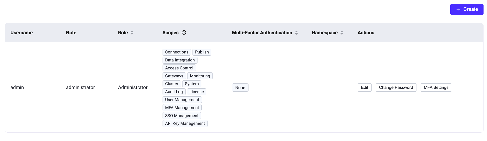
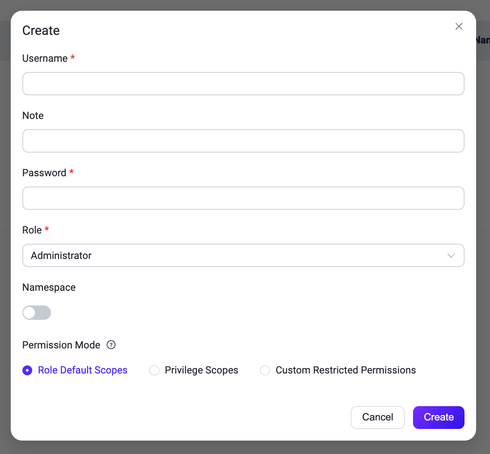
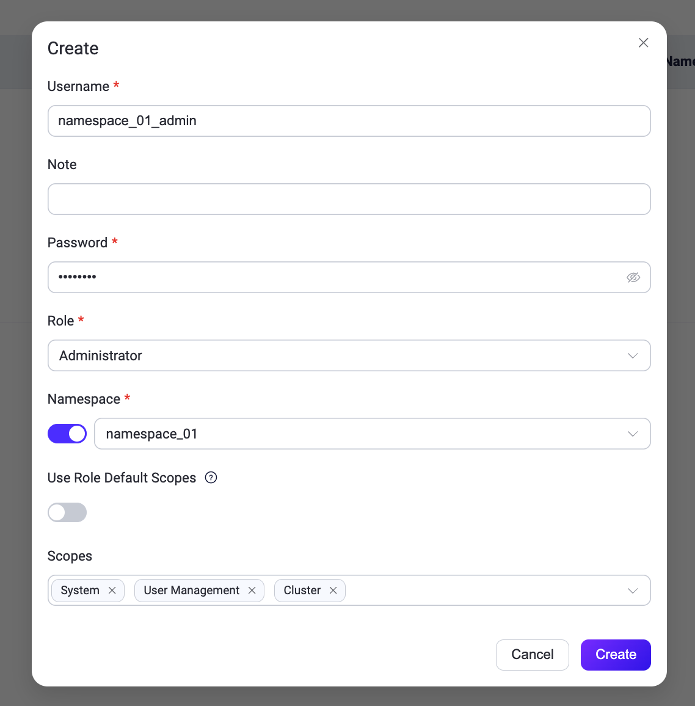
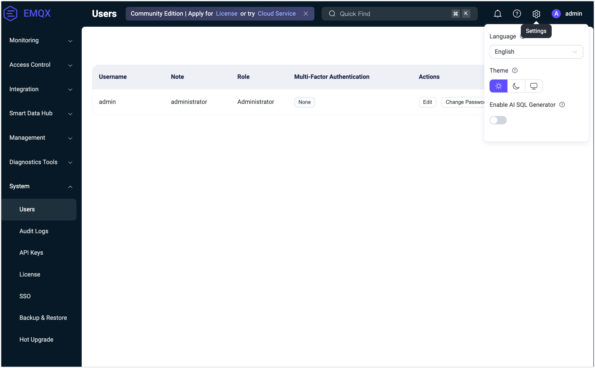

# システム

EMQX ダッシュボードの **システム** メニューでは、ユーザーおよびロール管理、監査ログ、API キー、ライセンス、SSO、データのバックアップとリストア、ホットアップグレード、一般設定などのシステム管理オプションにアクセスできます。

## ユーザー

**ユーザー** ページでは、[CLI](../cli.md) で生成されたユーザーを含む、すべてのアクティブなダッシュボードユーザーの概要を確認できます。

新しいユーザーを追加するには、ページ右上の **+ 作成** ボタンをクリックします。ポップアップダイアログが表示され、必要なユーザー情報の入力を求められます。入力後、**作成** ボタンをクリックしてユーザーアカウントを生成します。ユーザーの編集、パスワード更新、削除などの管理は、アクション列から簡単にアクセスできます。

> セキュリティ上の理由から、EMQX 5.0.0 以降、ダッシュボードユーザーは REST API 認証には使用できません。



### ロールベースアクセス制御

EMQX 5.3 以降、ダッシュボードに EMQX Enterprise ユーザー向けのロールベースアクセス制御（RBAC）機能が導入されました。

RBAC により、組織内のユーザーの役割に基づいて権限を割り当てられます。この機能は認可管理を簡素化し、アクセス制限によってセキュリティを強化し、組織のコンプライアンスを向上させるため、ダッシュボードの重要なアクセス制御機構となっています。

現在、ユーザーに設定できる事前定義ロールは以下の2つです。ユーザー作成時に **ロール** ドロップダウンから選択します。

+ **管理者（Administrator）**

    管理者はクライアント管理、システム設定、API キー、ユーザー管理を含むすべての EMQX 機能およびリソースを完全に管理できます。

+ **閲覧者（Viewer）**

    閲覧者はすべての EMQX データと設定にアクセスでき、REST API のすべての `GET` リクエストに相当します。ただし、データの作成、変更、削除はできません。

### ログインユーザースコープ

ダッシュボードのログインユーザーには、役割内でアクセスできる API の範囲をさらに制限するためにスコープを割り当てられます。EMQX 6.2.4 以降、ダッシュボードユーザーは [11 の API キースコープ](../api.md#built-in-api-key-scopes) と、ブラウザセッションにのみ適用される4つの追加スコープを使用できます。

| スコープ | 必要なロール | 用途 |
| --- | --- | --- |
| `user_management` | 管理者 | ダッシュボードユーザーの管理（作成／更新／削除）。 |
| `sso_management` | 管理者 | SSO バックエンドおよび SSO ユーザーレコードの管理。 |
| `api_key_management` | 管理者 | API キーの管理。 |
| `mfa_management` | グローバル管理者またはグローバル閲覧者 | 自分自身の MFA 管理。管理者は他ユーザーの MFA も管理可能。 |

これらのうち3つのスコープ（`user_management`、`sso_management`、`api_key_management`）は管理者ロールが必要で、閲覧者には割り当てられません。グローバルユーザーの場合、例外は `mfa_management` で、グローバル閲覧者も保持可能ですが、自分自身の MFA 管理のみ許可され、他ユーザーの MFA 設定にはアクセスできません。これはグローバル閲覧者アカウントが追加権限なしに自身の認証器を再登録または回復できるようにするために有用です。ネームスペースユーザーには `mfa_management` は割り当てられません。

グローバルユーザーをダッシュボードで作成すると、**ネームスペース** オプションはオフ、**権限モード** はデフォルトで **ロールのデフォルトスコープ** に設定されています。以下のモードから選択可能です。

- **ロールのデフォルトスコープ**：選択したロールのデフォルトを使用。ロールのデフォルト変更は自動的に反映されます。
- **権限スコープ**：`system`、`user_management`、`api_key_management`、`sso_management` から選択。これらは管理者相当の権限を提供します。
- **カスタム制限付き権限**：管理者相当グループ外のロールが保持可能なスコープ（例：`connections`、`publish`、`data_integration`、`monitoring`、`plugin_api`、`mfa_management`）から選択。空欄の場合、スコープ保護された API にはアクセスできません。



ネームスペースユーザーは別のスコープ割り当てフローを使用し、利用可能なスコープはロールとネームスペースによって制限されます。設定手順は [ネームスペースロールのユーザー作成](#create-a-user-with-a-namespaced-role) を参照してください。

| ユーザータイプ | デフォルト権限 |
| --- | --- |
| グローバル管理者 | 15 スコープすべて：11 の API キースコープと 4 つのログイン専用スコープ。 |
| グローバル閲覧者 | 11 の API キースコープ。`mfa_management` は明示的に割り当てた場合のみ付与。 |
| ネームスペース管理者 | 接続、監視、データ統合、アクセス制御、システム、クラスター、ライセンス、プラグイン拡張 API、ユーザー管理、API キー管理。 |
| ネームスペース閲覧者 | 接続、監視、データ統合、アクセス制御、システム、クラスター、ライセンス、プラグイン拡張 API。ログイン専用スコープは含まれません。 |

::: warning 管理者相当スコープは単独で使用

ダッシュボードの **権限スコープ** に含まれる管理者相当スコープ（`privilege scopes`）は以下の通りです。検証メッセージでもこの用語が使われます。

- `system`：設定管理（`/configs*`、`/data/*` など）をカバー。`system` を持つユーザーは任意の設定サブツリーを更新したり、ユーザーと API キー記録を含むバックアップアーカイブをリストア可能。
- `user_management`：他のダッシュボードユーザーの作成・変更が可能。任意のスコープ設定ユーザーも含む。
- `api_key_management`：任意のスコープ設定の API キーの作成・変更が可能。
- `sso_management`：SSO バックエンドのローテーションや再設定が可能で、管理者の認証方法を変更できる。

これらのスコープはすべて管理者相当の権限を付与します。これらのスコープのいずれかと管理者相当グループ外のスコープを組み合わせても、ユーザーの実効権限は減りません。

EMQX 6.0.4 以降、グローバルダッシュボードユーザーの明示的なスコープリストは、上記の管理者相当スコープとグループ外のスコープを混在できません。作成・更新リクエストは HTTP 400 を返し、スコープ変更は適用されません。必要な権限に応じて、管理者相当スコープのみかグループ外スコープのみを割り当ててください。`mfa_management` は管理者相当グループ外です。

EMQX 6.0.4 以前に作成された混在スコープユーザーは引き続き動作し、管理者相当スコープは有効です。ダッシュボードで編集すると互換性警告が表示され、保存前に **権限スコープ**、**カスタム制限付き権限**、**ロールのデフォルトスコープ** のいずれかを選択する必要があります。明示的なスコープリストは管理者相当スコープのみかグループ外スコープのみを含む必要があります。ロールのデフォルトやスコープなしは制限対象外です。

この排他ルールはネームスペースダッシュボードユーザーには適用されません。これらのユーザーはネームスペースロールで許可されたスコープを組み合わせ可能ですが、アクセスできる操作・リソースはネームスペース内に限定されます。

:::

#### ロール変更とスコープ互換性

ダッシュボードでユーザー設定中にロールやネームスペースを変更すると、そのロール・ネームスペースでサポートされないスコープは削除され、警告が表示されます。REST API 利用時は、EMQX がユーザーのスコープが新しいロールと互換性があるか検証し、互換性のないリクエストは HTTP 400 で拒否されます。エラー解決には、新しいロールに適合する `scopes` リストを同時に含めてください。

例えば、グローバル管理者を閲覧者に降格し、そのユーザーが `user_management`、`sso_management`、`api_key_management` を保持している場合、これらは管理者ロールが必要なためリクエストは拒否されます。閲覧者互換スコープのみを含む `scopes` リストを追加して変更を完了してください。`mfa_management` はグローバル閲覧者と互換性があります。ネームスペース閲覧者は `connections`、`monitoring`、`data_integration`、`access_control`、`system`、`cluster_operations`、`license`、`plugin_api` のみ許可され、その他のスコープを含むリクエストは HTTP 400 となります。

### デフォルト管理者保護

`dashboard.default_username` アカウント（`dashboard.default_password` で設定されたパスワードで作成）はブレークグラスアカウントです。ほかの管理者が誤設定やアクセス不能になった場合に備え、デフォルトユーザーは誤ってロックアウトされないよう保護されています。

- ダッシュボードや REST API から **削除できません**。削除ボタンは無効化されています。
- ロールは `administrator` から **変更できません**。
- スコープセットはカスタマイズできず、常にフル管理者権限を使用します。
- 説明やパスワードは通常通り編集可能です。

他の管理者は影響を受けず、システムに管理者が1人以上いれば削除可能です。

### セルフサービスの範囲

すべてのダッシュボードユーザーは、スコープに関係なく以下のセルフサービス操作を行えます。

- 自分のパスワード変更
- 自分の TOTP / MFA の登録または再登録。MFA 無効化も可能ですが、管理者がユーザーに MFA を必須にしている場合は `mfa_management` スコープが必要です。

その他のプロフィール更新（説明、ロール、管理者が割り当てたスコープ）は、操作ユーザーに適切なスコープが必要であり、対象が操作ユーザー自身でも例外ではありません。

### ネームスペースロール

EMQX 6.0 以降、ダッシュボードはネームスペースロールをサポートしています。この機能はロールベースアクセス制御を拡張し、マルチテナンシーを実現します。ユーザーは特定のネームスペース内でのみ操作を制限できます。

::: warning 信頼できるデプロイメントのみ

ネームスペース管理者アクセスは、組織内のチームや事業部門を分離するなど、信頼できる内部デプロイメント向けです。誤ったチーム間設定変更のリスクを減らしますが、強力な分離保証は提供せず、公共や信頼できないマルチテナント環境のセキュリティ境界としては不適切です。

委譲管理者にネームスペーススコープリソースの管理を許可する場合、**管理** -> **クラスター設定** -> **[ルールエンジンセキュリティ](./cluster_settings.md#rule-engine-security)** で SSRF 保護を有効にしてください。EMQX 6.0.4 以降、このポリシーはコネクター設定のテスト・作成・更新時に HTTP および MQTT コネクターのターゲットを検証します。その他のコネクタータイプやランタイム接続は対象外です。完全なアウトバウンドネットワーク境界を強制するには、`iptables` や `nftables` などのホストレベルのイグレス制御を追加してください。[ルールエンジンポリシーとファイアウォールルールによる SSRF 軽減](../cluster/security.md#mitigate-ssrf-with-rule-engine-policy-and-firewall-rules) を参照。

:::

::: tip

ネームスペースの詳細は [ネームスペース](../multi-tenancy/namespace-overview.md) をご覧ください。

:::

#### ネームスペースロールのユーザー作成

ダッシュボードで新規ユーザー作成時、**ネームスペース** オプションはデフォルトでオフです。有効にしてネームスペースを選択すると、ネームスペースロールのユーザーを作成できます。

::: tip 前提条件

1. ダッシュボードで管理対象ネームスペース（例：`namespace_01`）を作成済みであること。手順は [ネームスペースの作成](../multi-tenancy/create-namespace.md) を参照。
2. EMQX ライセンスおよびクラスターが EMQX 6.0 以降で稼働していること。

:::

1. **システム** -> **ユーザー** に移動し、**+ 作成** をクリック。
2. ユーザーを設定：
   - **ユーザー名**：ユーザーの一意識別子。
   - **備考**：任意の説明。
   - **パスワード**：ログインパスワード。
   - **ロール**：**管理者** または **閲覧者** を選択。
   - **ネームスペース**：デフォルトはオフ。オンにして既存のネームスペース（例：`namespace_01`）を選択。
   - **ロールのデフォルトスコープを使用**：ネームスペースをオンにすると、3択の **権限モード** フィールドに代わり表示され、デフォルトで有効。選択したネームスペースロールのデフォルトスコープを使用する場合は有効のまま、明示的にスコープを割り当てる場合はオフにします。
   - **スコープ**：**ロールのデフォルトスコープを使用** がオフの場合に表示。選択したロールがネームスペース内で保持可能なスコープから選択。空欄の場合はスコープなし。

   

3. **作成** をクリックして完了。

CLI または API でユーザーを作成する場合、ロールは以下の形式で明示的に指定する必要があります。

```
ns:<NAMESPACE>::<ROLE>
```

例：

- `ns:namespace_01::administrator`
- `ns:namespace_01::viewer`

#### ネームスペースユーザーの挙動

- **スコープ付きリソース**：ネームスペースユーザーは割り当てられたネームスペース内のリソース（コネクター、アクション、ソース、ルール、その他ネームスペース対応モジュール）の閲覧・管理のみ可能。
- **クラスター全体設定**：まだネームスペース対応していない設定はネームスペースユーザーに読み取り専用。変更可能なのはグローバル管理者のみ。
- **メッセージコンテンツ関連エンドポイントの制限**：MQTT メッセージの生コンテンツにアクセス・操作する一部の REST API エンドポイントはネームスペースユーザーに対して `403 Forbidden` を返します。これらはグローバル管理者のみアクセス可能です。
  - Mqueue メッセージ：`GET /clients/:clientid/mqueue_messages`
  - Inflight メッセージ：`GET /clients/:clientid/inflight_messages`
  - Retained メッセージ：`GET /mqtt/retainer/messages`、`GET /mqtt/retainer/message/:topic`、`DELETE /mqtt/retainer/message/:topic`、`DELETE /mqtt/retainer/messages`
  - Delayed メッセージ：`GET /mqtt/delayed/messages`、`GET /mqtt/delayed/messages/:node/:msgid`、`DELETE /mqtt/delayed/messages/:node/:msgid`、`DELETE /mqtt/delayed/messages/:topic`
- **グローバル限定のファイル転送コンテンツエンドポイント**：ファイル転送ストアはグローバルでネームスペース非対応です。クライアントがアップロードしたファイルへのアクセスをネームスペース外から防ぐため、以下のエンドポイントはネームスペースダッシュボードユーザーおよび任意ロールの API キーに対して利用不可です。
  - ファイル一覧：`GET /file_transfer/files`
  - 転送ファイル一覧：`GET /file_transfer/files/:clientid/:fileid`
  - ファイルダウンロード：`GET /file_transfer/file`

  グローバルダッシュボードユーザーと API キーはロールとスコープに応じてアクセス可能です。`/file_transfer` 設定エンドポイントは影響を受けません。
- **トレースのスコーピング**：トレースエンドポイントにアクセスすると、ネームスペースユーザーは自身のネームスペースに属するトレースのみ閲覧可能です。別ネームスペースのトレースの停止、ダウンロード、ログストリーム、削除（`PUT /trace/:name/stop`、`GET /trace/:name/download`、`GET /trace/:name/log`、`GET /trace/:name/log_detail`、`DELETE /trace/:name`）は `404 Not Found` を返し、存在が漏れません。バルク削除エンドポイント（`DELETE /trace`）はネームスペースユーザーに `403 Forbidden` を返し、全トレースのクリアはグローバル管理者のみ可能です。
- **監査ログアクセス**：EMQX 6.0.4 以降、ネームスペースユーザーはクラスター全体の監査ログを閲覧できません。閲覧可能なのはグローバル管理者とグローバル閲覧者のみです。詳細は [監査ログアクセス](./audit-log.md#audit-log-access) を参照。
- **API キー管理**：ネームスペース管理者は自身のネームスペース内の API キーを作成、一覧、読み取り、更新、削除できます。グローバル API キーや他ネームスペースのキーは作成不可で、非表示です。REST API の詳細は [ネームスペース管理者としての API キー管理](../api.md#manage-api-keys-as-a-namespaced-administrator) を参照。
- **デフォルトランディングページ**：ネームスペースユーザーは通常通りダッシュボードにログインし、**概要** ページから開始します。すべてのメニュー項目は表示されますが、リソースデータは自動的にネームスペースでフィルタリングされます。
- **ライセンス管理**：ネームスペースユーザーはライセンス通知を表示しません。ライセンス管理はシステム管理者の責任です。

#### ネームスペース内のロールの意味

- **管理者**：割り当てられたネームスペース内のリソースを作成、更新、削除、閲覧する完全な権限。
- **閲覧者**：割り当てられたネームスペース内のリソースを読み取り専用（`GET` リクエスト相当）。

## 監査ログ

**監査ログ** ページでは、グローバル管理者が EMQX クラスター内の重要な運用変更をリアルタイムで監視するための監査ログ設定を行えます。EMQX 6.0.4 以降、グローバル管理者とグローバル閲覧者は監査ログエントリを閲覧可能ですが、ネームスペースユーザーは閲覧できません。

監査ログ機能の詳細は [監査ログ](./audit-log.md) をご覧ください。

## API キー

**API キー** ページでは、[HTTP API](../api.md) へのアクセス用 API キーの作成と管理ができます。ロールやスコープの割り当てを含む API キーの作成・管理手順は [API キーの作成](../api.md#create-api-keys) を参照してください。

## ライセンス

左側の **システム** メニューから **ライセンス** をクリックするとライセンスページにアクセスできます。このページでは、現在のライセンスの基本情報（ライセンス接続クォータ使用状況、EMQX バージョン、顧客情報、発行情報など）を確認できます。

**ライセンス更新** をクリックしてライセンスキーをアップロードします。**ライセンス設定** セクションでは、ライセンス接続クォータ使用状況の高水位・低水位制限を設定可能です。ライセンスの詳細は [EMQX Enterprise ライセンスの利用](../../get-started/deploy/license.md) をご覧ください。

## SSO

**SSO** ページでは、管理者がユーザーログイン管理のための SSO 機能を設定できます。SSO 機能の詳細は [シングルサインオン（SSO）](./sso.md) を参照してください。

## バックアップとリストア

**バックアップとリストア** ページでは、運用データおよび設定ファイルのバックアップ設定を行えます。グローバル管理者は **グローバル** と特定のネームスペースを切り替えて、そのスコープ内のバックアップファイルを管理できます。ネームスペース選択時は、バックアップファイルのアップロード、ダウンロード、削除、リストアは可能ですが、バックアップの作成はできません。詳細は [バックアップとリストア](../backup-restore.md) をご覧ください。

## 設定

設定にアクセスするには、ダッシュボード右上の歯車アイコンをクリックしてください。

**設定** メニューでは、ダッシュボードの言語とテーマをカスタマイズできます。

- **言語**：表示言語を選択します。
- **テーマ**：ライトテーマ、ダークテーマ、または OS のテーマと自動同期を選択可能です。同期を有効にすると、テーマは OS 設定に従い、手動選択は無効になります。

さらに、設定メニューには **ルール** ページの [AI SQL ジェネレーター](../../develop/data-integration/rule-get-started.md#sql-generator) 機能の有効化／無効化トグルがあります。


