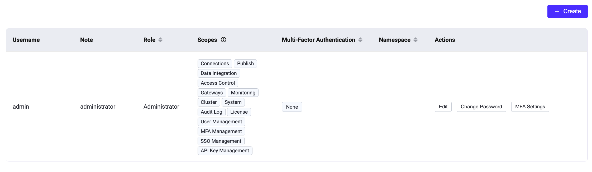
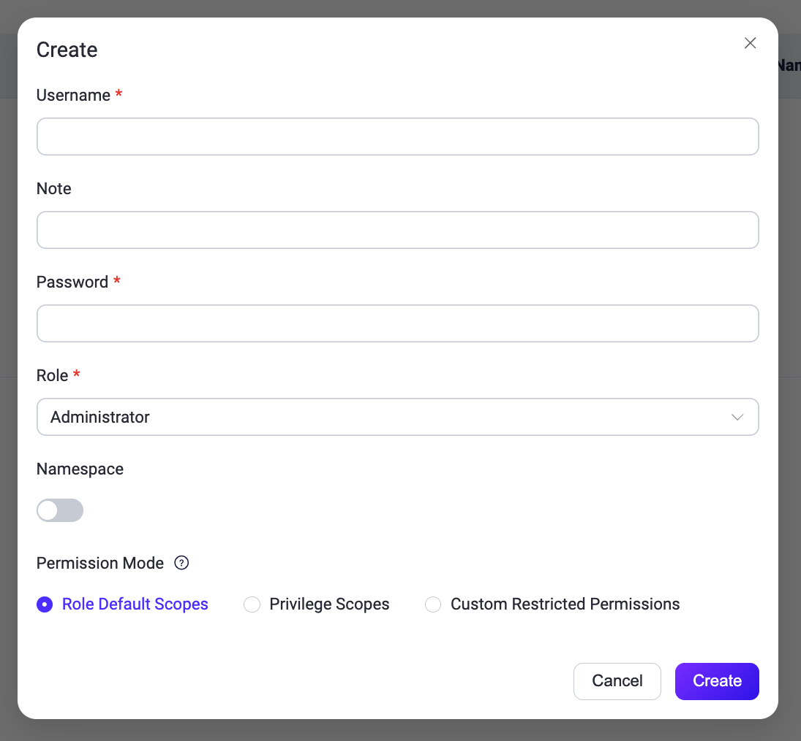
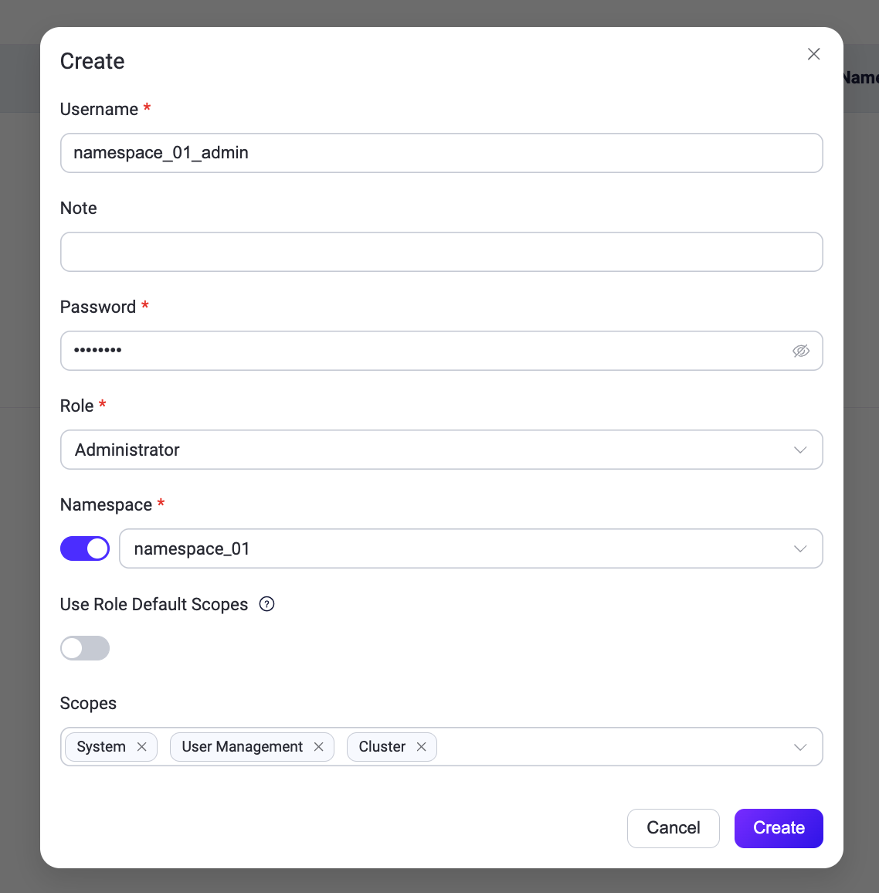
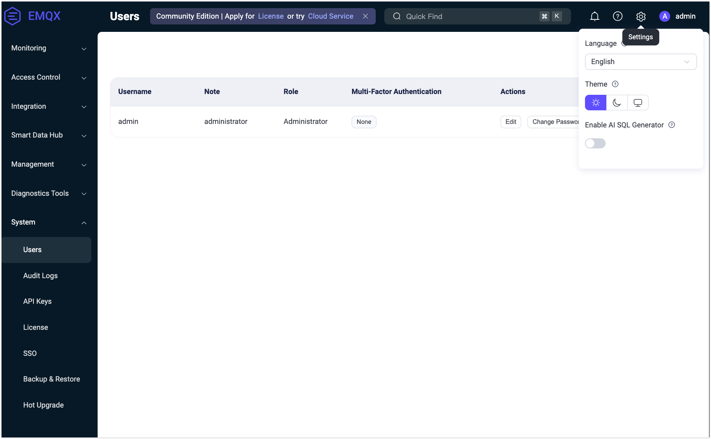

# システム

EMQXダッシュボードの**システム**メニューでは、ユーザーおよびロール管理、監査ログ、APIキー、ライセンス、SSO、データのバックアップと復元、ホットアップグレード、一般設定などのシステム管理オプションにアクセスできます。

## ユーザー

**ユーザー**ページでは、[CLI](../cli.md)で生成されたユーザーを含む、すべてのアクティブなダッシュボードユーザーの概要を確認できます。

新しいユーザーを追加するには、ページ右上の**+ 作成**ボタンをクリックします。ポップアップダイアログが表示され、必要なユーザー情報の入力を求められます。入力後、**作成**ボタンをクリックしてユーザーアカウントを生成します。ユーザー管理のために、編集、パスワード更新、ユーザー情報の削除などの操作は、アクション列から簡単にアクセスできます。

> セキュリティ上の理由から、EMQX 5.0.0以降、ダッシュボードユーザーはREST API認証には使用できません。



### ロールベースアクセス制御（RBAC）

EMQX 5.3以降、ダッシュボードではEMQX Enterpriseユーザー向けにロールベースアクセス制御（RBAC）機能が導入されました。

RBACにより、組織内のユーザーの役割に基づいて権限を割り当てることができます。この機能は認可管理を簡素化し、アクセス制限によるセキュリティ強化や組織のコンプライアンス向上に寄与し、ダッシュボードにおける重要なアクセス制御メカニズムとなっています。

現在、ユーザーには以下のいずれかの事前定義されたロールを設定できます。ユーザー作成時に**ロール**のドロップダウンから選択可能です。

+ **Administrator（管理者）**

    クライアント管理、システム設定、APIキー、ユーザー管理など、すべてのEMQX機能とリソースを完全に管理できます。

+ **Viewer（閲覧者）**

    すべてのEMQXデータおよび設定にアクセス可能で、REST APIのすべての`GET`リクエストに相当します。ただし、データの作成、変更、削除はできません。

### ログインユーザースコープ

ダッシュボードのログインユーザーには、ロール内でアクセス可能なAPIの範囲をさらに制限するためにスコープを割り当てることができます。EMQX 6.0.5以降、ダッシュボードユーザーは[11のAPIキー用スコープ](../api.md#built-in-api-key-scopes)と、ブラウザセッションにのみ適用される4つの追加スコープを利用できます。

| スコープ | 必要なロール | 用途 |
| --- | --- | --- |
| `user_management` | Administrator | ダッシュボードユーザーの管理（作成／更新／削除）。 |
| `sso_management` | Administrator | SSOバックエンドおよびSSOユーザー記録の管理。 |
| `api_key_management` | Administrator | APIキーの管理。 |
| `mfa_management` | グローバル管理者またはグローバル閲覧者 | 自身のMFA管理。管理者は他ユーザーのMFAも管理可能。 |

これらのうち3つのスコープ（`user_management`、`sso_management`、`api_key_management`）はAdministratorロールが必要で、Viewerには割り当てられません。グローバルユーザーの場合、例外は`mfa_management`で、グローバル閲覧者も保持可能ですが、自身のアカウントのMFA管理のみ許可され、他ユーザーのMFA設定にはアクセスできません。これは、グローバル閲覧者アカウントが追加権限なしに自身の認証器を再登録または回復できるようにするために有用です。ネームスペースユーザーには`mfa_management`は割り当てられません。

ダッシュボードでグローバルユーザーを作成すると、**Namespace**オプションはオフ、**Permission Mode**はデフォルトで**Role Default Scopes**に設定されています。以下のモードから選択します。

- **Role Default Scopes**: 選択したロールのデフォルトスコープを使用。ロールデフォルトの変更は自動的に反映されます。
- **Privilege Scopes**: `system`、`user_management`、`api_key_management`、`sso_management`から選択。これらは管理者相当の権限を提供します。
- **Custom Restricted Permissions**: 管理者相当以外のロールで利用可能なスコープ（`connections`、`publish`、`data_integration`、`monitoring`、`plugin_api`、`mfa_management`など）から選択。スコープリストを空にすると、スコープ保護されたAPIにアクセスできません。



ネームスペースユーザーは別のスコープ割り当てフローを使用し、利用可能なスコープはロールとネームスペースによって制限されます。設定手順は[ネームスペースロールのユーザー作成](#create-a-user-with-a-namespaced-role)を参照してください。

| ユーザータイプ | デフォルト権限 |
| --- | --- |
| グローバル管理者 | 15スコープすべて：11のAPIキー用スコープと4つのログイン専用スコープ。 |
| グローバル閲覧者 | 11のAPIキー用スコープ。`mfa_management`は明示的に割り当てられた場合のみ付与。 |
| ネームスペース管理者 | 接続、監視、データ統合、アクセス制御、システム、クラスター、ライセンス、プラグイン拡張API、ユーザー管理、APIキー管理。 |
| ネームスペース閲覧者 | 接続、監視、データ統合、アクセス制御、システム、クラスター、ライセンス、プラグイン拡張API。ログイン専用スコープは含まれません。 |

::: warning 管理者相当スコープは単独で割り当てる必要があります

ダッシュボードの**Privilege Scopes**にまとめられ、検証メッセージで`privilege scopes`と呼ばれる管理者相当スコープは以下の通りです。

- `system`：設定管理（`/configs*`、`/data/*`など）。`system`を持つユーザーは任意の設定サブツリーを更新したり、ユーザーおよびAPIキー記録を含むバックアップアーカイブを復元できます。
- `user_management`：他のダッシュボードユーザーの作成・変更が可能（任意のスコープ設定を含む）。
- `api_key_management`：任意のスコープ設定を含むAPIキーの作成・変更が可能。
- `sso_management`：SSOバックエンドのローテーションや再設定が可能で、管理者の認証方法を変更できます。

これらのスコープはすべて管理者相当の権限を付与します。これらのスコープと管理者相当以外のスコープを組み合わせても、ユーザーの実効権限は減少しません。

EMQX 6.0.4以降、グローバルダッシュボードユーザーの明示的なスコープリストは、上記管理者相当スコープとそれ以外のスコープを混在させることはできません。作成または更新リクエストはHTTP 400で拒否され、スコープ変更は適用されません。必要な権限に応じて、管理者相当スコープのみ、またはそれ以外のスコープのみを割り当ててください。`mfa_management`は管理者相当グループ外です。

EMQX 6.0.4以前に作成された混在スコープのユーザーは引き続き動作し、管理者相当スコープは有効です。ダッシュボードでそのようなグローバルユーザーを編集すると、互換性警告が表示され、保存前に**Privilege Scopes**、**Custom Restricted Permissions**、または**Role Default Scopes**のいずれかを選択する必要があります。明示的なスコープリストは管理者相当スコープのみ、またはそれ以外のスコープのみを含む必要があります。ロールデフォルトの使用やスコープ未付与はこの制限の対象外です。

この相互排他ルールはネームスペースユーザーには適用されません。ネームスペースユーザーは割り当てられたロールに許可されたスコープを組み合わせることができ、ネームスペース対応リソースへのアクセスは割り当てられたネームスペースに限定されます。

:::

#### ロール変更とスコープ互換性

ダッシュボードでユーザーのロールまたはネームスペースを変更すると、そのロールやネームスペースでサポートされないスコープはフォームから削除され、警告が表示されます。REST APIでは、ユーザーのスコープが新しいロールと互換性があるかをチェックし、互換性のないリクエストはHTTP 400で拒否されます。エラー解消には、新しいロールに適合する`scopes`リストを同時に含めてください。

例えば、グローバル管理者を閲覧者に降格し、そのユーザーが`user_management`、`sso_management`、`api_key_management`を保持している場合、これらは管理者ロールが必要なためリクエストは拒否されます。閲覧者に適合するスコープのみを含む`scopes`リストを指定して変更を完了してください。`mfa_management`スコープはグローバル閲覧者と互換性があります。ネームスペース閲覧者の場合、REST APIは`connections`、`monitoring`、`data_integration`、`access_control`、`system`、`cluster_operations`、`license`、`plugin_api`のみを受け入れ、その他のスコープを含むリクエストはHTTP 400で拒否されます。

### デフォルト管理者アカウントの保護

`dashboard.default_username`アカウント（`dashboard.default_password`で設定されたパスワードで作成）はブレークグラスアカウントです。ほかの管理者が誤設定されたりアクセスを失った場合でもシステムを復旧できるよう、以下の保護が適用されます。

- ダッシュボードやREST APIから**削除できません**。削除ボタンは無効化されています。
- ロールは`administrator`から**変更できません**。
- スコープセットは**カスタマイズできず**、常に管理者のフル権限を使用します。
- 説明とパスワードは通常通り編集可能です。

他の管理者は影響を受けず、システムに管理者が最低1人残っていれば削除可能です。

### セルフサービスの範囲

すべてのダッシュボードユーザーは、スコープに関係なく以下の2つのセルフサービス操作が許可されています。

- 自身のパスワード変更
- 自身のTOTP／MFAの登録または再登録。MFAの無効化も可能ですが、管理者がユーザーにMFAを必須にしている場合は`mfa_management`スコープが必要です。

その他のプロフィール更新（説明、ロール、管理者が割り当てたスコープの変更）は、操作ユーザーに適切なスコープが必要であり、対象が操作ユーザー自身でも例外はありません。

### ネームスペースロール

EMQX 6.0以降、ダッシュボードはネームスペースロールをサポートしています。この機能により、ロールベースアクセス制御が拡張され、ユーザーが割り当てられたネームスペース内のネームスペース対応リソースの管理に限定されます。

::: warning 信頼されたデプロイメントのみ

ネームスペース管理者アクセスは、組織内のチームや事業部門を分離するなどの信頼された内部デプロイメント向けであり、誤ってチーム間の設定変更が起きるリスクを低減します。本機能は強力な分離保証を提供せず、公開または信頼できないマルチテナント環境のセキュリティ境界としては不適切です。

委譲管理者にネームスペーススコープリソースの管理を許可する場合は、**Management** -> **Cluster Settings** -> **[Rule Engine Security](./cluster_settings.md#rule-engine-security)**でSSRF保護を有効にしてください。EMQX 6.0.4以降、このポリシーはコネクター設定のテスト、作成、更新時にHTTPおよびMQTTコネクターのターゲットを検証します。その他のコネクタータイプや実行時接続は対象外です。完全なアウトバウンドネットワーク境界を強制するには、`iptables`や`nftables`などのホストレベルのイグレス制御を追加してください。[Rule EngineポリシーとファイアウォールルールによるSSRF緩和](../cluster/security.md#mitigate-ssrf-with-rule-engine-policy-and-firewall-rules)を参照。

:::

::: tip

ネームスペースの詳細は[Namespace](../multi-tenancy/namespace-overview.md)をご覧ください。

:::

#### ネームスペースロールのユーザー作成

ダッシュボードで新規ユーザーを作成する際、**Namespace**オプションはデフォルトでオフです。有効にしてネームスペースを選択すると、ネームスペースロールのユーザーを作成できます。

::: tip 前提条件

1. ダッシュボードで管理対象ネームスペース（例：`namespace_01`）を作成してください。手順は[ネームスペースの作成](../multi-tenancy/create-namespace.md)を参照。
2. EMQXライセンスおよびクラスターがEMQX 6.0以降で稼働していることを確認してください。

:::

1. **システム** -> **ユーザー**に移動し、**+ 作成**をクリック。
2. ユーザーを設定：
   - **ユーザー名**：ユーザーの一意識別子。
   - **メモ**：任意の説明。
   - **パスワード**：ログインパスワード。
   - **ロール**：**Administrator**または**Viewer**を選択。
   - **Namespace**：デフォルトはオフ。オンにして既存のネームスペース（例：`namespace_01`）を選択。
   - **Use Role Default Scopes**：**Namespace**をオンにすると表示されるフィールドで、デフォルトで有効。選択したネームスペースロールのデフォルトスコープを使用するか、明示的にスコープを割り当てるかを指定。
   - **Scopes**：**Use Role Default Scopes**をオフにすると表示。選択したロールがネームスペース内で保持可能なスコープから選択。空欄の場合はスコープなし。

   

3. **作成**をクリックして完了。

CLIやAPIでユーザーを作成する場合、ロールは以下の形式で明示的に指定してください。

```
ns:<NAMESPACE>::<ROLE>
```

例：

- `ns:namespace_01::administrator`
- `ns:namespace_01::viewer`

#### ネームスペースユーザーの挙動

- **スコープ付きリソース**：コネクター、アクション、ソース、ルールなどのネームスペース対応リソースは、割り当てられたネームスペース内でのみ、ロールとスコープに応じて閲覧・管理可能です。
- **クラスター全体のメタデータ**：MQTTサブスクリプション情報などのメタデータは、ロール、スコープ、エンドポイント制限に従い、ネームスペースを跨いで閲覧可能です。
- **クラスター設定**：まだネームスペース対応していない設定は、ネームスペースユーザーに対して読み取り専用です。変更可能なのはグローバル管理者のみです。
- **メッセージコンテンツ関連エンドポイントの制限**：MQTTメッセージの生データにアクセス・操作する特定のREST APIエンドポイントはネームスペースユーザーには利用不可で、`403 Forbidden`を返します。これらはグローバル管理者のみアクセス可能です。
  - Mqueueメッセージ：`GET /clients/:clientid/mqueue_messages`
  - Inflightメッセージ：`GET /clients/:clientid/inflight_messages`
  - Retainedメッセージ：`GET /mqtt/retainer/messages`、`GET /mqtt/retainer/message/:topic`、`DELETE /mqtt/retainer/message/:topic`、`DELETE /mqtt/retainer/messages`
  - Delayedメッセージ：`GET /mqtt/delayed/messages`、`GET /mqtt/delayed/messages/:node/:msgid`、`DELETE /mqtt/delayed/messages/:node/:msgid`、`DELETE /mqtt/delayed/messages/:topic`
- **グローバル限定のファイル転送コンテンツエンドポイント**：ファイル転送ストアはグローバルでネームスペース非対応です。クライアントがアップロードしたファイルへのアクセスをネームスペース外から防ぐため、以下のエンドポイントはネームスペースユーザーおよびすべてのロールのAPIキーで利用不可です。
  - ファイル一覧：`GET /file_transfer/files`
  - 転送ファイル一覧：`GET /file_transfer/files/:clientid/:fileid`
  - ファイルダウンロード：`GET /file_transfer/file`

  グローバルダッシュボードユーザーおよびAPIキーはロールとスコープに応じてアクセス可能です。`/file_transfer`設定エンドポイントは影響を受けません。
- **トレースのスコーピング**：トレースエンドポイントにアクセスすると、ネームスペースユーザーは自身のネームスペースに属するトレースのみ閲覧可能です。異なるネームスペースのトレース停止、ダウンロード、ログストリーム、削除（`PUT /trace/:name/stop`、`GET /trace/:name/download`、`GET /trace/:name/log`、`GET /trace/:name/log_detail`、`DELETE /trace/:name`）は`404 Not Found`を返し、存在を漏らしません。バルク削除エンドポイント（`DELETE /trace`）はネームスペースユーザーに`403 Forbidden`を返し、全トレースのクリアはグローバル管理者のみ可能です。
- **監査ログアクセス**：EMQX 6.0.4以降、ネームスペースユーザーはクラスター全体の監査ログを閲覧できません。閲覧可能なのはグローバル管理者およびグローバル閲覧者のみです。詳細は[監査ログアクセス](./audit-log.md#audit-log-access)を参照。
- **APIキー管理**：ネームスペース管理者は自身のネームスペース内でAPIキーの作成、一覧表示、読み取り、更新、削除が可能です。グローバルAPIキーや他ネームスペースのキーは作成できず、表示もされません。REST APIの詳細は[ネームスペース管理者としてのAPIキー管理](../api.md#manage-api-keys-as-a-namespaced-administrator)を参照。
- **デフォルトランディングページ**：ネームスペースユーザーは通常通りダッシュボードにログインし、**概要**ページから開始します。すべてのメニュー項目は表示され、ネームスペース対応リソースのデータは自動的に自身のネームスペースにフィルタリングされます。
- **ライセンス管理**：ネームスペースユーザーはライセンス通知を受け取れません。ライセンス管理はシステム管理者の責任です。

#### ネームスペース内のロールの意味

以下はロールデフォルトスコープを使用した場合の説明です。明示的スコープはユーザーの操作範囲をさらに制限できます。

- **Administrator**：割り当てられたネームスペース内のネームスペース対応リソースに対する完全な操作権限（作成、更新、削除、閲覧）。
- **Viewer**：割り当てられたネームスペース内のネームスペース対応リソースに対する読み取り専用アクセス（`GET`リクエスト相当）。

## 監査ログ

**監査ログ**ページでは、グローバル管理者がEMQXクラスター内の重要な運用変更をリアルタイムで監視するための監査ログ設定を行えます。EMQX 6.0.4以降、グローバル管理者およびグローバル閲覧者は監査ログエントリを閲覧可能ですが、ネームスペースユーザーは閲覧できません。

監査ログ機能の詳細は[監査ログ](./audit-log.md)をご覧ください。

## APIキー

**APIキー**ページでは、[HTTP API](../api.md)へのアクセス用APIキーの作成と管理が可能です。ロールやスコープの割り当てを含むAPIキーの作成・管理手順は[APIキーの作成](../api.md#create-api-keys)を参照してください。

## ライセンス

左側の**システム**メニューから**ライセンス**をクリックすると、ライセンスページにアクセスできます。このページでは、現在のライセンスの基本情報（接続クォータ使用状況、EMQXバージョン、顧客情報、発行情報など）を確認できます。

**ライセンス更新**をクリックしてライセンスキーをアップロードします。**ライセンス設定**セクションでは、ライセンス接続クォータの高水位・低水位制限を設定できます。ライセンスの詳細は[EMQX Enterpriseライセンスの利用](../../get-started/deploy/license.md)をご覧ください。

## SSO

**SSO**ページでは、管理者がユーザーログイン管理のためのSSO機能を設定できます。SSO機能の詳細は[シングルサインオン（SSO）](./sso.md)を参照してください。

## バックアップ＆リストア

**バックアップ＆リストア**ページでは、運用データおよび設定ファイルのバックアップ設定が可能です。グローバル管理者は**グローバル**と特定のネームスペースを切り替えて、そのスコープ内のバックアップファイルを管理できます。ネームスペース選択時は、バックアップファイルのアップロード、ダウンロード、削除、復元が可能ですが、バックアップの作成はできません。詳細は[バックアップとリストア](../backup-restore.md)を参照してください。

## 設定

設定にアクセスするには、ダッシュボード右上の歯車アイコンをクリックします。

**設定**メニューでは、ダッシュボードの言語とテーマをカスタマイズできます。

- **言語**：表示言語を選択します。
- **テーマ**：ライトテーマ、ダークテーマ、またはOSのテーマに自動同期を選択可能です。同期を有効にすると、テーマはOS設定に従い、手動選択は無効になります。

さらに、設定メニューには**ルール**ページの[AI SQLジェネレーター](../../develop/data-integration/rule-get-started.md#sql-generator)機能を有効化・無効化するトグルがあります。


