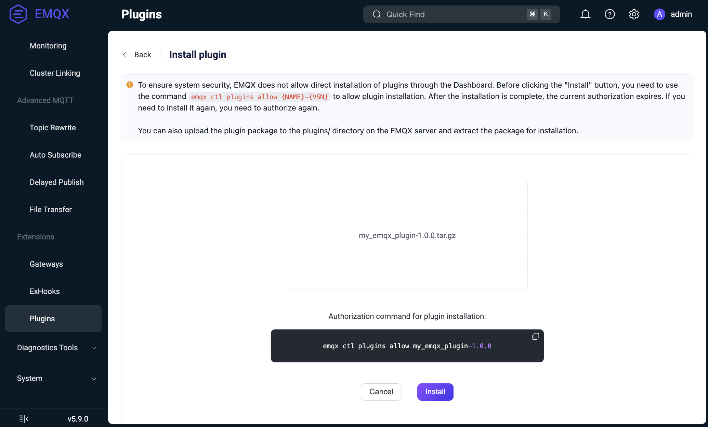
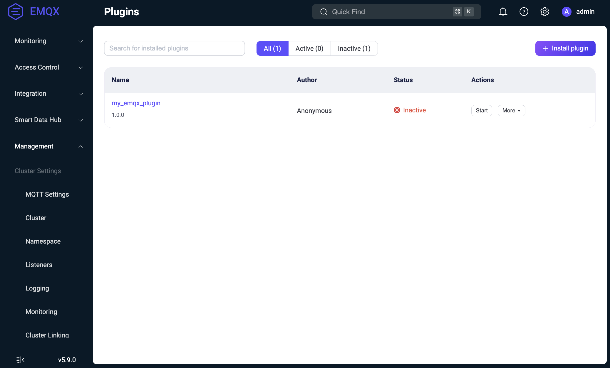

# プラグインの管理

このページでは、EMQXプラグインのデプロイおよび管理方法について説明します。プラグインはDashboard、CLI、REST APIを通じてクラスター全体で管理するか、事前にデプロイして個別ノードにピン留めできます。

EMQXは次の管理方式をサポートします。

- **クラスター管理プラグイン**：EMQXがプラグインパッケージと設定をクラスター内のノードへ配布し、有効状態を`plugins.states`に保存します。
- **ノードピン留めプラグイン**：EMQX 6.2.4以降、名前とバージョンを`node.pinned_plugins`に設定した事前デプロイ済みプラグインを、クラスター設定から独立して各ノードで実行できます。

## プラグインのライフサイクル

EMQXのプラグインは主に以下の3つのライフサイクル状態を経ます：

- **インストール済み**：プラグインのコードと設定が読み込まれているが、アプリケーションはまだ起動していない状態。
- **起動済み**：プラグインが稼働しており、EMQXと積極的に連携している状態。
- **アンインストール済み**：プラグインがシステムから完全に削除された状態。

### インストールプロセス

インストールの流れは以下の通りです：

1. プラグインパッケージ（`make rel`コマンドで作成されたtarball）をDashboard、API、またはCLI経由でアップロードします。詳細なインストール手順は[プラグインのインストールと管理](#install-and-manage-plugins)を参照してください。
2. プラグインパッケージはEMQXクラスターの各ノードに転送されます。
3. 各ノードで以下の処理が行われます：
   - tarballがEMQXルートディレクトリの`plugins`サブディレクトリに保存されます（`plugins.install_dir`オプションで上書き可能）：`$EMQX_ROOT/plugins/my_emqx_plugin-1.0.0.tar.gz`
   - 同じディレクトリに展開されます：`$EMQX_ROOT/plugins/my_emqx_plugin-1.0.0/`
   - 初期設定ファイル（メインプラグインのappからの`config.hocon`）が`$EMQX_DATA_DIR/plugins/my_emqx_plugin/config.hocon`にコピーされます。
   - Avroスキーマが存在する場合は検証のために読み込まれます。
   - プラグインコードがノードにロードされますが、アプリケーションは起動されません。
   - プラグインはEMQX設定の`plugins.states`で`disabled`として登録されます。

::: tip

プラグインの状態はEMQX設定内で`enable`フラグ（`true`または`false`）のみが保存されます。プラグインの詳細設定は各ノードの`$EMQX_DATA_DIR/plugins/my_emqx_plugin/config.hocon`ファイルに保持されます。

:::

### 設定

インストール後、プラグインの設定はDashboardまたはAPIを通じて更新可能です：

- 新しい設定はAvroスキーマ（存在する場合）に基づいて検証されます。
- 更新内容はクラスター内の全ノードに配布されます。
- プラグインの`on_config_changed/2`コールバック関数が呼ばれます。プラグインが新しい設定を受け入れた場合、設定は`$EMQX_DATA_DIR/plugins/my_emqx_plugin/config.hocon`ファイルに永続化されます。

::: tip

`on_config_changed/2`コールバック関数はアプリケーションが起動していなくても呼ばれます。

:::

::: tip

`on_config_changed/2`コールバック関数はEMQXクラスターの各ノードで呼ばれます。ローカルシステムの状態（例：ネットワークの可用性）に依存する設定検証は避けてください。ノード間で結果が不整合になる可能性があります。代わりに`on_health_check/1`を使用してランタイムチェックを行い、リソースが利用できない場合は不健康状態を報告してください。

:::

### 設定ファイルの場所

関連する設定ファイルの場所は2つあります：

- インストールされたプラグインパッケージ内のデフォルト設定ファイル：
  - Docker環境：
    `/opt/emqx/plugins/my_emqx_plugin-1.0.0/my_emqx_plugin-1.0.0/priv/config.hocon`
  - deb/rpm環境：
    `/usr/lib/emqx/plugins/my_emqx_plugin-1.0.0/my_emqx_plugin-1.0.0/priv/config.hocon`

- DashboardやAPI経由で設定が保存された後にEMQXが管理する永続化されたプラグイン設定ファイル：
  - Docker環境：
    `/opt/emqx/data/plugins/my_emqx_plugin/config.hocon`
  - deb/rpm環境：
    `/var/lib/emqx/plugins/my_emqx_plugin/config.hocon`

`priv/config.hocon`はパッケージに含まれるデフォルトテンプレートであり、`data/plugins/.../config.hocon`は設定変更後にEMQXが使用する永続化された設定ファイルです。

### 起動

プラグインはDashboard、API、CLIから手動で起動します。起動時には：

- プラグインのアプリケーションが起動されます。
- プラグインはEMQX設定の`plugins.states`で`enabled`として登録されます。

プラグインが起動している状態で情報を取得すると、`on_health_check/1`コールバック関数が呼ばれ、プラグインの状態が取得されます。

### 停止

プラグインを停止すると：

- プラグインのアプリケーションが停止されます。
- プラグインはEMQX設定の`plugins.states`で`disabled`として登録されます。

プラグインのアプリケーションは停止されますが、コードはノード上にロードされたままです。停止中のプラグインも設定可能なためです。

### アンインストールプロセス

アンインストールの流れは以下の通りです：

1. プラグインが起動中であれば停止します。
2. プラグインのコードをノードからアンロードします。
3. パッケージファイルをノードから削除します（設定ファイルは保持されます）。
4. プラグインはEMQX設定の`plugins.states`から登録解除されます。

プラグインパッケージはDashboardまたはCLIからアンインストール可能です。詳細は[プラグインのインストールと管理](#install-and-manage-plugins)を参照してください。

### クラスター参加時の挙動

EMQXノードがクラスターに参加する際、プラグインやその設定は各ノードのローカルファイルシステムに存在するため、新規ノードにプラグインがインストール・設定されていない場合があります。

新規ノードは以下の処理を行います：

- クラスター参加時にグローバルなEMQX設定を取得します。
- EMQX設定からプラグインの状態（どのプラグインがインストール済みで有効か）を把握します。
- 他のノードからプラグインとその実際の設定を要求します。
- プラグインをインストールし、有効なものは起動します。

## プラグインのインストールと管理

EMQXはDashboard、CLI、APIを通じてプラグインパッケージのインストール、アンインストール、管理をサポートしています。

### Dashboardからのパッケージインストール

プラグインがビルド済みで、`my_emqx_plugin-1.0.0.tar.gz`が用意されているとします。Dashboardから直接コンパイル済みプラグインパッケージをインストールする手順は以下の通りです：

::: tip 重要なセキュリティアップデート

セキュリティ上の理由から、EMQXはDashboard経由のプラグインインストールに対して明示的な許可を必要とします。

- インストール前に許可を与える必要があります。
- 許可状態は一時的で、インストール完了後に自動的に取り消されます。
- クラスター環境では、全ノードで許可を与える必要があります。

:::

1. CLIで以下のコマンドを実行し、プラグインインストールを明示的に許可します：

   ```bash
   emqx ctl plugins allow $NAME-$VSN
   ```

   - `{NAME}`：プラグイン名（例：`my_emqx_plugin`）
   - `{VSN}`：プラグインのバージョン（例：`1.0.0`）

   このコマンド実行後にDashboardからインストールを進められます。

2. EMQX Dashboardの **Management** -> **Plugins** に移動します。

3. **+ Install plugin** ボタンをクリックしてインストールページを開きます。

4. プラグインパッケージを選択またはドラッグしてアップロードします。

   

5. **Install** ボタンをクリックしてインストールを完了します。プラグイン一覧に新しいプラグインが表示されます。

   

これでプラグインの起動・停止や設定が可能です。Dashboardからプラグインをアンインストールするには、プラグイン一覧の**Actions**列の**More**メニュー内の**Uninstall**ボタンをクリックします。

以前に許可したプラグインの許可を取り消すには、以下のいずれかを実行してください：

1. プラグインをアンインストールする（既にインストール済みの場合）。
2. または以下のコマンドで明示的に許可を取り消す：

```bash
emqx ctl plugins disallow $NAME-$VSN
```

### CLIからのパッケージインストール

プラグインがビルド済みで、`my_emqx_plugin-1.0.0.tar.gz`が用意されているとします。CLIから直接コンパイル済みプラグインパッケージをインストールする手順は以下の通りです：

1. EMQXノード上でtarballをEMQXのプラグインディレクトリにコピーします：

   ```
   $ cp my_emqx_plugin-1.0.0.tar.gz $EMQX_HOME/plugins
   ```

2. プラグインをインストールします：

   ```
   $ emqx ctl plugins install my_emqx_plugin-1.0.0
   ```

   クラスター内の全稼働ノードにインストールする場合は`--cluster`オプションを追加します：

   ```
   $ emqx ctl plugins install my_emqx_plugin-1.0.0 --cluster
   ```

3. プラグイン一覧を確認します：

   ```
   $ emqx ctl plugins list
   ```

4. プラグインの起動・停止：

   ```
   $ emqx ctl plugins start my_emqx_plugin-1.0.0
   $ emqx ctl plugins stop my_emqx_plugin-1.0.0
   ```

5. プラグインのアンインストール：

   ```
   $ emqx ctl plugins uninstall my_emqx_plugin-1.0.0
   ```

### APIからのパッケージインストール

プラグインがビルド済みで、`my_emqx_plugin-1.0.0.tar.gz`が用意されているとします。APIを使ってプラグインをインストールする手順は以下の通りです：

1. インストールを許可します。以下のコマンドを実行してプラグインのインストールを許可してください：

   ```
   emqx ctl plugins allow my_emqx_plugin-1.0.0
   ```

2. `curl`を使ってPOSTリクエストを送信し、プラグインをインストールします：

   ```
   $ curl -u $KEY:$SECRET -X POST http://$EMQX_HOST:18083/api/v5/plugins/install -H "Content-Type: multipart/form-data" -F "plugin=@my_emqx_plugin-1.0.0.tar.gz"
   ```

3. プラグイン一覧を確認してインストールが成功したかを確認します：

   ```
   $ curl -u $KEY:$SECRET http://$EMQX_HOST:18083/api/v5/plugins | jq
   ```

4. プラグインの起動・停止：

   ```
   $ curl -s -u $KEY:$SECRET -X PUT "http://$EMQX_HOST:18083/api/v5/plugins/my_emqx_plugin-1.0.0/start"
   $ curl -s -u $KEY:$SECRET -X PUT "http://$EMQX_HOST:18083/api/v5/plugins/my_emqx_plugin-1.0.0/stop"
   ```

### ノードピン留めプラグインの事前デプロイ

EMQX 6.2.4以降、コンテナイメージなどノード固有のデプロイ成果物に組み込んだプラグインを、個別ノードへピン留めできます。

1. プラグインパッケージを`<plugins.install_dir>/<name-vsn>`に展開します。ディレクトリ直下に`release.json`が必要です。

   ```dockerfile
   COPY --chown=emqx:emqx my_emqx_plugin-1.0.0.tar.gz /tmp/my_emqx_plugin-1.0.0.tar.gz

   RUN mkdir -p /opt/emqx/plugins/my_emqx_plugin-1.0.0 && \
       tar zxf /tmp/my_emqx_plugin-1.0.0.tar.gz \
       -C /opt/emqx/plugins/my_emqx_plugin-1.0.0
   ```

2. 読み取り専用の`node.pinned_plugins`設定にプラグイン名とバージョンを追加します。コンテナでは環境変数を使用できます。

   ```dockerfile
   ENV EMQX_NODE__PINNED_PLUGINS="my_emqx_plugin-1.0.0"
   ```

   または`emqx.conf`に設定します。

   ```hocon
   node.pinned_plugins = ["my_emqx_plugin-1.0.0"]
   ```

EMQXはリスト順にピン留めプラグインを起動し、その後`plugins.states`内のプラグインを起動します。設定変更にはノードの設定更新と再起動が必要です。

ピン留めプラグインはローカルの展開済みディレクトリから直接実行され、クラスター参加時にパッケージや保存設定を他ノードへ配布しません。CLIの`start`、`stop`、`restart`は現在のノードのピン留めプラグインを操作できますが、DashboardとREST APIによるライフサイクル操作はHTTP `409`と`PLUGIN_PINNED`を返します。プラグインが見つからないか起動に失敗した場合、EMQXは`pinned_plugin_unavailable:<name-vsn>`アラームを発報してノードの起動を続行します。

## プラグインのアップグレード

EMQXでは同一プラグインの複数バージョンを同時にインストールできません。

新しいバージョンをインストールするには：

- 旧バージョンを先にアンインストールする必要があります。
- その後、新バージョンをインストールします。

プラグインの設定はインストール間で保持されます。

EMQX 6.2.4以降、クラスター内の異なるノードで同じプラグインの異なるバージョンをピン留めできます。プラグイン開発者は、共有データベーステーブル、ノード間RPC、プラグイン設定形式についてバージョン間の互換性を確保する必要があります。

<!-- **注意**：（EMQXエンタープライズ）プラグインはホットアップグレード後に再インストールが必要です。 -->
