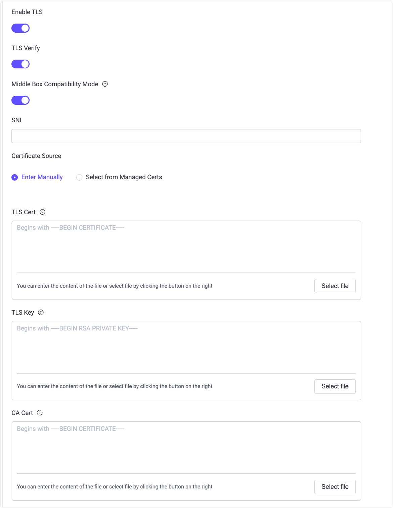

# ネットワークとTLS

IoTシナリオにおけるエンドツーエンドの暗号化通信にはセキュリティが不可欠です。Secure Sockets Layer（SSL）およびTransport Layer Security（TLS）プロトコルは、ネットワーク通信においてデータ送信の機密性を確保し、攻撃者による傍受や改ざんを防ぐために広く採用されています。SSL/TLS暗号化機能はトランスポート層でネットワーク接続を暗号化し、デジタル証明書を用いて通信当事者の認証と安全な通信チャネルの確立を行います。

EMQXは以下の場面で安全なネットワーク通信を確保するためにSSLおよびTLS暗号プロトコルを採用しています。

- MQTTクライアントとEMQX間の接続確立時
- データベースなど外部リソースへの接続時
- クラスター内の異なるEMQXノード間の通信時

EMQXは一方向／双方向認証およびX.509証明書認証を含むSSL/TLS機能を包括的にサポートしています。

## クライアント接続のためのTLS

EMQXはMQTTクライアント接続に対するSSL/TLS暗号化をサポートし、クライアントとブローカー間の安全で暗号化された通信を実現します。TLSリスナーは、セキュリティ要件に応じて一方向認証（サーバー認証のみ）または双方向認証（mTLS）をサポートするよう設定可能です。

本章の[Enable SSL/TLS Connections](./emqx-mqtt-tls.md)では、ダッシュボードおよび設定ファイルを用いたMQTTクライアント向けTLSリスナーの設定手順を詳しく解説しています。

### 証明書管理

EMQXはSSL/TLSのための統一された証明書管理モデルを提供しており、証明書の取得、保存、管理、リスナーや他のTLS対応コンポーネント間での再利用方法をカバーしています。これは従来のパスベース証明書だけでなく、集中管理されたライフサイクル管理を持つ管理証明書も含みます。

EMQXにおける証明書の概念とワークフローの全体像については、[SSL/TLS Certificates](./tls-certificate.md)をご参照ください。

### 証明書検証と失効確認

TLSのセキュリティをさらに強化するために、EMQXは証明書検証および失効確認をサポートしています。

- **CRLチェック**：証明書失効リストを用いて証明書が失効していないかを検証します。詳細は[CRL Check](./crl.md)をご覧ください。
- **OCSP Stapling**：オンライン証明書状態プロトコルを用いた証明書失効状態の確認を行います。詳細は[OCSP Stapling](./ocsp.md)をご覧ください。

これらの機能はTLSリスナー設定時に有効化でき、侵害された証明書の使用を防止します。

### クライアント側TLSの例

[Client TLS](./mqtt-client-tls.md)セクションでは、SSL/TLSを用いてEMQXに安全に接続するためのMQTTクライアントコード例やサンプルプロジェクトを提供しています。クライアント証明書やTLSオプションの設定に関する実践的なガイダンスも含まれています。

## 外部リソースアクセスのためのTLS

EMQXはHTTPベースの認証サービス、データベース、その他のデータ統合サービスなど外部リソースへのアクセス時にもSSL/TLS暗号化をサポートしています。これらの接続に対しては、対応する機能の設定時にダッシュボード上で**Enable TLS**オプションを有効にすることでTLSを利用可能です。

### デフォルトの信頼済みCA証明書 <Badge text="6.3.3" />

`node.trusted_certs`設定オプションは、サポートされるアウトバウンドTLSクライアントのデフォルトCAバンドルを選択します。デフォルト値は`system_default`です。サポート対象クライアントが`verify_peer`を使用し、`cacertfile`や`cacerts`を明示的に設定しない場合、EMQXはこのバンドルを用いて外部サーバー証明書を検証します。

対応クライアントの詳細、`system_default`の解決方法、およびカスタムCAバンドルの設定方法については[Trusted CA Certificates for Outbound TLS](./tls-certificate.md#trusted-ca-certificates-for-outbound-tls)をご参照ください。

### ダッシュボードでのTLS設定オプション

TLSを有効化すると、以下のオプションが利用可能になります。

- **TLS Verify**：外部リソースのサーバー証明書を検証するかどうかを制御します。有効にするとEMQXはサーバーの証明書チェーンを検証します。
- **Middle Box Compatibility Mode**：TLS 1.3接続の互換モードを有効にします。一部のネットワークミドルボックスは標準のTLS 1.3ハンドシェイクを正しく処理できない場合があります。このオプションを有効にすると、EMQXはTLS 1.3ハンドシェイクをTLS 1.2に類似した形に調整し、接続成功率を向上させます。
- **SNI**：Server Name Indication。TLSハンドシェイク時にサーバードメイン名と証明書の一致を検証するかどうかを示します。空欄の場合はホスト名検証を行いません。
- **Certificate Source**：クライアント証明書が必要な場合の提供方法を指定します。
  - **Enter Manually**：証明書の内容またはファイルを直接入力します。
  - **Select from Managed Certs**：EMQXで集中管理されている証明書バンドルを参照します（EMQX 6.1以降）。証明書の再利用やローテーションが容易になります。証明書バンドルの作成および管理の詳細は[Managed Certificates](./tls-certificate.md#managed-certificates)をご覧ください。
- **TLS Cert / TLS Key**：外部サーバーがクライアント証明書を検証する（相互TLS）場合に必要です。
- **CA Cert**：外部サーバー証明書の検証に使用するCA証明書を指定します。`node.trusted_certs`をサポートするクライアントでは任意です。**TLS Verify**が有効でこの項目が空の場合、EMQXは`node.trusted_certs`で選択されたCAバンドルを使用します。サポートしないクライアントは該当リソースのCA証明書要件に従ってください。



### 設定ファイルによるTLS設定

外部リソースアクセスに対しても、設定ファイルの対応する`ssl`オプションを設定することでTLSを有効化できます。例えばHTTPベースの認証バックエンドを設定する場合は以下のようになります。

```hocon
authentication {
  url = "https://127.0.0.1:8080"
  backend = "http"

  ...

  ssl {
    enable = true
    cacertfile = "etc/certs/cacert.pem"
    certfile = "etc/certs/cert.pem"
    keyfile = "etc/certs/key.pem"
    verify = verify_peer
  }
}
```

**SSL設定項目の説明**：

- **`enable`**：外部リソースへのアウトバウンド接続でSSL/TLSを有効にします。
- **`cacertfile`**：HTTPサーバー証明書の検証に使用するCA証明書を含むPEM形式ファイルのパス。サポートされるアウトバウンドTLSクライアントでは、`system_default`を設定して`node.trusted_certs`で選択されたCAバンドルを利用可能です。
- **`certfile`**：クライアントが提示するSSL/TLS証明書チェーンを含むPEM形式ファイルのパス。証明書がルートCAから直接発行されていない場合は、中間CA証明書をクライアント証明書の後に連結して完全なチェーンを形成してください。
- **`keyfile`**：`certfile`で指定したクライアント証明書に対応するPEM形式の秘密鍵ファイルのパス。
- **`verify`**：サーバー証明書検証の挙動を制御します。
  - **`verify_peer`**：サーバーの証明書チェーンを検証します。
  - **`verify_none`**：サーバー証明書を検証しません。

`verify`を`verify_peer`に設定し、`cacertfile`を省略した場合、EMQXは`node.trusted_certs`で選択されたCAバンドルを使用します。外部サーバーがデフォルトバンドルに含まれないプライベートCAを使用している場合は、`cacertfile`を設定してください。

管理証明書もリスナーと同様の証明書管理モデルに従い、設定ファイルで外部リソースに参照可能です。設定オプションの詳細は[Enable SSL/TLS with One-Way Authentication](./emqx-mqtt-tls.md#enable-via-configuration-file)をご覧ください。

## ノード間通信のためのTLS

クラスター接続に対するSSL/TLSの有効化方法については本章では扱っておらず、詳細は[Cluster Security](../cluster/security.md)をご参照ください。

## IPv6サポート

EMQXはクライアント接続、ダッシュボード、ノード間クラスター通信、および外部サービスへのアウトバウンド接続に対してIPv6を完全にサポートしています。設定の詳細は[IPv6](./ipv6.md)をご覧ください。
