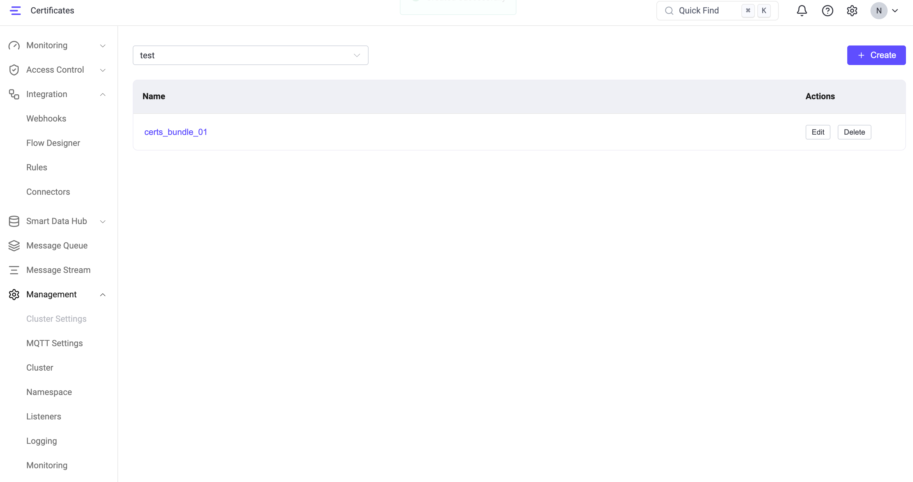

# SSL/TLS証明書

SSL/TLS証明書はEMQXのセキュリティアーキテクチャの中核をなす要素です。これらはネットワーク通信における認証、暗号化、およびデータの完全性を提供します。EMQXでは、以下のシナリオで安全な接続を確立するためにSSL/TLS証明書が必要です。

- TLS経由のMQTT接続（MQTTS）
- WebSocket Secure（WSS）経由のMQTT接続
- HTTPSサービスおよびダッシュボードへのアクセス
- TLS対応の外部接続（例：データ統合）

EMQX 6.1以降、証明書は単なるファイルパスではなく再利用可能なリソースとして扱われます。EMQXは2つの証明書管理方式をサポートしています。

1. パスベース証明書（従来方式）：設定内でファイルパスを直接参照する証明書
2. 管理証明書（EMQX 6.1以降）：名前で参照される再利用可能な証明書リソースとして管理される証明書

両方式とも標準的なPEMエンコードファイルを使用し、EMQXのSSL/TLS実装と完全に互換性があります。

本ページでは以下のトピックを扱います。

- SSL/TLS証明書の取得方法
- EMQXにおける証明書の管理
- 複数証明書のサポート
- SSL/TLS証明書の更新方法
- アウトバウンドTLSのための信頼済みCA証明書設定

## SSL/TLS証明書の取得

EMQXで証明書を使用する前に、信頼できるソースから証明書を取得する必要があります。取得方法は環境やセキュリティ要件によって異なります。

### 証明書取得の選択肢

TLS証明書は以下の方法で取得可能です。

- **自己署名証明書**

    独自の認証局（CA）によって発行された証明書です。デフォルトでは信頼されないため、テストや管理された環境での利用に推奨されます。

- **信頼されたCAからの証明書の申請または購入**

   公共または企業のCAから取得する証明書で、例として以下があります：

   - [Let's Encrypt](https://letsencrypt.org/)
   - クラウドプロバイダー（例：Huawei Cloud、Tencent Cloud）
   - 商用CA（例：[DigiCert](https://www.digicert.com/)）

   本番環境や企業展開では、OV（組織認証）以上の保証レベルの証明書が一般的に推奨されます。

<!-- **ACMEによる自動発行**-->

<!--EMQXはACMEプロトコル（例：Let’s Encrypt）を使用してサーバー証明書を自動取得・更新できます。-->

### 自己署名CA証明書の作成

自己署名証明書はテスト、開発、プライベート環境に適しています。

::: tip 前提条件

[OpenSSL](https://www.openssl.org/)がインストールされていること。

:::

1. 以下のコマンドを実行して鍵ペアを生成します。コマンドは鍵を保護するためのパスワード入力を求めます。このパスワードは証明書の生成、発行、検証時に必要です。鍵とパスワードは安全に保管してください。

   ```bash
   openssl genrsa -des3 -out rootCA.key 2048
   ```

2. 次に、鍵ペアの秘密鍵を使ってCA証明書を生成します。コマンドは証明書の識別名（DN）の設定を求めます。

   ```bash
   openssl req -x509 -new -nodes -key rootCA.key -sha256 -days 3650 -out rootCA.crt
   ```

### サーバー証明書の発行

先ほど生成したCA証明書を使い、EMQXのリスナーがクライアントに自身を証明するためのサーバー証明書を発行します。サーバー証明書は通常、ホスト名、サーバー名、またはドメイン名（例：[www.emqx.com](https://www.emqx.com/en)）に発行されます。サーバー証明書を生成するには、CA鍵（rootCA.key）、CA証明書（rootCA.crt）、およびサーバー証明書署名要求（CSR）（server.csr）が必要です。

1. サーバー証明書用の鍵ペアを生成します。

   ```bash
   openssl genrsa -out server.key 2048
   ```

2. サーバー鍵ペアを使ってCSRを作成します。CSRはCAルート証明書の秘密鍵で署名され、証明書公開鍵ファイルが生成されてユーザーに発行されます。このコマンドも識別名（DN）の設定を求めます。

   ```bash
   openssl req -new -key server.key -out server.csr
   ```

   以下の情報入力を求められます。意味は次の通りです。

   ```bash
   You are about to be asked to enter information that will be incorporated
   into your certificate request.
   What you are about to enter is what is called a Distinguished Name or a DN.
   There are quite a few fields but you can leave some blank
   For some fields there will be a default value,
   If you enter '.', the field will be left blank.
   -----
   Country Name (2 letter code) [AU]: # 国または地域
   State or Province Name (full name) [Some-State]: # 州または県名
   Locality Name (eg, city) []: # 市区町村名
   Organization Name (eg, company) [Internet Widgets Pty Ltd]: # 組織名（会社名）、例：EMQ
   Organizational Unit Name (eg, section) []: # 部署名、例：EMQX
   Common Name (e.g. server FQDN or YOUR name) []: # サーバーの完全修飾ドメイン名（FQDN）、例：mqtt.emqx.com
   ...
   ```

3. CSRを使ってサーバー証明書を生成し、有効期限を365日に設定します。

   ```bash
   openssl x509 -req -in server.csr -CA rootCA.crt -CAkey rootCA.key -CAcreateserial -out server.crt -days 365
   ```

   これで以下の証明書セットが生成されます。

   ```bash
   .
   ├── rootCA.crt
   ├── rootCA.key
   ├── rootCA.srl
   ├── server.crt
   ├── server.csr
   └── server.key
   ```

### クライアント証明書の発行

クライアント証明書は双方向（相互）TLS認証に使用されます。

発行手順はサーバー証明書とほぼ同様ですが、

- Common Name（CN）はクライアントを一意に識別する名前（例：ユーザー名やクライアントID）にします。
- 証明書は同じCA証明書で署名します。したがって、クライアント証明書も前述のCA証明書で署名可能です。

## EMQXにおける証明書管理

証明書を取得した後、EMQXではファイルパスで参照するか、再利用可能な証明書リソースとして管理できます。

### パスベース証明書

パスベース証明書はリスナーやコネクターのSSLオプションで明示的にファイルパスを指定して設定します。例：

- `certfile`
- `keyfile`
- `cacertfile`

パスベース証明書の特徴：

- 証明書ファイルはユーザーまたは外部ツールが完全に管理します。
- リスナーは証明書ファイルを直接参照します。
- 証明書の更新は通常、ディスク上のファイルを置き換えることで行います。

EMQXはテスト用に`etc/certs`ディレクトリにサンプル証明書を提供しています。

パスベース証明書は引き続き完全にサポートされており、すべてのEMQXバージョンと互換性があります。

### 管理証明書

EMQX 6.1以降、管理証明書というTLS証明書ファイルの集中管理機能が導入され、複数コンポーネント間で再利用可能になりました。

管理証明書は以下のリソースで参照・再利用可能です。

- MQTT SSLリスナー
- WSSリスナー
- HTTPS / ダッシュボードリスナー
- TLS対応コネクター（例：データ統合）

管理証明書はダッシュボードまたはREST APIで作成・管理でき、EMQXのデータディレクトリ`data/certs2/`に保存されます。

内部的には、EMQXはErlang/OTPのSSLライブラリと連携する際にパスベースのPEMパスを使用し、以下を実現しています。

- 既存のTLS動作との完全な後方互換性
- 証明書の自動リロード
- 証明書更新時にリスナーやコネクターの再起動不要

#### 管理証明書バンドル

管理証明書バンドルはTLS関連ファイルの論理的なセットであり、以下を含みます。

- サーバー証明書
- 秘密鍵
- 任意のCA証明書

各バンドルは名前と任意のネームスペースで識別され、複数のリスナーやコネクターから参照可能です。

管理証明書は再利用可能なリソースであり、バンドルを更新するとそれを参照するすべてのリスナーやコネクターに自動的に反映されます。

#### 証明書のフォーマットとファイル構成

管理証明書はEMQXの既存TLS証明書展開方式と同様にPEMエンコードファイルを使用します。

PEMファイルの利点：

- **可視性**：`openssl`などの標準ツールで容易に検査・検証可能
- **互換性**：Erlang/OTPのSSLライブラリがネイティブサポートし、
  - ファイルベースの証明書キャッシュ
  - 更新された証明書ファイルの自動リロード

##### 証明書ファイル構成

管理証明書バンドルは証明書名とネームスペースで識別されるディレクトリとしてディスクに保存されます。

例：

```
mqtt.example.com
tenant1/certs1
```

管理証明書バンドルは以下のファイルを含む場合があります。

| ファイル名            | 必須 | 説明                                           |
| --------------------- | ---- | ---------------------------------------------- |
| `key.pem`             | 必須 | 秘密鍵                                         |
| `chain.pem`           | 必須 | 証明書チェーン（ルートCAを除く）               |
| `ca.pem`              | 任意 | ピア検証用のルートCAバンドル                     |
| `key-password.pem`    | 任意 | 秘密鍵が暗号化されている場合の復号パスワード     |

#### SNIによる複数証明書の利用

同一リスナーに複数の管理証明書バンドルが設定されている場合、EMQXはTLSハンドシェイク時のServer Name Indication（SNI）に基づいて動的に証明書を選択します。

SNIはTLS拡張で、クライアントがTLS接続確立前に接続先のホスト名を指定する仕組みです。

##### SNIの利用方法

- 各管理証明書参照は任意で`sni`値を指定できます。
- TLSハンドシェイク時に：
  1. クライアントがSNIホスト名を送信
  2. EMQXが設定済みの証明書エントリと照合
  3. マッチすれば該当証明書バンドルを使用
  4. マッチしなければリストの最初の証明書をデフォルトとして使用

この仕組みにより、単一リスナーで同一IP・ポート上に複数ドメインやテナント向けに異なるTLS証明書を安全に提供可能です。

##### 例

```hocon
listeners.ssl.default {
  bind = "0.0.0.0:8883"

  ssl_options {
    managed_certs = [
      {
        bundle_name = "default-cert"
        sni = "example.com"
      },
      {
        bundle_name = "example-cert-1"
        sni = "mqtt.example.com"
      }
    ]
  }
}
```

## 管理証明書バンドルの作成と管理

このセクションではダッシュボードとREST APIを使った管理証明書バンドルの作成と管理方法を説明します。作成後、証明書バンドルは選択可能となり複数のリスナーやコネクターで再利用できます。

### ダッシュボードからの証明書バンドル作成

ダッシュボードから直接管理証明書バンドルを作成できます。

1. **Management** -> **Certificates** に移動します。

2. **+ Create** をクリックします。

3. **Create Managed Certs** パネルで以下の情報を入力します。

   - **Name**（必須）：管理証明書バンドルの一意の名前

   - **Namespace**：管理証明書バンドルをグローバルネームスペースか特定テナントネームスペースに作成するかを制御します。

     デフォルトではスイッチはオフで、グローバル（`global`）ネームスペースに作成されます。有効にするとテナントネームスペースを選択してその中に作成可能です。

     - グローバル管理者は`global`ネームスペースおよび任意のテナント（非グローバル）ネームスペースに作成可能
     - ネームスペーススコープのユーザーは自身のネームスペース内のみ作成可能

   - **TLS Cert**（必須）：PEM形式のサーバー証明書。証明書内容を直接貼り付けるか、**Select file**でファイルをアップロード可能。必要に応じて完全な証明書チェーンを含めます。

   - **TLS Key**（必須）：サーバー証明書に対応する秘密鍵（PEM形式）。直接貼り付けまたはファイルアップロード可能。

   - **Key Password**：秘密鍵が暗号化されている場合のパスフレーズ（任意）

   - **CA Cert**：PEM形式の認証局証明書（任意）。通常、以下の場合に必要です。

     - 双方向（相互）TLS認証を行う場合
     - CA証明書を必要とするコネクターで再利用する場合

4. **Create** をクリックして管理証明書バンドルを保存します。

### ダッシュボードでの証明書バンドル管理

作成した証明書バンドルはダッシュボードの証明書一覧に表示され、管理可能です。

- 画面上部のネームスペースドロップダウンでグローバルネームスペースと特定テナントネームスペースを切り替えられます。選択に応じて一覧が自動更新されます。
- 各証明書バンドルは**Name**と利用可能な**Actions**が表示されます。

この画面から以下の操作が可能です。

- 選択したネームスペース内の証明書バンドルの閲覧
- 証明書バンドルの編集（証明書内容、秘密鍵、CA証明書の更新）
- 不要になった証明書バンドルの削除

#### 証明書バンドルの削除

EMQX 6.1.4以降、証明書バンドルが何らかの設定から参照されている場合は削除できません。

1. **Delete** をクリックすると、**Confirm Delete?** ダイアログが表示されます。
2. **Cancel** でダイアログを閉じて削除を中止、**Confirm** で削除を実行します。
3. **Confirm** をクリックすると以下のいずれかが発生します。
   - 依存関係がなければ証明書バンドルは削除されます。
   - 依存する設定がある場合は削除が拒否され、**Bundle In Use** ダイアログに参照元設定が一覧表示されます。**Go to Page** をクリックして該当設定を更新または削除してから再試行してください。**Cancel** でダイアログを閉じて削除を中止できます。

管理証明書バンドルはディスクに保存され、EMQXによって自動的にリロードされます。更新時にEMQXの再起動は不要です。



### REST APIによる証明書バンドル管理

ダッシュボードに加え、EMQXはTLS証明書ファイル管理用のREST APIも提供しています。APIで作成した管理証明書はダッシュボードで作成したものと同一で、リスナーやコネクターから同様に参照可能です。

#### 証明書ファイルのアップロード

管理証明書バンドルの作成または更新のために証明書ファイルをアップロードします。

対応ファイル種別：

- `key`：秘密鍵
- `chain`：証明書チェーン（ルートCA除く）
- `ca`：CA証明書バンドル
- `key-password`：秘密鍵復号用パスワード

ネームスペースを指定して証明書ファイルをアップロード：

```
POST /certs/ns/:namespace/name/:name?file=key|chain|ca|key-password
```

グローバルネームスペースにアップロード：

```
POST /certs/global/name/:name?file=key|chain|ca|key-password
```

#### 証明書バンドル一覧の取得

ネームスペース内の管理証明書バンドル一覧を取得：

```
GET /certs/ns/:namespace/list
```

グローバルネームスペースの管理証明書バンドル一覧を取得：

```
GET /certs/global/list
```

#### 証明書バンドルの削除

EMQX 6.1.4以降、どのネームスペースの設定からも参照されている管理証明書バンドルやバンドル内の個別ファイルは削除できません。リクエストは`400 BAD_REQUEST`エラーで拒否されます。

ネームスペースから管理証明書バンドル全体を削除：

```text
DELETE /certs/ns/:namespace/name/:name
```

グローバルネームスペースから管理証明書バンドル全体を削除：

```text
DELETE /certs/global/name/:name
```

バンドル内の個別ファイルを削除する場合は同じエンドポイントに`kind`クエリパラメータでファイル種別を指定します。依存関係チェックはバンドル全体と個別ファイルの両方に適用されます。

`force_delete`クエリパラメータはAPIスキーマから削除されており、依存関係チェックを回避できません。既存クライアントが`force_delete=true`を送信しても無視され、通常の削除リクエストとして処理されます。

削除がブロックされた場合、`400`レスポンスのボディに`referencing_configs`フィールドが含まれ、参照元設定がネームスペース別に示されます。例：

```json
{
  "code": "BAD_REQUEST",
  "message": "Cannot delete file or bundle while configurations are depending on it",
  "referencing_configs": {
    "global": [
      ["connectors", "http", "my-connector"]
    ]
  }
}
```

削除を再試行する前に、`referencing_configs`に記載されたすべての設定を更新または削除し、バンドルを参照しない状態にしてください。

<!--## ACMEによる自動証明書発行（管理証明書のみ）

EMQXはACMEプロトコル（例：Let’s Encrypt）を通じてサーバー側TLS証明書の自動発行・更新をサポートします。この機能は、クライアントが公開ドメイン名を使って直接TLS接続する展開向けであり、ロードバランサーでTLS終端する場合やプライベート・内部ホスト名のみの場合には適しません。

ACMEはEMQX管理者が設定ファイルで有効化・設定し、ダッシュボードやネームスペーススコープユーザーからは操作できません。

ACMEはMQTTS、HTTPS/Dashboard、WSSリスナーで使用するサーバー証明書にのみ適用され、クライアント証明書には適用されません。

### 管理証明書とACMEの連携

ACME有効時：

1. EMQXはACMEクライアントとして設定されたACME CAから証明書を取得します。
2. 証明書は有効期限前に自動更新されます。
3. 生成されたファイルは管理証明書ディレクトリに書き込まれ、バンドルには以下が含まれます。
   - `key.pem`
   - `chain.pem`
   - `acc-key.pem`（該当する場合）
4. EMQXは自動的に管理証明書バンドルを作成します。

ACME発行証明書は手動アップロードの管理証明書と同様に動作します。ユーザーはリスナー設定時に生成済み管理証明書バンドルを選択・参照するだけで、手動アップロードは不要です。

### 設定ファイルでのACME有効化例

以下の操作にはEMQXホストへのアクセス権、設定ファイルの変更権限、管理者権限が必要です。

```hocon
## ACME CAディレクトリURL（例：Let's Encrypt）
acme.directory_url = "https://acme-v02.api.letsencrypt.org/directory"

## ACMEアカウント登録用連絡先メール
acme.contact_email = "admin@example.com"

## 証明書に含めるドメイン
## ドメイン所有権はHTTP-01チャレンジで検証
acme.domains = ["mqtt1.example.com", "mqtt2.example.com"]

## 発行証明書保存ディレクトリ
## 管理証明書と連携
acme.cert_dir = "${EMQX_MANAGED_CERTS_DIR}"
```

-->

## SSL/TLS証明書の更新

SSL/TLS証明書は有効期限切れ前に更新し、安全な接続を維持する必要があります。EMQXでの証明書更新方法は管理方式によって異なります。

### パスベース証明書の更新

パスベース証明書は設定内でファイルパス（例：`certfile`、`keyfile`、`cacertfile`）を直接参照しています。

更新手順：

1. `./etc` または `/etc/emqx/etc` ディレクトリ内の既存証明書ファイルを新しい証明書、鍵、またはCAファイルに置き換えます。
2. 設定で参照されるファイルパスは変更しないでください。

EMQXは更新された証明書ファイルを自動的にリロードします。

- 証明書ファイルは定期的にチェック・リロードされます。
- デフォルトでは120秒ごとにリロードされます。
- ほとんどの場合、リスナーの再起動は不要です。

### 管理証明書の更新

管理証明書は証明書バンドルを修正することで更新します。

管理証明書を更新するには、ダッシュボードまたは管理証明書APIを使って既存の管理証明書バンドルに新しい証明書、秘密鍵、またはCA証明書をアップロードします。

バンドルが更新されると：

- それを参照するすべてのリスナーやTLS対応コンポーネントは自動的に更新済み証明書を使用します。
- リスナーやEMQXの再起動は不要です。

管理証明書は再利用を前提として設計されており、バンドル更新は参照元すべてに影響します。

<!--### ACMEによる自動更新（管理証明書のみ）

ACME発行の管理証明書について：

- EMQXは有効期限前に自動的に証明書を更新します。
- 更新された証明書ファイルは管理証明書ディレクトリに書き込まれます。
- 対応する管理証明書バンドルも自動的に更新されます。

ACME有効化・設定後：

- 手動アップロードは不要です。
- リスナーは同じ管理証明書バンドルを参照し続けます。
- 証明書ローテーションはサービス中断なしに行われます。-->

## アウトバウンドTLSのための信頼済みCA証明書 <Badge text="6.3.3" />

`node.trusted_certs` 設定オプションはサポートされるアウトバウンドTLSクライアントのデフォルトCAバンドルを選択します。デフォルト値の `system_default` はOSのCAバンドルを使用します。カスタムCAバンドル（PEM形式）を設定することも可能です。

### クライアントがデフォルトCAバンドルを使う仕組み

EMQXはアウトバウンドクライアントが`verify_peer`を有効にし、かつ`cacertfile`や`cacerts`を明示的に設定していない場合に自動的にデフォルトCAバンドルを使用します。明示的に設定されたCA証明書（管理証明書バンドル由来を含む）が優先されます。`verify_none`を使う接続はデフォルトバンドルを自動使用しません。

アウトバウンドTLSクライアントは`cacertfile = system_default`を設定して`node.trusted_certs`で選択されたCAバンドルを使うこともできます。リスナーは`cacertfile`に`system_default`を受け付けません。

### 対応クライアント

| 用途 | クライアント |
| --- | --- |
| `verify_peer`有効かつ`cacertfile`や`cacerts`未設定時に自動で`node.trusted_certs`を使用 | AI Completion、ClickHouse、OpenTSDB、TDengine、Tablestore、HTTP認証・認可、S3で使われる組み込みHTTPクライアント、HTTPコネクター、その他EMQX共通TLSオプション利用クライアント |
| `cacertfile = system_default`が明示的に設定された場合のみ`node.trusted_certs`を使用 | GreptimeDBおよびDatalayers Arrow Flightコネクター |
| `node.trusted_certs`非対応 | DynamoDBおよびKinesis |

### EMQXが`system_default`を解決する方法

起動時に各EMQXノードはErlang/OTPがチェックする場所から最初に読み込み可能なCAバンドルファイルを選択します。例えば、DebianやUbuntuでは`/etc/ssl/certs/ca-certificates.crt`、RHELでは`/etc/pki/tls/certs/ca-bundle.crt`を確認します。CAバンドルファイルが見つからない場合、EMQXは`system_ca_bundle_file_not_found`警告をログに出します。OSから直接CA証明書を読み込めるクライアントは独自のCA読み込み機構にフォールバックします。その他のアウトバウンドTLS接続はCAバンドルファイルがないため失敗する可能性があります。

Docker展開の場合は、[Trusted CA Bundle](../../get-started/deploy/install-docker.md#trusted-ca-bundle)を参照してください。公式イメージがシステムCAバンドルを提供する方法を説明しています。

### カスタムCAバンドルの設定

カスタムCAバンドルを使用するには、EMQX起動前に`etc/emqx.conf`で`node.trusted_certs`を設定します。

```hocon
node.trusted_certs = "file:///absolute/path/to/ca-bundle.pem"
```

パスは絶対パスで、ファイルはEMQXを実行するユーザーが読み取り可能で存在している必要があります。クラスター環境では全ノードで同一パスにファイルが存在する必要があります。EMQXはCAバンドルの内容変更を検知してリロードするため、同じパスでファイルを置き換えてもEMQXの再起動は不要です。

## 次のステップ

SSL/TLS証明書を取得したら、クライアントのSSL/TLS接続を有効化できます。

- [SSL/TLS接続の有効化](./emqx-mqtt-tls.md)
