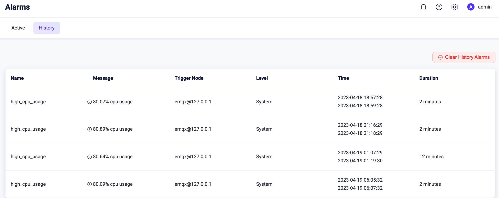
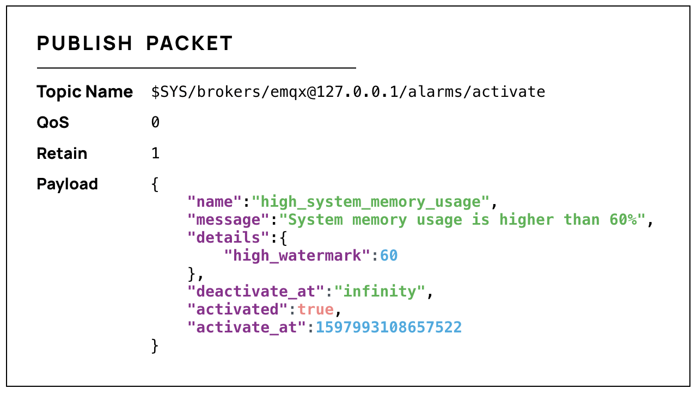
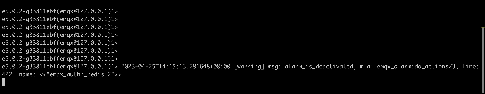
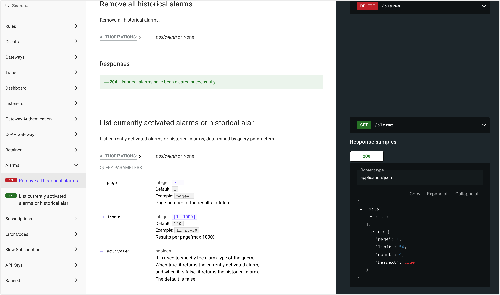
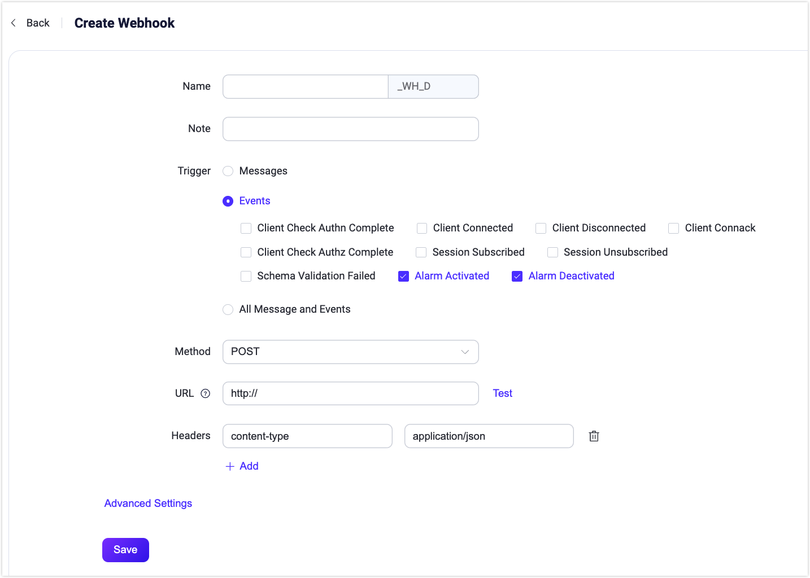
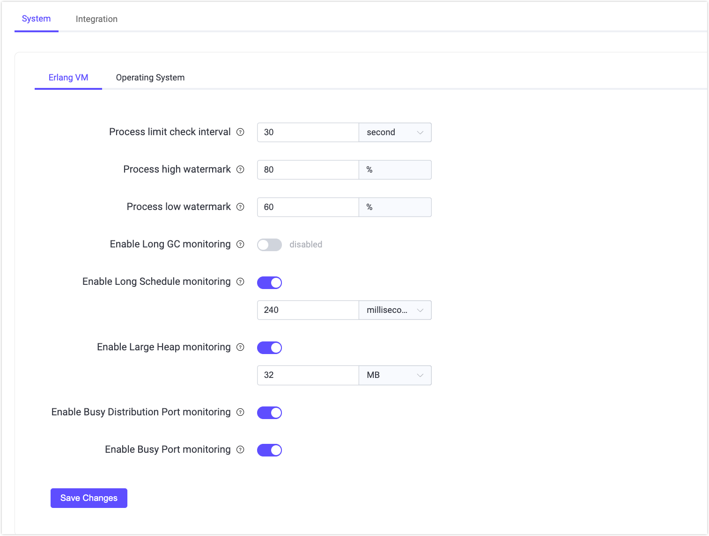
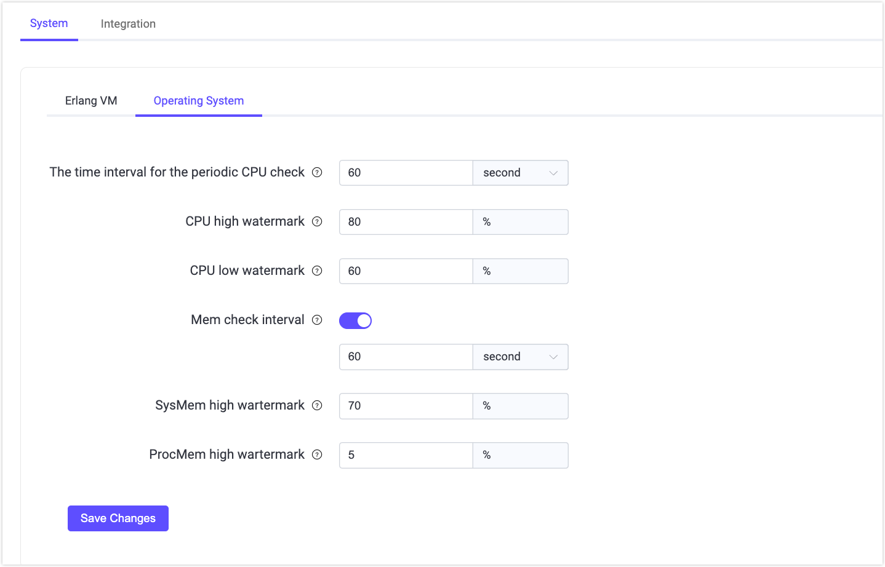

# アラーム

EMQX は、CPU 使用率、システムおよびプロセスメモリ使用率、プロセス数、ルールエンジンのリソース状況、クラスターのパーティションおよび修復など、内部状態の変化を監視するための組み込みの監視およびアラーム機能を提供しています。これらの変化が閾値を超えたり期待値から逸脱した場合に EMQX はアラームをトリガーし記録し、正常に戻った際にはリストから削除します。

本ページでは、EMQX が提供するアラーム情報、詳細なアラーム情報の取得および確認方法、EMQX におけるアラーム設定および閾値の設定方法について紹介します。監視およびアラーム機能により、運用中の潜在的な問題を通知し続けます。適切な閾値を設定してアラームを構成することで、EMQX の安全性、安定性、信頼性を確保できます。

## アラーム一覧

以下の表は、システム監視中に潜在的な問題を示すためにトリガーされる可能性のあるアラームを示しています。

::: tip

アラームはシステムへの影響度や重要度に応じて、3つのレベルに分類されます。

- **Error（エラー）**: ユーザー設定によるエラー。クライアントはエラーを検知して再試行可能です。

- **Warning（警告）**: 時折発生するエラー。頻発する場合は注意が必要です。

- **Critical（重大）**: クライアントとサーバー間での不可逆的なデータ損失が発生し、通信や業務が中断されます。

これらのレベルは開発視点で定義されており、あくまで推奨です。ビジネスニーズに応じて独自のアラームレベルを定義できます。

:::

| **アラーム**                 | レベル    | 説明                                                        | **詳細**                                    | **閾値**                                                    |
| :-------------------------- | -------- | :---------------------------------------------------------- | :------------------------------------------ | :---------------------------------------------------------- |
| high_system_memory_usage    | Warning  | システムメモリ使用率が高すぎる                              | システムメモリ使用率が ~p% を超えている      | `os_mon.sysmem_high_watermark = 70%`                         |
| high_process_memory_usage   | Warning  | 単一の Erlang プロセスのメモリ使用率が高すぎる（システムメモリ使用率の割合） | プロセスメモリ使用率が ~p% を超えている      | `os_mon.procmem_high_watermark = 5%`                         |
| high_cpu_usage              | Warning  | CPU 使用率が高すぎる                                        | CPU 使用率が ~p%                             | `os_mon.cpu_high_watermark = 80%` `os_mon.cpu_low_watermark = 60%` |
| too_many_processes          | Warning  | プロセス数が多すぎる                                        | プロセス使用率が ~p%                         | `vm_mon.process_high_watermark = 80%` `vm_mon.process_low_watermark = 60%` |
| license_quota               | Warning  | ライセンスの接続数が上限を超えている                        | ライセンス：接続数が % を超えている          | `license.connection_high_watermark_alarm = 80%` `license.connection_low_watermark_alarm = 75%` |
| license_expiry              | Critical | ライセンスの有効期限が切れるか、切れそうである              | アラームメッセージは `The license expires on YYYY-MM-DD.`、`The license expires today, YYYY-MM-DD.`、または `The license expired on YYYY-MM-DD.` | 残り30日未満、またはライセンスが期限切れ                      |
| license_tps                 | Warning  | TPS 使用量がライセンス上限を超えている                      | ライセンス：TPS 上限（例：10）を超過         | -                                                            |
| partition                   | Critical | ノードでパーティションが発生している                          | ノード ~s でパーティションが発生している      | -                                                            |
| resource                    | Critical | リソースが切断されている                                    | リソース ~s(~s) がダウンしている             | -                                                            |
| conn_congestion             | Critical | 接続プロセスが混雑している                                  | 接続が混雑している                            | -                                                            |

## アラームの取得

EMQX では、アラームを取得し詳細情報を確認するための複数の方法を提供しています。1つは EMQX ダッシュボードを使用する方法で、アクティブなアラームと履歴アラームの両方をユーザーフレンドリーなインターフェースで閲覧できます。これにより、トリガーされたアラームの概要を一元的に把握できます。

また、MQTT のシステムトピックをサブスクライブしてシステムアラームのリアルタイム通知を受け取る方法もあります。さらに、Webhook 統合を利用してアラームイベントを外部の HTTP サービスに送信することも可能です。アラームはログや REST API からもアクセスできます。

### ダッシュボードでアラームを確認する

EMQX ダッシュボードで、**Monitoring** -> **Alarms** をクリックします。次に、**Active** タブまたは **History** タブを選択して、現在アクティブなアラームや履歴アラームの一覧を表示します。

EMQX ダッシュボードでのアラーム管理の詳細は [Alarms](../dashboard/alarm_dashboard.md) を参照してください。

### システムトピック経由でアラームを取得する

アラームがトリガーまたは解除されると、EMQX は MQTT メッセージをシステムトピック `$SYS/brokers/<Node>/alarms/activate` または `$SYS/brokers/<Node>/alarms/deactivate` にパブリッシュします。ユーザーはこれらのトピックをサブスクライブしてアラーム通知を受け取れます。

アラーム通知メッセージのペイロードは JSON 形式で、以下のフィールドを含みます。

| フィールド名         | 型               | 説明                                                        |
| -------------------- | ---------------- | ----------------------------------------------------------- |
| `name`               | string           | アラーム名                                                  |
| `details`            | object           | アラームの詳細                                              |
| `message`            | string           | 人間が読みやすいアラームの説明                             |
| `activate_at`        | integer          | アラームが有効化された時刻をマイクロ秒単位の UNIX タイムスタンプで表現 |
| `deactivate_at`      | integer / string | アラームが無効化された時刻をマイクロ秒単位の UNIX タイムスタンプで表現。アクティブなアラームの場合は `infinity` となる。 |
| `activated`          | boolean          | アラームが有効かどうか                                     |

システムメモリ使用率が高いアラームの例を挙げると、以下のようなアラームメッセージを受信します。

同じ種類のアラームは繰り返し報告されません。例えば、高 CPU 使用率のアラームが有効化されている場合、同じ種類のアラームは新たに生成されません。監視対象の指標が正常に戻ると自動的にアラームは無効化されますし、手動で無効化することも可能です。

### ログからアラームを取得する

アラームの有効化・無効化はログ（コンソールまたはファイル）に書き込まれます。メッセージ送信やイベント処理で障害が発生した場合、詳細情報がログに記録され、ログ解析を通じてアラートを検知することも可能です。以下の例は、ログに出力された詳細なアラーム情報を示しています。ログレベルは `warning` で、`msg` フィールドは `alarm_is_activated` および `alarm_is_deactivated` です。

### REST API 経由でアラームを取得する

API を通じてアラームの照会や管理が可能です。UI の左ナビゲーションメニューで **Alarms** をクリックすると、この API リクエストが実行されます。EMQX API の利用方法は [REST API](../api.md) を参照してください。

### Webhook 統合によるアラームイベント送信

EMQX バージョン 5.8.5 以降、ルールエンジンは以下の2つの新しいアラームイベントをサポートしています。

- [$events/sys/alarm_activated](../../develop/data-integration/rule-sql-events-and-fields.md#system-alarm-activated-event-events-sys-alarm-activated)
- [$events/sys/alarm_deactivated](../../develop/data-integration/rule-sql-events-and-fields.md#system-alarm-deactivated-event-events-sys-alarm-deactivated)

これらのイベントにより、Webhook 統合を通じて外部 HTTP サービスにアラームの発生・解除通知を送信できます。

Webhook 統合の設定手順：

1. EMQX ダッシュボードで **Monitoring** -> **Alarms** に移動します。
2. 右上の **Set Up Webhook** ボタンをクリックし、Webhook 統合設定ページを開きます。
3. Webhook 統合の名前と任意のメモを入力します。**Trigger** フィールドには `Alarm Activated` と `Alarm Deactivated` があらかじめ選択されています。
4. 通知を送信する Webhook URL を入力します。
5. 詳細な設定については [Create Webhook](../../develop/data-integration/webhook.md) を参照してください。
6. 設定が完了したら **Save** をクリックします。

## アラーム設定

アラーム設定には、アラームの動作設定と閾値設定が含まれます。アラーム設定はアラームメッセージの表示方法や保存方法を決定し、閾値設定は潜在的な問題を検知してアラームをトリガーするための限界値や値を定めます。これにより、ビジネスニーズに応じてアラームの設定や閾値をカスタマイズできます。

### アラーム設定の構成

アラームの設定は、設定ファイル内の設定項目を変更することでのみ構成可能です。以下の表は、アラーム設定に利用可能な設定項目を示しています。

| 設定項目               | 説明                                                        | デフォルト値          | 選択可能な値       |
| ---------------------- | ----------------------------------------------------------- | -------------------- | ------------------ |
| alarm.actions          | アラームが有効化または無効化された際に、ログ（コンソールまたはファイル）への書き込みおよびシステムトピック `$SYS/brokers/<node_name>/alarms/activate` と `$SYS/brokers/<node_name>/alarms/deactivate` への MQTT メッセージのパブリッシュを行うアクション。 | `["log", "publish"]`  | -                  |
| alarm.size_limit       | 無効化されたアラームの履歴として保持する最大件数。この上限を超えると、最も古い無効化アラームから削除される。 | `1000`               | `1-3000`           |
| alarm.validity_period  | 無効化されたアラームの保持期間。アラームは無効化直後に削除されず、一定期間経過後に削除される。 | `24h`                | -                  |

### ダッシュボードでのアラーム閾値設定

アラームの閾値は EMQX ダッシュボード上で設定可能です。閾値設定用の **Monitoring** ページを開く方法は2通りあります。

1. **Alarms** ページで **Setting** ボタンをクリックすると、**Monitoring** ページに遷移します。
2. 左ナビゲーションメニューから **Management** -> **Monitoring** をクリックします。

**Monitoring** -> **System** タブの中の **Erlang VM** タブでは、Erlang 仮想マシンのシステムパフォーマンスに関する以下の項目を設定できます。

- **Process limit check interval**: プロセス数の定期チェック間隔を秒単位で指定します。デフォルトは `30` 秒です。
- **Process high watermark**: ローカルノードで同時に存在可能なプロセス数の閾値（割合）を指定します。この値を超えるとアラームが発生します。デフォルトは `80`% です。
- **Process low watermark**: プロセス数がこの割合まで減少するとアラームが解除されます。デフォルトは `60`% です。
- **Enable Long GC monitoring**: デフォルトは無効。Erlang プロセスが長時間ガベージコレクションを行った場合に警告レベルのログ `long_gc` を出力し、システムトピック `$SYS/sysmon/long_gc` に MQTT メッセージをパブリッシュします。
- **Enable Long Schedule monitoring**: デフォルトで有効。Erlang VM が長時間スケジュールされたタスクを検出すると警告レベルのログ `long_schedule` を出力します。タスクの適切なスケジュール時間をミリ秒単位で設定可能です。デフォルトは `240` ミリ秒です。
- **Enable Large Heap monitoring**: デフォルトで有効。Erlang プロセスが大きなヒープ領域を消費した場合に警告レベルのログ `large_heap` を出力し、システムトピック `$SYS/sysmon/large_heap` に MQTT メッセージをパブリッシュします。ヒープサイズの制限をバイト数で設定可能です。デフォルトは `32` MB です。
- **Enable Busy Distribution Port monitoring**: デフォルトで有効。クラスター内の他ノードと通信するための RPC 接続が過負荷状態になると警告レベルのログ `busy_dis_port` を出力し、システムトピック `$SYS/sysmon/busy_dist_port` に MQTT メッセージをパブリッシュします。
- **Enable Busy Port monitoring**: デフォルトで有効。ポートが過負荷状態になると警告レベルのログ `busy_port` を出力し、システムトピック `$SYS/sysmon/busy_port` に MQTT メッセージをパブリッシュします。

設定完了後は **Save Changes** をクリックしてください。

**Operating System** タブでは、システムパフォーマンスに関する以下の項目を設定できます。

- **The time interval of the periodic CPU check**: CPU 使用率の定期チェック間隔を秒単位で指定します。デフォルトは `60` 秒です。
- **CPU high watermark**: システム CPU 使用率の閾値を指定します。この値を超えるとアラームが発生します。デフォルトは `80`% です。
- **CPU low watermark**: CPU 使用率がこの値まで低下するとアラームが解除されます。デフォルトは `60`% です。
- **Mem check interval**: メモリ使用率の定期チェック間隔を秒単位で指定します。デフォルトで有効で、デフォルト値は `60` 秒です。
- **SysMem high watermark**: システムメモリ使用率の閾値を指定します。この値を超えるとアラームが発生します。デフォルトは `70`% です。
- **ProcMem high watermark**: 単一の Erlang プロセスが使用するメモリ使用率の閾値を指定します。この値を超えるとアラームが発生します。デフォルトは `5`% です。

設定完了後は **Save Changes** をクリックしてください。

### 設定項目によるアラーム閾値の構成

設定ファイル内の設定項目を変更することでもアラーム閾値を構成できます。現在変更可能な設定項目は以下の通りです。

| 設定項目                         | 説明                                                        | デフォルト値     |
| -------------------------------- | ----------------------------------------------------------- | --------------- |
| sysmon.os.cpu_check_interval      | CPU 使用率のチェック間隔                                    | `60s`           |
| sysmon.os.cpu_high_watermark      | CPU 使用率の高水位閾値。これを超えるとアラームが発生する。 | `80%`           |
| sysmon.os.cpu_low_watermark       | CPU 使用率の低水位閾値。これを下回るとアラームが解除される。 | `60%`           |
| sysmon.os.mem_check_interval      | メモリ使用率のチェック間隔                                  | `60s`           |
| sysmon.os.sysmem_high_watermark   | システムメモリ使用率の高水位閾値。これを超えるとアラームが発生する。 | `70%`           |
| sysmon.os.procmem_high_watermark  | プロセスメモリ使用率の高水位閾値。単一プロセスの使用率がこれを超えるとアラームが発生する。 | `5%`            |
| sysmonn.vm.process_check_interval | プロセス数のチェック間隔                                    | `30s`           |
| sysmon.vm.process_high_watermark  | プロセス占有率の高水位閾値。これを超えるとアラームが発生する。作成済みプロセス数／最大数の割合で測定。 | `80%`           |
| sysmon.vm.process_low_watermark   | プロセス占有率の低水位閾値。これを下回るとアラームが解除される。作成済みプロセス数／最大数の割合で測定。 | `60%`           |
| sysmonn.vm.long_gc                | Long GC 監視の有効化                                        | `disabled`      |
| sysmon.vm.long_schedule           | Long Schedule 監視の有効化                                  | `disabled`      |
| sysmon.vm.large_heap              | Large Heap 監視の有効化                                     | `disabled`      |
| sysmon.vm.busy_dist_port          | Busy Distribution Port 監視の有効化                         | `true`          |
| sysmon.vm.busy_port               | Busy Port 監視の有効化                                      | `true`          |
| sysmonn.top.num_items             | 監視グループごとのトッププロセス数                         | `10`            |
| sysmon.top.sample_interlval       | トッププロセスのチェック間隔                               | `2s`            |
| sysmon.top.max_procs              | VM 内のプロセス数がこの値を超えた場合、データ収集を停止    | `1000000`       |

EMQX Enterprise では、ライセンスの有効期限が30日未満になるか、接続数が高水位閾値を超えた場合にアラームを発生させます。接続数の高水位／低水位閾値は設定ファイル内の以下の設定項目を変更して調整可能です。ライセンス設定の詳細は [License](../configuration/license.md) を参照してください。

| 設定項目                             | 説明                                                        | デフォルト値     |
| ----------------------------------- | ----------------------------------------------------------- | --------------- |
| license.connection_high_watermark_alarm | ライセンスがサポートする最大接続数の高水位閾値。これを超えるとアラームが発生。アクティブ接続数／最大接続数の割合で測定。 | `80%`           |
| license.connection_low_watermark_alarm  | ライセンスがサポートする最大接続数の低水位閾値。これを下回るとアラームが解除。アクティブ接続数／最大接続数の割合で測定。 | `75%`           |
