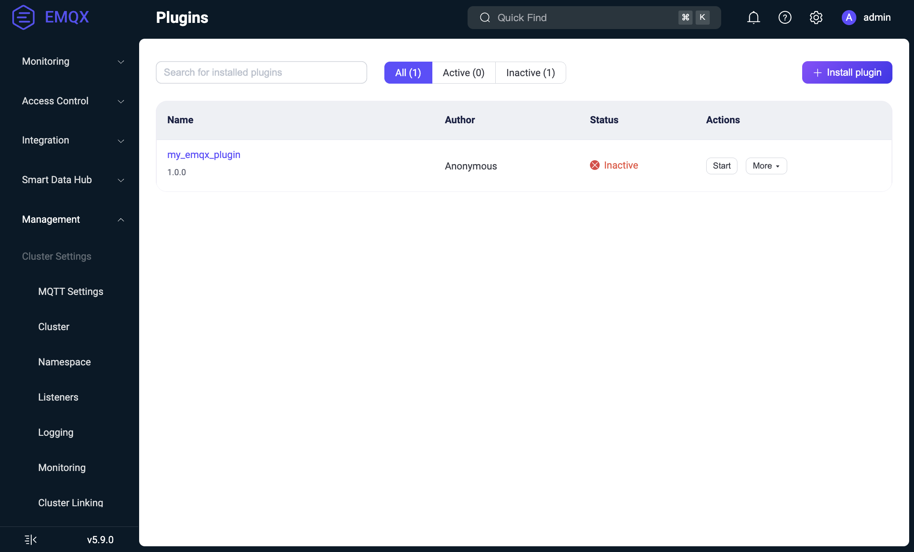

# 管理插件

本页面介绍如何部署和管理 EMQX 插件。可以通过 Dashboard、CLI 或 REST API 在集群中管理插件，也可以将预先部署的插件固定到单个节点。

EMQX 支持以下插件管理方式：

- **集群管理插件**：EMQX 将插件包和配置分发到集群节点，并在 `plugins.states` 中记录插件的启用状态。
- **节点固定插件**：从 EMQX 6.1.6 开始，可将预先部署插件的名称和版本添加到 `node.pinned_plugins`，使其在该节点上独立于集群插件配置运行。

## 插件生命周期

集群管理插件有以下三个主要生命周期状态：

- **已安装（Installed）**：插件的代码和配置已加载，但应用尚未启动。
- **已启动（Started）**：插件正在运行，并与 EMQX 活跃交互。
- **已卸载（Uninstalled）**：插件已从系统中完全移除。

### 安装流程

插件的安装流程如下：

1. 通过 Dashboard、API 或 CLI 上传插件包（由 `make rel` 命令生成的 `.tar.gz` 压缩包）。详细安装步骤参见[安装和管理插件](#安装和管理插件)。
2. 插件包会被分发至 EMQX 集群的每个节点。
3. 在每个节点上：
   - 压缩包保存在 EMQX 根目录下的 `plugins` 子目录（可通过 `plugins.install_dir` 配置覆盖），例如：`$EMQX_ROOT/plugins/my_emqx_plugin-1.0.0.tar.gz`。
   - 插件包会被解压到同一目录：`$EMQX_ROOT/plugins/my_emqx_plugin-1.0.0/`。
   - 插件初始配置文件（来自插件主应用的 `config.hocon`）被复制到 `$EMQX_DATA_DIR/plugins/my_emqx_plugin/config.hocon`。
   - 若存在 Avro schema，则会被加载以用于配置校验。
   - 插件代码被加载到节点，但应用未启动。
   - 插件在 EMQX 配置中被注册为 `disabled`（禁用）状态，保存在 `plugins.states` 字段中。

::: tip

对于集群管理插件，只有启用状态（即 `enable` 标志为 `true` 或 `false`）保存在 EMQX 配置中。插件的完整配置保存在每个节点上的 `$EMQX_DATA_DIR/plugins/my_emqx_plugin/config.hocon` 文件中。

:::

### 配置

插件安装后，可以通过 Dashboard 或 API 更新配置：

- 新配置将通过 Avro schema（如果存在）进行校验。
- 配置更新会分发到报告该插件版本的节点。
- 插件的 `on_config_changed/2` 回调函数将被调用。如果插件接受该配置，则配置将被持久化写入 `$EMQX_DATA_DIR/plugins/my_emqx_plugin/config.hocon`。

::: tip

即使插件应用尚未启动，`on_config_changed/2` 回调函数仍会被调用。

:::

::: tip

`on_config_changed/2` 回调函数会在收到配置更新的每个节点上调用。避免编写依赖本地系统状态（例如检查网络可用性）的配置校验逻辑，这可能导致节点间结果不一致。应将此类检查逻辑放在 `on_health_check/1` 回调函数中，并在资源不可用时上报不健康状态。

:::

### 配置文件路径

插件有两个相关的配置文件路径：

- 安装包内的默认配置文件：
  - Docker 部署：
    `/opt/emqx/plugins/my_emqx_plugin-1.0.0/my_emqx_plugin-1.0.0/priv/config.hocon`
  - deb/rpm 部署：
    `/usr/lib/emqx/plugins/my_emqx_plugin-1.0.0/my_emqx_plugin-1.0.0/priv/config.hocon`

- 通过 Dashboard 或 API 保存配置后，由 EMQX 管理的持久化配置文件：
  - Docker 部署：
    `/opt/emqx/data/plugins/my_emqx_plugin/config.hocon`
  - deb/rpm 部署：
    `/var/lib/emqx/plugins/my_emqx_plugin/config.hocon`

`priv/config.hocon` 是插件包自带的默认配置模板。`data/plugins/.../config.hocon` 是 EMQX 保存插件配置变更后使用的持久化配置文件路径。

### 启动

可通过 Dashboard、API 或 CLI 手动启动插件。启动时：

- 插件的应用被启动。
- 插件状态在 EMQX 配置中被标记为 `enabled`（启用）。

当插件启动后被查询状态时，会调用其 `on_health_check/1` 回调函数以返回运行状态。

### 停止

插件被停止时：

- 插件的应用会被停止。
- 插件状态在 EMQX 配置中被标记为 `disabled`（禁用）。

注意，虽然插件应用已停止，但其代码仍保留在节点中，因此即使停止状态下仍可以配置插件。

### 卸载流程

卸载流程如下：

1. 如果插件正在运行，则先停止插件。
2. 卸载插件代码。
3. 删除插件包文件（配置文件会保留）。
4. 插件从 EMQX 配置（`plugins.states`）中注销。

你可以通过 Dashboard 或 CLI 卸载插件，详见[安装和管理插件](#安装和管理插件)。

### 集群节点加入行为

当新节点加入集群时，可能尚未安装或配置所需插件，因为插件及其配置是保存在每个节点的本地文件系统中的。

新节点将执行以下操作：

- 加入集群时，会同步整个 EMQX 的全局配置。
- 从全局配置中得知哪些插件已安装及其启用状态。
- 请求其他节点发送插件包和配置。
- 安装插件，并启动已启用的插件。

## 安装和管理插件

EMQX 支持通过 Dashboard、CLI 和 API 安装、卸载和管理插件包。

### 在 EMQX 启动前预装插件

如果希望插件在 EMQX 启动时即可使用，例如构建自定义 Docker 镜像时，可以提前解压插件包并配置 EMQX。

根据使用场景选择以下方式：

- 如果所有节点都应遵循 `plugins.states` 并参与集群级生命周期操作，请预装集群管理插件。
- 如果插件属于特定节点的部署产物，并且必须独立于集群插件配置运行，请将插件固定到该节点。

#### 预装集群管理插件

以下步骤以 Dockerfile 为例，但同样适用于 deb/rpm、裸机部署等其他部署方式：

1. 将插件包复制并解压到插件目录：

   ```dockerfile
   COPY --chown=emqx:emqx my_emqx_plugin-1.0.0.tar.gz /opt/emqx/plugins/my_emqx_plugin-1.0.0.tar.gz

   RUN cd /opt/emqx/plugins && \
       mkdir -p my_emqx_plugin-1.0.0 && \
       tar zxf my_emqx_plugin-1.0.0.tar.gz -C my_emqx_plugin-1.0.0
   ```

2. 在 EMQX 基础配置文件中注册插件，使其在启动时自动加载：

   ```dockerfile
   RUN cat <<EOF >> /opt/emqx/etc/base.hocon
   plugins {
       states = [
           {
               name_vsn = "my_emqx_plugin-1.0.0"
               enable = true
           }
       ]
   }
   EOF
   ```

   设置 `enable = true` 可在启动时自动启用插件，设置 `enable = false` 则仅安装但不启动。

#### 在节点上独立运行插件

从 EMQX 6.1.6 开始，可以将预先部署的插件固定到单个节点。该方式适用于将插件构建到容器镜像或其他节点专属部署产物中的场景。

1. 将插件包解压到 `<plugins.install_dir>` 下。EMQX 启动前，解压后的文件必须位于 `<plugins.install_dir>/<name-vsn>` 中，并且 `release.json` 必须直接位于该目录下。例如：

   ```dockerfile
   COPY --chown=emqx:emqx my_emqx_plugin-1.0.0.tar.gz /tmp/my_emqx_plugin-1.0.0.tar.gz

   RUN mkdir -p /opt/emqx/plugins/my_emqx_plugin-1.0.0 && \
       tar zxf /tmp/my_emqx_plugin-1.0.0.tar.gz \
       -C /opt/emqx/plugins/my_emqx_plugin-1.0.0
   ```

2. 将插件名称和版本添加到只读配置项 `node.pinned_plugins`。对于容器镜像，请设置对应的环境变量：

   ```dockerfile
   ENV EMQX_NODE__PINNED_PLUGINS="my_emqx_plugin-1.0.0"
   ```

   对于其他部署方式，请在 `emqx.conf` 中设置该配置项：

   ```hocon
   node.pinned_plugins = ["my_emqx_plugin-1.0.0"]
   ```

   可以配置多个插件。每个条目必须是有效的 `<name-vsn>` 标识符，并且不能同时包含同一插件名称的两个版本。EMQX 按列表顺序启动这些插件，然后再启动 `plugins.states` 中的插件。如需修改该列表，请更新节点配置并重启节点。节点加入集群、API 调用和配置导入均无法更改此配置项。

节点固定插件的运行行为如下：

- EMQX 直接从解压目录运行插件。节点加入集群时，EMQX 不会在节点之间分发该插件包，也不会同步其已保存的配置。
- 插件始终处于启用状态，不需要 `plugins.states` 条目、`emqx ctl plugins allow` 授权或安装命令。无论版本如何，`plugins.states` 中的同名插件条目均不会控制该插件。
- 初始配置来自插件包中的 `priv/config.hocon`。如果存在 `etc/plugins/<name>.hocon`，EMQX 会将其深度合并到默认配置中。通过 Dashboard 或 API 保存配置后，EMQX 使用 `data/plugins/<name>/config.hocon` 作为完整配置。配置变更仅应用到报告相同插件版本的节点。
- 在固定该插件的节点上，使用 `emqx ctl plugins start|stop|restart <name-vsn>` 管理插件。通过 CLI 停止该插件后，它会保持停止状态，直至节点再次启动所有插件，例如节点重启或加入集群时。
- Dashboard 和 REST API 可以更新插件配置，但不能管理固定实例的生命周期。以下任一情况发生时，生命周期请求会返回 HTTP `409` 和错误码 `PLUGIN_PINNED`：
  - 处理请求的节点在 `node.pinned_plugins` 中配置了同名插件。
  - 报告目标插件版本的所有节点均将其配置为节点固定插件。

  如果有节点以集群管理方式运行同一插件版本，则从该节点发起的集群级操作仅影响集群管理实例。
- 如果插件目录不存在或插件启动失败，EMQX 会触发 `pinned_plugin_unavailable:<name-vsn>` 告警并继续启动节点。插件后续启动成功时，EMQX 会清除该告警。

### 通过 Dashboard 安装插件

假设你已经构建好插件，并且已有 `my_emqx_plugin-1.0.0.tar.gz` 文件。可按照以下步骤在 Dashboard 中安装：

::: tip 安全性更新

出于安全考虑，现在通过 Dashboard 安装插件需要显式授权：

- 必须先授予安装权限，才能开始上传安装流程。
- 授权状态是临时的，安装完成后会自动失效。
- 如果是集群环境，所有节点都需提前授权。

:::

1. 使用 CLI 显式授权：

   ```bash
   emqx ctl plugins allow $NAME-$VSN
   ```

   - `{NAME}`：插件名称（如 `my_emqx_plugin`）。
   - `{VSN}`：插件版本（如 `1.0.0`）。

2. 打开 EMQX Dashboard，进入**管理 > 插件**页面。

3. 点击 **+ 安装插件**按钮，打开上传页面。

4. 拖放或选择插件包文件上传。

   

5. 点击**安装**，插件即会被安装并显示在插件列表中。

   

现在，您可以启动/停止插件并进行配置。若要卸载插件，可点击插件列表中**更多 > 卸载**。

要撤销先前授予的安装权限，可：

1. 卸载已安装插件，或

2. 使用以下命令显式撤销授权：

   ```bash
   emqx ctl plugins disallow $NAME-$VSN
   ```

### 通过 CLI 安装插件

假设你已经构建好插件，并且已有 `my_emqx_plugin-1.0.0.tar.gz` 文件。可在 CLI 上按以下步骤操作：

1. 将插件包复制到 EMQX 插件目录：

   ```bash
   cp my_emqx_plugin-1.0.0.tar.gz $EMQX_HOME/plugins
   ```

2. 安装插件：

   ```bash
   emqx ctl plugins install my_emqx_plugin-1.0.0
   ```

   如需将插件安装到集群中所有运行中的节点，可添加 `--cluster` 参数：

   ```bash
   emqx ctl plugins install my_emqx_plugin-1.0.0 --cluster
   ```

3. 查看插件列表：

   ```bash
   emqx ctl plugins list
   ```

4. 启动 / 停止插件：

   ```bash
   emqx ctl plugins start my_emqx_plugin-1.0.0
   emqx ctl plugins stop my_emqx_plugin-1.0.0
   ```

5. 卸载插件：

   ```bash
   emqx ctl plugins uninstall my_emqx_plugin-1.0.0
   ```

### 通过 API 安装插件

假设你已经构建好插件，并且已有 `my_emqx_plugin-1.0.0.tar.gz` 文件。插件包构建完成后，可以使用 REST API 安装：

1. 首先需要授权安装：

   ```bash
   emqx ctl plugins allow my_emqx_plugin-1.0.0
   ```

2. 使用 `curl` 上传并安装插件：

   ```bash
   curl -u $KEY:$SECRET -X POST http://$EMQX_HOST:18083/api/v5/plugins/install \
        -H "Content-Type: multipart/form-data" \
        -F "plugin=@my_emqx_plugin-1.0.0.tar.gz"
   ```

3. 查看插件列表确认安装成功：

   ```bash
   curl -u $KEY:$SECRET http://$EMQX_HOST:18083/api/v5/plugins | jq
   ```

4. 启动 / 停止插件：

   ```bash
   curl -s -u $KEY:$SECRET -X PUT \
     "http://$EMQX_HOST:18083/api/v5/plugins/my_emqx_plugin-1.0.0/start"
   
   curl -s -u $KEY:$SECRET -X PUT \
     "http://$EMQX_HOST:18083/api/v5/plugins/my_emqx_plugin-1.0.0/stop"
   ```

## 插件升级

升级集群管理插件时：

- 必须先卸载旧版本；
- 然后再安装新版本。

插件配置会在升级过程中保留。

从 EMQX 6.1.6 开始，集群中的不同节点可以固定同一插件的不同版本。如果节点在 `node.pinned_plugins` 中配置了某个插件版本，EMQX 仅运行该固定版本，并忽略 `plugins.states` 中该插件所有版本的条目。插件作者必须确保这些版本在共享数据库表、跨节点 RPC 和插件配置格式方面保持兼容。

<!-- 注意：EMQX 企业版在热升级后需要重新安装插件。 -->
